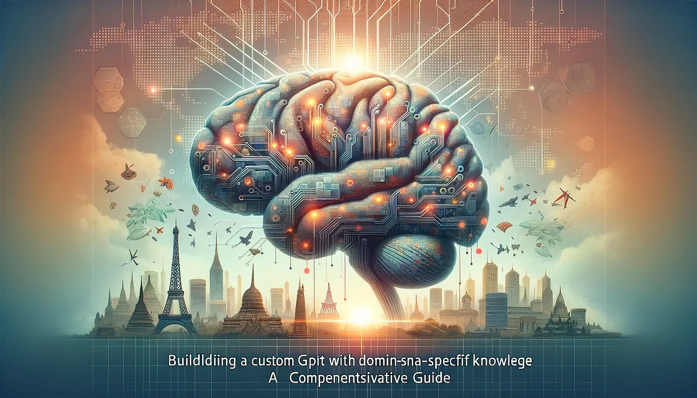

Zanzibar'a özel bir GPT oluşturma üzerine hazırlanan videonun özeti.

<https://www.youtube.com/watch?v=DNkyL4Uw_dk>

Bu video GPT-4'ü ve onu kendi uzmanlık alanınızda (bu örnekte Zanzibar turizmi) nasıl kullanabileceğinizi anlatıyor. Yapay zeka bilgiye ulaşma ve bilgiyi kullanma şeklimizi değiştiriyor; kararlara yardımcı olup iş hayatında veya herhangi bir alanda özel içgörüler sunabiliyor.

GPT-4 size dünyanın bilgisinin büyük bir kısmına çok hızlı bir şekilde erişim imkanı tanıyor. Klasik bir arama motoru gibi sadece bir veritabanında arama yapmıyor. Bilgiyi birçok farklı kaynaktan bir araya getirip size çok daha detaylı bir cevap sunuyor. Videoda bu durum her turistin sorduğu "Zanzibar'daki en iyi Akdeniz restoranı hangisi?" sorusuyla örneklendiriliyor ve model elindeki tüm verilere dayanarak çeşitli cevaplar veriyor.

## Yerelleştirme

Süreci kişiselleştiren şey, alana özgü detaylı bilgilerdir. Sunucu, Zanzibar'ı bir turist rehberi kadar iyi biliyor ve GPT-4'ü sadece Zanzibar hakkındaki sorulara odaklanacak şekilde özelleştiriyor. Özel bilgiler, cevapları kullanım amacına göre çok daha alakalı ve doğru hale getiriyor; böylece genel küresel verilerden sıyrılıp orayı gerçekten bilen birinin yerel bilgilerine ulaşıyorsunuz.

Ardından "Zanzibar Insider GPT" aşamasına geçiliyor. Sunucu önce temel çerçeveyi kurup genel sorularla test ediyor. Cevaplar doğru olsa da bir yerlinin sahip olduğu derinlikten yoksun. Bu yüzden bir sonraki adım, modeli ince ayarlarla yapılandırmak ve Zanzibar hakkında özel, detaylı bilgilerle beslemek oluyor; örneğin Akdeniz restoranı için en iyi seçimin Paje'deki Glow restoranı olduğu gibi.

Bundan sonra PDF dosyaları veya ses kayıtları gibi daha fazla veri yükleyebilir, yerel bilgiler eklemeye devam edebilirsiniz. Her seferinde GPT biraz daha isabetli ve yerel hale geliyor; bu da başladığı o devasa genel veri setine kıyasla büyük bir ilerleme anlamına geliyor.

## Sonuç

Ortaya çıkan sonuç, yerel bağlamı anlayan bir Zanzibar Insider GPT. En iyi yemek mekanlarını ve gece hayatı rotalarını bulabiliyor, üstelik birkaç farklı soruyu tek bir net ve detaylı cevapta birleştirebiliyor. Genel bir yapay zeka modeli, belirli bir alan için özel bir araca dönüşmüş oluyor.

Video, herkesi kendi yapay zeka projelerini denemeye ve en iyi bildikleri konular üzerine modeller oluşturmaya davet ederek bitiyor. Bu yaklaşım yapay zekayı günlük hayatta kullanışlı kılıyor ve çok daha fazla insana ulaştırıyor. Yapay zeka geliştikçe, her birimizin ihtiyaç duyduğu ve bildiği şeye o kadar iyi uyum sağlayabilir.
