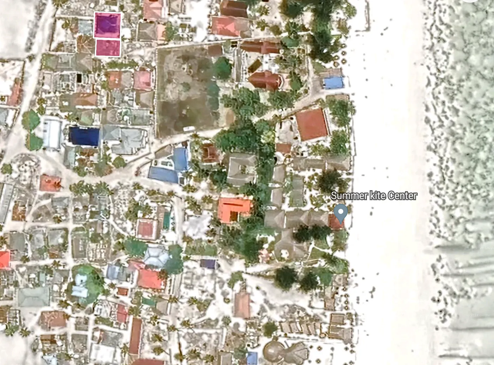

WhatsApp üzerinden tavsiye al: [+255775585555](https://api.whatsapp.com/send/?phone=255775585555&text=&type=phone_number&app_absent=0) ya da [cal.com/em](https://cal.com/em) adresinden ücretsiz bir görüşme ayarla.

Zanzibar, Tanzanya'ya bağlı yarı özerk bir bölge. Unguja ve Pemba adında iki ana adası var, nüfusu da yaklaşık 1,3 milyon. Buranın oldukça zengin bir kültürü ve tarihi var. Zanzibar deyince akla bembeyaz kumsallar, turkuaz deniz, mercan kayalıkları, baharat çiftlikleri ve o meşhur tarihi Stone Town geliyor.

## Zanzibar'da arazi işleri nasıl yürüyor

Zanzibar'ın kendi arazi sistemi var, yani anakara Tanzanya'dan farklı. 1992 tarihli Arazi Tasarruf Yasası'na göre Zanzibar'daki tüm araziler kamu malı sayılıyor. Arazi işlerinden sorumlu Bakan, Başkan adına yönetiyor buraları. Serbest Ekonomik Bölgeler içindeki arazileri ise Zanzibar Yatırım Teşvik Kurumu (ZIPA) yönetiyor.

Aynı kanunda üç tür arazi hakkı tanımlanmış. Birincisi "Right of Occupancy", yani kullanım hakkı. Başkan bunu 99 yıla kadar verebiliyor. "Customary Right of Occupancy" ise örf ve adet hukukuna göre arazide yaşama ve kullanma hakkı. Bu miras kalabiliyor ya da devredilebiliyor. Bir de "Derivative Right" var; bu da tarım, hayvancılık veya madencilik gibi belirli bir amaç için araziyi kullanma hakkı. Bakan ya da ZIPA bunu 5 yıla kadar verebiliyor.

Yabancı olduğun için doğrudan devletten "Right of Occupancy" alamıyorsun. Ama "Right of Occupancy" hakkı olan ya da miras ya da satın alma yoluyla arazinin yasal sahibi olan bir Zanzibarlıdan arazi veya mülk alabiliyorsun. Bu yazı, yabancı biri olarak Zanzibar'da arazi satın almanın adımlarını anlatıyor. İleride satmak istersen diye birkaç ipucu da ekledim.

## Zanzibarlı bir satıcıdan arazi almak

1. Adım, satıcının gerçekten arazinin sahibi olduğundan ve "Right of Occupancy" hakkının bulunduğundan emin olmak. İşin en başı ve en önemli kısmı bu. Tapu sicilini kontrol ettirebilir ya da yerel Sheha'ya sorabilirsin. Sheha, köyün lideri oluyor ve arazi kayıtları onda tutuluyor. Sana satıcının arazinin sahibi olduğunu belirten yazılı bir onay veriyor; içinde çevredeki arazi sahibi dört komşunun isimleri ve kimlik bilgileri de oluyor. Sonraki tüm işlemler için bu belge lazım.

2. Adım, satış sözleşmesi. İşin şartlarını belirleyen yasal belge bu. Alıcı ve satıcının isimlerini, kimliklerini, arazinin nerede olduğunu ve büyüklüğünü, fiyatı ve nasıl ödeneceğini, imza tarihini ve yerini, dört komşunun isim ve kimliklerini, bir de alıcı, satıcı ve iki şahidin imzalarını ekle. Sözleşmenin 1992 tarihli Arazi Tasarruf Yasası ve 1995 tarihli Arazi Devir Vergisi Yasası'na uygun olması lazım. Bir avukat ya da emlakçı, bunu yazarken ve kontrol ederken sana yardımcı olabilir.

## Sözleşmeyi kaydettirmek ve vergileri ödemek

3. Adım, sözleşmeyi onaylanması ve kaydedilmesi için devlete teslim etmek. Sözleşmenin aslı ve iki kopyası, Sheha'dan gelen onay yazısı, satıcının arazi tapusu ya da belgesi, pasaportun ya da oturum iznin, satıcının vergi borcu olmadığına dair belgesi ve damga vergisi makbuzu lazım.

Damga vergisi, Zanzibar'da arazi alırken alıcının devlete ödediği bir vergi. Satış fiyatının %10'u kadar. Herhangi bir bankaya ya da postaneye yatırıp makbuzunu alabilirsin.

Belgeler üç yere gidiyor. Bölge Kaymakamlığı (District Commissioner's Office) sözleşmeyi kontrol edip onaylıyor. Değerleme ve Vergi Dairesi arazi devir vergisini hesaplayıp tahsil ediyor. Tapu Dairesi (Land Registry Office) ise sözleşmeyi kaydedip sana bir kayıt numarası veriyor.

Arazi devir vergisi, alıcının ödediği ikinci vergi. Bu da satış fiyatının %1'i. Onu da Değerleme ve Vergi Dairesi'ne yatırıp makbuzunu alıyorsun.

## İnceleme, resmi gazete ilanı ve 99 yıllık kiralama

4. Adım, devlet yetkililerinin gelip araziyi kontrol etmesini ve yeniden ölçmesini beklemek. Bunu atlayamazsın. Bilgilerin doğruluğunu kesinleştiriyor ve ileride çıkabilecek anlaşmazlıkları önlüyor. Bölge Arazi Memuru sınırları ve komşuları kontrol ediyor. Harita mühendisi araziyi tekrar ölçüp haritayı güncelliyor. Tapu Sicil Memuru detayları kaydediyor ve yeni tapuyu ya da belgeyi çıkarıyor. Yetkililerin yoğunluğuna göre bu iş haftalarca, hatta aylarca sürebiliyor. İletişimde kal ve süreci sürekli takip et.

5. Adım, devletin resmi arazi devrini başlatmasını beklemek. İşin son ve en önemli kısmı bu. Satın alma işlemini bitirip sana arazide yaşama ve kullanma hakkını veriyor. Kontrol ve ölçüm bitip yeni tapu çıkınca devlet süreci başlatıyor. Sonra devlet resmi gazetede ve yerel gazetelerde bir ilan yayımlayıp araziyi sana devretmek istediğini duyuruyor; itirazı olan varsa çıksın diye. 30 gün bekliyorlar ki itiraz varsa çözülsün. Sonunda sana arazide 99 yıl boyunca yaşama ve kullanma hakkı veren bir kira sözleşmesi veriyorlar. Süre dolmadan yenilenebiliyor tabii. Bir de seni tapu siciline yeni arazi sahibi olarak kaydedip kayıtları güncelliyorlar.

Kira sözleşmesi, arazi üzerindeki haklarının şartlarını belirleyen yasal belge. Kiracı ve kiralayanın isimleri ve kimlikleri, arazinin yeri ve büyüklüğü, kiralama süresi ve yenileme seçenekleri, kira bedeli ve ödeme şekli, iki tarafın hak ve görevleri, bir de kiracı, kiralayan ve iki şahidin imzaları olmalı.

Kira bedeli, araziyi kullandığın için devlete yaptığın yıllık bir ödeme. Devlet bunu arazinin konumuna, boyutuna ve değerine göre belirliyor. Yine herhangi bir bankaya ya da postaneye ödeyip makbuzunu alabilirsin.

## Yabancı olarak araziyi satmak

Zanzibar'da yabancı olarak arazi sahibiysen ve satmak istiyorsan işler biraz zorlaşıyor. 1992 tarihli Arazi Tasarruf Yasası'na göre bir yabancı, arazi Serbest Ekonomik Bölge içinde değilse, doğrudan başka bir yabancıya arazi satamıyor. Ayrıca bir yabancı, Başkan'ın onayı olmadan (ki şartlar veya kısıtlamalar koyabiliyor) bir Zanzibarlıya da satış yapamıyor.

Yani ileride satmayı düşünüyorsan, bir şirket kurup araziyi şirketin üzerine geçirmeyi düşün derim. O zaman araziyi değil şirketi satarsın. Çok daha kolay ve hızlı olur.

İyi tarafı: Bu kısıtlamalardan ve araziyi doğrudan satmanın zorluklarından kurtulursun. Şirketi uyruğu ya da yaşadığı yer fark etmeksizin herkese satabilirsin. Ayrıca kontrol, yeniden ölçüm, arazi devir vergisi ve kira sözleşmesi gibi işlerle uğraşmazsın; zamandan ve paradan tasarruf edersin.

Kötü tarafı: Şirket kurmak ve yürütmek için masraf yaparsın; kayıt ücreti, yıllık ücretler, denetim ücreti ve kurumlar vergisi gibi. Şirket yönetimi kurallarına uyman gerekir; muhasebe ve raporlama standartları, iş ve çevre kanunları, kara para aklamayla mücadele kuralları gibi. Bir de potansiyel alıcılara şirketin finansal ve operasyonel verilerini göstermen gerekir, bu da fiyatı ve pazarlığı etkileyebilir.

Bu yolu seçersen, önce İş Kayıt ve Lisanslama Kurumu (BRELA) ile bir şirket kur. Tanzanya'daki şirketleri bunlar kaydedip denetliyor. Sonra araziyi kendi üstünden alıp şirketin üzerine geçir. Zanzibarlıdan alırkenki adımların aynısını yapıyorsun, sadece bu sefer satıcı sen, alıcı şirket oluyor. Sonra şirketi, Tanzanya'da nasıl satılıyorsa öyle satıyorsun. Alıcı bulup fiyat ve şartlarda anlaşıyorsun. Şirket için satış sözleşmesi hazırlayıp imzalıyorsun. Tanzanya Gelir İdaresi'nden (TRA) vergi borcu yoktur yazısı alıyorsun. Sözleşmeyi ve bu yazıyı onay için BRELA'ya veriyorsun. Şirket hisselerini ve varlıklarını alıcıya devrediyorsun. Son olarak da ilgili makamlara ve paydaşlara şirket sahibinin değiştiğini bildiriyorsun.

## Kaynaklar ve referanslar

Yabancı olarak Zanzibar'da arazi alım satımı rehberi bu. Daha fazla okumak istersen ya da yardıma ihtiyacın olursa, kullandığım kaynaklar ve referanslar şunlar.

Kaynaklar:

- Land Tenure Act 1992, burada: [https://landportal.org/library/resources/land-tenure-act-1992](https://landportal.org/library/resources/land-tenure-act-1992)
- Zanzibar'da Mülk Satın Almak, burada: [https://www.zanzibar.net/buying-property-in-zanzibar/](https://www.zanzibar.net/buying-property-in-zanzibar/)
- Zanzibar'da Arazi Nasıl Alınır, burada: [https://www.zanzibarproperty.com/how-to-buy-land-in-zanzibar/](https://www.zanzibarproperty.com/how-to-buy-land-in-zanzibar/)
- Zanzibar'da Mülk Satmak, burada: [https://www.zanzibar.net/selling-property-in-zanzibar/](https://www.zanzibar.net/selling-property-in-zanzibar/)

Referanslar:

- BRELA, Business Registration and Licensing Authority, burada: [https://www.brela.go.tz/](https://www.brela.go.tz/)
- TRA, Tanzania Revenue Authority, burada: [https://www.tra.go.tz/](https://www.tra.go.tz/)
- ZIPA, Zanzibar Investment Promotion Authority, burada: [https://zipa.go.tz/](https://zipa.go.tz/)

## Bunun dayandığı TLDR, Emin Mahrt ve Copilot'tan

Yabancı olarak Zanzibar'da birinden arazi almak için şu adımları izle.

1) Satıcının mülkiyetini yerel Sheha'ya giderek doğrula. Sheha sana yazılı bir onay verir, içinde dört komşu arazi sahibinin isimleri ve kimlikleri de olur.
2) Arazi için bir satış sözleşmesi hazırla, komşu sahiplerin isimlerini de ekle.
3) Sözleşmeyi devlet kurumlarına teslim et.
4) Devlet görevlileri araziye gelir, kontrol eder ve yeniden ölçer.
5) Devlet resmi arazi devir sürecini başlatır.
6) Devlet alıcıya yeni arazi sahibi olarak tapu verir ve onu arazi siciline kaydeder.
7) Yeni sahip olarak alıcı genelde devlete 99 yıl boyunca yıllık arazi kira vergisi ödemek zorundadır.

Yabancı olan alıcı araziyi satmayı düşünüyorsa, önce bir şirket kurması ve arazi mülkiyetini şirkete devretmesi tavsiye edilir. Böylece araziyi doğrudan satmak yerine şirketi satmak daha kolay olur, çünkü spekülasyonu önlemek için yabancılara bazı kısıtlamalar var.

## GPT-4 AI ile doğrulama kontrolü

Bing'e TLDR'yi doğrulamasını sorduğumda, web aramasından bulup verdiği cevap bu.

Land Tenure Act 1992'ye göre Zanzibar'daki tüm araziler kamu arazisidir ve Cumhurbaşkanı adına arazi işlerinden sorumlu Bakan tarafından yönetilir¹. Serbest Ekonomi Bölgeleri içindeki araziler ise Zanzibar Investment Promotion Authority (ZIPA) tarafından yönetilir¹.

Hiçbir yabancıya, satın alma veya edinme yoluyla, arazide mülkiyet hakkı anlamına gelen Right of Occupancy verilemez¹². Ama bir yabancı, Right of Occupancy'si olan ya da miras ya da satın alma yoluyla yasal mülkiyete sahip bir Zanzibarlıdan arazi veya mülk satın alabilir²³.

Adımlar çoğunlukla doğruydu, üç düzeltmeyle. 1. adımda satıcının Right of Occupancy'sini ya da yasal mülkiyetini arazi sicilinden ya da yerel Sheha'dan kontrol ederek de doğrulaman gerekir². 6. adımda devlet alıcıya yeni arazi sahibi olarak tapu vermez, bunun yerine süresi dolmadan yenilenebilen 99 yıllık bir kira sözleşmesi verir²³. 7. adımda alıcı sadece yıllık arazi kira vergisi ödemekle kalmaz, aynı zamanda satın alma fiyatının %10'u kadar damga vergisi ve %1'i kadar kayıt ücreti de öder²³.

Yabancı olarak araziyi satma tavsiyesi de doğru. Bir şirket kurup arazi mülkiyetini şirkete devretmek daha kolay, çünkü yabancıların araziyi doğrudan satmasına kısıtlamalar var²⁴.

## Kaynak: Bing ile sohbet, 17/01/2024

(1) Guide to Buying Land and Property in Zanzibar - TanzaniaInvest. https://www.tanzaniainvest.com/construction/realestate/acquiring-land-in-zanzibar.
(2) Land Purchase in Zanzibar - Eden Law Chambers. https://www.edenlawchambers.co.tz/2022/04/12/land-purchase-in-zanzibar/.
(3) Can Foreigners Buy Zanzibar Land For Sale. https://www.africaluxproperties.com/post/can-foreigners-buy-zanzibar-land-for-sale.
(4) A Guide to Owning Property in Zanzibar for Foreigners. https://www.thetradeadviser.com/post/a-guide-to-owning-property-in-zanzibar-for-foreigners.
