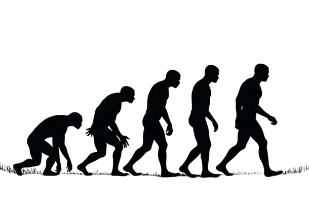

Yapay zeka içeriği inanılmaz hızlı artıyor ve bu durum, yapay zekanın kendi geleceği için bile ciddi bir sorun haline gelmeye başladı. Yapay zeka, insanın elinden çıkmış gibi duran metinler, görseller ve videolar üretme konusunda giderek ustalaşıyor. Bu yüzden bunun tam olarak ne anlama geldiğine yakından bakmamız şart.

Ortalıkta o kadar çok yapay zeka içeriği var ki, bir sonraki modelleri eğitirken kullanacağımız verinin kalitesi ve çeşitliliği ne olacak diye sormak zorundayız. Üstelik buradan doğabilecek sorunlar, insan genetiğinden çok iyi bildiğimiz şeylere fena halde benziyor.

## Yapay zeka içeriği tsunamisi

İlk mesele sırf işin hacmi. Yapay zeka içeriği interneti resmen boğuyor. Uzmanların tahminine göre yakın gelecekte internetteki tüm bilginin %90'ını yapay zeka üretebilir. Bu kadar çok olunca da gerçek insan üretimi içerikle makine çıktısını birbirinden ayırmak giderek zorlaşıyor.

Haliyle genel kalite çakılıyor. Yapay zeka sistemleri kendini tekrar eden, kalitesiz ve hatta düpedüz yanlış bilgiler kusmaya başlayabilir. Bu da insanları yanıltır ve internette bulduğun şeylerin değerini yerle bir eder.

Bir örnek vereyim. Yapay zeka bir makale yazdığında, konuyu toparlayıp tutarlı kalmakta zorlanabiliyor ve ortaya mantıksal bağı kopuk paragraflar çıkıyor. Baştan sona tek bir ana fikrin izlenmesi gereken uzun metinlerde bu dev bir problem. Yapay zeka içeriklerinde bu soruna çok sık rastlanıyor, çünkü bu sistemler insan yazarların hemen yakaladığı o ince detayları genelde ıskalıyor.

## Yapay zekanın yapay zekadan öğrenmesi

Birçok yapay zeka sisteminin nasıl eğitildiğine baktığında iş daha da tatsızlaşıyor. Bu sistemler internetteki verilerden öğreniyor ve o verilerin içinde zaten bir sürü yapay zeka içeriği var. Yani yapay zekanın yapay zeka içeriğinden öğrendiği, sonra da gidip daha fazla yapay zeka içeriği ürettiği bir kısır döngü oluşuyor.

Buradaki risk şu: Gelecekteki modeller, insanların ürettiği çeşitli ve kaliteli veriler yerine fazlasıyla kendi çıktılarına bağımlı kalacak. Bazıları buna model çöküşü (model collapse) diyor. Bu durum Ölü İnternet Teorisi'ne de çok benziyor, hani internette gördüğün şeylerin büyük kısmının insan değil de yapay zeka tarafından üretildiği fikrine.

Araştırmalar, internetteki cümlelerin yarısından fazlasının yapay zeka tarafından defalarca çevrildiğini ve bu yüzden içeriğin kalitesizleştiğini gösteriyor. Yapay zeka sürekli içerik üretip onu tekrar tekrar dönüştürdükçe, işin orijinal çeşitliliği ve zenginliği kaybolup gidebiliyor. Tıpli kapalı bir gen havuzunda üreyip duran bir popülasyonda genetik çeşitliliğin erimesi gibi. O çeşitlilik bittiğinde de yapay zeka yeni ve ilginç şeyler üretmekte çuvallamaya başlıyor.

## Neden akraba evliliğine benziyor?

İnsan DNA'sı ile yapılan benzetme cuk oturuyor. İnsanlarda akraba evliliği genetik sorunlara yol açabilir, mesela daha kolay hastalanırsın ve çevre değiştiğinde ayak uydurmakta zorlanırsın. Çeşitlilikten yoksun eğitim verisiyle beslenen yapay zeka da tam olarak aynı türden duvara toslayabilir.

Modeller çoğunlukla kendini tekrar eden verilerden beslendiğinde, gerçekten yeni fikirler ya da çözümler üretme konusunda körelir. Bu da yapay zekanın gelişimini fena halde yavaşlatabilir. Genetik çeşitlilik, canlı popülasyonlarını nasıl sağlıklı ve uyumlu tutuyorsa, eğitim verisindeki çeşitlilik de yapay zeka için aynısını yapar. Onu güçlü ve yaratıcı kılar. Geniş ve kaliteli bir bilgi havuzu olmazsa yapay zeka uyum sağlayamaz, yeni bir şey üretemez. Geleceğin yapay zeka içeriği de sığ ve kopyala yapıştır bir şeye dönüşür.

## Yapabileceğimiz beş şey

Yani yapay zekanın daha iyi bir geleceği olsun istiyorsak, eğitim verisinin kalitesini ve çeşitliliğini ilk sıraya koymalıyız. Bu konuda yapabileceğimiz beş şey görüyorum.

Birincisi, orijinal ve yüksek kaliteli veriyi korumak. Gerçek veri setlerinin içine yapay zeka içeriği sızmasını engellemeliyiz ki gelecekteki modeller güvenilir ve doğru bilgilerle beslenmeye devam edebilsin.

İkincisi, eğitim verisinin içine daha fazla insan içeriği katmak. Bu sayede yapay zeka için bilgi çok daha zengin ve çeşitli olur. İnsan dokunuşu işin ilginç, amaca uygun ve anlamlı kalmasını sağlar.

Üçüncüsü, kalite her zaman nicelikten önce gelir. Sadece daha çok veriye değil de iyi veriye odaklanırsan çok daha iyi sonuç alırsın. Bilgilendirici ve ilginç olduğu için özenle seçilen veriler, yapay zekanın daha sağlam cevaplar vermesine yardım eder.

Dördüncüsü, pek çok farklı kaynaktan, hatta sesi pek duyulmayan köşelerden bile veri toplamak. Bu hamle eğitim verisini zenginleştirir, çıktıları daha özgün kılar. Yapay zekanın farklı bakış açılarını anlamasına ve olayları çok daha incelikli yazmasına yardımcı olur.

Beşincisi, içerikleri denetlemek için sağlam yöntemler bulmalıyız. Bir içeriğin nereden geldiğini izleyen ve gerçek olup olmadığını kontrol eden sistemler kurulmalı. Bu sayede internetteki bilgi dürüst kalır, dezenformasyonla mücadele edilir ve yapay zeka içeriğinin doğru ve güvenilir olması sağlanır.

Yapay zeka içeriğinin patlaması çok yönlü ve büyük sorunları da beraberinde getiriyor. Canlılar için genetik çeşitlilik neyse, yapay zeka için de eğitim verisindeki çeşitlilik tam olarak odur.

Kaliteli ve çeşitli veriyi ilk sıraya koyarsak, bir de içerik üretimine insanları dahil etmeye devam edersek, yapay zekayı geleceğe çok daha iyi hazırlarız. Hepimizin kullandığı bilgiyi de zengin ve renkli tutmuş oluruz. Bu durum hem yapay zekayı korur hem de topluma gerçekten fayda sağlama potansiyelini artırır. Günün sonunda elimizde çok daha güçlü ve akıllı bir yapay zeka kalır.
