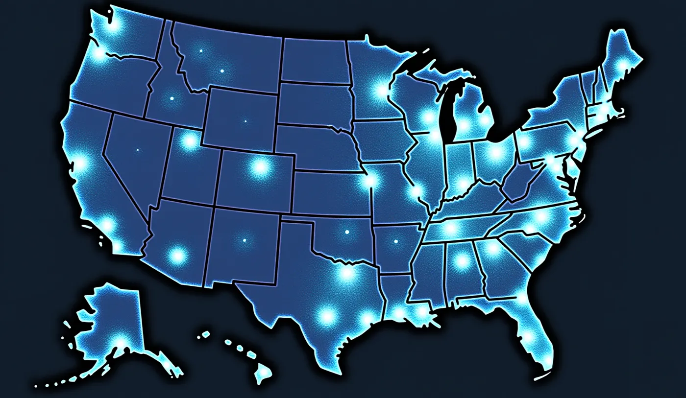

## Benim asıl düşüncelerim

Bunlar benim asıl düşüncelerim, tam da söylediğim haliyle.

“Göçmenlik konusunda aslında insanlara yardım etmekten yanayım. Bu yüzden, ihtiyaç içindeyken devletlerin onları kabul etmesi gerektiğini düşünüyorum. Mesela Avrupa Birliği’nde bunu güvenli olmayan ülkelerden gelen mültecilerle yapıyoruz.

Ama Elon Musk gibi insanların temel argümanlarını da anlıyorum, devletin bir şirket gibi işlemesi gerektiğini söylüyorlar. Şirketler mesela sadece şirkete faydası olan insanları işe alabilir; yoksa bir sürü insana maaş ödeyip kimsenin para getirmediği bir şirket batardı. Hatta bunu bir basketbol takımına benzetti, “Basketbol oyuncusu değilsen ve oynamayı bilmiyorsan, takımın parçası olamazsın” dedi.

Öte yandan ben göçmen bir aileden geliyorum ve toplumun ekonomik olarak doğrudan ölçülemeyecek şekillerde fayda görmesinin binlerce yolu olduğunu düşünüyorum. Mesela babamın durumunda, doğrudan ekonomik katkı sağlamasa da 20 yıldan fazla yerel tiyatro düzenledi, kültüre ciddi katkıda bulundu, filmler üretti ve yerel yaratıcı ve felsefi topluluğun önemli bir üyesiydi. Bu katkıları ekonomik olarak ölçmek çok zor ama “Para açısından net etkisi negatif olsa bile, devlet için genel olarak net pozitifti” diye düşünüyorum.

Bunları söyledikten sonra, network state gibi modern fikirlerin olduğunu düşünüyorum, kişi istediği yerde yaşayabilir. Fiziksel sınırlara bağlı değiller ama yine de pasaport alabilirler. Bunun iyi bir örneği Liberland, ben de orada yer alıyorum. Liberland’da fiziksel sınırlar var ama dünyanın her yerinden vatandaş ve e-resident kabul ediyorlar ve bu insanların pasaport almak için sınırlar içinde yaşaması gerekmiyor. Vatandaşlar vergiyle katkıda bulunabilir, oy kullanabilir ve ülkenin sağladığı hizmetlere erişebilir, mesela uluslararası sağlık sigortası ya da şirket kurma. Bu şirketler sonra dünya çapında ya da Liberland ekosistemi ve ağı içinde çalışabilir.

Network state vatandaşları olarak, kız arkadaşımın dediği gibi, ülkede çöp üretmezlerdi, yani hükümetin çöp toplamasına ya da geri dönüştürmesine gerek kalmazdı. Elektriği, sağlık sistemini, yolları falan kullanmazlardı. Bu yaklaşım devletin bu hizmetleri sağlama baskısını azaltıyor, ki bu da ABD’deki Cumhuriyetçilerin korkularından biri, sisteme katkıda bulunmayan ülkeye giren insanlara bakamayacakları.

Yani farklı ve yeni sistemleri benimsiyorum. Mesela dört yıldan fazla Liechtenstein’da resident oldum. Liechtenstein’ın sınırları içinde, ki bir monarşi, her şey mükemmel çalışıyor. Tek bir bozuk yol yok, herkes vergi ödüyor ve %0 işsizlik var. Devlet her şeyi kontrol altında tutuyor ve kraliyet ailesinin bağlı olduğu ilke şu: “Devlet bir hizmet şirketi gibi davranmalı, sürekli vatandaşlarını dinlemeli ve mükemmel çalışan bir altyapı sağlamalı.”

Devlet sağlık hizmetlerini düzenlemeli, çalışan bir itfaiye sağlamalı, yolları tamir etmeli ve genel olarak bir hizmet şirketi gibi davranmalı. İnsanlar seçme özgürlüğüne sahip olmalı, kraliyet ailesinin vurguladığı gibi.

Bu konsept Liechtenstein içinde özellikle özel, çünkü ülke daha küçük bölgelere ayrılmış. Bu bölgeler istedikleri zaman Liechtenstein’dan ayrılıp bağımsız olma konusunda oy kullanabilir, tıpkı New York eyaletinin ABD’den ayrılıp kendi devleti olması için oy kullanabilmesi gibi. Ama bir bölge ayrılmayı seçerse, artık Liechtenstein’dan hizmet almaz, yani kendi sağlık sistemine, itfaiyesine, yol bakımına, havaalanına falan ihtiyacı olur. Bu gerçek onları bağımsız olmaya karar vermeden önce iki kere düşündürüyor, devletin verimli ve vatandaşlarına duyarlı kalmasını sağlıyor.

İlginç ve biraz radikal bir yaklaşım, özellikle bir monarşiden geliyor ama düşünmeye değer. Ve benim hikayem bu.”

## Makale

ABD seçimleri yaklaşıyor ve göçmenlik ile devletlerin insanlara ne borcu olduğu tartışması geri döndü. Bu, devlet olma, vatandaşlık ve hükümetin nasıl değişmesi gerektiği hakkında daha büyük bir soru. Bu makale göçmenliğin iki tarafına, network state gibi devlet yönetmenin yeni yollarına ve iki gerçek örneğe bakıyor, Liberland ve Liechtenstein. Liberland’dan bir diplomat olan ve network state’leri savunan Emin Mahrt, giderek daha bağlantılı hale gelen bir dünyada bu fikirler hakkındaki düşüncelerini paylaşıyor.

## Merhamet mi hesap mı

Göçmenlik bugün ABD’de en bölücü konulardan biri. Bazı insanlar ihtiyaç içindeki insanları kabul etmenin insani bir görev olduğunu söylüyor. Diğerleri devletlerin daha çok bir işletme gibi yönetilmesi gerektiğini söylüyor.

Avrupa Parlamentosu, insani krizler hakkındaki bir raporunda “Mültecileri kabul etme isteği sadece yasal bir zorunluluk değil, ortak insanlığımızın yansımasıdır” diyor. Bu fikir, Avrupa Birliği’nin bunu yapma şeklinin temeli, merhametle ve hesapla değil.

Emin Mahrt buna katılıyor. “İnsanlar ihtiyaç içindeyken devletlerin onları kabul etmesi gerektiğine inanıyorum. Mesela Avrupa Birliği’nde güvensiz ülkelerden gelen mültecileri kabul ediyoruz ve bu ilke diğer devletlere de rehberlik etmeli.” Göçmenlikten yana ve insanlara yardım etmenin devletin yaptığı işin merkezinde kalması gerektiğini düşünüyor.

Öte tarafta, Elon Musk gibi insanlar devletin bir şirketle aynı ilkelerle yönetilmesi gerektiğini söylüyor. Yakın zamanda Musk “Devlet bir şirketle aynı verimlilik ve hedeflerle çalışmalı. Şirketinizde anlamlı katkı sağlayamayan birini işe almazsınız. Neden ülkenize kabul edesiniz?” dedi.

Bunu bir spor takımına da benzetti. “Basketbolda yetenekli değilsen, takıma giremezsin.”

Mahrt bunun mantığını görüyor. “Elon Musk gibi insanların devleti bir şirkete benzeten temel argümanlarını anlıyorum. Bir devlet sadece katkıda bulunabilenleri kabul ederek sürdürülebilir şekilde çalışabiliyorsa, bu yaklaşım iş bağlamında mantıklı.” Ama onun için bir insanın değeri sadece ekonomik olarak getirdikleriyle ölçülmemeli.

## Parayla ölçemeyeceğin değer

Göçmenliğin para tarafı önemli ama değeri ölçmenin tek yolu bu değil. Sosyolog Alejandro Portes “Göçmenlerin toplum üzerindeki etkisi sadece ekonomik terimlerle ölçülemez; ördükleri sosyal ve kültürel dokudur” diye savundu.

“Kültürel sermaye”ye işaret ediyor, göçmenlerin toplumu ekonomisinin ötesinde zenginleştiren şekillerde getirdiği şey.

Emin Mahrt’ın buna uyan kişisel bir hikayesi var. “Ben de göçmen bir aileden geliyorum. Babam 20 yıldan fazla yerel tiyatro düzenledi, yerel kültüre çok katkıda bulundu, filmler üretti ve ekonomik olarak ölçülmesi zor şekillerde toplulukla etkileşimde bulundu. Katkısı parasal açıdan net negatif olsa bile, devlet için genel olarak net pozitif olduğuna inanıyorum.”

Kültür tarihçisi John Higham *Strangers in the Land*’de “Göçmenler herhangi bir toplumda kültürel evrimin can damarıdır, sadece emek değil, fikirler, gelenekler ve sosyal canlılık katıyorlar” diye yazıyor. Bunları saymak zor ama bir toplumun nasıl yaşadığını ve düşündüğünü şekillendiriyorlar.

## Ağ devletleri ve Liberland

Devletin eski modeli baskı altında ve “ağ devleti” gibi yeni fikirler ilgi görüyor. Ağ devletinde, sınırlarına bağlı olmadan sanal bir devlete ait oluyorsun. Bu fikrin en bilinen seslerinden Balaji Srinivasan, ağ devletlerini “Önce dijital, coğrafyası hafif topluluklar” olarak tanımlıyor ve bunların sabit, toprağa bağlı ulus devlete bir alternatif olduğunu söylüyor.

*The Network State: How to Start a New Country* kitabında, “Devlet artık coğrafi olarak tanımlanmış bir şiddet tekeli değil, isteğe bağlı vatandaşları olan bir hizmet sağlayıcı” olduğu bir gelecek hayal ediyor.

Liberland diplomatı Emin Mahrt, Liberland ile yaptığı çalışmalara dayanarak bunu destekliyor. “Liberland modern bir fikrin iyi bir örneği. Fiziksel sınırları var ama dünyanın her yerinden vatandaş ve e-resident kabul ediyor, onlardan bu sınırlar içinde yaşamalarını istemiyor. Vergi ya da fee karşılığında vatandaşlar oy kullanabiliyor, şirket kurabiliyor ve uluslararası sağlık hizmeti gibi servislere erişebiliyor. Geleneksel devletlerin aksine Liberland’in fiziksel altyapı kurma ya da çöp toplama, yerel elektrik gibi hizmetler verme baskısı yok.”

Liberland, özgürlük, ait olmayı seçmek ve küresel vatandaşlık üzerine kurulu, devlet hakkında yeni bir düşünme biçimi.

Dijital devletin ve fiziksel devletin giderek daha merkeziyetsiz bir dünyada nasıl buluşabileceğini gösteriyor.

## Liechtenstein, hizmet şirketi gibi bir devlet

Bir başka örnek de Liechtenstein, Orta Avrupa’da küçük ve verimli bir prenslik. Neredeyse özel bir şirket gibi yönetiliyor. Prens Hans-Adam II bunu şöyle anlatıyor. “Devlet bir hizmet şirketi gibi çalışmalı, sürekli kendini geliştirmeli ve vatandaşlarının ihtiyaçlarına cevap vermeli.”

Mahrt dört yıl Liechtenstein’da yaşadı ve bu yaklaşımı seviyor. “Liechtenstein sınırları içinde her şey kusursuz çalışıyor. Bozuk tek bir yol bile yok, herkes vergisini ödüyor ve işsizlik diye bir şey yok. Fikir basit: devlet bir hizmet şirketi gibi davranmalı ve kaliteli altyapıyla hizmetlere öncelik vermeli.”

Liechtenstein’ın özel yanı, ayrılma hakkının içinde olması. Prenslik içindeki bölgeler, aldıkları hizmetten memnun değillerse bağımsızlık ilan edebiliyor. Hans-Adam II şöyle dedi: “Bir bölge devletin artık kendisine hizmet etmediğini düşünüyorsa, kendi yoluna gitmekte özgür olmalı, ama o zaman kendi kendini yönetmenin tüm sorumluluğunu üstlenmeli.”

Mahrt bunu ikna edici buluyor. “Bu, bölgelere seçme özgürlüğü vermek gibi, ama ayrılmayı seçerlerse kendi kaynaklarını yönetme sorumluluğunu da vermek. Radikal ama ilginç bir yaklaşım.”

## Devlet ne olmalı

ABD seçimleri yaklaşırken göç ve devletlerin insanlara borçlu olduğu şeyler yine siyasi tartışmanın en önünde. Devletin ne olması gerektiğini ve vatandaşlarıyla nasıl ilgilenmesi gerektiğini yeniden sormak için iyi bir an.

Ağ devletleri dijital vatandaşlık sunuyor ve Liechtenstein gibi küçük devletler devletin bir hizmet sağlayıcı olabileceğini gösteriyor, yani yönetmenin giderek daha fazla yolu var.

Küresel stratejist Parag Khanna TED konuşmasında bundan bahset
