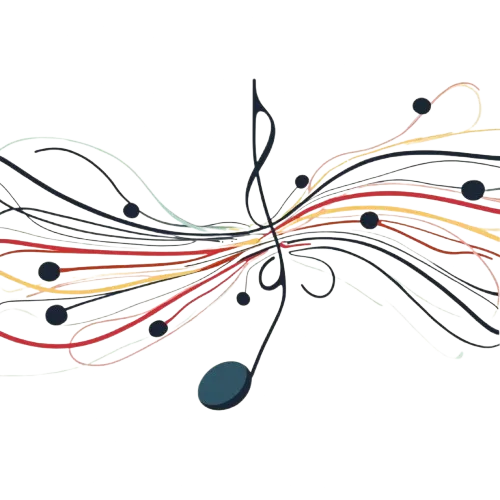

## Bu hikayeyi anlatmanın iki yolu var

Bu hikayeyi anlatmanın bir yolu daha var, o da tam ters istikametten gidiyor: Bastırıcı olarak uyuşturucular, yani insan deneyiminin susturulmuş senfonisi. O versiyon diyor ki uyuşturucular duyguları falan büyütmez; tam aksine hissettiklerini bastırır, köreltir ve çarpıtır.

Beş noktaya odaklanır bu bakış. Alkolün, ketaminin ve kokainin normal beyin fonksiyonlarına ve duygu durumunu yönetme becerine nasıl çomak soktuğunu göstermek ister. Her madde kendi farmakolojik rotasını izlediği için, ortaya çıkan etkilerin aslında ne kadar tahmin edilebilir ve uyuşturucu olduğunu anlatır.

Kişisel deneyimleri baştan ele alıp, maddelerin gerçek hisleri nasıl soldurduğunu gözler önüne sermeyi hedefler. Ortada düpedüz bir algı bozulması varken buna "duyguları büyütmek" demenin ne kadar tehlikeli olduğunu savunur. Madde kullanmak yerine ayıklığı ve gerçek duygusal zekayı yüceltir.

Böyle bir metnin tonu; uyuşturucuların ruh hali ve düşünceler üzerindeki etkilerine dair kulaktan dolma fikirlere karşı bilimsel kanıtlarla örülü, son derece klinik bir tonda olurdu.

Şu an okuduğunuz metin ise ilk versiyon. Uyuşturucu ve alkolün, neyin sesini açacağına kafasına göre karar veren birer amfi gibi nasıl çalıştığını; maskeleri, rolleri bir kenara fırlatıp altta aslında ne yatıyorsa onu nasıl çırılçıplak ortaya döktüğünü anlatıyor.

## Amfi olarak uyuşturucular

Olay basit: Uyuşturucular kafanın içine gökten zembille yeni bir şey indirmez. Bir amfi gibi çalışırlar. O an içindeki hangi duygu çalıyorsa, onun sesini sonuna kadar açarlar.

Zihnini onlarca enstrümandan oluşan koca bir orkestra gibi düşün. Uyuşturucu da orkestra şefliğine soyunup hangi enstrümanın, hangi duygunun en yüksek perdeden çalacağına karar verir.

Kimi zaman da neyi parlatıp öne çıkaracağı konusunda uyuşturucunun kendi iradesi varmış gibi gelir. Vücuduna bir şey aldığın anda kontrol artık senin elinden çıkar.

Mesele, direksiyonu sadece canının istediği bir sonraki parçayı çalmaya kilitlenmiş kaotik ama tuhaf şekilde seçici bir DJ'e devretmeye benzer.

## Alkol, namıdiğer joker kartı

Alkol sağı solu belli olmamasıyla meşhurdur. Bir iki kadeh seni bulutların üzerine de fırlatabilir, zifiri karanlık bir kuyuya da itebilir. Çünkü alkol ayrım yapmaz; o sırada kafanda ne dönüyorsa onu katbekat büyütür.

Keyfin yerindeyse neşen katlanır, için buruksa efkarın dibine vurursun; öfkeliysen bir anda gözü dönmüş bir boğaya dönüşebilirsin. Bu yazının altındaki örnekler tam da bunu anlatıyor: alkolle hortlayan bir öfke nöbeti ve bir babanın derin hüznü.

Kafan güzelken yaşadığın o içsel kaos ve uç noktalar, zaten içinde var olan şeylerin sadece megafonla bağırılmış halidir.

İşte alkolü bu kadar tehlikeli yapan da bu joker kartı rolüdür. Kendi içinde bir Rus ruleti oynarsın, namlunun nerede duracağını asla kestiremezsin. Bir bakmışsın dünyanın zirvesindesin, hemen ardından hiçbir mantığı olmayan bir öfke patlamasının veya çaresizlik kuyusunun içinde debeleniyorsun.

Bu yüzden alkol genelde keyif verici maddeler arasında en tekinsizi olarak görülür. Ruh halini darmadağın eder ve günün sonunda seni, kafanın iplerini elinde tutan bir kukla gibi ortada bırakır.

## Ketamin

Ketamin disosiyatif etkileriyle bilinir ve eleştirel düşünme mekanizmanı neredeyse tehlikeli bir noktaya kadar felç eder. Dünyanın en rezil yeri bile gözüne kusursuz bir cennet gibi görünebilir.

Özgüvenin tavan yapar, dertler buharlaşır ve etrafındaki dünya mistik bir havaya bürünür. Ancak o sakin yüzeyin altında, çevreni tartıp biçme ve doğru değerlendirme yetin fena halde uyuşmaktadır.

Zaten ketaminin antidepresan olarak kullanılmasının ardındaki mantık da tam olarak bu: Kötü düşünceleri söküp atabilir; geriye huzurlu, neredeyse rüya gibi bir hafiflik bırakabilir.

Gelgelelim iki ucu keskin bir bıçaktır. Yaşattığı o kopuş zihinsel acıya kısa bir mola aldırır aldırmasına ama aynı zamanda görmezden gelmeye başladığın tehlikelere karşı seni bütünüyle savunmasız bırakır.

## Kokain

Kokain, özgüveni içi boş bir büyüklük sanrısına çevirir. Bir çizgi çektiğinde, durum hiç de öyle olmasa bile dünya ayaklarının altına serilmiş gibi hissedersin.

Bu körleşmiş özgüven hissi, gözü kara işlere kalkışmana ve neler yapabileceğin konusunda tamamen yanlış hayallere kapılmana yol açar. Dünyayı parmağında oynatabileceğini zannedersin ama gerçekte son sürat duvara toslamak üzeresindir.

## Hikayelerin gösterdiği şey

Kısacası ortada katman katman bir yapı var. Madde etkisindeki zihni anlamak için derine inmek şart. Bu maddeler sadece duyguların volümünü artırmakla kalmıyor; zaten derinlerde bir yerde pusuya yatmış hisleri gün yüzüne çıkararak her insan için farklı bir senaryo yazıyor. Ve her madde bunu kendine has bir dille yapıyor.

Bunu görmenin en iyi yolu kişisel hikayelere bakmaktır; bu amfilerin iç sesimizi değiştirmekle yetinmeyip kimi zaman onu nasıl tamamen rehin alabildiğini görürsün. Mesele sadece tehlikeleri sıralamak değil.

Asıl mesele, dışarıdan gelen kimyasallar iç dünyamızın kontrolünü ele geçirdiğinde içeride tam olarak neyin koptuğunu anlamaktır.

## Beyin, denge ve doz

Madalyonun diğer yüzü var bir de; yedi maddede özetlenebilecek bir çerçeve bu.

Duygusal beyin kontrolü eline aldığında, özellikle aşırı alkol tüketiminin ardından, amigdala mantıklı beyni ve sağlıklı muhakemeyi saf dışı bırakır. Sık sık blackout yaşamamızın, ertesi gün hiçbir şey hatırlayamamamızın sebebi de budur.

Mantığın sesi kesilir, kontrol ham duygulara geçer; böylece fren mekanizması olmadan hareket ederiz ve yaşananlar bilinçli hafızaya hiç yazılmaz.

Ruh halimiz zaten duyguların bir alaşımıdır. İşler yolundayken mutluluk zirvededir, kötü günlerde hüzün ağır basar. Depresyondaki insanların duygusal dengeyi yeniden kurabilmek adına uyuşturuculara sarılması boşuna değildir.

Bazı maddeler odaklanmana yardım edebilir ama bu durum, o hassas teraziyi darmadağın etme riskiyle birlikte gelir.

Üçüncü mesele dozaj. Ayarı kaçırırsan duygular öyle bir şahlanır ki mantıklı düşünen tarafla bağın tamamen kopar. İçindeki %5'lik ufacık bir kırgınlık ya da asabiyet bir anda %90'a, %100'e fırlayabilir.

Bu noktaya gelen insanlar genelde kontrolü kaybeder ve sonrasında hatırlamayacakları haltlar yerler. Bu aşırı yükleme o kadar şiddetlidir ki mantıklı düşünceye zihinde zerre yer bırakmaz.

## Hayatta kalma içgüdüleri ve geri dönüş yolu

Duygusal yapımız evrimsel süreçten gelir; bizi hayatta tutmak üzere tasarlanmıştır. Korku hissettiğimiz anda amigdala direksiyona geçer ve bize ya kaçmamızı ya da savaşmamızı emreder.

Bu doğal ayarları uyuşturucularla kurcalamak; hayatta kalma reflekslerimizle, kendi canımızla, başkalarının hayatıyla ve iç huzurumuzla kumar oynamaktan farksızdır.

Uyuşturucu tecrübesinin ardından iç huzurunu ve o dengeyi yeniden yakalamak hiç de kolay olmaz. Hangover dedikleri o ertesi gün sendromu, hele de fıtrat olarak duygusal biriysen, can yakıcı ve çok uzun sürebilir.

O devasa yükselişlerin faturası çoğu zaman günlerce süren bir çöküş olur. Madde yokken kendi halimizde ne kadar yoğun duygular yaşıyorsak, darbe o kadar sert olur ve ayağa kalkmak da o kadar uzun sürer.

## Senfoni ve caz

Duygularımız bir senfoniye benzer; her hissin bir yeri, bir görevi vardır ve hepsi bir araya geldiğinde bir ahenk yaratır. Uyuşturucu kullanmak ise diğer bütün orkestrayı susturup tek bir enstrümanın, tek bir duygunun dakikalarca körü körüne solo atmasına izin vermektir. O noktada denge altüst olur; tek bir duygu öyle bir bağırır ki diğer her şeyi ezip geçer ve hayatın doğal ritmini bozar.

Geriye bir armoni değil, kontrolden çıkıp tehlikeli boyutlara ulaşan kaotik bir solo kalır.

Bu altıncı noktaydı; yedinci nokta ise caz. Uyuşturucu kafasındaki duygular vahşi bir caz doğaçlamasına benzer. Caz özgürdür, kurallara sığmaz; bir anda büyüleyici bir güzellikten zifiri bir kaosa evrilebilir.

Nasıl ki bir caz solosu tahmin edilemez bir şekilde her yöne savrulabiliyorsa, kafa güzelken duygular da öyle oradan oraya savrulur. Bu başıboşluk insana kimi zaman berrak anlar ve derin aydınlanmalar yaşatabilir; ama aynı zamanda fena halde sarsıcı, tekinsiz savrulmaları da beraberinde getirir.

O caz seansı bir kere çığırından çıktı mı, sana bir şeyler katabileceği gibi seni paramparça da edebilecek tekinsiz yerlere sürükleyebilir.

## Senfoniyi dengede tut

Kısacası vücudumuzu yöneten kuklacılar aslında duygularımız. Onları nasıl yöneteceğimizi ve mantığımızla nasıl dengeleyeceğimizi bilmezsek kendimizi kaybedebiliriz.

Üstelik bu denge sadece mutluluk, korku, kaygı ve öfke gibi dört temel duygudan ibaret değil; hissettiğimiz her şey için geçerli.

Bu dengeyi korumak ve farkında olmak önemli. Duyguların direksiyona geçmesine izin verirsen sonradan gurur duymayacağın birine dönüşebilir ya da ileride pişman olacağın kararlar alabilirsin.

Sakin kalmak, soğukkanlılığını korumak, kullandığın maddeleri ve sınırlarını bilmek, insan duygularının o kaotik senfonisinde ayaklarının yere basmasını sağlar.

Bir de şu var; hani bir caz seansı uyumla kaos arasında gidip gelir ya, uyuşturucuların etkisi altındayken duygularımız da aynen öyle savrulur. Bazen her şeyi çözmüş gibi hissettiğin ya da kendinden geçtiğin o anlar olur ama kontrolü kaybetmek tehlikelidir. Durumun ne kadar kaygan olduğunu anladığında, duygularının kontrolden çıkmasına izin vermek yerine ayaklarını yere basmak ve onları dengelemek çok daha kolaylaşır.

O yüzden içindeki o duygusal senfoniyi dengede tut ve maddelerin tetikleyebileceği caza karşı dikkatli ol. Sınırlarını bil, mantığınla kalbinin arasındaki o akordu hiç bozma.
