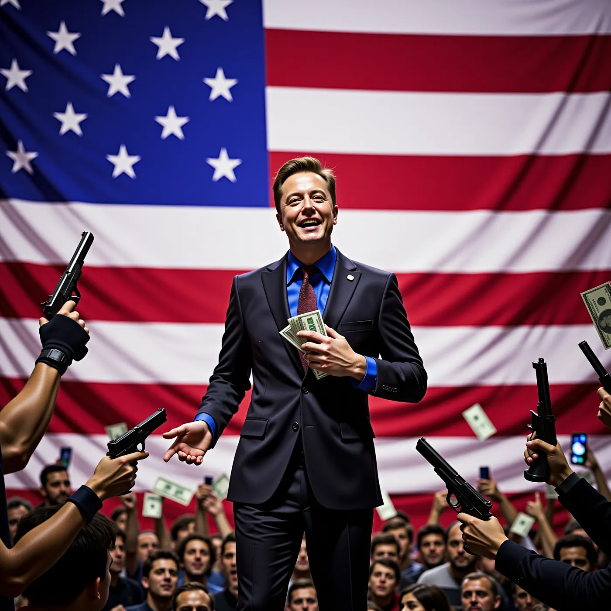

Elon Musk bana çok şüpheli geliyor. Her ay Trump'a oy veren ve onun dilekçelerini destekleyen seçmenlere bir milyon dolar dağıtıyor. Herkese silah. Sapıkça bu ya.

*Bu yazı annemin sözlerine dayanıyor, Perplexity.ai (Yapay Zeka) tarafından açıklandı ve yorumlandı*

## Musk'ın Trump'a Parası

Dünyanın en zengin insanı Elon Musk, son dönemdeki siyasi faaliyetleriyle ortalığı karıştırdı. Donald Trump'ın 2024 başkanlık seçimlerindeki adaylığını desteklemek için America PAC adında bir siyasi eylem komitesi kurdu. Musk, Trump'ın seçim kampanyasını desteklemek için bu komiteye şimdiden yaklaşık 75 milyon dolar yatırdı[1].

Musk'ın stratejisinin önemli bir parçası, dilekçesini destekleyen seçmenlere her ay 1 milyon dolarlık bir çekiliş yapması. Bu dilekçe, ABD'deki Birinci (ifade özgürlüğü) ve İkinci (silah bulundurma hakkı) Anayasa değişikliklerinin desteklenmesini talep ediyor. Çekiliş, Pennsylvania, Georgia ve Arizona gibi kritik eyaletlerdeki kayıtlı seçmenlere yönelik. Her gün dilekçeyi imzalayan rastgele bir kişi 1 milyon dolarla ödüllendiriliyor[2][3].

Eleştirmenler, bu tür mali teşviklerin hukuken sorunlu olduğunu savunuyor. Hukuk profesörü Paul Schiff Berman'a göre, Musk'ın teklifi, seçmenlere kayıt veya oy verme karşılığında ödeme yapmayı yasaklayan ABD seçim yasalarını ihlal edebilir[2]. Bu da eylemlerinin yasallığı konusunda ciddi sorular doğuruyor ve hukuki sonuçlara yol açabilir.

## Herkese Silah

Musk, Trump'a mali desteğinin yanı sıra, silahlara erişimi kolaylaştıran bir politikayı da savunuyor. Bu, Trump'ın silah yanlısı tutumu ve ABD'deki silah yasası tartışmalarıyla uyumlu. Birçok Amerikalı trajik silahlı saldırıların ardından daha sıkı silah yasaları talep ederken, silah sahipliğini savunanlar, silah hakkının İkinci Anayasa Değişikliği'nde güvence altına alındığını ve kısıtlanmaması gerektiğini iddia ediyor[3][4].

Herkesin silaha erişimi olması gerektiği fikri, özellikle ABD'deki yüksek şiddet suçları göz önüne alındığında, birçok kişi tarafından tehlikeli görülüyor. Anketler, Amerikalıların ezici çoğunluğunun, tüm silah alımları için geçmiş taraması da dahil olmak üzere, daha sıkı silah yasalarından yana olduğunu gösteriyor[4].

## Tepkiler ve Sonuçlar

Musk'ın eylemlerine gelen tepkiler karışık. Bazıları onun yaklaşımını yaratıcı bulurken, diğerleri bunu çaresiz ve demokrasi için potansiyel olarak zararlı olarak görüyor[2][3]. Pennsylvania Valisi Josh Shapiro, Musk'ın davranışlarını "derinden endişe verici" olarak nitelendirdi ve kolluk kuvvetleri tarafından soruşturma açılmasını talep etti[2].

Musk'ın faaliyetleri, seçim sürecinin bütünlüğü hakkında sorular doğuruyor ve Amerikan siyasetinde para ile güç arasındaki gerilimleri gözler önüne seriyor. Mali teşviklerin seçmen davranışıyla birleştirilmesi, demokrasi üzerinde uzun vadeli etkilere sahip olabilir ve siyasi kurumlara olan güveni zayıflatabilir.

Elon Musk'ın yaklaşımı, özellikle bir milyon dolarlık çekilişi ve sınırsız silah sahipliğine verdiği destek, bir dizi etik ve hukuki endişeyi beraberinde getiriyor. Bu girişimlerin yaklaşan seçim kampanyasını nasıl etkileyeceğini ve ABD'nin siyasi manzarası için ne gibi sonuçlar doğurabileceğini zaman gösterecek.

Alıntılar: [1] [https://www.techpolicy.press/tracking-elon-musks-political-activities/](https://www.techpolicy.press/tracking-elon-musks-political-activities/) [2] [https://www.bbc.com/news/articles/ced0d1g5zyno](https://www.bbc.com/news/articles/ced0d1g5zyno) [3] [https://www.bbc.com/news/world-us-canada-61591236](https://www.bbc.com/news/world-us-canada-61591236) [4] [https://en.wikipedia.org/wiki/Gun_politics_in_the_United_States](https://en.wikipedia.org/wiki/Gun_politics_in_the_United_States) [5] [https://www.nbcnews.com/tech/tech-news/elon-musk-defends-1-million-petition-giveaway-federal-warning-rcna177377](https://www.nbcnews.com/tech/tech-news/elon-musk-defends-1-million-petition-giveaway-federal-warning-rcna177377) [6] [https://www.newsweek.com/donald-trump-elon-musk-million-dollar-giveaway-swing-state-voters-doj-1974782](https://www.newsweek.com/donald-trump-elon-musk-million-dollar-giveaway-swing-state-voters-doj-1974782) [7] [https://abcnews.go.com/Business/elon-musks-1-million-voter-sweepstakes-legal-experts/story?id=115077809](https://abcnews.go.com/Business/elon-musks-1-million-voter-sweepstakes-legal-experts/story?id=115077809)
