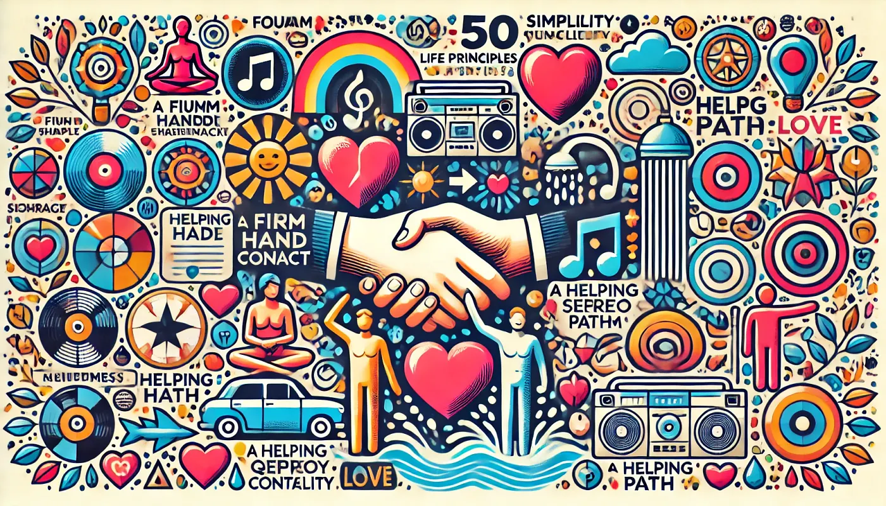

[Pat Divilly](https://medium.com/bigger-picture/lifelessons-advice-from-an-80-year-old-man-799510fb0f91)'den alınan metin, İngilizceden çevrilmiştir.

80 yaşındaki birinden 50 tavsiye. Bunları burada Türkçe paylaşıyorum çünkü tekrar tekrar okunabilirler.

## Tavsiyeler 1'den 10'a

1. Sıkı bir el sıkışmanız olsun.
2. İnsanların gözlerinin içine bakın.
3. Duşta şarkı söyleyin.
4. Harika bir stereo sisteminiz olsun.
5. Bir kavgadaysanız, önce siz vurun ve sert vurun.
6. Sırları saklayın.
7. Asla kimseyi bırakmayın. Mucizeler her gün gerçekleşir.
8. Uzatılan her eli tutun.
9. Cesur olun. Değilseniz bile öyle davranın. Kimse farkı anlayamaz.
10. Islık çalın.

## Tavsiyeler 11'den 20'ye

11. Alaycı sözlerden kaçının.
12. Hayat arkadaşınızı dikkatli seçin. Mutluluğunuzun ve mutsuzluğunuzun %90'ı bu tek karardan doğacak.
13. Bunu asla öğrenmeyecek insanlar için güzel şeyler yapmayı alışkanlık edinin.
14. Sadece bir daha görmek istemediğiniz kitapları ödünç verin.
15. Kimsenin umudunu elinden almayın; sahip olduğu tek şey o olabilir.
16. Çocukların oyun oynarken kazanmasına izin verin.
17. İnsanlara ikinci bir şans verin ama üçüncüyü vermeyin.
18. Romantik olun.
19. Tanıdığınız en pozitif ve en coşkulu kişi olun.
20. Rahatlayın. Sakin olun. Nadir hayati meseleler dışında hiçbir şey ilk göründüğü kadar önemli değildir.

## Tavsiyeler 21'den 30'a

21. Telefonun önemli anları bölmesine izin vermeyin. O bizim rahatlığımız için var, arayan için değil.
22. İyi bir kaybeden olun.
23. İyi bir kazanan olun.
24. Bir arkadaşınıza sır vermeden önce iki kez düşünün.
25. Biri size sarıldığında, bırakan ilk kişi o olsun.
26. Mütevazı olun. Siz doğmadan önce birçok şey başarılmıştı zaten.
27. Basit tutun.
28. Kaybedecek hiçbir şeyi olmayan kişiden sakının.
29. Köprüleri yakmayın. Aynı nehri ne sıklıkla geçmek zorunda kalacağınıza şaşıracaksınız.
30. Hayatınızı öyle yaşayın ki mezar taşınızda şu yazabilsin: Pişmanlık Yok.

## Tavsiyeler 31'den 40'a

31. Cesur ve gözü pek olun. Hayatınıza geri dönüp baktığınızda, yapmadığınız şeyleri yaptıklarınızdan daha çok pişman olacaksınız.
32. Birine onu sevdiğinizi söyleme fırsatını asla kaçırmayın.
33. Kimsenin tek başına başaramadığını unutmayın. Minnettar bir kalbe sahip olun ve size yardım edenleri hemen takdir edin.
34. Tutumunuzun kontrolünü elinize alın. Başkasının sizin için seçmesine izin vermeyin.
35. Hastaneye düştüklerinde arkadaşlarınızı ve akrabalarınızı ziyaret edin; sadece birkaç dakika kalmanız yeterli.
36. Her güne en sevdiğiniz müziklerden biriyle başlayın.
37. Arada bir manzaralı yolu seçin.
38. Bol bol Sevgililer Günü kartı gönderin. Altına "Seni harika bulan biri" diye imzalayın.
39. Telefonu sesinizde coşku ve enerjiyle açın.
40. Komodininizin üzerinde bir defter ve kurşun kalem bulundurun. Milyon dolarlık fikirler bazen sabahın 3'ünde gelir.

## Tavsiyeler 41'den 50'ye

41. İşi ne kadar önemsiz görünürse görünsün, çalışan herkese saygı gösterin.
42. Sevdiklerinize çiçek gönderin. Sebebini sonra düşünürsünüz.
43. Arkanızdaki arabanın geçiş ücretini ödeyerek birinin gününü güzelleştirin.
44. Birinin kahramanı olun.
45. Sadece aşk için evlenin.
46. Nimetlerinizi sayın.
47. Birinin evinde misafir olduğunuzda yemeği övün.
48. Okul otobüsündeki çocuklara el sallayın.
49. Her işte başarının %80'inin insanlarla geçinebilme yeteneğinize bağlı olduğunu unutmayın.
50. Hayatın adil olmasını beklemeyin.
