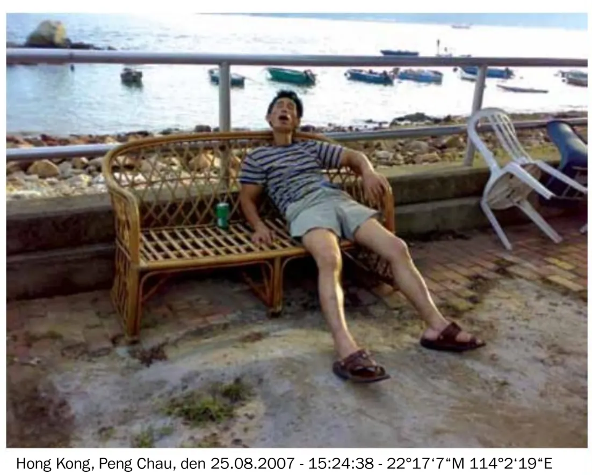

proud Magazine'in ilk sayısına hoş geldiniz!

Biz senin şehir ormanındaki silahın, alnındaki korku teri, ensendeki yırtıcı nefesiz. Kaçma içgüdünüz ve avlanma içgüdünüzüz.

Misyonumuz, ihtiyacı olanları beslemek. Çünkü Berlin Moloch'u sıradan insanları yutmadı, sadece sakladı. Neler döndüğünü size göstereceğiz.

Ekibimiz şehirciler, müzisyenler, stilistler, moda tasarımcıları, cinsiyetçilerden oluşuyor. Ya da öyle bir şey. Büyükannemin "-ist" ile biten her şey kötüdür dediğini muhtemelen dinlemeliydik. Bunu kesin batırdık. Hip-Hop Tip-Top.

Bu proud'un doğuşu ve sen oradasın. Tabii kanlı, yapışkan bir olay değil, bunu mecazi olarak görmelisin. Sen proud'un bir parçasısın ve bizimle geleceğe, göz kamaştırıcı, glamour, stil, seks ve yoga dolu bir geceye doğru yol alabilirsin. Yukarı, yukarı! Şehri ele geçirdiğimizde herkese çikolata olacak.

Berlin ol. proud ol.
