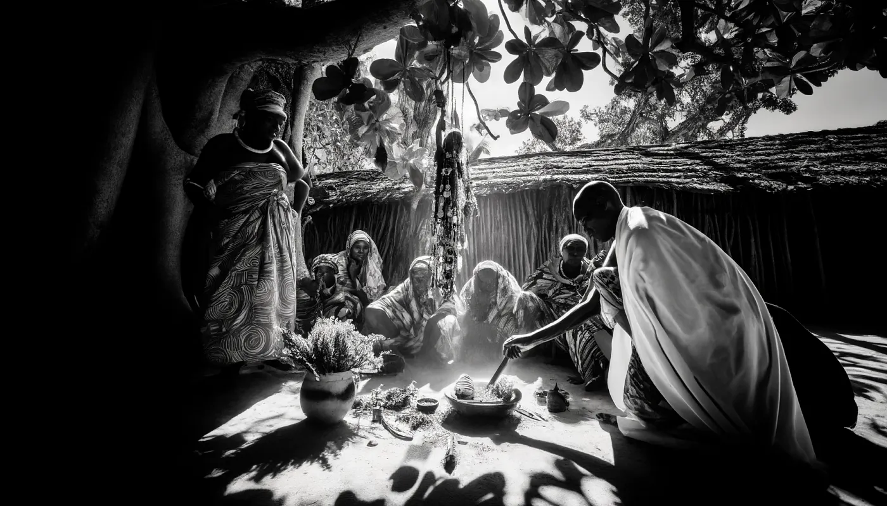

Zanzibar ve Pemba'da kara büyü ve kadim ruhani gelenekler hakkında anlatılan bir sürü hikaye var. Adalar kültürel mirasıyla tanınıyor; bu mirasın içinde doğaüstü varlıklara olan inanç ve geleneksel tıp da önemli bir yer tutuyor.

## Shetani ve Popobawa

Shetani, Zanzibar ve Pemba'da insanların hayatına karıştığına inanılan bir tür ruh veya cin. Eskiden Büyük Efendi olarak bilinen Mwinyi Mkuu'nun, gücünü bu ruhları kontrol ederek ve geleceği görerek kazandığı anlatılır. Hatta Dunga'daki sarayının kalıntılarında geceleri hala ruhların dolaştığı söyleniyor ([Siyabona](https://www.siyabona.com/shetani-zanzibar.html)).

Bir de adı çıkmış bir ruh var: Popobawa. Önce Pemba'da, sonra da Zanzibar'da insanlara korku salmış. Kurbanlarını felç edip onlara saldırdığı söyleniyor; ne zaman geri dönse bölgede adeta bir kitle histerisi yaşanıyor ([Siyabona](https://www.siyabona.com/shetani-zanzibar.html)).

## Waganga ve Cinler

Shetani ve diğer ruhlarla başı derde girenlerin imdadına Waganga, yani geleneksel şifacılar yetişiyor. Ruhlar sorun çıkardığında gidilecek ilk kişi onlar. Hastalıkları iyileştirmek ve kötü ruhları kovmak için bitkisel ilaçlar ve ruhani ritüeller kullanıyorlar. Bu pratikler yerel kültürün derinliklerine işlemiş durumda ve genellikle babadan oğula aktarılıyor ([Siyabona](https://www.siyabona.com/shetani-zanzibar.html)) ([Voices of Africa](https://voicesofafrica.co.za/believe-it-or-not-witchcraft-in-kenya/)).

İslamiyetin etkisiyle cin inancı da buralarda çok yaygın. İnsanlar bu varlıkların dilekleri gerçekleştirebileceğine, doğru şekilde çağrılıp kontrol edilirlerse kişiyi koruyabileceğine inanıyor. Bu tür büyülerde genellikle İslami dualar eski geleneklerle harmanlanıyor. Birçok kişi, cinlerle ve diğer doğaüstü meselelerle ilgilenmesi için bir Mganga'nın kapısını çalıyor ([Voices of Africa](https://voicesofafrica.co.za/believe-it-or-not-witchcraft-in-kenya/)).

## Kültürlerin Harmanlandığı Nokta

Zanzibar ve Pemba'da Afrika, Arap, Fars ve Hint etkileri iç içe geçmiş durumda. Bu harman, kara büyü ile geleneksel şifacılığın İslami inançla yan yana yaşadığı, kendine özgü ruhani gelenekler doğurmuş. Koruma büyüleri, ritüeller ve ruh çağırma seansları hala çok yaygın; bu da adalardaki farklı inançların ne kadar birbirine geçtiğini gösteriyor ([Indigo Safaris](https://www.indigosafaris.com/pemba_island_history_and_culture.html)) ([Tanzania Odyssey](https://www.tanzaniaodyssey.com/blog/cadogan-guide-to-tanzania-the-indian-ocean-islands-pemba/)).

Bu gelenekler yerel kültürün ayrılmaz bir parçası. Adalar, hem derman arayan inananları hem de geleneksel Afrika maneviyatını merak eden araştırmacıları kendine çekiyor. Coğrafi olarak uzak ve daha az gelişmiş oldukları için bu gelenekler yüzyıllar boyunca neredeyse hiç bozulmadan günümüze ulaşabilmiş.

*Bu makale emino.ai, Bane ve ChatGPT tarafından birlikte yazılmıştır.*
