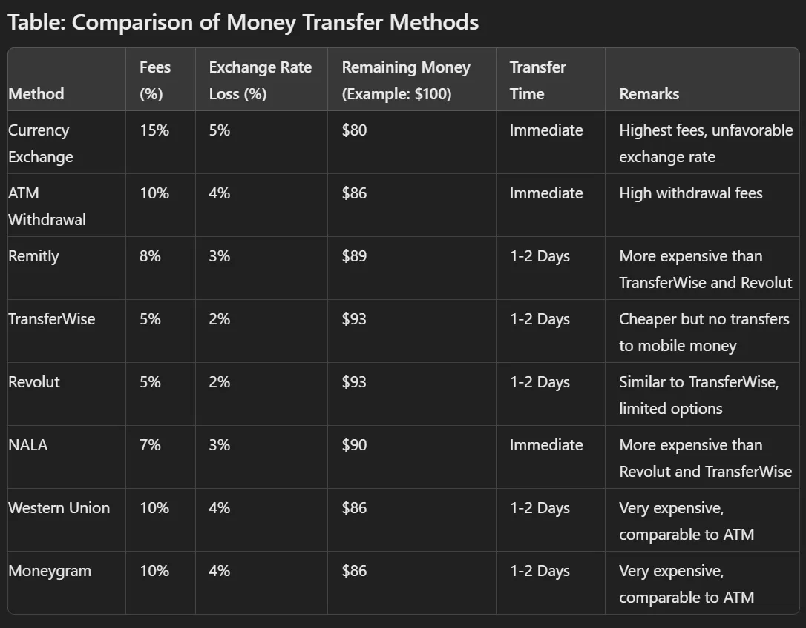

Bu, Tanzanya'ya nasıl para gönderileceğiyle ilgili. Bir banka hesabından ya da kredi kartından, M-Pesa, Tigo Pesa ve Airtel Money gibi mobil para sistemlerine, ya da bir Wakala dükkânından alınan nakit paraya.

Sahra Altı Afrika'da neredeyse her köyde bir tane var.

Kısa versiyonu. Kripto para, para göndermeyi ve döviz çevirmeyi NALA, Revolut, Transfer Wise, Remitly, Western Union, Moneygram ve normal bankalardan daha ucuz hale getiriyor. Yaklaşık %15 ila %20 tasarruf ediyorsun, çünkü kurlar daha iyi ve fee'ler daha düşük.

Eve para gönderiyorsan, para doğrudan yerel bir banka hesabına, mobil paraya gidebilir ya da nakit olarak teslim edilir.

İşletmeler, büyük miktarlarda döviz çevirip yurt dışına fatura öderken çok tasarruf ediyor. Yabancı yatırımcılar da parayı doğru borsa üzerinden getirdiklerinde %10 daha fazla para elde edebiliyor.

## Yeterli döviz yok

Bütün bunların arkasındaki sebep, yeterli döviz olmaması.

Birçok ülkede hükümet, insanların gerçekten ihtiyaç duyduğu şeylerin, benzin gibi, fiyatını düşük tutmaya çalışıyor. Bu yüzden bir tavan fiyat belirliyor. Tanzanya'da bu fiyat Tanzanya Şilini (TZS) cinsinden.

Ve sorun burada. Dünya piyasasında benzin, ABD doları gibi dövizle ödeniyor. Tanzanya dışında neredeyse kimse Tanzanya Şilini istemiyor.

Yerel işletmeler için bu zor. Bir benzin istasyonu benzini dövizle almak zorunda, ama sadece TZS karşılığında satabiliyor.

Tanzanya'da yeterli döviz yok, bu yüzden benzin istasyonu işletenler genellikle TZS'lerini kötü bir kurdan çevirmek zorunda kalıyor ve %10'a kadar kaybediyorlar.

Sahra Altı Afrika'nın diğer ülkelerinde bu kayıp %40 ila %50'ye bile çıkabiliyor. Böyle kurlarla bir benzin istasyonu dünya piyasasında ayakta kalamaz. Sonuç olarak bütün bölgede boş pompalar ve öfkeli sürücüler görüyorsun.

Daha da kötüleşiyor. TZS çevirisinden doğan kaybın üstüne, birçok insan karaborsada ABD dolarıyla spekülasyon yapıyor ve bu da fiyatı daha da yukarı çekiyor.

Diğer ülkelerle ticarete bağımlı olan herkes bunun bedelini ödüyor, araba satıcıları, süpermarketler ve havayolları gibi.

## Fee'ler insanların eve gönderdiğini yiyor

Sonra bir de dövizi Afrika'ya göndermenin maliyeti var. Bankalar yüksek fee'ler alıyor ve genellikle kötü bir kur veriyor, yani parayı iki kez kaybediyorsun.

Yurt dışında çalışıp eve para gönderiyorsan, kazandığının büyük bir kısmı fee'lere ve kötü kurlara gidiyor. Milyonlarca insan ailelerini geçindirmek için bu paraya bağımlı, bu yüzden çok acıtıyor.

## Wakala dükkânları

İşte burada Wakala dükkânları devreye giriyor. Tanzanya'da ve tüm Sahra Altı Afrika'da paranın hareketinde büyük bir rol oynuyorlar. Bu yerel acenteler neredeyse her köyde var.

Oradan hemen nakit alabilirsin ya da parayı M-Pesa ya da Tigo Pesa ile doğrudan telefonuna alabilirsin.

Banka transferi yavaş ve pahalı, üstelik birçok insan zaten bir bankaya gerçekten ulaşamıyor. Wakala dükkânı hızlı, yakın ve ucuz.

Böylece banka hesabından ya da kredi kartından doğrudan birinin mobil cüzdanına para gönderebilirsin. Ya da para bir sonraki Wakala dükkânından nakit olarak alınır. Yüksek fee'leri ve kötü banka kurlarını atlıyorsun.

Kişinin nerede yaşadığı önemli değil, parayı hızlı alıyor. Bu yüzden bölgedeki milyonlarca insan bunu kullanıyor.

## Kripto burada devreye giriyor

Ve işte kripto para burada devreye giriyor. Döviz kurlarını normale döndürmek ve para göndermeyi ucuzlatmak isteyen bir proje var. Bankalar ve SWIFT transferleri üzerinden gitmiyor. Lisanslı trader'lardan oluşan bir ağ ve kripto kullanıyor.

Bir örnek. Tanzanya'daki bir araba satıcısı artık TZS'yi kriptoya çevirebilir, Japonya'ya gönderebilir ve orada yene çevirebilir. Bu daha hızlı ve çok daha ucuz. %15 kaybetmek yerine, satıcı kur üzerinden %5 bile kazanabilir.

Afrika'daki ailene para göndermek istiyorsan, bu da NALA, Revolut, TransferWise, Remitly, Western Union ya da Moneygram'dan daha ucuz. Ve seçebilirsin. Para yerel bir banka hesabına, mobil paraya gider ya da nakit olarak teslim edilir.

Ailelerinin eve gönderdiği parayla yaşayan Sahra Altı Afrika'daki milyonlarca insan için bu daha güvenli ve daha ucuz.

Sadece aileler için değil. Yurt dışından mal alan işletmeler de bunu kullanabilir. Kripto, parayı banka transferleri için ekstra maliyet olmadan ve döviz fee'si olmadan taşıyor ve çeviriyor. Böylece çok tasarruf ediyorlar ve işlerini daha iyi yürütebiliyorlar.

## Yabancı yatırımcılar için %10 avantaj

Sonra bir de yabancı yatırımcılar var ve bu kısım gerçekten ilginç. Yabancı bir yatırımcı Tanzanya'ya geldiğinde, her şey TZS cinsinden fiyatlandırılıyor. Paralarını doğru borsa üzerinden getirirlerse %10 daha fazla alıyorlar.

%5 kaybetmiyorlar, %10 kazanıyorlar. Yani bu temelde tüm yatırımda %10 indirim demek, sırf döviz tuttukları için. Tek başına bu, birinin bölgeye yatırım yapıp yapmayacağına karar verebilir.

## 100 dolar için seçenekler nasıl karşılaştırılıyor

Para gönderme yollarının 100 dolar için nasıl karşılaştırıldığı burada.

| Yöntem | Fee'ler (%) | Kur kaybı (%) | 100 dolardan kalan | Süre | Notlar |
|---|---|---|---|---|---|
| Döviz Bürosu | %15 | %5 | $80 | Anında | En yüksek fee'ler, kötü kur |
| ATM'den Para Çekme | %10 | %4 | $86 | Anında | Yüksek çekim fee'leri |
| Remitly | %8 | %3 | $89 | 1 ila 2 gün | TransferWise ve Revolut'tan daha pahalı |
| TransferWise | %5 | %2 | $93 | 1 ila 2 gün | Daha ucuz ama mobil paraya transfer yok |
| Revolut | %5 | %2 | $93 | 1 ila 2 gün | TransferWise gibi, sınırlı seçenekler |
| NALA | %7 | %3 | $90 | Anında | Revolut ve TransferWise'dan daha pahalı |
| Western Union | %10 | %4 | $86 | 1 ila 2 gün | Çok pahalı, ATM gibi |
| Moneygram | %10 | %4 | $86 | 1 ila 2 gün | Çok pahalı, ATM gibi |

## Daha ucuz transferlerden fazlası

Daha ucuz transferler bunun sadece bir parçası. Mesele, Sahra Altı Afrika'daki insanlara ve işletmelere ihtiyaç duydukları para araçlarını vermek. Ve yabancı yatırımcılara bölgeye yatırım yapmaları ve bununla para kazanmaları için güvenli bir yol sunmak.

Döviz eksikliği Sahra Altı Afrika'daki ekonomilere hâlâ çok zarar veriyor. Kripto, bundan çıkmanın gerçek bir yolu.
