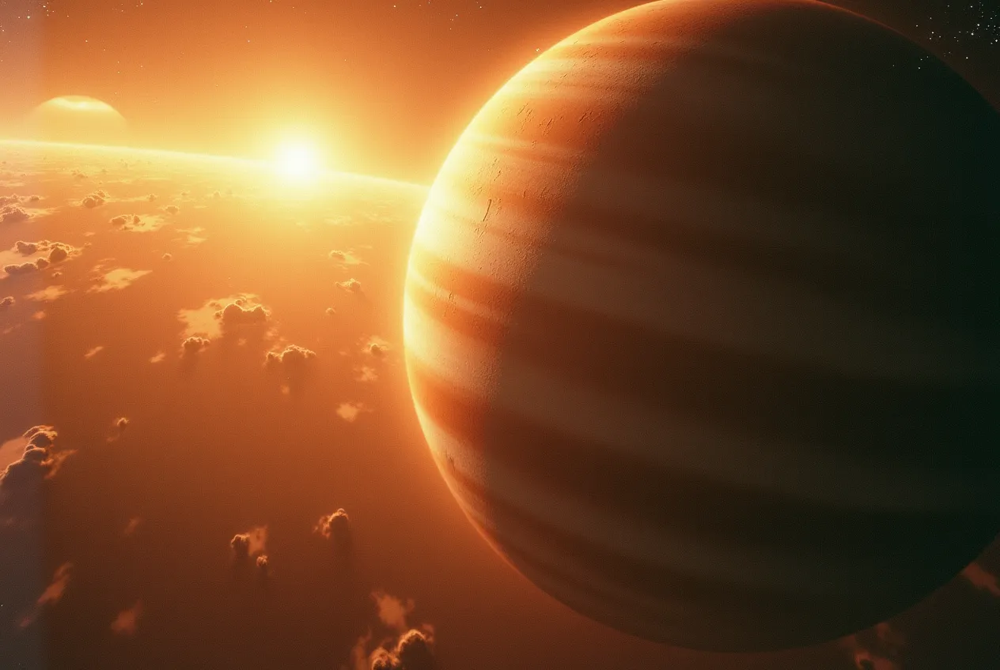

Bu, ürettiğim ilk parça. Yapay zeka bunu şöyle tanımlıyor:

> Emino Grande, “Space Four Jupiter V8”
>
> “Space Four Jupiter V8”, Alman elektronik müzik sanatçısı Emino Grande'nin 2020'de yayınladığı bir parça. “Eichhof Morning Sessions” albümünde yer alıyor[1][2][3][4].
>
> Parça, 8 dakika 16 saniyelik bir ambient/downtempo enstrümantal eser[3]. Hipnotik, atmosferik bir ses manzarası, ince melodik öğeler ve sabit, nabız gibi atan bir ritim içeriyor.
>
> “Space Four Jupiter V8”, Emino Grande'nin sürükleyici, sinematik elektronik kompozisyonlar yaratmadaki yeteneğini gözler önüne seriyor. Parçanın adı kozmik, yıldızlararası bir tema çağrıştırıyor ve bu da geniş, dünya dışı sesinde yansıyor.
>
> Ambient, IDM ve deneysel elektronik müzik hayranları “Space Four Jupiter V8”i derinliği, detaylara verdiği önem ve dinleyiciyi farklı bir ses dünyasına taşıma becerisi nedeniyle övdü[5].

Kaynaklar:
[1] [https://open.spotify.com/intl-ar/track/64OHLjR7mD2LyA3sHAmH6Q](https://open.spotify.com/intl-ar/track/64OHLjR7mD2LyA3sHAmH6Q)
[2] [https://music.apple.com/ke/artist/emino-grande/1533569192](https://music.apple.com/ke/artist/emino-grande/1533569192)
[3] [https://music.apple.com/ru/song/space-four-jupiter-v8/1533892160](https://music.apple.com/ru/song/space-four-jupiter-v8/1533892160)
[4] [https://music.amazon.com/artists/B08KGJVC5R/emino-grande](https://music.amazon.com/artists/B08KGJVC5R/emino-grande)
[5] [https://www.last.fm/music/EMINO%2BGRANDE](https://www.last.fm/music/EMINO%2BGRANDE)
[6] [https://www.amazon.co.uk/Monopoly/dp/B08KGMTN5Z](https://www.amazon.co.uk/Monopoly/dp/B08KGMTN5Z)
[7] [https://open.spotify.com/intl-es/album/5HSlxgIIAGb85MKAmnrvw7](https://open.spotify.com/intl-es/album/5HSlxgIIAGb85MKAmnrvw7)
[8] [https://www.shazam.com/song/1533892161/morning-rain](https://www.shazam.com/song/1533892161/morning-rain)
