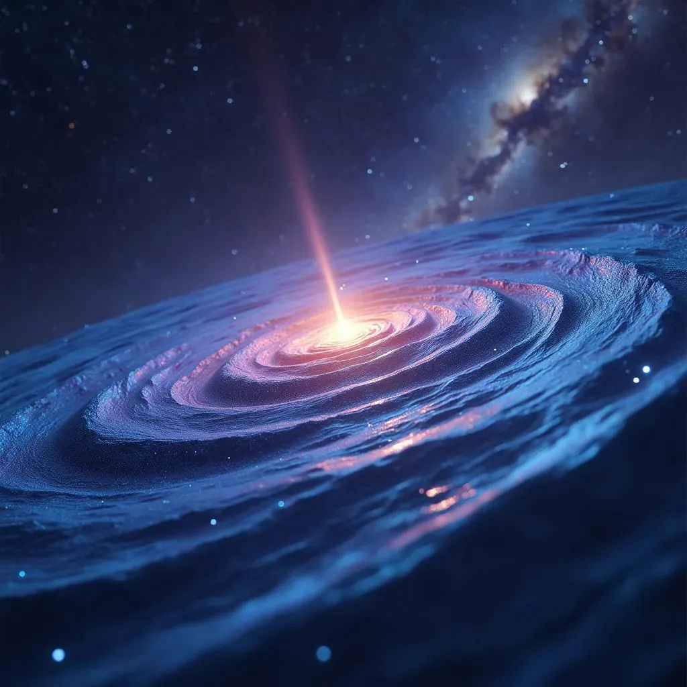

Kara delik bilgi paradoksu teorik fizikte eski bir sorun. Kuantum mekaniğiyle genel göreliliği kara deliklere birlikte uyguladığında ortaya çıkan bir çatışmadan geliyor. Ama artık kütleçekim dalgalarını tespit edebildiğimize göre, buna bakmanın yeni yolları var. Bu yazıda şunu öneriyoruz: bir kara deliğe düşen maddenin durumu hakkındaki bilgi, düşme sırasında çıkan kütleçekim dalgalarıyla tutulup dışarı taşınabilir.

## Paradoks ve fikir

Kuantum mekaniği bilginin kaybolamayacağını söyler. Ama madde bir kara deliğe düştüğünde, sonsuza dek yok olmuş gibi görünüyor, çünkü olay ufkunun ötesinden hiçbir şey geri dönemez. İşte bilgi paradoksu bu ve doğrudan fiziğin temel yasalarına gidiyor.

Bizim fikrimiz şu: kütleçekim dalgaları, yani uzayzamandaki dalgalanmalar, içeri düşen madde hakkındaki bilgiyi tutup onu dışarı taşıyan şey olabilir. Madde olay ufkuna yaklaştığında aşırı bir kütleçekimden geçer ve bu da kütleçekim dalgaları yaymasına yol açar. Bu dalgalar içeri düşen maddenin kuantum durumunu kodlayabilir ve böylece bilgi kara delikten dışarı çıkabilir.

## Bir çerçeve ve nasıl test edilir

Bunu desteklemek için kuantum mekaniğini, genel göreliliği ve bilgi teorisini bir araya getiren teorik bir çerçeve öneriyoruz. Bu üçüyle, maddenin kuantum durumunun içeri düşerken kütleçekim dalgalarına nasıl basılabileceğine dair matematiksel modeller kurabiliriz. Bu modeller daha fazla araştırma ve testlerin temeli olur.

Ve bunu test etmenin birkaç yolu var. Birincisi, daha iyi kütleçekim dalgası detektörleri. Şu an elimizdeki detektörler, LIGO ve Virgo gibi, daha hassas hale gelirse, madde kara deliklere düşerken yayılan kütleçekim dalgalarını yakalayabilirler. İkincisi, uzay tabanlı interferometreler. LISA (Laser Interferometer Space Antenna) gibi uzayda bir detektör düşük frekanslı kütleçekim dalgalarını görebilir ve bunların içeri düşen madde hakkında bilgi taşıması daha olası. Üçüncüsü, kara delik analogları. Kara delikler gibi davranan sistemler, Bose-Einstein yoğunlaşmaları veya akustik kara delikler gibi, bilginin kütleçekim dalgalarına nasıl kodlandığını incelemek için bize kontrollü bir ortam sağlar.

## Neyi değiştirir

Bu fikir doğru çıkarsa, kara delikleri, kuantum mekaniğini ve evrenimizde bilginin ne olduğunu anlama biçimimizde çok şey değiştirir. Eski bilgi paradoksunu çözer ve teorik fizikte yeni araştırmalar açar.

Daha ileri gitmek için teorik fizikçilerin, deneysel fizikçilerin ve bilgi teorisini bilen insanların birlikte çalışması gerekiyor. Ve daha iyi kütleçekim dalgası detektörleri inşa etmek ve büyük deneyler yürütmek için bilim kurumlarından ve hükümetlerden para ve destek gerekiyor.

Yani fikir basit. Kütleçekim dalgaları, kara deliklere düşen maddenin durumu hakkındaki bilgiyi taşıyabilir ve bu, bilgi paradoksundan bir çıkış yolu olur. Kuantum mekaniğini, genel göreliliği ve bilgi teorisini bir araya getirirsek, bunun için bir çerçeve kurabiliriz. Kanıtlamak için daha iyi kütleçekim dalgası detektörlerine, uzayda interferometrelere ve analog sistemlere ihtiyacımız var. Tutarsa, kara delikleri ve bilginin gerçekte ne olduğunu anlama biçimimizi değiştirir.

## İlk varsayımsal formül

Ve biraz kazdıktan sonra devamı. İşte kütleçekim dalgalarının bir kara deliğe düşen maddenin durumu hakkındaki bilgiyi taşıdığı fikri için varsayımsal bir formül. Her bir parçasını ve ne anlama geldiğini tek tek anlatıyorum.

Önerilen formül şu.

I_BH = ∫ Ψ_GW(t) dt

I_BH kara deliğin bilgi içeriği. Ψ_GW(t), madde içeri düşerken yayılan kütleçekim dalgalarının dalga fonksiyonu, zamanın (t) bir fonksiyonu olarak. Ve ∫ zaman üzerinden integral.

I_BH kara deliğin toplam bilgi içeriği. Bu fikirde bilgi kaybolmuyor, madde içeri düşerken yayılan kütleçekim dalgalarıyla tutuluyor ve taşınıyor.

Ψ_GW(t) bu kütleçekim dalgalarının dalga fonksiyonu. Dalga fonksiyonu, kuantum durumunu tanımlayan karmaşık değerli bir fonksiyondur, burada kütleçekim dalgalarının kuantum durumunu. Zamana (t) bağlı çünkü içeri düşme sürekli değişen bir süreç.

∫ integrali dalga fonksiyonunu zaman boyunca toplar. Yani maddenin içeri düştüğü tüm süre boyunca kütleçekim dalgalarının taşıdığı tüm bilgiyi hesaba katar.

Yani formül şunu söylüyor: kara deliğin bilgi içeriği (I_BH), kütleçekim dalgalarının dalga fonksiyonunun (Ψ_GW(t)) zaman üzerinden integraline eşittir. Bu da içeri düşen maddenin durumu hakkındaki bilginin kütleçekim dalgalarına kodlandığı ve dalga fonksiyonuna bakarak geri alınabileceği anlamına geliyor.

Bunu geliştirmek için daha fazla değişken ve parametre gerekir, içeri düşen maddenin başlangıç durumu (Ψ_IM), kütleçekim alan şiddeti (G), kara deliğin kütlesi (M_BH) ve olay ufkunun yarıçapı (R_EH) gibi.

Bunlarla içeri düşen madde, kütleçekim alanı ve ortaya çıkan kütleçekim dalgalarının nasıl bağlantılı olduğunu tanımlayabiliriz. Dalga fonksiyonunun (Ψ_GW(t)) tam biçimi, kuantum mekaniği ve genel görelilik denklemlerinden gelir, olay ufkunun yakınındaki aşırı kütleçekim göz önünde bulundurularak.

Bu formül fikri yazıya dökmek için sadece varsayımsal bir yol. Gerçek matematiksel çalışma ve testler gerekiyor. Bir gün kanıtlanırsa, gerçek formül büyük olasılıkla çok daha karmaşık olur ve bilginin kütleçekim dalgalarına nasıl kodlandığını tam olarak tanımlamak için daha fazla değişken içerir.

Ama kütleçekim dalgalarının kara delik bilgi paradoksunu çözüp çözemeyeceğine dair daha fazla teori ve daha fazla deney için bir başlangıç noktası.

## Hawking'in entropi formülünü genişletmek

Ve son olarak daha fazlası.

Stephen Hawking'in bilgi paradoksu üzerine çalışmasını da işin içine katalım ve olası bir çözüm olarak kütleçekim dalgalarını ekleyelim. Hawking, kara deliklerin radyasyon yaydığını öne sürdü, buna Hawking radyasyonu deniyor ve bu yüzden kara delikler zamanla buharlaşıyor. Hawking radyasyonunun formülü, kara delik entropisi fikrine dayanıyor.

Hawking'in kara delik entropisi formülü şu.

S_BH = (k_B × A_EH) / (4 × l_P^2)

S_BH kara deliğin entropisi, k_B Boltzmann sabiti, A_EH olay ufkunun alanı ve l_P Planck uzunluğu.

Hawking'in formülünü, kütleçekim dalgalarının bilgi taşıdığı fikriyle genişletmek için onu şöyle değiştirebiliriz.

Değiştirilmiş formül şu.

S_BH = (k_B × A_EH) / (4 × l_P^2) + ∫ I_GW(t) dt

Burada S_BH kara deliğin toplam entropisi, k_B Boltzmann sabiti, A_EH olay ufkunun alanı, l_P Planck uzunluğu, I_GW(t) kütleçekim dalgalarının taşıdığı bilginin zamana (t) bağlı fonksiyonu ve ∫ zaman üzerinden integral.

Bu değiştirilmiş formülde bir terim daha ekliyoruz, ∫ I_GW(t) dt. Bu, madde kara deliğe düşerken yayılan kütleçekim dalgalarının taşıdığı bilgiyi temsil ediyor. Bunu zaman üzerinden integre ediyoruz, böylece tüm süreç boyunca bütün bilgiyi hesaba katıyoruz.

Orijinal kısım, (k_B × A_EH) / (4 × l_P^2), Hawking'in tanımladığı şekliyle kara deliğin entropisi. Entropiyi olay ufkunun alanıyla (A_EH) ve Boltzmann sabiti (k_B) ile Planck uzunluğu (l_P) gibi temel sabitlerle bağlıyor.

Hawking'in formülüne ∫ I_GW(t) dt'yi eklediğimizde, kara deliğin toplam entropisinin sadece olay ufkunun alanıyla belirlenmediğini söylüyoruz. Aynı zamanda kütleçekim dalgalarının taşıdığı bilgiyi de içeriyor. Ve bu, bilgi paradoksunu çözebileceğin anlamına gelir, eğer kütleçekim dalgalarının düşen maddenin bilgisini nasıl saklayıp taşıdığına bakarsan.

Bu değiştirilmiş formül de Hawking'in çalışmasının sadece varsayımsal bir uzantısı. Daha fazla teoriye ve gerçek testlere ihtiyacı var. I_GW(t)'nin tam biçimi ve kara delikle ve düşen maddeyle nasıl bağlantılı olduğu, kuantum mekaniğinden ve genel görelilikten gelmek zorunda.

Ama bize kütleçekim dalgalarını kara deliğin bilgi paradoksu tartışmasına dahil etmek için basit bir çerçeve veriyor ve Stephen Hawking'in bu alanda yaptığı büyük çalışmanın üzerine inşa ediyor.
