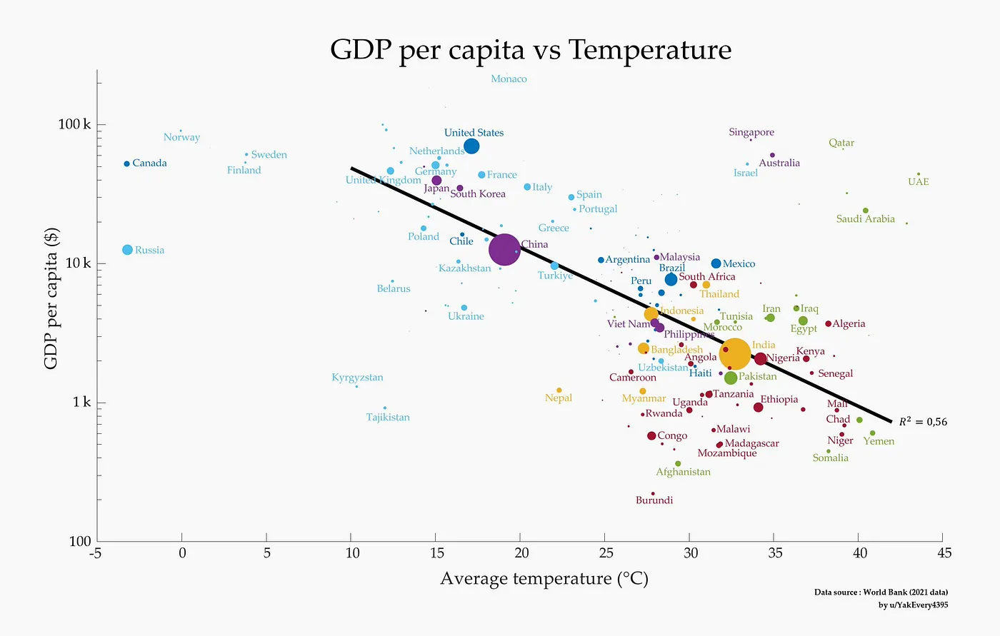

Grafik, kişi başına düşen milli gelirle bir ülkenin ortalama sıcaklığının nasıl bir arada gittiğini gösteriyor ve ortaya garip bir tablo çıkıyor. Hava ısındıkça, kişi başına düşen gelir genelde düşüyor. Gel bu bağlantıya ve arkasında nelerin yatabileceğine beraber bakalım.

## Grafiğin anlattığı şey

Grafik, kişi başına düşen gelirle ortalama sıcaklık arasında net bir negatif korelasyon olduğunu gösteriyor. Aşağı doğru inen trend çizgisinde bunu görüyorsun zaten. Yani ortalama sıcaklığı daha yüksek olan ülkelerin kişi başına düşen geliri çoğunlukla daha düşük.

Veriler Dünya Bankası'ndan (2021). Her baloncuk bir ülkeyi temsil ediyor ve baloncuğun büyüklüğü orada kaç kişinin yaşadığını gösteriyor. Yani sadece bir ülkenin ne kadar zengin olduğunu değil, bu trendin içinde kaç insanın yer aldığını da görüyorsun.

Ülkeler belli gruplara ayrılıyor. Norveç, Kanada, İsveç ve Finlandiya'da kişi başına düşen gelir yüksek ve ortalama sıcaklıklar 10°C'nin altında. Amerika, Almanya ve Fransa ortalarda yer alıyor; 10 ila 20°C civarında ılıman sıcaklıklara ve yine yüksek bir kişi başına düşen gelire sahipler. Ortalama sıcaklıkları 25°C'nin üzerinde olan Etiyopya, Nijerya ve Kenya gibi ülkelerde ise kişi başına düşen gelir çok daha düşük.

## Neden böyle olabilir?

Bunu açıklayabilecek birkaç neden var.

Biri tarım. Yüksek sıcaklıklar genelde tarlalardan daha az ürün alınması demek, çünkü aşırı sıcaklar ekinleri vuruyor ve su kıtlığı oluyor. Bu da ekonomisi büyük oranda tarıma dayanan birçok ülkenin birincil sektörüne darbe indiriyor.

Bir diğeri sağlık ve çalışma koşulları. Sıcak hava insanları hasta edebiliyor. Sıtma vakaları ve güneş çarpmaları artıyor, bu yüzden insanlar daha az çalışabiliyor ve sağlık masrafları katlanıyor.

Sonra ekonominin yapısı var. Sıcak ülkelerin çoğu gelişmekte olan ülkeler. Ekonomileri yeterince çeşitlenmiş değil, daha çok tarıma ve hammaddelere bağımlılar. Bunlar da iklim krizinin tam kalbinden vurduğu sektörler.

Enerji maliyetleri de var tabii. Sıcak ülkeler soğutma ve klima için daha fazla para harcamak zorunda kalabiliyor. Bu da insanların cebindeki harcanabilir parayı eritiyor ve ekonomik üretkenliği baltalıyor.

Tarih ve coğrafya da devasa bir rol oynuyor. Sömürgecilik, teknolojiye erişim ve bir yerin sunduğu avantajların hepsi önemli. Ilıman iklimli ülkeler sanayiye ve teknolojiye genelde erkenden kavuştu, bu da ekonomilerinin çok uzun süre büyümesini sağladı.

## Bu ne anlama geliyor?

Politika üretiyorsan veya ekonomi planlıyorsan, bu bağlantıyı çözmen şart. Yapılması gereken birkaç şeyi açıkça gösteriyor. Sıcak ve gelişmekte olan ülkelerin iklime dayanıklı altyapı ve tarım için paraya ihtiyacı var, böylece sıcağın verdiği zarar azalır. Tarıma bağımlı ekonomilerin başka sektörlere yayılması gerekiyor; bu hem kişi başına düşen geliri daha istikrarlı kılar hem de büyümesini sağlar. Daha iyi bir sağlık sistemi ve eğitim de en zorlu iklimde bile insanları daha üretken yapabilir.

Özetle bu grafik, ortalama sıcaklık arttıkça kişi başına düşen gelirin nasıl düştüğünü çok net ortaya koyuyor. Bu trendi besleyen çok fazla etken var, ama veriler sıcak bölgelerde büyüme için hedefe yönelik ekonomi politikalarının ve iklime uyum sağlamanın ne kadar hayati olduğunu gösteriyor. Bu sorunları anlar ve üzerlerine gidersek, tablonun gösterdiği bu ekonomik uçurumu kapatmaya yardımcı olabiliriz.

Kaynaklar

World Bank Data (2021)
Analiz: u/YakEveryr3395

Bu genel bir bakış. Daha kesin planlamalar ve politikalar için her ülkeyi ayrıntılı incelemek gerekir.
