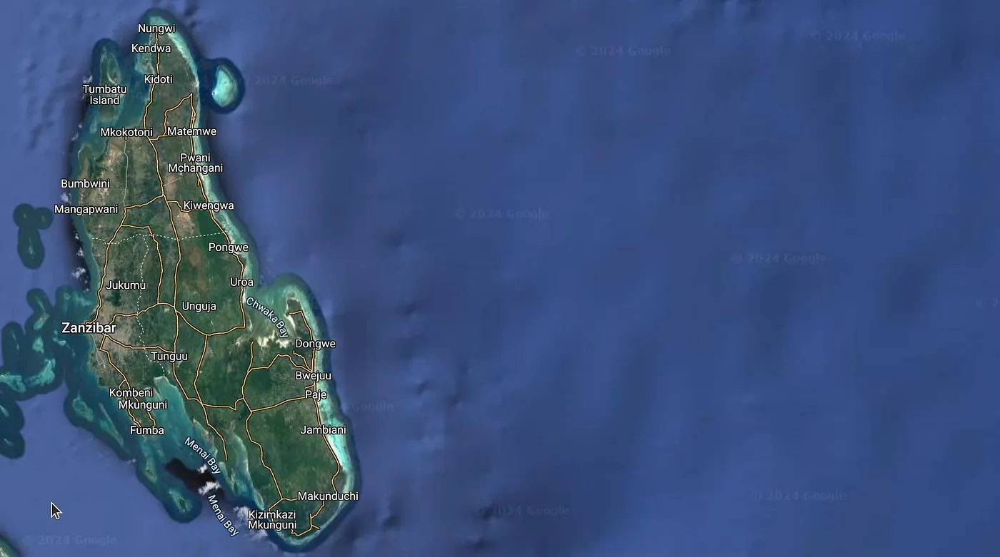

Yabancıların Zanzibar'da nasıl arsa alabileceğine dair güncel bir rehber bu. Kurallar değişti. İster bireysel yatırımcı ol ister gayrimenkul geliştiricisi, işlerin şu an nasıl yürüdüğünü bilmen şart.

Burada iki tip yatırımcı var: Bireysel yatırımcılar ve gayrimenkul geliştiricileri.

## Bireysel yatırımcılar

Kendine arsa almak istiyorsan, mesela bir lodge yapmak için, önünde iki ana yol var.

1. Seçenek bir şirket kurmak. Çoğunluk hissesi Zanzibar yerlisi bir ortakta olan yerel bir şirket kuruyorsun. Şirket arsayı kendi adına satın alıyor ve tapuyu alıyor. Bu tapu daha sonra yabancı ortağa devredilebiliyor. Böylece arsa sahibi olmak için yasal bir çerçeven oluyor ve ileride satmak istediğinde işin çok daha kolaylaşıyor.

2. Seçenek doğrudan satın almak. Yabancılar kendi adlarına da arsa alabiliyor ama sınırları iyi bilmek lazım. Tapuyu kendi adına çıkartabilirsin. Fakat iş satmaya gelince tıkanırsın, çünkü sadece Zanzibarlı bir yerliye satabilirsin. Yani daha fazla yatırım yapmak ya da ileride elden çıkarmak istiyorsan bu seçenek pek esnek değil.

## Bireysel alıcılar için adım adım rehber

Bir lodge ya da benzeri bir şey yapmak için arsa alacaksan, izleyeceğin adımlar şunlar:

1. Adım, doğru yeri bul. Turistlerin sevdiği ya da hala büyüme potansiyeli olan Jambiani, Paje veya Stone Town gibi bölgelere bak. Piyasanın nereye gittiğini ve mülklerin gerçek değerini araştır ki kararlarını sağlam verilere göre ver.

2. Adım, arsanın durumunu kontrol et. Zanzibar Yatırım Teşvik Ajansı'na (ZIPA) ve yerel tapu dairelerine sorup arsanın satışa uygun olup olmadığını öğren. Yapmak istediğin projenin, mesela bir lodge inşaatının, yerel imar planına uyduğundan emin ol.

3. Adım, şirket yolunu seçtiysen yerel bir şirket kur. Şirketi Zanzibar'daki İşletme Kayıt ve Ruhsatlandırma Kurumu'na (BRELA) kaydettir. Yerel ortağınla kimin neye sahip olduğunu ve kimin ne iş yapacağını netleştiren sağlam bir sözleşme yap.

4. Adım, satıcının arsanın gerçekten sahibi olup olmadığını doğrula. Bunu tapu dairesinden ya da yerel köy lideri olan Sheha üzerinden yapabilirsin.

5. Adım, satış sözleşmesini hazırla. İki tarafın da bilgileri, arsanın konumu ve büyüklüğüyle birlikte net bir tanımı, satış fiyatı, ödeme planı, tarafların ve şahitlerin imzaları sözleşmede yer almalı. Her şeyin yasalara uygun olması şart, bu yüzden yerel bir avukatla çalışmak çok iyi bir fikir.

6. Adım, evrakları onay için teslim et. Satışı resmiyete dökmek için sözleşmenin aslını ve kopyalarını, Sheha'dan alınan onay belgesini, satıcının tapusunu ya da sertifikasını, kimlik belgelerini, satıcının vergi borcu yoktur yazısını veriyorsun. Bir de damga vergisini (satış bedelinin %10'u) ve tapu devir vergisini (satış bedelinin %1 %'i) ödüyorsun. Evraklar Bölge Komiserliği Ofisi'ne, Değerleme ve Vergi Dairesi'ne ve Tapu Sicil Dairesi'ne gidiyor.

7. Adım, arsa yeniden kontrol edilir ve ölçülür. Hükümet yetkilileri gelip sınırları inceler. Bu işlem biraz uzayabilir, o yüzden işin peşini bırakma, sürekli takip et.

8. Adım, devir işlemi tamamlanır. İtirazı olan çıksın diye kamuya açık bir ilan verilir. İtirazları çözmek için belli bir süre tanınır. Sonunda 99 yıla kadar geçerli bir kiralama sözleşmesi (lease) alırsın. Ve tapu kütüğüne resmi kiracı/lehdar olarak kaydedilirsin.

## Gayrimenkul geliştiricileri

Gayrimenkul geliştiricilerinin yaptığı gibi daha büyük çaplı yatırımlar çok daha belirli bir prosedürü takip eder.

Geliştiriciler, Zanzibar Yatırım Teşvik Ajansı'ndan (ZIPA) bir Yatırım Sertifikası almak için başvurur. Şirketlerinin %100'üne sahip olabilirler ve arsa 99 yıla kadar kiralanır.

Gayrimenkul ve otel projelerinde minimum yatırım tutarı 2,5 milyon dolar. Diğer sektörlerde ise bu rakam çok daha düşük, 300.000 dolar.

Önce ZIPA'nın Yatırım Niyet Formu'nu doldurup projeni anlatan bir konsept özeti veriyorsun. Detaylı başvurunu teslim ederken 200 dolarlık geri ödemesiz bir harç ödüyorsun. Proje onaylandığı anda Yatırım Sertifikanı alıyorsun. Sermaye yatırımını tamamen tamamlayana kadar da bu sertifikayı her yıl yeniliyorsun.

## Piyasa nereye gidiyor?

Zanzibar'ın gayrimenkul piyasası yükselişte, bunun da birkaç net sebebi var:

Kira getirileri gayet yüksek. Zanzibar, kira getirisi açısından Afrika şehirleri arasında 7. sırada. Gittikçe daha fazla turist ve expat yazlık ya da uzun dönemli ev kiralamak istiyor.

Turizm büyüyor. Her yıl adayı milyonlarca insan ziyaret ediyor. Haliyle tatil evlerine ve konaklama tesislerine aralıksız bir talep var. Mülk yatırımcıları için müthiş bir fırsat.

Hükümet piyasayı destekliyor. "Altın vize" (Class C11 oturum izni) veriyorlar. ZIPA onaylı bir projeden en az 100.000 dolarlık mülk alırsan, sen ve çekirdek ailen oturum izni alabiliyorsunuz.

İnanılmaz bir inşaat faaliyeti var. Şu anda Zanzibar'da devam eden yaklaşık 50 proje var. Bu da yatırımcıların bu pazara ne kadar güvendiğini gösteriyor. Lüks yaşama odaklanan Fumba Town ve Blue Amber Resort bunlardan sadece ikisi.

Diğer yerlere kıyasla ucuz. Zanzibar'daki fiyatlar Dubai ve Mauritius gibi oturmuş turizm merkezlerine göre hala çok daha düşük. Bu da fiyatların zamanla artacağını öngören ve getiri peşinde olan yatırımcıları çekiyor.

## İşi zorlaştıran ne?

Tabii ki sıkıntılar da var.

Bürokrasi hantal olduğu için tapu senetlerini ve oturum izinlerini almak can sıkıcı derecede uzayabiliyor. Zanzibar daha fazla yabancı yatırım çekmek istiyorsa bu süreci hızlandırmak zorunda.

Rakipler var. Mauritius ve Seyşeller benzer bir doğaya sahip ama onların kuralları genellikle çok daha oturmuş durumda ve yatırım yapmayı kolaylaştırıyor.

Bir de işin ekonomik boyutu var. Tanzanya istikrarlı bir şekilde büyüdü ama yaşanacak herhangi bir dalgalanma yatırımcı güvenini sarsıp piyasayı anında etkileyebilir.

## Özetle

Zanzibar'da gayrimenkul hem bireysel yatırımcılar hem de büyük geliştiriciler için çok ciddi bir fırsat. Yasal çerçeveyi anlar ve adımları doğru takip edersen, süreç çok daha rahat ilerler ve yerel kuralların dışına çıkmamış olursun.

Zanzibar bir yandan altyapısını güçlendiriyor, yollar yapıyor, bir yandan da turistler için giderek daha cazip hale geliyor. Sektörün kalıcı ve sağlıklı bir şekilde büyümesi için herkesin oturup kuralları daha iyi hale getirmek üzere birlikte çalışması şart.

Zanzibar'a yatırım yapma konusunda daha fazla yardıma ihtiyacın olursa bir avukatla konuş ya da doğrudan ZIPA ile iletişime geç.

Zanzibar'a taşınmak veya burada yatırım yapmakla ilgili ücretsiz danışmanlık almak için Emin Mahrt ile iletişime geçebilirsin:

- Telefon +255775585555
- Telegram [@eminoemino](https://markdown-to-medium.surge.sh/t.me/@eminoemino)
- E-posta emin@emin.de

Kaynaklar: [1] [https://www.ippmedia.com/the-guardian/business/read/revolutionising-real-estate-investment-in-zanzibar-with-innovative-approach-2024-06-06-170441](https://www.ippmedia.com/the-guardian/business/read/revolutionising-real-estate-investment-in-zanzibar-with-innovative-approach-2024-06-06-170441) [2] [https://www.thecitizen.co.tz/tanzania/news/national/shock-waves-hit-zanzibar-s-nascent-real-estate-industry-3951880](https://www.thecitizen.co.tz/tanzania/news/national/shock-waves-hit-zanzibar-s-nascent-real-estate-industry-3951880) [3] [https://www.zanzibarluxproperties.com/post/the-growth-and-promise-of-zanzibar-s-real-estate-market](https://www.zanzibarluxproperties.com/post/the-growth-and-promise-of-zanzibar-s-real-estate-market) [4] [https://www.thecitizen.co.tz/tanzania/zanzibar/zipa-warns-of-illicit-foreign-land-acquisition-unregulated-bnbs-4750038](https://www.thecitizen.co.tz/tanzania/zanzibar/zipa-warns-of-illicit-foreign-land-acquisition-unregulated-bnbs-4750038) [5] [https://www.ardeanlawchambers.co.tz/2023/01/28/land-for-investment-and-doing-business-in-zanzibar/](https://www.ardeanlawchambers.co.tz/2023/01/28/land-for-investment-and-doing-business-in-zanzibar/) [6] [https://www.tanzaniainvest.com/construction/realestate/acquiring-land-in-zanzibar](https://www.tanzaniainvest.com/construction/realestate/acquiring-land-in-zanzibar) [7] [https://zanzibaba.com/blog/-can-foreigners-buy-land-in-zanzibar--a-comprehensive-guide-for-investors](https://zanzibaba.com/blog/-can-foreigners-buy-land-in-zanzibar--a-comprehensive-guide-for-investors) [8] [https://www.edenlawchambers.co.tz/2024/08/05/zanzibar-real-estate-and-property-purchase-comprehensive-guide/](https://www.edenlawchambers.co.tz/2024/08/05/zanzibar-real-estate-and-property-purchase-comprehensive-guide/)
