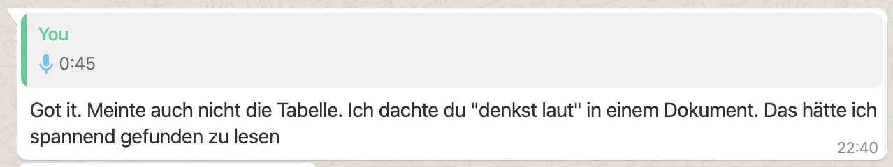
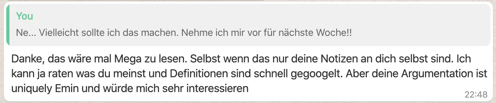
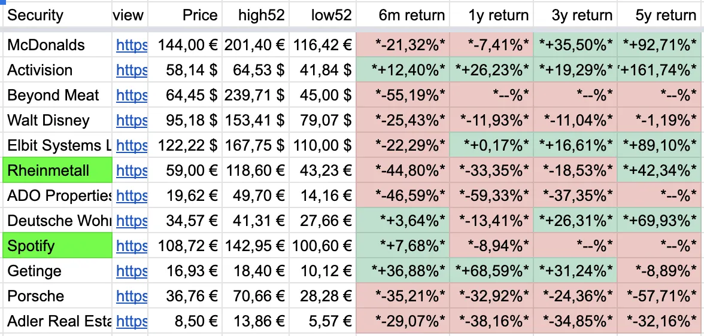
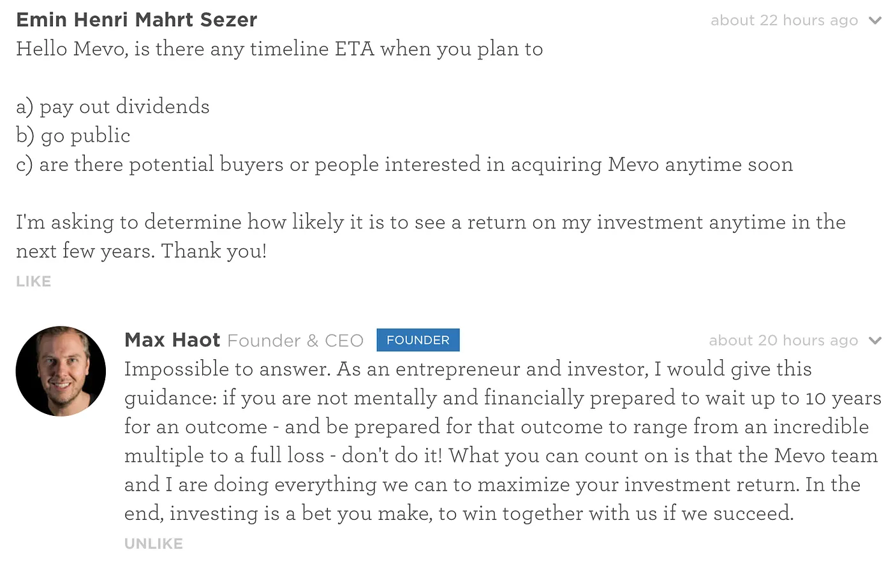
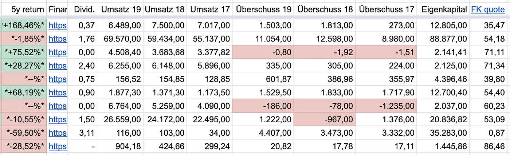

# 2020 Başlıyoruz, Korona Dönemi Yatırım Günlüğüm ve İlk Yatırım Deneyimim

## Giriş, Pazartesi, 30 Mart 2020, 12. Gün

Bu yazı, yakın arkadaşım Frederik Eichelbaum ile yaptığım kısa bir sohbetten doğdu. Yatırımlarla ilgili düşüncelerimi yazmamı ve bunları çevremle paylaşmamı önerdi.

Kısacası, "sesli düşünmemi" ve fikirlerimi bir metne dökmemi söyledi. Fikir hoşuma gitti; şu an okuduğunuz bu doküman da tam olarak bu yüzden var.

## Salı, 31 Mart 2020, 13. Gün

Özel bir hisse senedi portföyü yönetmeye başladığımın ilk günü. Trader değilim, bu yüzden inandığım ve önümüzdeki 5 ila 10 yıl içinde değerleneceğini düşündüğüm şirketlere odaklanıyorum. Özetle, 10 yıl sonraki değerlerinin bugünkünden daha yüksek olacağını öngörüyorum.

Bugün **Visa**, **Mastercard** ve **Altın** aldım. Hafta sonu ise **Berkshire Hathaway** (bir fon), **Lenovo** ve **Getinge** almaya karar vermiştim.

Seçimlerimin nedeni basit. İlk olarak son 3, 5 ve 10 yıllık grafiklerine bakıyorum. Grafik birkaç küçük iniş çıkışla istikrarlı bir şekilde yukarı gidiyorsa, o şirketin mevcut Korona krizini atlatacağına ve birkaç hafta içinde eski fiyatına döneceğine inanıyorum. Geçtiğimiz ay tüm hisseler %10-15'ten fazla değer kaybettiği için, beklediğim minimum getiri önümüzdeki birkaç yıl içinde bu kaybı telafi etmek. Ayrıca hisselerin 3 ve 5 yıllık performanslarını da kontrol ediyorum. Bu temel olarak grafiğe bakmakla aynı şey olsa da yüzde değerlerini görmek kıyaslamayı kolaylaştırıyor. Bu sayıları hızlıca karşılaştırabileceğim küçük bir tablo hazırladım, şöyle görünüyor:

Tabloya bakınca onu yorumlamak için iki seçeneğim var. Bir şirket derin kırmızıdaysa, diplerden toparlanma ve yükselme potansiyeli olabilir. Ancak 3 ve 5 yıllık getiriler daha ilgi çekici. Hisselerimi en az 3 yıl tutmayı planlıyorum, bu yüzden 3 ve 5 yıllık getirisi iyi olan her hisse benim için cazip. Bazı hisseler ise çok yeni; burada önümüzdeki 5 yıl içinde büyük bir oyuncu olabileceklerine dair hislerime güvenmek zorundayım. Bu şirketler daha riskli ama kazanç potansiyelleri de bir o kadar yüksek.

Neden **Visa** ve **Mastercard** aldım? Dijital ödemelerin önümüzdeki on yıl boyunca, hatta kalıcı olarak durdurulamaz bir şekilde büyüyeceğine inanıyorum. Yakında herkes akıllı telefonuyla veya temassız kredi kartıyla ödeme yapacak. Mastercard ve Visa her yerde var; gelecekleri kesinlikle parlak ve piyasaya yeni oyuncuların girmesi kolay olmadığı için çok güçlü bir konumdalar. Ayrıca bu, Bitcoin ve kripto paralara karşı da bir koruma. Grafiklerine baktığınızda her hisse gibi bir "Korona darbesi" yediler ama geçmiş performansları ve getirileri harika. İkisini de almak benim için çok kolay bir karardı, portföyüme **PayPal** ve **American Express**'i de ekleyebilirim. Keşke **UnionPay** (Çin kartları) borsada işlem görseydi, onu da kesin alırdım.

Neden altın aldım? Altının düşük büyüme oranına sahip ama oldukça istikrarlı bir varlık olmasını umuyorum. Planım, Euro'yu banka hesabımda boş yere tutmamak. Her şey, değer kazanma ihtimali gerçekçi olan varlıklara yatırılmalı. Euro zamanla değer kaybedecek. Altın, on yıllardır istikrarlı olan ve değerini sürekli koruyan en bilindik varlık. Bankadaki Euro'larımı tutmak yerine nakit varlıklarımın en az %10'unu altına yatırmayı planlıyorum. Altının da 2008 finansal krizinde olduğu gibi %30 değer kaybedebileceğinin farkındayım, ancak uzun vadede altın her zaman Euro'yu veya Bitcoin dışındaki diğer tüm para birimlerini geride bırakacaktır.

Berkshire Hathaway almamın tek sebebi, Warren Buffet'ı ve onun değer yatırımı stratejisini gerçekten beğenmem. Gerçek değer yaratan, olması gerekenden ucuz olan, büyüyecek ve uzun yıllar varlığını sürdürecek şirketler arıyor. Adam bu yıl 90 yaşına giriyor, bir sürü röportajını okudum, videolarını izledim ve fonunu iyi yöneteceğine güvenim tam. Fonun performansı ve grafiği de iyi görünüyor, diğer tüm fonlar ve hisseler gibi %30 çakıldı ama bu adamın bir geri dönüş yapacağına dair inancım var. Ölürse hisseleri satmayı düşünebilirim ama umarım bu yakın zamanda olmaz!

Lenovo hissesi alma sebebim ise şu: Lenovo'yu inceledim ve grafikleri pek iyi görünmüyor. Bazı web siteleri Lenovo'nun mevcut fiyatıyla oldukça değersizleştirildiğini söylüyor ve bence haklılar. Kendime ait bir Thinkpad laptopum ve bir Motorola telefonum var, ikisi de harika. Pazarlama da iyi ve şirket sürekli olarak gelirini ve kârını artırıyor. Hisse fiyatının neden sürekli düştüğünü anlamıyorum. Burada biraz daha araştırma yapmalıydım ama şu an için ürünlerini daha fazla insanın alabileceği bir noktaya geldikçe büyüyeceklerine güveniyorum. Umarım haklıyımdır!

Getinge'yi seçtim çünkü sağlık sistemine yatırım yapmak istedim. İsveçli bir şirket (ki bunu seviyorum) ve finansal büyümeleri çok sağlıklı. Kötü bir yılın ardından 2019'da çok iyi bir yıl geçirdiler. Borç/özsermaye oranına bakmayı seviyorum (Getinge'de %53 borç, %47 özsermaye, bu çok iyi bir oran). Her yıl milyarlarca dolar gelir elde ediyorlar ve sürekli büyüyorlar. Ancak karar vermemdeki en önemli faktör, 10 yıldan fazladır Getinge'de çalışan kardeşimle yaptığım konuşmaydı. Bana mutlu olduğunu ve Korona nedeniyle üretimi artıracaklarını söyledi. Şirket tıbbi ekipman üretiyor. Sevdiğim ve güvendiğim, ara sıra şirket hakkında ne düşündüğünü sorabileceğim birilerinin olduğu şirketlere yatırım yapmayı seviyorum.

## Çarşamba, 1 Nisan 2020, 14. Gün

Bugün pek bir araştırma yapmadım. 0.1 Bitcoin aldım (şu an 7 gündür her gün 0.1 Bitcoin alıyorum ve bir 7 gün daha devam edeceğim, çünkü Bitcoin halving'i ve Coinbase'de okuduğum [şu makale](https://blog.coinbase.com/on-crypto-markets-and-bitcoins-value-proposition-2fbbca5349dd) yüzünden bu yılın Bitcoin için çok büyük olabileceğine inanıyorum). Her gün bir hisse senedi alma sözü verdiğim için bir süredir istek listemde olan Amazon ile devam etmeye karar verdim. Amazon tam bir çılgınlık; sadece e-ticaret değil, sattıkları sunucular ve yazılımlar da öyle. Sürekli büyüyorlar ve önümüzdeki on yıl boyunca da büyümeye devam edeceklerine inanıyorum. Portföyümde ağırlıklı olarak ABD şirketleri olduğu için, aynı miktarda Alibaba hissesi de aldım. Çin pazarı için Amazon ile benzer bir yolda ilerliyor gibi görünüyor.

## 2 Nisan 2020, Perşembe, 15. Gün

Bugün birkaç saat dışarıda yürüdüm ve borsanın şu anki durumu üzerine kafa yordum. Sebebi, sabah uyanır uyanmaz [okuduğum bir makaleydi](https://m.onvista.de/news/ist-die-millennial-generation-zu-optimistisch-gegenueber-dem-aktienmarkt-344084129). Yazının ana fikri şuydu: Genç yatırımcı nesli, önümüzdeki aylar (ya da yıllar) ve borsada yaşanabilecek olası bir resesyon konusunda fazla iyimser olabilir. Yazar; 2002, 2008 ve 1929 krizlerinde, portföylerin üst üste defalarca %30 değer kaybettiği o dönemlerin nasıl bir his olduğunu çok güzel anlatmış. Mesela 1929 krizinin başında 15.000 USD yatıran birinin elinde, başlangıç parasının yarısından azı kalmış. Buna karşılık, yıllar boyunca her ay düzenli olarak 100 USD yatırmaya devam edenlerin portföylerinde %50 artış olduğunu örnek vermiş. Bu krizin dünya ekonomisini ne kadar sert vuracağı benim için hâlâ net değil. Piyasanın toparlanıp toparlanmayacağını, düşmeye devam mı edeceğini yoksa uzun süre yerinde mi sayacağını önümüzdeki birkaç ay gösterecek. Yine de bu senaryo beni korkutmuyor. Aksine, almak istediğim her hissede en dip noktayı yakalayıp kârımı nasıl artırırım diye düşünüyorum. Mastercard'a bakıyorum (dün ilk yatırımımı yaptığımdan beri bugün %10 düştü), duygusal davranıp "maliyet düşürmek" ve gelecekte daha çok kâr etmek için biraz daha almayı bile düşündüm. Diğer yandan yazar haklı olabilir, sabırlı olmak dibi ıskalama riskine karşı iyi bir korunma yöntemi. Bu yüzden en başta günde sadece tek bir hisse almaya karar vermiştim (gerçi başladığımdan beri açgözlülüğüm yüzünden bu kuralı birkaç kez çiğnedim). Son 15 günde 22 hisse aldım. Kendime verdiğim sözü tutmak için biraz yavaşlayacağım ve tekrar alım yapmadan önce birkaç gün bekleyeceğim.

Bugün Pfizer da aldım. Sağlık ve ilaç sektörüne yatırım yapmak istiyordum; en bilinen markaların ve ilaçların çoğu Pfizer'ın elinde. Son 5 yıllık performansları pek iç açıcı değil ama [SimplyWallst'taki analistler](https://simplywall.st/stocks/de/pharmaceuticals-biotech/etr-pfe/pfizer-shares) hissenin değerinin çok altında olduğunu söylüyor. Şirketin fiyatı 5 yıl önceki seviyelere kadar düştü ve daha da aşağı gideceğini sanmıyorum. Bir artısı da %4,79'luk yüksek temettü verimi; yani kazançlarına oranla yatırımcıya iyi ödeme yapıyorlar. En kötü ihtimalle, bu hissenin önümüzdeki birkaç yıl boyunca ne çok kaybettireceğini ne de çok kazandıracağını, yatay seyredeceğini düşünüyorum. Ama sağlık sektöründeki yüksek talep nedeniyle büyüme şansları bana çok mantıklı geliyor. Pfizer almaya karar verince aklıma Bayer de takıldı. Monsanto hamleleri çok zekice. Monsanto hakkında bir şeyler okudum ve ne kadar "kötü" ama bir o kadar da zeki bir şirket olduklarını uzun uzun düşündüm. Bayer'in Alman olması da hoşuma gidiyor, işleri bir şekilde yoluna koyacaklarına güveniyorum. 5 yıllık grafikleri korkunç ama 10 yıllık grafik ciddi bir yükseliş potansiyeli vaat ediyor. Nereye baksam uzmanlar da aynı fikirde, hissenin değerinin altında olduğunu düşünüyorlar. Eğer ABD'de Monsanto ile bir anlaşmaya varırlarsa, gelecekteki işlerine daha çok odaklanırlar ve etraflarındaki haber akışı düzelir. Bu da bireysel yatırımcıları çeker ve hisseyi uçurur diye inanıyorum (sürekli "inanıyorum" yazmayı bırakabilirim aslında ama sonuçta burada yazdığım her şey benim inancım, o yüzden kendimi tekrar etmeye devam edeceğim).

Ayrıca iyi yatırım fikirleri bulmak için biraz beyin fırtınası yaptım. İnternette sörf yaparken potansiyeli olan markaları ve pazarları her gün düşünüyorum. Gıda pazarı çok ilginç. Badem gibi kuruyemişler üzerine uzmanlaşmış şirketler bulmaya çalıştım ama Google'a birkaç anahtar kelime yazınca karşıma düzgün bir şey çıkmadı. Bu düşünce deneyi beni Danone, Unilever, Nestle gibi dev oyunculara ve dünyanın diğer büyük atıştırmalık üreticilerine yönlendirdi. Bazılarını takip listeme (watchlist) ekledim. Genel olarak takip listem hâlâ biraz karışık. Bir fikir aklıma gelir gelmez hisseyi aratıp kaydediyorum. Her hisseyi hemen derinlemesine incelemiyorum, orada öylece duruyorlar. Eğer bir hisse üst üste birkaç kez aklıma düşerse, rakamlarına ve haberlerine (Google ve Investfolio gibi uygulamalar üzerinden) daha dikkatli bakmaya başlıyorum. Dünyanın her yerinde güvenlik personeli sağlayan ve 1934'ten beri var olan İsveçli Securitas'ı yine düşündüm. Pfizer gibi o da değerinin çok altında görünüyor (son 5 yıldır yatay gitmesine rağmen fiyatı şu an 5 yıl önceki seviyesinde). Securitas'ı düşünürken, konser ve etkinlikler düzenleyen Live Nation Entertainment yine aklıma geldi. Bu şirketin listemde olmasının tek sebebi, bir arkadaşımın Facebook'ta bunu tavsiye olarak paylaşması. Hissenin ilginç gelme sebebi ise şu: Çökmesinin tek sebebi Corona. Eğer iflas etmezlerse, geri dönecekler ve etkinlik düzenlemeye devam edecekler. Haliyle hisse de eski gücüne kavuşacaktır.

Bu metni yazarken arkadaşım Niko, Airbus'ı ortaya attı. Kriz başladığından beri düştükçe düşüyor. Aslında kısmen devlet ortaklı (ABD tarafı da var) ve savunma sanayii ile havacılık için kritik öneme sahip. Hükümetin Airbus'ın düşmesine izin vermemesi, onları kurtarması çok muhtemel, sistem için fazla önemliler. Son 10 yıllık grafiği ise tek kelimeyle şahane. Airbus'ın eski gücüne döneceğine dair bahis oynamak mantıklı. Sadece 1 yıllık getirisine bakınca %50'den fazla ekside; bu %50'lik fark, önümüzdeki birkaç yıl içindeki potansiyel yükseliş marjı demek. Bunları yazarken elim telefona gidiyor, hemen al emri vermek istiyorum ama kendime "dur" diyorum. Bu hisseyi almadan önce 5 gün daha bekleyeceğim, o sırada Excel tablolarım ve mevcut portföyüm üzerinde çalışacağım.

Not: 2013'ün başlarında Bitcoin alırken ne hissettiysem, bugün hisse alırken de aynısını hissediyorum ve bir şeyi fark ettim: Bir şeye finansal olarak yatırım yaptığınız an, ilginiz tavan yapıyor. Daha çok haber okuyor, daha çok dikkat ediyor ve bilgi sahibi oluyorsunuz. Yatırım yaptığınız şirketler hakkında adım adım daha fazla şey öğreniyorsunuz; hem onların pazarını hem de genel piyasayı tanıyorsunuz. Dışarıda yürürken beyniniz sürekli çalışıyor ve benzer ilgi alanları olan biriyle karşılaştığınızda hemen konuşmaya başlıyorsunuz. Otomatik olarak konuya sadık kalıyorsunuz ve bu süreklilik sizi daha bilgili ve özgüvenli yapıyor. Kaybetseniz bile, gelecekteki yatırımlarınız ve projeleriniz için yanınıza kar kalacak muazzam bir bilgi birikimi ediniyorsunuz. Daha çok merak ediyor, daha çok öğreniyorsunuz.

Son olarak, kitle fonlaması üzerinden şirketlere küçük miktarlarda özel yatırım yapmayı düşünüyorum. Üç şirket ilgimi çekti. İlki Estonya'da muhasebe ve sanal ofis hizmeti veren [Xolo](http://www.xolo.io) OU. Bu servisi kendim de kullanıyorum ve bayılıyorum. [funderbeam.com](http://www.funderbeam.com) üzerinden yatırım yapma seçeneğini görünce 2000 Euro yatırdım. Funderbeam, likidite sınırlı olsa da elinizdeki hisseleri satabilmeniz için entegre bir platform da sunuyor. Bu özellik çok hoşuma gitti, hemen Funderbeam OU'nun (platformun kendisi) kendisine de yatırım yapmayı düşündüm.

Araştırmalarım sırasında [Mevo](https://mevo.com) adında bir canlı kamera şirketi gördüm. Onlar da [wefunder.com](https://wefunder.com/mevo/ask) üzerinden fon topluyor. Kötü tarafı, bu platform aldığınız hisseleri tekrar satmanıza olanak sağlamıyor. Yani bu yatırım, şirketin halka açılmaması veya satılmaması durumunda muhtemelen tüm paranızı kaybedeceğiniz 10 yıllık büyük bir kumar. Sorum üzerine CEO'dan şu cevabı aldım:

Bu cevabın ardından, girişimlerini desteklemek için 1000 USD yatırım yapabilirim ve önümüzdeki 10 yıl içinde halka açıldıklarını görmeyi umabilirim. Hoşuma gitmeyen bir şey, CEO ve Kurucu Max Haot'un Mevo için sadece yarı zamanlı çalışması ve zamanının çoğunu yeni bir girişime (küçük uydular için mini roketler gönderme) ayırması. Birkaç yıl önce Mevo'nun erken bir versiyonunu satın almıştım, hiç gerçekten kullanmadım ama kullandığımda genel olarak ürünlerini beğendim. Genel olarak borçları ve satışları pek iyi görünmüyor ama canlı yayın bir trend olursa, bu şirket yükselebilir, özellikle de platform ve domain olan livestreaming.com'a da sahip oldukları için, ki bu da Max Haot tarafından kurulmuş ve Mevo kameralarını da tanıtıyor. Ayrıca, "Livestream camera" diye Google'da aratırsanız, Mevo ve Livestream.com ikisi de son derece üst sıralarda çıkıyor. Satış hedefleri gerçekçi görünüyor ama başarısız olurlarsa, tüm şirket büyük ihtimalle çökecek ve batacak.

İkinci sırada Koawach var, guarana ile içecek çikolatası üreten ve ürünlerini (esas olarak) Alman pazarında satan bir şirket. Zaten çok para topladılar ve değerlemeleri oldukça yüksek. Kullandıkları platform econeers.de ve yatırım modeli Wefunder ve Funderbeam'den farklı. Yatırımda yıllık %7 getiri sunuyorlar. Rakamlarına bakınca finansallarının da pek iyi olmadığını hissediyorum ama yine de, onlarınki gibi alternatif gıda ürünlerinin başarılı olma ve büyüme şansının iyi olduğuna inanıyorum. Bazı TV kanallarıyla yapılan anlaşma sayesinde pazarlamaları büyük, marka iyi tanınıyor ve bildiğim kadarıyla birçok bilinen süpermarkette satın alabiliyorsunuz. Mevo ile aynı şekilde, Koawach da büyük ihtimalle zararla sonuçlanacak 10 yıllık bir bahis olacak. Alman ismi (wach / uyanık) nedeniyle, Almanca konuşulan bölgelerin dışında büyüyemeyeceklerini düşünüyorum, bu yüzden büyümeleri sınırlı. Yatırım yaparsam, 1000 USD'den fazla bahis koymayacağım.

Öğleden sonra Adobe aklıma geri geldi. Adobe, geçmişten bildiğim bir marka, dünyanın her yerinde milyonlarca tasarımcı tarafından kullanılan Adobe Photoshop veya Indesign gibi sektör lideri yazılımlar üretiyorlar. 5 ila 10 yıl önce tekliflerini bulut ve abonelik tabanlı bir programa geçirmeyi başardılar ve profesyonellik yıllarımda olumlu gelişimlerini fark ettim. Bugün yüz binlerce şirket onların yazılımını kullanıyor. İnternette tonlarca ücretsiz öğrenme materyali var ve okullar ile üniversiteler onların programlarını öğretiyor. Adobe o kadar sağlam bir konuma sahip ki önümüzdeki on yıl içinde, ya da hiçbir zaman, yok olmaları çok düşük bir ihtimal. Böyle yazılımlar hakkında düşünürken profesyonel bir kreatif olan bir arkadaşımla görüştüm ve o da Autodesk veya Avid gibi markalar önerdi. Ayrıca Maxon, Ableton, Black Magic Design, Imageline, Universal Audio, The Foundry, Brainworx, Rubber Monkey ve diğerleri gibi borsada işlem görmeyen ama aynı yapıya uyan birden fazla şirket saydı. Bazı borsa uzmanlarıyla bir YouTube videosu izlediğimi de hatırlıyorum, onlar da sektör standardı olarak kullanılan yazılım programlarının kendileri için çok ilginç olduğundan bahsetmiş

## Cuma, 3 Nisan 2020, 16. Gün

Bu sabah aklıma ilk gelen türlü türlü şirketlere bakarak yatakta epey vakit geçirdim. Onları Yahoo Finance takip listeme eklemeye başladım, bazılarını da "alım listeme". Bugün almayacağım, ilk alım yine gelecek hafta Pazartesi ya da Salı olacak. Genel olarak ek temel verilerle kendimi çok daha iyi bilgilendirmek istiyorum. Maalesef kullandığım uygulamaların hiçbiri (SimplyWallst, ARD Boerse, Yahoo Finance, Google Finance) ihtiyacım olan tüm bilgiyi tek sayfada vermiyor. Kendimi tekrar ediyor olabilirim ama beni en az 5 yıllık geçmiş performans, gelir, büyüme, kâr, borç ve temettü ilgilendiriyor. Oldukça basit şeyler ama hiçbir uygulama bunu tek sayfada net ve basit göstermiyor, bu yüzden sayfalar arasında mekik dokumam ve kendi tablomu oluşturmam gerekiyor. Kendi tablonu kurmanın kötü yanı, zaman alması. Bir sürü veriyi otomatik çekebiliyorsun ama eksik parçaları elle eklemek zorundasın. Yeni bir veri noktası eklemeye karar verdiğinde, diğer tüm girdileri de güncellemen gerekiyor, bu da yorucu ve zaman alıcı olabiliyor (Örnek: geçenlerde listemdeki her şirkete **borç oranı** ekledim; şirketin öz sermayesine göre yüzde kaç borcu olduğunu gösteriyor). Fremdkapital/borç oranı en sağda:

Arkadaşım Vinzent'le sohbet ederken bana her firmadan kaç hisse alacağımı sordu. Buradaki cevap oldukça basit, şu an her hisseye aşağı yukarı aynı miktarı yatıracağım. Hedefim yaklaşık 50 hisseye sahip olmak, her biri portföyümün ortalama %2'sini oluşturacak. Zamanla hisseleri değiştirmeye başlayacağım; ya portföyümdeki başka bir hisseyle takas ederek (bu o hisseyi portföyümde ~%4'e çıkarır) ya da henüz portföyümde olmayan yeni bir hisse alarak. Başta yüksek temettülü hisselere odaklanmayı planlıyordum ama favori şirketlerimden bazılarının kârlarını temettü olarak dağıtmak yerine yeniden yatırmayı tercih ettiğini fark ettim. Bunun kötü bir şey olduğunu düşünmüyorum. Kârı elde tutup yeniden yatıran şirketler bence uzun vadede büyümeye ve sağlıklı kalmaya daha yatkın. Kendi şirketimi de aynı şekilde yönetirdim; kârı ortaklara dağıtmak yerine elinde tutup işine yeniden yatırırdın. Bir şirket tüm kârı temettü olarak dağıtıldığı için büyümek adına borca girmek zorunda kalıyorsa, temettü almamayı ve borçsuz bir şirkete sahip olmayı tercih ederim. Yine de borç genel olarak kötü bir şey değil. Bir şirket dışarıdan çok para alabiliyorsa, bu aynı zamanda güvenilirlik işaretidir. Bu alandaki bankalar ve diğer oyuncular, yani borç verenler, kendi kontrollerini yaparlar ve ancak parayı faiziyle geri alacaklarına inanırlarsa borç verirler.

Bana neden Rheinmetall'e yatırım yaptığım da soruldu, çünkü işlerinin büyük kısmı savunma sanayisinde. Bu kararı vermek zamanımı aldı. Altyapıya, büyük bir oyuncuya, Almanya merkezli bir şirkete yatırım yapmak istedim çünkü portföyüm ağırlıklı olarak ABD hisselerinden oluşuyor. Rheinmetall sürekli büyüme gösteren, Almanya merkezli ve yüz yıllık geçmişi olan şirketlerden biriydi. Listemde havacılık ve otomotiv de var, birçoğu da son derece kârlı savunma işine bulaşmış durumda, burada gözlerimi kapatamam. Bilgi edinmek ve bu şirketlerin ne yaptığının farkında olmak istiyorum; bu hisseleri daha sonra daha sürdürülebilir ve daha iyi olanlarla değiştirebilirim. Araştırmam ve sağduyum bana bir sürü şirketin elinin kirli olduğunu söylüyor. Büyük ilaç şirketleriyle başlıyor; havacılık, otomotiv ve hammaddeyle devam ediyor. Neredeyse her sektörde yüksek kârlı işlere bakmaya başladığında bataklığın dışında kalmak imkansız gibi bir şey.

***Aşağıdaki metin bir test, Google telefonuma konuşurken otomatik alınan döküm:***

Bunu ilk kez deneyeceğim, yazmak yerine Google Recorder kullanarak. Yine birkaç saati hisse haberlerini okuyarak geçirdim. Konuşmak yazmaktan çok daha zor. Yazarken sadece yazıyorum. Konuşurken ise konuşmadan önce düşünmem gerektiği hissine kapılıyorum, bu da her şeyi biraz yavaşlatıyor.

Bu sabah farklı hisselere bakıyordum. Takip listemdeki hisselerden biri Beyond Meat. Şirketi birkaç nedenden dolayı seviyorum. İlk neden, halka arzlarını geçen yıl yapmış olmaları. Gelirlerini artırarak birden fazla çeyrek geçirdiler. Geçen çeyrekten beri kâra bile geçtiler. Mevcut fiyat halka arz tarihindeki fiyatla aynı. Çok daha fazla insanın daha az et yemeye başlayacağına inanıyorum. Bu insanlar alternatifler arayacak. Beyond Meat'in çok iyi bir marka algısı var. Ve insanlar ürünlerini deneyecek. Ürünü denedim ve bence gayet güzel.

Birçok büyük satış noktası Beyond Meat ürünlerini satmaya başladı ya da satmayı planlıyor. McDonald's bile. Yine de Impossible Foods gibi rakipleri var; henüz halka açık değiller ama onlar da pazara giriyor. Fark ettiğim başka bir şey de, süpermarketlerde bilinmeyen her türlü markadan et alternatiflerinin türemeye başlaması (çoğunlukla tofu, soya ve bir sürü E katkı maddesi bazlı).

Yine de dağıtım ağları büyük bir artı. Dağıtımlarının ve satışlarının iyi olduğunu gösteriyor. Ayrıca Çin pazarına girmeye çalıştıklarını okudum, gerçi orada yakında yerel rakipler göreceğimizi ya da zaten olduğunu düşünüyorum.

Geleceği parlak ama değeri çok düşmüş şirketlere bakmayı seviyorum.

Biraz riskliler ama ucuz kalmış olma ile genç ve hızlı büyüme kombinasyonu gelecekte büyük bir potansiyel sunabilir. Ama tabii daha büyük kayıp riski de taşıyor.

Beyond Meat'e bakarken, analizimi yapmak için doğru araçları da hâlâ bulmaya çalışıyorum. Finansallarına bakmayı gerçekten sevmeye başladım. Geçmiş yıllarda gelir büyümesi ve artan kâr ya da azalan borç varsa bakmaya devam ediyorum, yoksa bırakıyorum. Şirketin borcu olup olmadığı beni ilgilendiriyor ve yavaş yavaş benim için önemli olan temel göstergeleri oturtmaya başlıyorum. Son üç haftada okuduğum birkaç makaleden ve konuştuğum birkaç kişiden fazla etkilenip etkilenmediğimden henüz emin değilim.

Portföyümdeki ilk alımlarıma geri dönüp baktığımda gelecekte farklı kararlar verebileceğimden de oldukça eminim. Hâlâ alım yapmamın nedeni, geçen iki haftada bu hisseleri almamış olsaydım kendimi eğitmek için bu kadar zaman harcamayacak olmam. Bu teoriyi daha önce de savunuyordum, hâlâ arkasındayım.

Bugün ve önümüzdeki üç gün içinde dört dörtlük bir takip listesi oluşturmak istiyorum. Ya da buna alım listesi diyelim. Tüm hisselerin olduğu bir liste. Her bir hisseyi analiz etmeye çalışacağım ve bu listeyi yaklaşık 25 hisseyle sınırlandıracağım. Alım listesindeki bir hisseden daha iyi bir tane bulduğumda, listedekini çıkarıp yerine o daha iyi olan hisseyi ekleyeceğim. Bu şekilde umarım yatırım yapılacak en iyi şirketler için doğal bir filtrem olur. Şu anda kararları hızlı veriyorum. Geçen iki haftaya baktığımda çok hızlı. Kendime günde sadece bir hisse alacağıma söz vermiştim ama sınırı çoktan aştım.

Hisse almak hızla bağımlılığa dönüşebiliyor. Bunu şimdiden görebiliyorum. Rakamların inip çıkmasını izlemek ilgi çekici ve yukarı gittiklerinde insan kendini iyi hissediyor çünkü doğru kararı vermişsin demektir.

Bu hisselerle ve rakamlarla aramda bir bağ olsa da o kadar da duygusal yaklaşmıyorum. Aldığım hisselerin ve tüm piyasanın bugünden itibaren yüzde 30-40, hatta yüzde 50 daha çakılabileceğini biliyorum. Yine de vazgeçmiyorum. Her hissenin önümüzdeki beş ila on yıl içinde eski seviyesine döneceği prensibine inanıyorum. Belki tüm zamanların en yüksek seviyesine çıkmaz ama en kötü ihtimalle korona çöküşünden önceki fiyatına gelir. Benimki de bir umut işte!

Sürekli kafamı kurcalayan bir şey var: şirketin menşei, yani hangi ülkeden çıktığı. Şirketin merkezinin nerede olduğu konusu. Portföyüme baktığımda şirketlerin çoğu ABD merkezli. Hem çeşitlilik olsun diye bunu gerçekten değiştirmek istiyorum hem de biraz Çin, belki Kore ve Japon markalarına ve hisselerine odaklanmayı çok istiyorum. Almanya'dan hisse almayı da seviyorum çünkü insanını, kültürünü ve pazarını bildiğimi hissediyorum.

Çin'de ise durum bambaşka. Hakkında hiçbir şey bilmediğin bir şirketi ya da markayı hissetmek, anlamak çok zor. Sadece sektöre bakabiliyorum. Geçmiş performansı, bilançoları falan gösteren geçmiş veriler var. Kararımı bunlara dayanarak vermek zorundayım. Bence bu çok iyi bir antrenman, çünkü bir markanın pazarlaması gözünü boyayamıyor. Starbucks hissesi aldığımda Starbucks'ın başarılı olacağına inanıyorum, çünkü markayı ezelden beri çok iyi biliyorum. Ama bu durum beni hızla yanlış bir karara da sürükleyebilir, çünkü daha önce hiç bilmediğim ve yeni keşfettiğim bir şirkette yapacağım gibi rakamları ve geçmişi o kadar detaylı incelemeyebilirim.

Gelecekte mutlaka yapmak istediğim bir diğer şey de yatırım yaptığım her şirketin rakiplerini tek tek not etmek. Bu çok önemli, çünkü rakipler satın aldığın şirketin kârını ve cirosunu elinden alabilir. Bir de artıları ve eksileri yazma alışkanlığı kazanmak istiyorum. Sadece o hisseyi aldığım için kendimi iyi hissettirecek güzel nedenleri değil, hisseyi neden almamam gerektiğine dair bir sürü sebebi de yazmalıyım.

Bu iş epey vakit alıyor, günün nasıl bittiğini anlamıyorsun bile ama bence şart. Bir şirkete 1000 ya da 2000 Euro gömüyorsan, satın almadan önce oturup en azından birkaç saatini o şirketi araştırmaya ayırmalısın.

## 9 Nisan 2020 Çarşamba, 22. Gün

Söz verdiğim gibi frene bastım, tempoyu düşürdüm ve hala da öyle devam ediyorum. Dün gece portföyüme bir hisse daha eklemeye karar verdim: TSMC, yani Taiwanese Semiconductor. Yıllar önce Bitcoin madencilik donanımları için ASIC çipleri üreten ana üreticilerden biri olarak keşfettiğim bir şirketti; aynı zamanda Apple'ın iPhone ve iPad işlemcilerinin bir numaralı üreticisi. Şirketi ve iş modellerini beğenip karar vermek benim için kolay oldu ama asıl önemlisi, finansallarına ve geçmiş büyümesine şu maddelerle daha detaylı bakmaya başladım:

1. Geçmişteki gelişim benim için önemli, bu yüzden grafiğin 5 yıllık ve tüm zamanlar haline bakıyorum. Grafik sağlıklı görünüyorsa, yani geçmiş yıllarda çılgın dalgalanmalar olmadan istikrarlı bir büyüme varsa, içim şimdiden çok rahat ediyor.
1. Yıllar içinde artan bir ciro ve mümkünse kâr görmek istiyorum.
1. Kâr marjı sadece yüzde 1 ila 4 arasında olan şirketler de hiç içime sinmiyor, bana pek sağlam bir iş gibi gelmiyor. Yüzde 20'ye yakın veya bunun üzerindeki her oran sağlıklı (ve akıllıca) görünüyor, böyle bir şirketin peşini bırakmam. Bu durum bir şirketin kesinlikle kârlı olması gerektiğini de gösteriyor. Şirket kâr etmiyorsa, yatırım yapmam için geleceğe dair çok özel ve güçlü beklentileri olması lazım. Biliyorum, özellikle çılgın büyüme oranlarına sahip genç şirketler başta genelde kâr etmez ama bence onlara yatırım yapmanın riski de aşırı yüksek.
1. Kendimi tekrarlıyor olsam da borç konusu çok önemli. Çılgınca borcu olan bir şirkete yatırım yapmak istemiyorum. İşi büyütmek için bazen kredi çekmenin mantıklı olduğunu anlıyorum ama borç dağları aşmışsa bir şeyler ters gidiyor demektir.
1. Temettüler... Bu konuda hala emin değilim. Temettülerin sevdiğim yanı, elimdeki hisseleri satmak zorunda kalmadan gelen parayla yeni hisselere yatırım yapabilmem. Bu gerçekten çok güzel bir şey ve hissenin kendi borsa primi dışında portföyü büyütmenin tek yolu. Yine de temettü dağıtmama kararı alan şirketler de aptal değil; o parayı kendilerine yatırım yapmak için kullanıyorlar, bunu da destekliyorum ve yadırgamıyorum.
1. Kısa vadeli getiriler (1 yıllık getiriler bile) zerre umurumda değil.
1. Şirketin değerlemesi benim için önemli. Bir şirketin ucuz mu yoksa pahalı mı olduğunu belirli bir formüle göre gösteren siteler var. Fiyatı ederinin çok altında kalmış şirketleri almayı seviyorum, gerçi bunu belirlemek için kullandıkları formülü anlamakta hala zorlanıyorum. Anlaması kolay olan tek şey, formüllerin çoğunun şirketin mevcut veya gelecekteki nakit akışına dayanması. Bir şirket ucuz kalmışsa, bunun sebebi gelecekte daha iyi nakit akışı yaratmasının ve hisse fiyatının artmasının beklenmesidir.
1. Fiyat/Kazanç oranı (F/K), **hisse fiyatını** **hisse başına düşen kâra** oranlayarak hesaplanan bir sayıdır. Bu oranın düşük olması daha iyidir.
1. PEG oranı (Fiyat/Kazanç Büyüme Oranı), **hisse fiyatının** şirketin **tahmini kâr büyümesine** oranını gösteren bir sayıdır. Rakam ne kadar düşükse o kadar iyi :)
1. Piyasa Değeri / Defter Değeri (PD/DD) güzel bir gösterge. Şirketin tüm hisselerine (piyasadakiler dahil) göre mevcut piyasa değerini hesaplar ve bunu şirketin defter değeriyle (kayıtlarında ne varsa, tüm varlıklar eksi yükümlülükler) karşılaştırır. Değerin düşük olması şirketin ucuz kaldığını gösterebilir, yüksek bir PD/DD oranı ise şirketin borsada defterindeki değerinden daha pahalı olabileceği anlamına gelir.
1. Gelir ve kârlılıkta gelecekteki büyüme (biliyorum tekrar ediyorum) çok önemli! Ve kâr marjı da fazlasıyla mühim!
1. Özkaynak kârlılığı, şirketin hisse satışlarından elde ettiği parayı iyi kullanıp kullanmadığını ve bu parayla daha yüksek kârlar elde edip edemeyeceğini (veya edip etmeyeceğini) gösterir.
1. Finansal sağlık: Borç/özkaynak oranı yüzde 60'ı geçmemeli. Bence iyi şirketlerin borcu ya çok azdır ya da hiç yoktur, tabii akıllıca yatırımlar yapmıyor veya yapmak istemiyorlarsa. Bu konuda sağlıklı bilgi bulmak da çok zor, tıpkı Bayer'in Monsanto'yu satın alması mevzusunda olduğu gibi.

Yukarıdakilerin çoğu TSMC tarafında gözüme gayet iyi göründü, ben de aldım.
