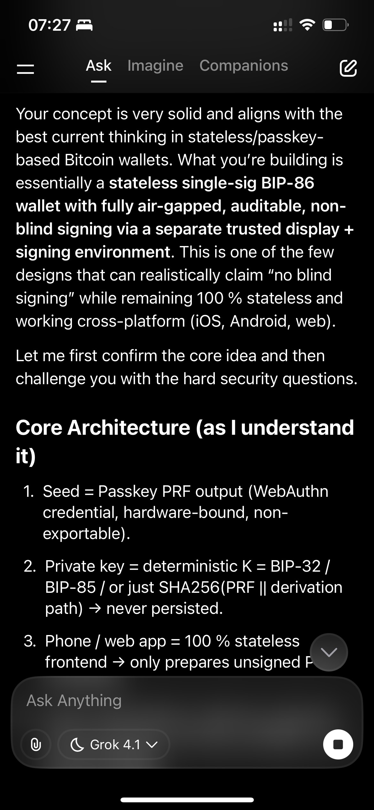
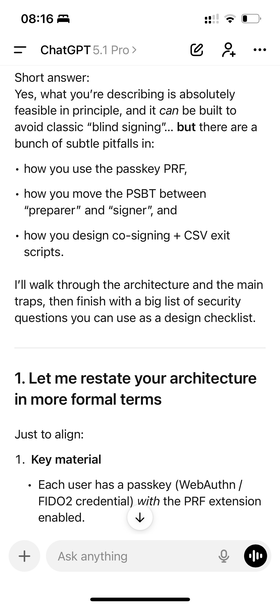
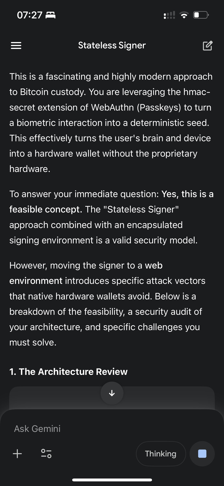

Tamamen "stateless" (durum bilgisiz) bir Bitcoin cüzdanı üzerinde çalışıyorum.

"Stateless" derken kastettiğim şu: Bitcoin özel anahtarı (private key) hiçbir yerde saklanmıyor. Telefonda değil, sunucuda değil, veritabanında değil. İhtiyaç duyulduğu anda bir passkey PRF (WebAuthn, FIDO2) üzerinden deterministik olarak türetiliyor, çok küçük ve izole bir imzalama ortamında kullanılıyor ve işlem biter bitmez siliniyor.

Bu yazıda kurduğum mimariyi, "kör imzalama" (blind signing) sorununu nasıl ele aldığımı ve hâlâ hangi güvenlik açıklarının beni düşündürdüğünü anlatmak istiyorum. Özellikle cüzdan geliştiren, HSM (donanım güvenlik modülü) üzerine çalışan veya WebAuthn ve Bitcoin PSBT'leri ile haşır neşir olan insanlardan geri bildirim almayı çok isterim.

## Tohum (seed) olarak passkey

Temel mantık basit. Her kullanıcının PRF uzantısı açık bir passkey'i (WebAuthn veya FIDO2 kimlik bilgisi) var. Bu uzantıdan çıkan çıktıya "passkey PRF" diyorum. Bu PRF çıktısı yüksek entropili bir sır ve hiçbir zaman authenticator'dan ham haliyle dışarı çıkmıyor; sadece PRF arayüzü üzerinden erişilebiliyor. Ben de bu PRF çıktısından deterministik bir şekilde Bitcoin özel anahtarı türetiyorum. Yani PRF aslında benim tohumum (seed).

Böylece kullanıcı her WebAuthn isteğini onayladığında (Face ID, parmak izi, PIN, cihaz ne kullanıyorsa), imzalayıcı hiçbir şeyi saklamak zorunda kalmadan aynı Bitcoin anahtarını yeniden türetebiliyor.

Bu aslında standart bir passkey'i tek imzalı bir Bitcoin cüzdanının tohum ifadesine (seed phrase) dönüştürüyor ama ortada ne mnemonic var, ne yazılı bir not, ne de yedeklenmesi gereken bir dosya.

Cüzdanın güvenliği, passkey'in güvenliğine dönüşüyor (tabii imzalama ortamını nasıl yönettiğim de önemli).

## Fikir nereden çıktı?

Bu fikir durup dururken aklıma gelmedi. Passkey'leri yüksek entropili sırlar olarak kullanan birkaç projeden ilham aldım. [FileKey.app](https://filekey.app/) durumu olmayan (stateless) dosya şifreleme ve şifre çözme yapıyor. Girdi olarak passkey PRF kullanıyor, anahtarları anlık türetiyor ve asla kalıcı olarak saklamıyor. [Bitwarden](https://bitwarden.com/) ve [1Password](https://1password.com/) da şifre yöneticinizin kilidini passkey ile açmanızı destekliyor. Passkey PRF (veya eşdeğer kimlik bilgisi sırrı), web ortamları da dahil olmak üzere kasanızın kilidini açmak ve korumak için kullanılıyor.

Benim yapmaya çalıştığım şey, aynı modeli Bitcoin'e uyarlamak ve passkey'leri stateless bir imzalama düzeni için ana sır olarak kullanmak.

## Hazırlık ve imzalama iki ayrı yerde

Uygulamayı Expo React Native ile geliştiriyorum. Nedeni basit: Stateless imzalayıcının Android, iOS ve tarayıcıdaki web ortamı gibi mümkün olan her yerde çalışmasını istiyorum.

Uygulamanın "cüzdan" kısmı sadece bir arayüz. İşlemleri hazırlar, bakiyeleri ve geçmişi gösterir ama asla özel anahtar tutmaz. Tüm imzalama işlemi, ayrı ve sıkı şekilde kontrol edilen bir ortamda gerçekleşir.

Tasarımda aldığım en önemli karar, işlemlerin hazırlandığı yer ile imzalandığı yeri ayırmak oldu.

İlk kısım işlem hazırlığı. Bu standart cüzdan arayüzü. UTXO'ları seçmenizi, çıktıları belirlemenizi, fee'leri ayarlamanızı ve her şeyi gözden geçirmenizi sağlar. Ham bir işlem yerine bir PSBT (Partially Signed Bitcoin Transaction, BIP-174 ve BIP-370) oluşturur ve bu PSBT imzalayıcıya gönderilir. Bu kısım telefonda, tarayıcıda veya herhangi bir yerde durabilir. Stateless'tır ve özel anahtara ihtiyaç duymaz.

İkinci kısım ise minimalist bir imzalama web sitesi. İmzalama işlemi; tek işi bir PSBT almak, passkey PRF'den Bitcoin anahtarını türetmek, PSBT'yi imzalamak ve imzalı işlemi veya PSBT'yi geri vermek (örneğin metin veya QR kod olarak) olan ayrı bir web sitesinde gerçekleşir. Bu imzalayıcının en önemli özelliği aşırı minimalist olması, kendi sunucunuzda barındırılabilmesi ve çok küçük bir kod tabanıyla kolayca denetlenebilecek şekilde tasarlanmış olmasıdır.

Buradan imzalanan işlem cüzdana geri gönderilebilir, herhangi bir cüzdan QR kodu tarayıp broadcast edebilir veya kullanıcı hex kodunu kopyalayıp kendi node'u veya başka bir servis üzerinden yayına verebilir.

Özetle, imzalayıcı küçük ve çok iyi korunmuş bir kale gibi. Telefondaki uygulama ise sadece bir "arayüz".

## Kör imzalama yok

Hedeflerimden biri, bu sistemin kör imzalama (blind signing) kabusuna dönüşmemesi.

İmzalayıcıyı öyle bir tasarlayabilirim ki sadece yapılandırılmış Bitcoin PSBT'lerini (BIP-174 ve BIP-370) imzalar, rastgele baytları asla. PSBT'yi ayrıştırır, doğrular ve anlamadığı hiçbir şeyi imzalamayı reddeder. Girdi, çıktı, fee, zaman kilidi (timelock) ve script veya koşullar (CSV gibi) dahil olmak üzere deşifre edilmiş işlemi her zaman kullanıcıya gösterir ve o ekranda kullanıcının onayını ister.

Bunu yaptığımda "kör imzalama API'si" diye bir şey kalmaz. Rastgele veriyi sessizce imzalamanın bir yolu yoktur. Her şey, imzalayıcının deşifre edip gösterebileceği geçerli bir PSBT olmak zorundadır.

Tüm bunlara rağmen, bu mimarinin sihirli bir şekilde çözemediği şeyler var. Yine de imzalayıcı arayüzünün dürüst olmasına güveniyorum. Eğer imzalayıcı web sitesi hacklenirse, kötü niyetli JavaScript sunarsa veya bir tedarik zinciri saldırısına uğrarsa, gösterdiği bilgiler hakkında yalan söyleyebilir. Yine de kullanıcının ne imzaladığını okumasına güvenmek zorundayım. Eğer bakmadan "onayla" tuşuna basarsa, hiçbir mimari bunu düzeltemez. Ayrıca PSBT ayrıştırıcısının ve görüntüleme mantığının doğru çalışmasına güvenmek zorundayım. Ayrıştırıcıdaki hatalar garip scriptleri veya alanları gizleyebilir ve yanıltıcı ekranlar oluşturabilir.

Yani kör imzalama API'sini yok edebilirim ama arayüzün dürüst olmasını veya kullanıcının dikkatli olmasını kriptografik olarak zorlayamam. Gerçek bu.

## CSV çıkışlı bir ortak imzacı (co-signer)

Stateless tek imzalı kurulumun üstüne, bir ortak imzalama (co-signing) sunucusu ve CSV (CheckSequenceVerify) kaçış kapısı eklemeyi de denedim.

Kabaca fikir, 2-of-2 bir script kullanmak. Bir anahtar kullanıcının passkey PRF'sinden türetiliyor (yukarıda anlattığım gibi). İkinci anahtar bir ortak imzalama sunucusunda duruyor. Sonra buna bir CSV koşulu ekliyorum. Örneğin 10.000 blok (~3 ay) geçtikten sonra paralar sadece kullanıcının kendi anahtarıyla harcanabiliyor.

Bu size iki şey sağlar: Bir anahtar ele geçirilirse bu, cüzdanın anında boşaltılabileceği anlamına gelmez. İkincisi, eğer ortak imzalama sunucusu ortadan kaybolursa, kapatılırsa veya artık güvenmezseniz, hâlâ bir çıkış yolunuz var demektir. CSV süresinin dolmasını beklersiniz, sonra tek anahtarınızla harcama yaparsınız.

Kullanıcı ikinci anahtarı bilmez veya kontrol etmez ama sonsuza kadar ona muhtaç da değildir. CSV çıkışı, en kötü durumda bile bir gecikmeyle paraların tamamen kendi kontrolünde olacağını garanti eder.

Bu mükemmel bir güvenlik değil ama güzel bir denge; saldırgan için ekstra zorluk ve ortak imzacı giderse felaket yaşanmaması.

## Büyük resim ve geri bildirim beklediğim yerler

Büyük resim şöyle: Passkey PRF, asla saklanmayan deterministik bir Bitcoin özel anahtarı sağlıyor. Cüzdan arayüzü (Expo React Native) Android, iOS ve web'de çalışıyor. PSBT'leri hazırlıyor, bakiyeleri gösteriyor; tamamen stateless, özel anahtar yok, sadece herkese açık veriler ve PSBT'ler var. Minimalist imzalayıcı, küçük bir web uygulaması (kendi sunucuna kurabiliyorsun). Anahtarı türetmek ve PSBT'leri imzalamak için WebAuthn passkey kullanıyor. Sadece yapılandırılmış PSBT'leri imzalıyor, her zaman deşifre edilmiş görünümü gösteriyor ve rastgele veri imzalamıyor. İsteğe bağlı 2-of-2 artı CSV, saldırganlar için ekstra bir engel oluşturuyor ve CSV çıkışı (~10.000 blok) sayesinde eninde sonunda fonlarınızı sadece passkey anahtarınızla taşıyabileceğinizi biliyorsunuz.

Konseptin genelinden oldukça memnunum ama gözden kaçırdığım kör noktalar ve saldırı biçimleri olduğundan eminim.

Özellikle şu konularda geri bildirim almak isterim: Passkey PRF ve türetme süreciyle ilgili ince detaylar (WebAuthn detayları, tarayıcı gariplikleri, platform farkları), PSBT'leri "hazırlayıcı" ile "imzalayıcı" arasında taşırken oluşabilecek saldırı vektörleri (QR kodlar, deep link'ler, kopyala-yapıştır, vb.), ortak imzacı artı CSV kurulumunu tasarlamanın daha iyi yolları (script şablonları, uç durumlar) ve hafife aldığım tehdit modelleri (phishing, arayüz yanıltma, ele geçirilmiş cihazlar, vb.).

Hata, risk veya daha iyi paternler görüyorsanız lütfen bu mimariye meydan okuyun.

Hedef sadece zekice bir şey yapmak değil, gerçek dünyada gerçekten ayakta kalabilecek bir şey inşa etmek.

## Aldığım yanıt

Yukarıdaki gönderiye gelen ve üzerinde ufak düzeltmeler yaptığım yanıt bu. Bana "sen" diye hitap ediyor.

Kısa cevap: Evet, tarif ettiğin şey prensipte kesinlikle yapılabilir ve klasik kör imzalardan (blind signing) kaçınacak şekilde kurgulanabilir. Ancak passkey PRF'ini nasıl kullandığın, PSBT'yi hazırlayıcı ile imzalayıcı arasında nasıl taşıdığın ve co-signing ile CSV çıkış scriptlerini nasıl tasarladığın konusunda bir sürü gizli tehlike var.

Önce mimariyi ve temel tuzakları anlatacağım, sonra da tasarım kontrol listesi olarak kullanabileceğin kapsamlı bir güvenlik soruları listesiyle bitireceğim.

## Daha teknik terimlerle mimarin

Aynı sayfada olduğumuzdan emin olalım. Anahtar materyali tarafında, her kullanıcının PRF uzantısı açık bir passkey'i (WebAuthn, FIDO2 kimlik bilgisi) var. İmzalayıcı çalıştığında, authenticator'dan o kimlik bilgisine bağlı 32 baytlık bir PRF çıktısı istiyor. Sen bu PRF çıktısını, bir Bitcoin özel anahtarını veya kökünü (root) deterministik olarak türetmek için bir seed (veya IKM) gibi kullanıyorsun.

Durumsuzluk (statelessness) konusuna gelince; cüzdan arayüzü (Expo uygulaması, tarayıcı vs.) özel anahtarları asla saklamıyor. İmzalayıcı (minimal bir web sitesi, kendi sunucunda barındırılabilir, belki PWA olarak paketlenebilir), özel anahtarı passkey PRF'inden o an türetiyor, imzalıyor ve sonra hafızadan siliyor.

Akış şöyle işliyor: Ortam A (cüzdan ön yüzü), UTXO'ları, çıkışları ve işlem ücretlerini kullanarak bir PSBT (veya imzalanmamış bir tx) oluşturuyor. Bu PSBT, QR (veya başka bir kanal) olarak kodlanıp Ortam B'ye, yani imzalayıcı web sitesine gönderiliyor. İmzalayıcı web sitesi PSBT'nin kodunu çözüyor, işlem detaylarını minimal ve denetlenebilir bir arayüzde gösteriyor, Bitcoin anahtarını almak için passkey PRF'ini kullanıyor, imzalıyor ve imzayı veya imzalanmış PSBT'yi QR ya da mesaj olarak geri döndürüyor. Yayınlama işi ise başka bir yerde (cüzdan, başka bir node veya üçüncü taraf) yapılıyor.

Opsiyonel co-signer ile birlikte çıkışlar; `IF 2-of-2 (kullanıcı anahtarı + co-signer anahtarı) ELSE CSV(10.000 blok) + tek kullanıcı anahtarı ENDIF` gibi, OP_CHECKSEQUENCEVERIFY kullanan bir script ile kilitleniyor. Yani normalde kullanıcı anahtarına ek olarak co-sign sunucusuna ihtiyacın var. Eğer co-sign sunucusu kaybolursa, kullanıcı ~10 bin blok (~70 gün) sonra kendi başına harcama yapabiliyor.

Seni böyle anladım. Eğer uyuyorsa, aşağıdakilerin hepsi doğrudan geçerli.

## Bu yapılabilir mi?

Evet. Tüm bu parçalar bugün mevcut. İstendiğinde 32 baytlık bir sır döndüren PRF destekli passkey'ler var. Passkey PRF'ini şifreleme ve durumsuz anahtar türetme için kullanan gerçek sistemler var (vault şifrelemesi için Bitwarden, dosya şifrelemesi için FileKey ve diğerleri). Bir de sadece PSBT alan, hafızada imzalayan ve sonucu veren durumsuz imzalama ön yüzleri mevcut.

Temelde "FileKey yapıyorsun, ama dosyaları şifrelemek yerine Bitcoin PSBT'lerini imzalıyorsun." Bu çok makul.

Yapılabilirlik konusunda iki temel uyarı var. Birincisi platform desteği. PRF hala yaygınlaşıyor. Birçok Chromium tabanlı tarayıcıda çalışıyor ama Safari'de veya her authenticator'da henüz değil, mobil destek de biraz inişli çıkışlı olabilir. İkincisi Expo RN. Android ve iOS'te yerel WebAuthn ve FIDO2 API'lerine (PRF ile) köprüler kurman gerekecek. Bu biraz daha mühendislik işi, temel bir engel değil.

Kriptografik ve Bitcoin perspektifinden bakarsak, evet, önerdiğin şeyi tam olarak yapabilirsin.

## Bu, kör imzayı ortadan kaldırıyor mu?

İmzalayıcıyı sadece gelişigüzel baytları değil, yapılandırılmış Bitcoin PSBT'lerini (BIP-174 ve 370) imzalayacak şekilde tasarlayabilirsin. PSBT'yi ayrıştırır ve tam olarak anlamadığı hiçbir şeyi imzalamayı reddeder. Ayrıca her zaman kodlanmış işlemi (girişler, çıkışlar, ücret, timelock'lar, scriptler) gösterir ve kullanıcıdan açık onay ister.

Bunu yaparsan, elinde kör imza (blind-signing) API'si kalmaz. Gelişigüzel şeyleri sessizce imzalamanın bir yolu olmaz. Her şey, imzalayıcının kodunu çözüp gösterebileceği geçerli bir PSBT olmalı.

Kriptografik olarak garanti edemeyeceğin şey, çevresindeki her şey. Yine imzalayıcı arayüzünün dürüst olmasına (arayüz bozulması, XSS veya tedarik zinciri saldırısı olmaması), kullanıcının gerçekten imzaladığı şeyi okumasına ve PSBT kod çözücüsünün doğru çalışmasına (tuhaf scriptleri veya alanları gizleyen ayrıştırıcı hataları olmaması) güveniyorsun.

Yani "Bu cüzdan bir özellik olarak kör imzayı desteklemiyor. Sadece anlamsal olarak tamamen ayrıştırılmış ve kullanıcıya gösterilen PSBT'leri imzalar" diyebilirsin. Ama "hiçbir kullanıcı asla anlamadığı bir şeyi imzalamaz" garantisini veremezsin. Bu nihayetinde kriptografik değil, bir UX ve eğitim sorunudur.

## Passkey PRF'ini Bitcoin anahtarları için güvenle nasıl kullanırsın?

Çok önemli detay: WebAuthn PRF çıktısı bir Giriş Anahtarlama Materyali (IKM) olarak ele alınmalı ve ardından amaca yönelik anahtarlar türetmek için uygun bir KDF'ye (HKDF) beslenmelidir. Bu, PRF'i şifreleme için uygulayanlar tarafından açıkça öneriliyor.

Önerilen bir türetme şeması şöyle: PRF çıktısı (IKM) ile başla. RP ID'nle (örneğin wallet.yourdomain.com) kimlik doğrulaması yaparken, "bitcoin-wallet-root" gibi bir tuz (salt) ile PRF iste. prf_ikm'i (32 bayt, kimlik bilgisi başına, gizli) alırsın. Sonra 64 baytlık anahtar materyali almak için HKDF çalıştır.

```
master_key_material = HKDF(
    ikm = prf_ikm,
    salt = "btc-mainnet" veya "btc-testnet" vb.,
    info = "stateless-btc-wallet v1",
    L = 64 bayt
)
```

Sonra bunu böl:

```
root_priv_key = master_key_material[0:32]
root_chain_code = master_key_material[32:64]
```

Artık elinde BIP32 köküne benzeyen bir şey var (privkey artı chain code). Sonra standart HD türetmeyi (BIP32, BIP84 vb.) uygula. Standart türetme yolunu kullan; mesela native segwit için `m/84'/0'/0'/0/i` veya özel bir descriptor.

Bu sana Bitcoin ile diğer kullanımlar arasında, mainnet ile testnet arasında ve gelecekteki potansiyel sürümler için alan ayrımı sağlar. Ayrıca sana normal HD cüzdanlara çok benzeyen bir yapı sunar, böylece cüzdan mantığının ve araçlarının çoğunu yeniden kullanabilirsin.

Lütfen bunu tek bir statik özel anahtar yapma. Gizlilik ve temel iyi uygulama adına, gerçekten birçok adrese ihtiyacın var. Durumsuz imzalayıcı her seferinde aynı xprv ve xpub'ı yeniden hesaplayabilir, sonra anahtarları talep üzerine türetebilir. Sadece izleme (watching-only) tarafı (backend'in veya istemci), sızsa bile zararsız olan sadece xpub'ı veya descriptor'ı tutabilir.

Burada cevaplaman gereken sorular var (daha sonraki büyük listeye de bak). Aynı PRF'den birden fazla hesap mı istiyorsun (örneğin "birikim", "harcama")? Eğer evet ise, bunu HKDF girdilerine nasıl kodlarsın? Ve kullanıcıların asla fonları karıştırmaması için ağı (mainnet veya testnet) nasıl kodlarsın?

## Hazırlayıcı ve imzalayıcı arasındaki ayrım

Buradaki tehdit, PSBT'nin güvenliği ihlal edilmiş olabilecek hazırlayıcı cüzdan arayüzü tarafından oluşturulmasıdır. Yani hafifletici önlemler imzalayıcıda olmalı.

Birincisi, katı bir PSBT politikası. Sadece küçük bir script şablonu setini destekle; örneğin basit P2WPKH veya P2TR, senin tam 2-of-2-with-CSV şablonun ve belki bilinen bir para üstü çıkış (change-output) descriptor'ı. Diğer her şeyi reddet; yani bilinmeyen script türleri, egzotik sighash bayrakları, standart dışı ekler, tescilli alanlar falan.

İkincisi, tam alan gösterimi. Her çıkış için hedef adresi (ve script türünü çözerek), BTC cinsinden miktarı artı (oranları çekebiliyorsan) fiat karşılığını ve (descriptor eşleşmesiyle) "cüzdanına para üstü" olarak tanınıp tanınmadığını göster. Küresel olarak toplam giriş toplamını, toplam çıkış toplamını, ücret miktarını, ücret oranını (sat/vB), locktime'ı ve RBF veya CSV kısıtlamalarını ima eden her türlü sequence'i göster. CSV yapın için şunu açıkça belirt: "Bu coin'ler ~X gün sonra tek anahtarlı harcamaya geri dönen bir 2-of-2 script altında kilitli."

Üçüncüsü, mantıklı varsayılanlar ve uyarılar. Belirli bir eşiğin üzerindeki ücretler için, cüzdandaki tüm fonları göndermek için ve güvenlik modelini değiştiren script'ler (örneğin cüzdan normalde CSV kullanırken CSV olmayan adreslere göndermek) için uyar.

Eğer imzalayıcının kod tabanını çok küçük ve denetlenebilir tutarsan ve asla "gelişigüzel baytları imzala" diye bir API eklemezsen, kör imzaya karşı makul olarak yapabileceğin hemen her şeyi yapmışsın demektir.

Hazırlayıcı ve imzalayıcı arasındaki kanal için QR veya UR2 gayet iyi çalışır, ama PSBT'lerin büyüyebileceğini unutma, o yüzden animasyonlu UR veya benzeri bir şema kullan. İmzalayıcı, ağın eşleştiğini (mainnet vs testnet), girişlerin (mümkünse) beklenen descriptor'a ait olduğunu ve tuhaf, bilinmeyen alanların olmadığını doğrulamalı.

Birisi hazırlayıcının güvenliğini ihlal ederse, yine de kötü niyetli bir PSBT oluşturabilir. Ama sana onu körü körüne imzalattıramaz, çünkü imzalayıcı ne yaptığını sana gösterecek.

## Co-signing sunucusu ve CSV çıkışı

Temelde zaman kilitli bir 2-of-2 şeması kuruyorsun.

```
OP_IF
    2 <user_pub> <server_pub> 2 CHECKMULTISIG
OP_ELSE
    <10000> CHECKSEQUENCEVERIFY DROP
    <user_pub> CHECKSIG
OP_ENDIF
```

Kabaca bu şekilde.

Bunun sana sağladığı şey şu: Kullanıcı anahtarı sızarsa ama co-signer güvendeyse, saldırgan hemen harcama yapamaz. Ya co-signer'ın onayını alması gerekir ya da fonlanan UTXO'lar için 10.000 blokluk sürenin dolmasını bekleyip sadece CSV yolu üzerinden harcama yapabilir. Eğer co-signer anahtarı sızar ama kullanıcı anahtarı güvende kalırsa, saldırgan yine hiçbir şey yapamaz çünkü kullanıcının PRF tabanlı anahtarına ihtiyaçları var. Co-signer ortadan kaybolursa kullanıcı 10 bin blok bekler ve CSV üzerinden tek başına harcama yapar.

Yani evet, bir anahtarın açığa çıkması cüzdanı hemen boşaltmaz. Tabii scriptlerin doğruysa ve hiçbir zaman daha zayıf scriptlere sahip UTXO'lar oluşturmazsan.

Dikkat etmen gereken birkaç nokta var:

Script tekdüzeliği. Cüzdanın, içindeki tüm UTXO'lar için her zaman aynı koruyucu script'i kullanmalı. "Hadi ama, bu adres düz P2WPKH olsun" deme. Çünkü anahtar sızarsa fonlar bu şekilde boşaltılır.

Zaman kilidi süresi. 10.000 blok yaklaşık 10.000 / 144 ≈ 69,4 gün eder. Co-signer kaybolursa ve parana hemen ihtiyacın varsa bu çok uzun bir süre. 7 ile 30 gün arası bir süre UX ve güvenlik açısından daha iyi bir tercih olabilir mi, bir düşün.

Co-signer politikası. Co-signer harcama politikalarını dayatabilir, PSBT'yi şüpheli varış noktaları veya tutarlar için kontrol edebilir, günlük limitler koyabilir, whitelist oluşturabilir vs. Ama signer'ın zaten güvendeyse ve "kör" değilse, co-signer daha çok anahtar sızıntısını engeller, UI kaynaklı hataları değil.

Uygulama karmaşıklığı. Artık P2WSH ve P2TR scriptlerini doğru oluşturmaya, nSequence ve CSV mantığını hatasız yönetmeye ve yanlış dalı asla seçmeyecek bir cüzdan mantığına güveniyorsun.

Bunu kesinlikle yapabilirsin ama CSV ve script yolu seçimi konusunda testlerin dibine vur.

## Platform ve uygulama (Expo, web, self-hosting)

Signer'ı statik bir site yap. Backend'i olmayan, tek sayfalık bir uygulama olsun ve oluşturulan build içerik hash'i ile sabitlensin. Kullanıcılar kendi sunucularında barındırabilir (GitHub Pages veya statik hosting gibi) ya da tek bir index.html dosyasını indirip tamamen offline çalıştırabilirler.

Tekrarlanabilir build'ler. Kaynak kodları ve talimatları yayınla ki insanlar build alıp hash'leri doğrulayabilsin. Minimal ve denetlenebilir bir signer güvenilirliği için bu şart.

Passkey'ler için RP ID stratejisi. Web signer ve native uygulamalar için (associated domains üzerinden) tek bir kanonik RP ID (örneğin signer.senindomainin.com) kullan. Böylece aynı passkey web ve mobilde çalışır, PRF çıktısı da tutarlı olur.

PRF uygunluğu. PRF desteklenmediğinde bunu algılayıp sistemi kapatmaya (zayıf kriptografiye düşme sakın) veya passkey tabanlı olmayan ayrı bir cüzdan moduna sahip olmaya hazır ol.

## Tasarımını zorlayacak güvenlik soruları

Benden çok soru istedin, işte üzerinde çalışabileceğin yapılandırılmış bir liste. Bunları bana cevaplamana gerek yok. Tasarım dokümanların ve tehdit modelin için bunlar.

Passkey ve PRF kullanımıyla ilgili olarak, domain ayrımıyla başla. PRF salt'larına veya HKDF salt ve info kısmına tam olarak ne giriyor? Mainnet ile testnet veya regtest'i, uygulama v1 ile v2'yi, Bitcoin ile gelecekte destekleyebileceğin diğer zincirleri nasıl ayırıyorsun? Sonra anahtar rotasyonu. Passkey sızarsa veya iptal edilirse kullanıcı yeni bir PRF köküne nasıl geçecek? Fonları eski scriptten yeni script'e taşıyan yerleşik bir "cüzdanı yenile" akışın var mı? Sonra passkey yaşam döngüsü. Kullanıcı o passkey'in olduğu tüm cihazları kaybederse ne olacak? Ya da bulutla senkronize passkey'ler sızarsa (mesela Apple veya Google'ın hacklenmesi durumu)? Sadece "co-signer + CSV" mi senin tek savunman? Ve PRF uygunluğu ile yedeği. Bir tarayıcı veya platform PRF desteklemiyorsa, sert bir şekilde hata mı veriyorsun ("bu cüzdan PRF gerektirir" gibi) yoksa sessizce daha düşük bir seviyeye mi iniyorsun? Kesinlikle sert bir şekilde hata vermeni öneririm.

Cüzdan arayüzünde işlem hazırlığı kısmında, önce descriptor doğruluğu. Descriptor'lar nerede tutuluyor, sunucuda mı yoksa istemci tarafında mı? Signer'ın PRF'ten türettiği şeyle bunların her zaman eşleştiğinden nasıl emin oluyorsun? Sonra UTXO keşfi. Hangi UTXO'ların cüzdana ait olduğunu kendi node'undan mı yoksa halka açık API'lerden mi öğreniyorsun? Buradaki tehdit, kullanıcının olduğundan daha az parası olduğunu sanması için UTXO'ları gizleyen kötü niyetli bir backend. Sonra change (para üstü) tespiti. Bir çıktıyı nasıl "para üstü" olarak işaretliyorsun ki signer "bu cüzdanda kalıyor" diyebilsin? Para üstünün her zaman aynı script türüne (örneğin CSV korumalı script) dönmesini zorunlu kılıyor musun?

Signer web sitesi veya uygulamasında, önce PSBT titizliği. Hangi PSBT versiyonlarına ve alanlarına izin veriliyor? Bilinmeyen anahtar türlerini, kısmi imzaları ve standart dışı script türlerini reddediyor musun? Sonra görüntüleme eksiksizliği. Çok küçük miktarlar (dust) dahil tüm çıktıları gösteriyor musun? Tuhaf taproot yolları dahil tüm scriptleri? Her giriş için locktime ve nSequence değerleri gözüküyor mu? Sonra "gelişigüzel byte'ları imzala" özelliği asla olmasın. PSBT çözümleme ve gösterme akışından geçmeden herhangi bir API yolu imza üretebilir mi? Ve tedarik zinciri bütünlüğü. Kötü niyetli güncellemelerin kullanıcılara gönderilmesini, XSS veya bağımlılık hack'lerinin çıktıları gizleyen kodlar enjekte etmesini nasıl engelliyorsun?

Co-signing sunucusunda, önce anahtar saklama. Co-signer anahtarı HSM içinde mi? CSV açma yolunu bozmadan anahtarı rotasyona sokabiliyor musun? Sonra politika motoru. Sunucu PSBT'ler üzerinde politikaları (whitelist, limitler) ayrıştırıp zorunlu mu kılıyor, yoksa ne gönderilirse körü körüne imzalıyor mu? Ve erişilebilirlik ve DoS. Co-signer saatlerce veya günlerce erişilemez olursa ne olacak? Kullanıcıya "CSV yolunu kullanmak için artık N blok beklemen gerekiyor" diyen net bir arayüz var mı?

Kurtarma, UX ve "eyvah" senaryolarında, önce kullanıcı eğitimi. Stateless (durumsuz) olma durumunu, CSV gecikmeli çıkışlarını ve cihaz sızması durumunda passkey'leri yenileme gerekliliğini nasıl açıklıyorsun? Sonra kaza müdahalesi. Signer siten veya co-signer altyapın hacklenirse kullanıcılara nasıl haber veriyorsun? "Her şeyi yeni bir descriptora taşı" diye bir toplu taşıma planın var mı? Ve izleme. CSV yolu üzerinden harcamaları (sunucu kesintisine işaret edebilir) ve beklenen kökenden gelmeyen şüpheli harcamaları (kullanıcının yapmadığını iddia ettiği işlemler gibi) zincir üzerinde izliyor musun?

## Sonuç

Evet, bu fikir uygulanabilir. Evet, signer'ı öyle bir tasarlayabilirsin ki içinde kör imzalama özelliği olmaz, sadece çözümlenmiş ve görüntülenmiş PSBT'ler imzalanır. Hayır, kullanıcıların imzaladıkları her şeyi matematiksel olarak tam anlamalarını garanti edemezsin. Ancak "hazırlayıcı" ile "minimal signer" ayrımın, riski en aza indirmek için güçlü ve temiz bir mimari. Co-signing ve CSV kurulumu, her UTXO doğru script şablonunu kullandığı ve CSV gecikmelerini mantıklı bir süreye ayarladığın sürece, tek bir anahtar sızıntısının cüzdanı hemen yok etmemesini sağlamak için sağlam bir yol.

İstersen bir sonraki adımda işin bir parçasına (mesela tam HKDF ve türetme şeması veya CSV scripti ve descriptor'lar) odaklanıp, teknik bir doküman olarak yayınlamaya çekinmeyeceğin bir hale getirmene yardımcı olabilirim.






