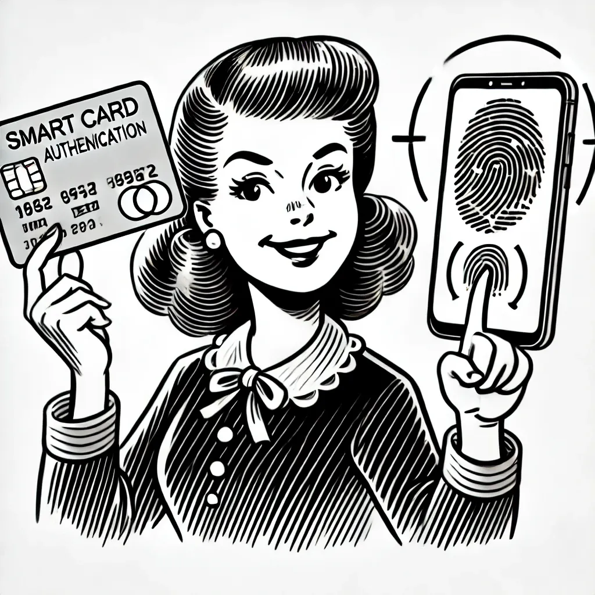
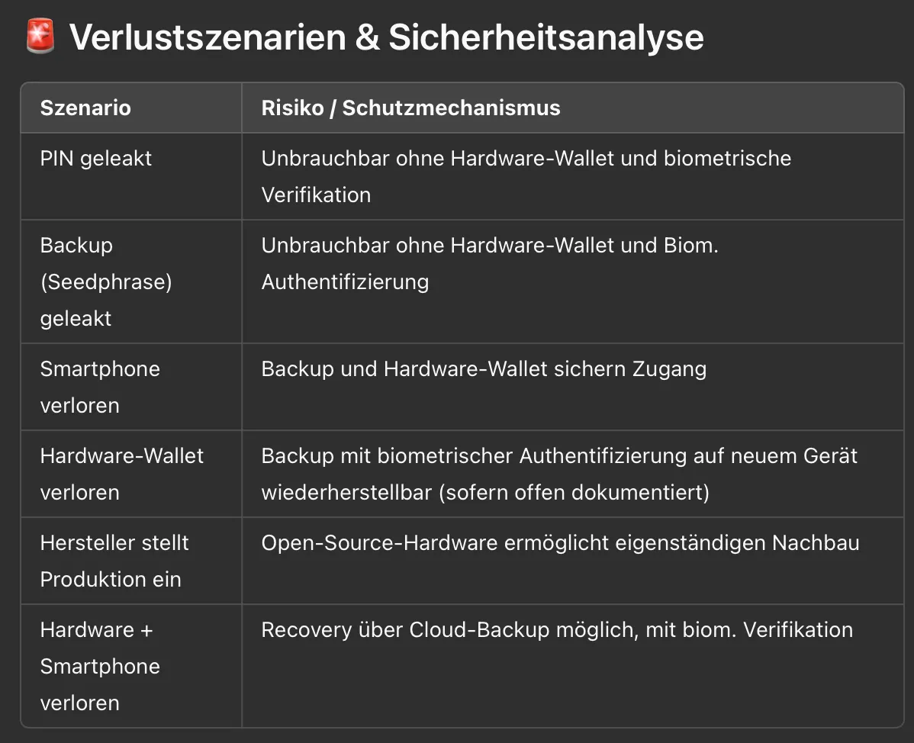

Bugün bir saatimi, herkes için Bitcoin cüzdanı olması hedefiyle yola çıktığımız Nuri üzerine düşünmeye ayırdım. İstediğim şey, kullanımı olabildiğince basit bir Bitcoin cüzdanı geliştirmek. Her cüzdanda olduğu gibi süreç kurulumla başlıyor. Kullanıcı Nuri Wallet uygulamasını indiriyor ve telefonunda açıyor. İlk adım her zaman "private key" yani özel anahtarı oluşturmak. Özel anahtar, kullanıcının Bitcoin'ine giden şifre aslında. Klasik cüzdanlar genellikle bu anahtarı temsil eden 12-24 kelime üretir; kullanıcı da bunları güvenli bir yere not edip saklamak zorundadır. Bu anahtara genellikle sadece telefon kaybolduğunda, cüzdanı geri yüklemek gerekirse ihtiyaç duyulur.

İşte piyasadaki çeşitli adımlar ve yöntemler:
1. Özel anahtar telefonda oluşturulur.
2. Özel anahtar telefona kaydedilir ve bir PIN, parola veya biyometri ile şifrelenir.
3. Özel anahtar kullanıcı tarafından elle kağıda yazılır (bir kağıt yedek oluşturulur).
4. Özel anahtar kullanıcı tarafından buluta (Google Drive, iCloud) kaydedilir ve genellikle bir PIN veya parola ile şifrelenir.
5. Özel anahtar ek bir PIN veya parola ile korunur (tuzlama/salt).
6. Özel anahtar harici bir donanım cüzdanda oluşturulur.
7. Özel anahtar harici bir cüzdana kaydedilir ve PIN, parola veya biyometri ile şifrelenir.

Liste uzayıp gider, yaratıcı fikirlerden yana sorun yok. Ancak vardığımız sonuç şu: Özel anahtarın güvenli bir şekilde oluşturulması ve saklanması ilk ve belki de en önemli adım. Eğer anahtar güvenli oluşturulmazsa, teorik olarak bir üçüncü şahıs süreci izleyebilir veya anahtarı çalabilir. Buradaki bir numaralı risk faktörü neredeyse her zaman insandır.

Özellikle özel anahtarını yedekleme konusunda ilk kez tecrübesi olan ve dijital sırları güvenli bir şekilde saklama veya not etme konusunda acemi olan kullanıcılar için, anahtarın ekran görüntüsünü almak, kişisel notlar uygulamasına kopyalamak, hatta belki e-posta veya WhatsApp üzerinden bir yerlere göndermek gibi hatalar yapılması çok olası.

Anahtar ekranda göründüğü an, hatalar da otomatik olarak başlar. Nuri'nin amacı ise anahtarı kaybetmeyi fiilen imkansız hale getirmek.

## Çözülmesi gereken sorunlar

Peki, özel anahtarı "özel" tutmak için hangi problemleri çözmemiz lazım?

1. Eğer sadece tek bir anahtar varsa ve bu anahtar ele geçirilirse, ciddi bir sorun doğar (cüzdana doğrudan erişim sağlar ve Bitcoin'leri transfer edebilirsiniz). Buradaki en yaygın çözüm tek bir anahtar yerine birden fazla anahtarı kombine etmektir. Bir anahtar telefonda, bir anahtar donanım cüzdanda ve diğer anahtarlar yedek olarak bulutta veya bir saklama hizmetinin sunucusunda tutulabilir.
2. Ek koruma sağlayan PIN kodları ve parolalar birçok kullanıcı için sorunlu, çünkü bu şifreleri unutmaya meyilliler veya şifrelenmiş anahtarı aslında hiç korumayan zayıf PIN ve parolalar seçiyorlar.

Nuri'nin çözümü, kullanıcının anahtar oluşturma ve yedekleme sürecini, hem üretim hem de yedekleme aşamasında "tek bir hata noktası" (single-point-of-failure) kalmayacak şekilde tasarlamak.

Anahtarlar kim tarafından ve nerede oluşturulabilir?
1. Donanım cüzdanda, kullanıcının biyometrisiyle şifrelenmiş şekilde.
2. Telefonda, donanım cüzdan tarafından şifrelenmiş şekilde.
3. Telefonda, parola, PIN veya biyometriyle şifrelenmiş şekilde.
4. Nuri sunucularında.

Tek bir anahtarın cüzdana erişimi olmadığından ve bir veya birden fazla anahtar kaybedilirse cüzdanı kurtarmanın mümkün olduğundan emin olmalıyız.

## Kayıp ve kurtarma

Kayıp senaryoları şunlar:
1. Telefonun kaybolması.
2. Donanım cüzdanın kaybolması.
3. Hem telefonun hem donanım cüzdanın kaybolması.
4. Yedekleme/bulut hesabı, e-posta kutusu veya Nuri.com hesabına ait PIN ve parolanın unutulması (genellikle e-posta, parola veya Google/Apple girişi gibi sosyal girişlerle korunur).

Kayba karşı %100 koruma mümkün değil. Kurtarma sürecini çok kolay yaparsanız, potansiyel saldırganların bu süreci taklit edip cüzdana erişmesini kolaylaştırırsınız.

Eğer kurtarma sürecini çok karmaşık yaparsanız, bu sefer de kullanıcının yedekleme veya kurtarma sırasında hata yapma riskini artırırsınız.

## Nuri'nin anahtarlar için planı

Nuri'nin anahtarı oluşturma planı şu şekilde:

1. Bir anahtar telefonda oluşturulur ve biyometri, PIN veya parola ile şifrelenir. Telefonun anahtarı aynı zamanda bulutta yedeklenir.
2. Bir anahtar Nuri sunucusunda oluşturulur, orada da şifrelenir.
3. Bir anahtar Nuri donanım cüzdanında oluşturulur ve Nuri'nin parmak iziyle şifrelenir.
4. Diğer anahtarlar arkadaşlara veya aileye gönderilebilir.
5. Bir kurtarma sayfası (recovery sheet) ana yedek olarak oluşturulabilir (tek hata noktası uyarısı!).

Bir saldırgan kullanıcının telefonuna erişmeyi başarırsa, telefon anahtarına da erişebilir. Eğer Nuri sunucusu anahtarına da ulaşırsa, saldırgan cüzdana girmek için yeterli olan 2 anahtarı ele geçirmiş olur.

Nuri sunucusundaki anahtar, yüz tanıma (Face-ID) ve parmak izi kombinasyonuyla, belki erişimi zorlaştıran bir PIN ve parola ile şifrelenebilir.

Uygulamada en iyisi, donanım cüzdanda birden fazla anahtar oluşturmak, ardından bu anahtarları biyometriyle şifreleyip dışarı aktarmak ve kullanıcının telefonunda, Nuri bulutunda veya kullanıcının kendi bulut yedeğinde saklamaktır.

Buradaki bir risk şu: Eğer Nuri şirketi ve donanım ürünü ortadan kalkarsa, anahtarı kurtarmak çok zor veya imkansız hale gelir, çünkü gereken parmak izi entropisi sağlanamaz ya da çok zahmetli olur.

Özetle, güvenli bir yedekleme ve özel anahtarların güvenli üretimini sağlamak, kriptografi alanındaki en büyük zorluklardan biri. Nuri şu an farklı yolları ve imkanları test ediyor.

Bu "beyin fırtınası" sürecinde diğer kaynaklardan gelen soru ve cevapları da topladım, özeti aşağıdadır:

## Güvenli biyometri tabanlı anahtar yönetimi ve yedekleme

## 🎯 Hedef

Biyometri (parmak izi, yüz tanıma) ile PIN veya parolaların ve donanım cüzdanların kombinasyonuna dayalı, **aptal geçirmez, güvenli bir kriptografik anahtar oluşturma, saklama ve kurtarma sistemi**.

## 🔑 Gereksinimler ve hedefler

- Donanım cüzdanlarda veya akıllı telefonlarda güvenli **yerel anahtar üretimi**.
- Bulutta, akıllı telefonda veya çevrimdışı güvenli harici yedeklemeler.
- Biyometri ile şifrelenmiş anahtar yedekleri, isteğe bağlı olarak PIN/parola ile desteklenmiş.
- Tek hata noktasından (Single-Point-of-Failure) kaçınmak.
- Bağımsız tekrarlanabilirliği sağlamak için açık kaynak donanım.

## 📌 Olası anahtar üretimi ve yedekleme

1. Donanım cüzdanda (akıllı kart) anahtar üretimi, parmak izi doğrulaması ile korumalı.
2. Akıllı telefonda anahtar üretimi, donanım cüzdanın anahtarıyla şifreli.
3. Şifrelenmiş anahtarın akıllı telefonda, bulutta veya çevrimdışı yedekte saklanması.
4. Aile/arkadaşlarda veya kurtarma sayfasıyla isteğe bağlı bir kurtarma anahtarı saklanması (dikkat: tek hata noktası!).

## 🚩 Zorluklar ve riskler

Entropi ve güvenlik
- Sadece biyometrik veriler (parmak izi ~10-20 bit, yüz ~10-20 bit) güvenli kriptografik anahtar türetimi için yeterli entropi sağlamaz.
- Parmak izi, yüz ve PIN kombinasyonu entropiyi ciddi oranda artırır ve kabul edilebilir bir güvenlik sunar.

Donanım bağımlılığı
- Tescilli donanım çözümleri, ürün artık üretilmediğinde kullanıcıların erişimini kaybetme riski taşır.
- **Açık kaynak** donanım/yazılım bu riski ciddi oranda azaltır, çünkü kullanıcılar acil durumda sistemi kendileri yeniden oluşturabilir.

## 🔓 Güvenlik mimarisi (önerilen)

Anahtar üretimi ve şifreleme
- Seed (12 kelime) donanım cüzdanda üretilir.
- Seed şu kombinasyonla şifrelenir:
  - Biyometrik faktör olarak parmak izi ("13. kelime").
  - İsteğe bağlı PIN veya parola ("14. kelime").
- Güçlü bir anahtar türetme fonksiyonu (Argon2, PBKDF2) kullanımı.
- Yedeğin harici olarak şifreli saklanması.

**Kurtarma süreci**
Kurtarma için gerekenler:
- Şifreli yedek.
- Biyometrik doğrulama için donanım cüzdan.
- İsteğe bağlı PIN kodu/parola.

## ⚠️ Zorluklar

- **Biyometrik değişkenlik:** Anahtarların güvenilir bir şekilde türetilmesi için "Fuzzy Extractors" gibi teknikler gerekir.
- **Donanım kilidi (Lock-in):** Uzun vadeli erişimi garanti etmek için açık standartlar ve açık donanım özellikleri şiddetle tavsiye edilir.
- **Kullanıcı dostu olma:** Güvenlik ile basit kullanım arasındaki dengeyi kurmak.

## ✅ Riskleri minimize etmek için tavsiyeler

- Standartlaştırılmış, açık biyometrik formatların (ISO/IEC) kullanılması.
- Tüm kriptografik yöntemlerin ve donanım tasarımlarının şeffaf olması ve belgelenmesi.
- Yedekleme ve kurtarma süreçlerinin yedekli bir şekilde kurulması (bulut, aile, donanım, kağıt).

## 🎖️ Sonuç

Parmak izi, opsiyonel yüz tanıma, kısa bir PIN ve açık donanım mimarisi bir araya geldiğinde şunları elde ediyorsun:

- Saldırılara ve kayıplara karşı yüksek güvenlik.
- Kolay kullanım ve kullanıcı dostu bir deneyim.
- Açık kaynak standartlarıyla geleceğe uygunluk.

Bu yaklaşım; biyometrik faktörleri ek güvenlik öğeleriyle (PIN, şifre), sağlam bir donanım ve yedekleme altyapısıyla birleştirdiğin sürece anahtar yönetimi için gerçekten güvenli ve işlevsel bir çözüm sunuyor.
