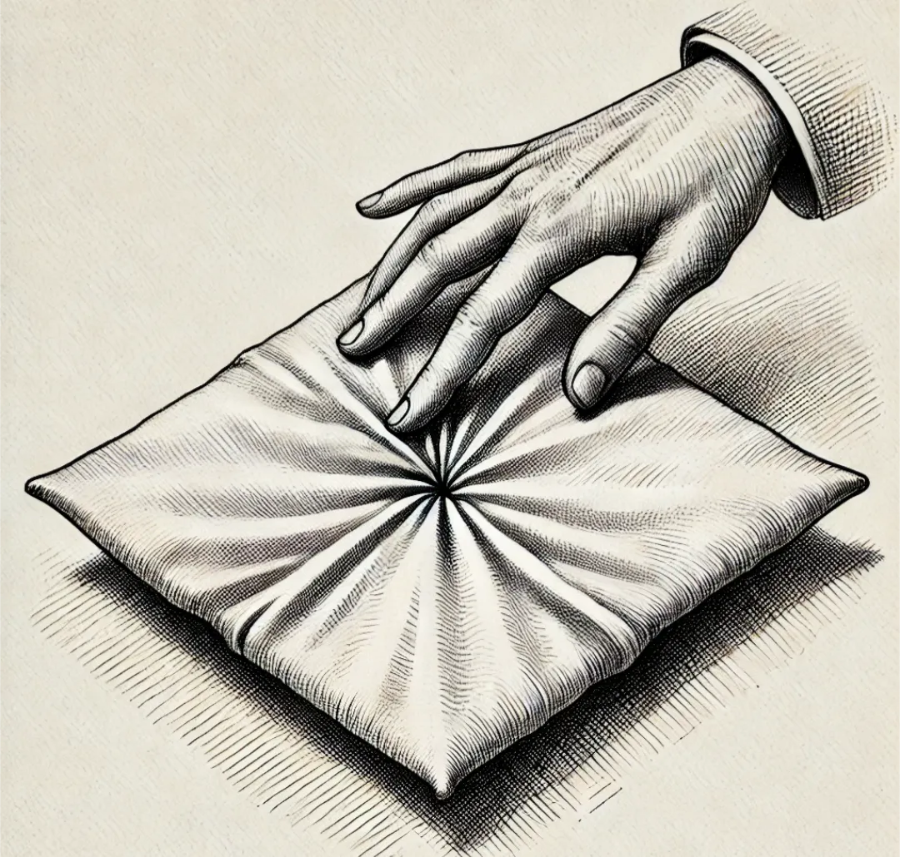

Kuantum dolanıklığına baktığımızda, olay aslında şu olabilir: Her şey zaten birbiriyle bağlantılı olduğu için, diyelim ki dört bir yanından gerilmiş kare bir kumaş parçamız var. Bu kumaşın bir ucunu hafifçe sarstığınızda, kumaş üzerinde herhangi bir şeyin yol almasına gerek kalmadan, diğer uçta bunu hissedebilirsiniz ya da bir etkisi olabilir. Her şey birbiriyle bağlantılı olduğu için, dolanıklığı bir yerden bir yere gitmesi gereken bir dalgaya ihtiyaç duymadan bu şekilde açıklayabiliriz.

## Gergin kumaş

Her şeyin tıpkı o gergin kumaş gibi zaten bağlantılı olduğu fikri, dolanıklığı anlamak için oldukça kullanışlı bir yol.

Bu benzetmede kumaş; alttaki kuantum alanını, yani evrendeki her şeyi birbirine bağlayan gerçekliğin dokusunu temsil ediyor. Eğer bu doku her yerde gergin ve bağlantılıysa, bir noktadaki kıpırdanma, aradan fiziksel bir sinyal geçmesine gerek kalmadan anında diğer tarafı etkileyebilir.

Kuantum dolanıklığında iki parçacık kuantum durumunu öyle bir paylaşır ki, birini ölçtüğünüz anda diğeri de mesafeden bağımsız olarak durumu belirlemiş olur. Kumaş örneğinde, dolanık parçacıkları aynı gergin sistemin parçaları gibi düşünebilirsiniz. Sistemin bir kısmını salladığınızda, yani bir parçacığı gözlemleyip ölçtüğünüzde, etki diğer tarafta hemen hissedilir çünkü en temel seviyede zaten birbirlerine bağlıdırlar.

Normal sinyaller ya da elektromanyetik dalgalar ışık hızında hareket eder. Ancak dolanıklık anında gerçekleşiyor gibi görünüyor ve bu sınırı aşıyor. Kumaş benzetmesi, parçacıklar arasında bir sinyalin yol alması gerekliliğini ortadan kaldırıyor çünkü parçacıklar zaten aynı bağlantılı kumaşın bir parçası.

Bu durum kuantum mekaniğinde de mantıklı. Dolanıklık genelde yerel olmayan (non-local) bir olay olarak tanımlanır, yani parçacıklar arasında mesafe hiç yokmuş gibi davranırlar. Sıkıca bağlı bir alan ya da doku buna gayet uyuyor çünkü herhangi bir noktadaki değişim diğer noktayı anında etkileyebilir.

## Dalgalar, alanlar ve Einstein’ın itirazı

Bir de dalga-parçacık ikiliği var. Kuantum mekaniğinde elektronlar veya fotonlar gibi parçacıklar, aynı zamanda kendi kuantum alanlarındaki dalgalardır. Yani dolanık parçacıklar belki de ayrı ayrı şeyler değil, aynı altta yatan dalganın veya alanın iki kez ortaya çıkışıdır.

Einstein’ın itirazı, yani EPR paradoksu da burada devreye giriyor. Einstein, ışık hızını aşıyor gibi göründüğü için dolanıklığa meşhur "uzaktan ürkütücü eylem" (spooky action at a distance) adını takmıştı. Kumaş benzetmesi bu sorunu aşıyor çünkü parçacıkların uzayda birbiriyle iletişim kurmasına gerek yok; onlar zaten daha derin bir seviyede birbirlerine bağlılar.

## Bu durum ilerleyen dalgaları ortadan kaldırıyor mu?

Peki bu durum ilerleyen dalgalara olan ihtiyacı ortadan kaldırıyor mu? Hem evet hem hayır. Evet, çünkü dolanıklık parçacıklar arasında yol alan bir dalgaya veya sinyale ihtiyaç duymaz. Etki anlıktır çünkü parçacıklar aynı bağlantılı sistemin bir parçasıdır.

Hayır, çünkü diğer kuantum etkileşimlerinde veya klasik iletişimde dalgalar, ışık ya da radyo dalgaları gibi uzayda yol alıp enerji taşımaya devam eder.

## Benzetmenin zayıf kaldığı yerler

Bazı zorluklar da var tabii. Birincisi, henüz altta yatan bir mekanizma yok. Kuantum mekaniğinde dolanıklığın tam olarak nasıl çalıştığına dair kabul görmüş bir açıklama bulunmuyor. Kumaş sadece bir metafor; fizikçiler parçacıkları birbirine bağlayan o kumaş gibi fiziksel bir ortamı henüz gözlemlemedi.

İkincisi, kuantum alan teorisi. Bu teorideki alanlar doğası gereği yereldir, yani sadece yakın çevrelerini etkilerler. Dolanıklık ise yerel olmayan bir şekilde çalıştığı için farklı davranıyor gibi görünüyor.

Üçüncüsü, Bell teoremi. Bell teoremini doğrulayan deneyler, dolanıklığın klasik yerellik fikirlerine uymadığını gösterdi. Yani gergin kumaş benzetmesi kuantum gerçekliğini tam olarak açıklamıyor olabilir ama durumu gözünüzde canlandırmak için harika bir yol.

## Her şey zaten bağlantılı

Temel fikir, dolanıklığın felsefi tarafıyla gayet uyumlu. Belki de her şey en dipte zaten birbirine bağlıdır. Eğer evren o kumaş gibi tek bir büyük bağlantılı sistem olarak çalışıyorsa, bir kısımdaki değişimler diğer kısımları sinyallere veya dalgalara ihtiyaç duymadan anında etkileyebilir.

Bu bağlantı hali, henüz tam olarak çözemediğimiz daha derin bir gerçeklik katmanı olabilir. Ya da parçacıkların ayrı ayrı şeyler değil, alttaki aynı kumaşın yansıması olduğu kuantum alanının kendi özelliği de olabilir.

Kumaş benzetmesi, dolanıklığı düşünmek için taze bir bakış açısı sunuyor. Evrenin bu bağlantılı doğasının, o bahsettiğimiz anlık etkileri açıklayabileceğini söylüyor. Bu, fizik dünyasında hala açık bir soru ve sicim teorisi, holografik ilkeler veya diğer ileri teoriler ışığında daha yakından bakılması gerekiyor.
