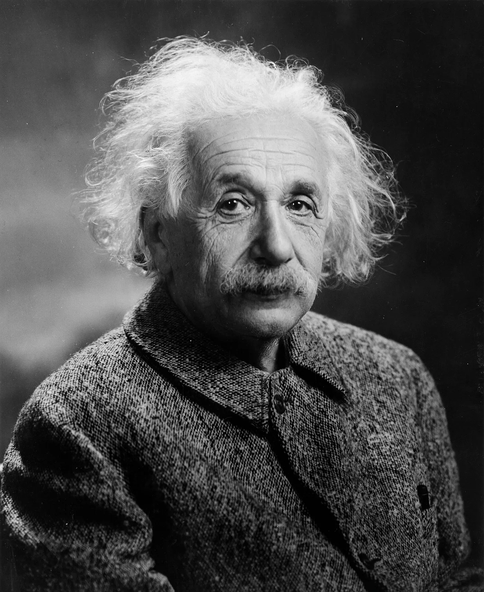

NBC radyo programı "I’m an American"ın 22 Haziran 1940 tarihli yayınının dökümü. Albert Einstein, vatandaşlık sınavına girdikten sadece birkaç saat sonra Çalışma Bakanlığı İkinci Müsteşarı Marshall Dimock ile konuşuyor.

Bunu paylaşıyorum çünkü özgürlük, hoşgörü ve bilimin kapasitesi hakkındaki söyledikleri bugün bile geçerli. Kayıt YouTube'da mevcut.

<https://www.youtube.com/watch?v=_0Iq64sYLsM>

## Döküm

**Sunucu**

Ben bir Amerikalıyım.

Amerika Birleşik Devletleri Göçmenlik ve Vatandaşlık Bürosu, National Broadcasting Company ile iş birliği yaparak yakın zamanda Amerikan vatandaşlığı almış bir grup insanı konuk etti. Bizim kanıksadığımız, ancak onlar için hala yeni ve heyecan verici olan bu vatandaşlık hakkında konuşmalarını istedik.

Bugün programımızda, tam bu sabah, sadece birkaç saat önce vatandaşlık sınavına girmiş olan seçkin bilim insanı **Dr. Albert Einstein**'ı ağırlamaktan mutluluk duyuyoruz.

Dr. Einstein'ın Çalışma Bakanlığı İkinci Müsteşarı **Bay Marshall Dimock** ile Amerikan vatandaşlığına duyduğu takdirin nedenlerini tartışması için kesinlikle daha iyi bir zaman olamazdı.

**Marshall Dimock**

Dr. Einstein, röportaj vermeyi pek sevmediğinizi biliyorum. Bu yüzden bugün buraya geldiğiniz için tüm dinleyicilerimiz adına size teşekkür etmek istiyorum. Söyleyeceklerinizin yeni ülkeniz için gerçekten ilgi çekici ve faydalı olacağından eminim.

**Albert Einstein**

Bu daveti kabul etmenin kendiliğinden apaçık bir görev olduğu benim için net. Ancak şunu da belirtmeliyim ki, sadece kelimelerin insanlığın bugünkü sorunlarını çözeceğine inanmıyorum. Silahların gümbürtüsü, insanların sesini bastırıyor. Olağan zamanlarda, yani barış dönemlerinde, düşünen insanlar arasında fikir alışverişine büyük inancım vardır. Ama bugün korkarım ki kaba kuvvet milyonlarca insanın hayatına hükmederken, insana hitap etmenin entelektüel yolu artık pek işe yaramıyor.

## Neden Almanya'dan ayrıldı

**Dimock**

Bu sabah, Dr. Einstein, Amerikan vatandaşlığı için son sınavınıza girerken yanınızda bulunma ayrıcalığına sahip oldum. **Dünya görüşünüz ve bilimsel ilgi alanlarınız gereği enternasyonal birisiniz. Neden başka herhangi bir ülke yerine Amerika'da yaşamayı tercih ettiğinizi bize anlatır mısınız?**

**Einstein**

Yedi yıl önce, Bay Dimock, Almanya'daki görevimi neden bıraktığım sorulduğunda şu açıklamayı yapmıştım: Seçim hakkım olduğu sürece, sadece siyasi özgürlüğün, hoşgörünün ve tüm vatandaşların yasalar önünde eşitliğinin kural olduğu bir ülkede kalırım. Siyasi özgürlük; kişinin siyasi görüşünü sözlü veya yazılı olarak ifade etme özgürlüğü ve her türlü bireysel görüşe hoşgörülü bir saygı anlamına gelir.

**Dimock**

Bu gerçek bir Amerikan doktrini. **Peki söyleyin bana, Amerika'nın yaşam alanı olarak bahsettiğiniz şartları hala yerine getirdiğini düşünüyor musunuz?**

**Einstein**

Evet, Bay Dimock. İnsan kusurlarını göz ardı edersek, Amerika'da hayattaki en değerli şeyin, yani bireyin gelişimi ve yaratıcı gücünün mümkün olduğunu gerçekten hissediyorum. Siyasi haklar ve özgür bireysel gelişim imkanı olmadan yaşayabilen insanlar olabilir. Ama bunun çoğu Amerikalı için katlanılmaz olduğunu düşünüyorum. Burada, nesiller boyunca insanlar hiçbir zaman sorgusuz sualsiz itaatin aşağılayıcı zorunluluğu altında kalmadılar. Burada insan onuru öyle bir noktaya gelmiş ki, bireyin sadece devletin bir kölesi olduğu, hükümetinde söz hakkının bulunmadığı ve kendi yaşam tarzı üzerinde hiçbir kararı olmadığı bir sistemde insanların yaşaması imkansız olurdu.

## Bilim ne yapabilir, ne yapamaz

**Dimock**

Dr. Einstein, siz bir bilim insanısınız ve bilimsel ilerlemeyi insanın en büyük başarılarından biri olarak görmelisiniz. Yine de günümüzde birçok insan için bilim ve buluşların insanlığa iyilikten çok bela getirdiği düşünülüyor. Teknolojik işsizlik, endüstriyel hammadde uğruna çıkan uluslararası kavgalar ve nihayetinde mekanize savaş silahları. **Bilimin keşiflerinin insanın kendi yıkımından ziyade kendi yararına nasıl döndürülebileceğini düşünüyorsunuz?**

**Einstein**

Bilim, insanoğluna ağır işlerden kurtulma imkanı sağladı ancak bilim tek başına bir kurtarıcı değildir. Araçlar yaratır, sonuçlar değil. İnsan bunları mantıklı hedefler için kullanmalı. İnsanlığın amacı savaş ve fetih olduğunda, o araçlar üç yaşındaki bir çocuğun elindeki ustura kadar tehlikeli hale gelir. İnsanın yaratıcılığını ve doğanın güçlerini sabırla fethetmesini, şu an yanlış ve yıkıcı bir şekilde kullanılıyorlar diye kınamamalıyız. İnsanlığın kaderi tamamen ahlaki gelişimine bağlıdır.

**Dimock**

Bilim ve kültür liderlerinin siyasi olayların seyri üzerinde neden bu kadar az etkisi olduğunu hep merak etmişimdir. **Bu konudaki fikriniz nedir?**

**Einstein**

Bunu oldukça anlaşılır buluyorum. Bilim insanları ve sanatçılar, eserleri aracılığıyla siyaset alanında bile sıklıkla kalıcı etkilere sahip olmuşlardır. Ancak siyasi olayların gidişatını doğrudan yönetmek için, insanları ve eylemlerini yönlendirme yeteneğine de sahip olmanız gerekir. Bu, mantıksal bağlantıların net bir şekilde anlaşılmasından ziyade duygu ve kişisel güveni uyandırıp kullanmakla ilgilidir. Bu nedenle, entelektüellerin kitleleri etkileme şansı azdır. Ayrıca genellikle hızlı karar verme yetenekleri de yoktur. Önde gelen Amerikalı devlet adamları arasında Woodrow Wilson belki de entelektüel tipin en gerçek örneğidir, ancak o bile insanlarla başa çıkma sanatında ustalaşmış görünmüyordu. En büyük başarısı olan Milletler Cemiyeti, bugün yüzeysel bir gözlemle başarısızlık gibi görünüyor. Yine de Wilson'ın eserinin daha güçlü bir formda yeniden yaratılacağına inanıyorum. Ancak o zaman bu büyük yenilikçinin değeri tam olarak anlaşılacaktır.

## Federal bir uluslar düzeni

**Dimock**

**Kaynakları dengesiz dağılmış ve ekonomik koşulları istikrarsız olan milliyetçi bir dünyada, başka bir Milletler Cemiyeti'nin başarılı olabileceğine dair ne kadar umudunuz var, Dr. Einstein?**

**Einstein**

Dünya uluslarının federal bir örgütlenmesinin sadece mümkün değil, gezegenimizin koşullarının insan için katlanılmaz hale gelmemesi adına mutlak bir zorunluluk olduğuna ikna olmuş durumdayım. Milletler Cemiyeti başarısız oldu çünkü üyeleri egemenlik haklarının bir kısmından vazgeçmeye istekli değildi ve Cemiyetin herhangi bir yaptırım gücü yoktu. Bir dünya örgütü, üyelerinin tüm askeri gücü üzerinde kontrol sahibi olmadığı sürece barışı etkili bir şekilde güvence altına alamaz. Abartılı milliyetçilik, savaşa hazırlıklı olma zorunluluğundan kaynaklanan, yapay olarak yaratılmış duygusal bir durumdur. Savaş tehlikesi ortadan kalktığında hızla kaybolacaktır. Hammaddelerin coğrafi dağılımındaki eşitsizliğin mutlaka savaşa yol açması gerektiğine inanmıyorum. Bir ulus, gelişimine yetecek malzemelere erişebildiği sürece pekala refah içinde yaşayabilir. Nitekim savaş öncesinde Avrupa'nın en müreffeh ülkelerinden olan İsviçre, Finlandiya, Danimarka ve Norveç bunu kanıtlıyor. Böyle uluslararası bir örgütün en önemli işlevlerinden biri, hammaddelerin engelsiz dağıtımını ve pazarlara serbest erişimi sağlamak olacaktır. İç ekonomik ve sosyal sorunların çözümü büyük ölçüde bireysel devletlere bırakılabilir.

**Dimock**

**Atlantik'in diğer tarafında kaba kuvvet birbiri ardına demokratik ulusları boğarken, adalet üzerine kurulu uluslararası bir düzen için çabalanabilir mi?**

**Einstein**

İyimser olmaktan çok uzağım ama size söylediklerim bir kehanet değil, bu dünyadaki yaşamın katlanılmaz hale gelmesini önlemek için yapılması gerekenlerin bir beyanıdır. Herkes, şu anda bu hedeften on yıl öncesine göre daha uzak olduğumuz konusunda hemfikir olacaktır. Demokrasiler o zamanlar, şu anki büyük acil durum saatinde gösterdikleri dayanışmayı ve fedakarlığa hazır olma durumunu göstermiş olsalardı, bu gerileme önlenebilirdi. Ancak fedakarlık iradesi, dayanışma ve bilge bir öngörü, en çok büyük ihtiyaç saati gelmeden önce etkilidir. Amerika'mız, vatandaşlarının ve devlet adamlarının kararlı eylemleri sayesinde böyle bir saatten esirgensin.

## Seçilmiş bir ülkeye duyulan inanç

**Dimock**

Doktor Einstein, seçtiğiniz bu ülkeye büyük bir inanç besliyorsunuz. Duyguların olayları net görmemize engel olduğu bu zorlu zamanlarda, atacağımız her adımda, alacağımız her kararda ve takınacağımız her tavırla buna layık olabiliriz umarım.

**Einstein**

Amerikalıların çoğunun Amerikalı gibi davrandığına inanıyorum. Bununla, özlerinde adil, hoşgörülü ve mantıklı insanlar olduklarını kastediyorum. Ancak kriz dönemleri bu demokratik vasıfları sınar. Mesela aramıza yeni katılan sekiz milyon sonradan vatandaş olmuş Amerikalı ve dört milyon yabancıyla birlikte; demokrasi olarak hem kendimize hem de dünyaya hoşgörünün sadece bir ideal değil, tüm Amerikalıların benimsediği pratik bir değer olduğunu kanıtlama sınavıyla karşı karşıyayız. Demokrasinin sadece iyi bir anayasaya bağlı bir yönetim biçimi değil, aynı zamanda ahlaki bir güç geleneğine sahip insanlar tarafından desteklenen bir yaşam tarzı olduğunu Amerika'nın kanıtlayacağına inanıyorum. İnsanlığın kaderi de bugün her zamankinden daha fazla bu ahlaki güce bağlı.

**Dimock**

Seçtiğiniz bu ülkeye verdiğiniz ilham verici mesaj için teşekkürler, Doktor Einstein.

*(Yayın sonu)*

