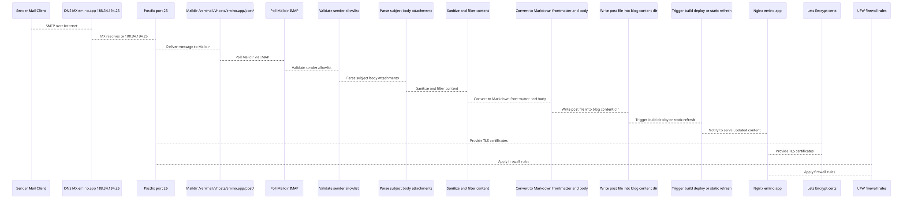

post@emino.app adresine gelen bir e-postanın blogumda yayınlanan bir yazıya dönüşme sürecindeki tüm teknik detaylar burada. DNS ve TLS yapılandırmasından SMTP ve IMAP trafiğine, filtreleme ve doğrulama süreçlerinden içe aktarıcının (importer) arka planda yaptıklarına kadar her şeyden bahsettim. Yazının sonundaki akış şemasında gönderen kontrolleri ve ayrıştırma (parsing) işlemleri de net bir şekilde görünüyor.

## Kısa versiyon

Sistem özetle şöyle çalışıyor: DNS tarafında emino.app için 188.34.194.25 adresine işaret eden bir A kaydı ve bir MX kaydı (0 emino.app) tanımlı.

TLS sertifikası için /etc/letsencrypt/live/emino.app/ yolunda bir Let's Encrypt sertifikası yüklü. Nginx, Postfix (STARTTLS için) ve Dovecot (IMAPS için) bu sertifikayı paylaşıyor. certbot.timer ise sertifikayı otomatik yeniliyor.

Postalar 25 numaralı porttan Postfix üzerinden ulaşıyor ve sanal posta kutusu post@emino.app, /var/mail/vhosts/emino.app/post/ yolundaki Maildir dizinine yazılıyor. Dovecot, aynı sertifikayla 993 numaralı portta çalışıyor; böylece içe aktarıcı veya herhangi bir e-posta istemcisi IMAP üzerinden mailleri okuyabiliyor. ufw güvenlik duvarında 22, 80, 443 ve 25 portları açık. 993 portu ise sadece IMAP erişimine ihtiyaç duyulduğunda açılıyor.

İçe aktarıcı; Maildir veya IMAP dizinini düzenli kontrol ediyor, göndereni doğruluyor, postayı ayrıştırıp temizliyor, Markdown formatına çeviriyor, ardından ilgili içerik klasörüne (posts/) yazıp build ve deploy sürecini tetikliyor. Nginx ise statik blogu HTTPS üzerinden yayınlıyor.

## İçe aktarıcı (importer) neler yapıyor?

İçe aktarıcı, bir zamanlayıcı (systemd timer veya cron) ile çalışıyor ya da arka planda sürekli takipte olan bir gözlemci (watcher) gibi hareket ediyor. Maildir'deki new/ ve cur/ dizinlerini veya IMAP gelen kutusunu tarıyor.

From başlığını kendi adreslerinin olduğu bir izin verilenler listesiyle (allowlist) karşılaştırıyor. Tanınmayan gönderenlerden gelen iletileri görmezden gelip logluyor. E-postanın konusu (subject) yazının başlığı ve URL slug'ı oluyor, e-posta gövdesi ise Markdown içeriğine dönüşüyor. Ekleri yoksayabiliyor veya kaydedebiliyorsun; kaydettiğin takdirde sadece metin ve resim türlerini tutuyor.

Ardından temizlik aşamasına geçiyor. Tehlikeli HTML etiketlerini ayıklıyor, kodlamaları normalize ediyor; dilersen bağlantıları ve emojileri bile elden geçirebiliyor. Başlık, tarih, etiketler ve yazar bilgilerini içeren front matter kısmını oluşturup Markdown içeriğiyle birleştiriyor ve belirlediğin yola (örneğin content/posts/) kaydediyor. Dosyayı yazdıktan sonra statik site oluşturucu veya önbellek yenileme gibi bir build ve deploy tetikleyicisi çalıştırıyor.

Tüm işlemleri kendi log dosyasına kaydediyor. Bir sorun oluşursa loglayıp iletiyi Maildir'de tutuyor, böylece daha sonra tekrar deneyebiliyor.

## Kurulum

1. DNS. `A emino.app 188.34.194.25` ve `MX 0 emino.app.`
2. TLS. `certbot --nginx -d emino.app -d www.emino.app --redirect` komutunu çalıştır ve `systemctl list-timers | grep certbot` ile zamanlayıcıyı doğrula.
3. Sanal posta kutusu ve Postfix. `/etc/postfix/vmailbox` dosyasına `post@emino.app emino.app/post/` satırını ekle. Sonra `postmap /etc/postfix/vmailbox`, `postconf -e "virtual_mailbox_domains=emino.app"` ve `postconf -e "virtual_mailbox_maps=hash:/etc/postfix/vmailbox"` komutlarını çalıştır. TLS ayarları için `postconf -e "smtpd_tls_cert_file=/etc/letsencrypt/live/emino.app/fullchain.pem"`, `postconf -e "smtpd_tls_key_file=/etc/letsencrypt/live/emino.app/privkey.pem"` yapılandırmasını yap ve `systemctl reload postfix` komutuyla ayarları uygula.
4. IMAP/IMAPS için Dovecot. `/etc/dovecot/conf.d/10-ssl.conf` dosyasında `ssl_cert = </etc/letsencrypt/live/emino.app/fullchain.pem` ve `ssl_key = </etc/letsencrypt/live/emino.app/privkey.pem` tanımlamalarını yap, ardından `systemctl reload dovecot` çalıştır.
5. Maildir izinleri. /var/mail/vhosts/emino.app/post/ dizininin sahibi vmail:vmail olmalı; izinleri 700 ve dosya izinlerini 600 olarak ayarla.
6. ufw güvenlik duvarı. `ufw allow 25/tcp` komutuyla portu aç; IMAP gerekiyorsa `ufw allow 993/tcp` ekle ve 80, 443 portlarını da açmayı unutma.
7. İçe aktarıcı kurulumu. Maildir veya IMAP üzerinden okuma yapan, sadece yetkili adresleri kabul edip içeriği blog klasörüne (content/posts/) yazan betiğini kur. Bunu bir systemd timer veya cron ile otomatize et, loglarını bir dosyaya yönlendir ve ihtiyaç varsa build/deploy sürecini tetikle.
8. Nginx. 80 portundan gelen trafiği 301 ile https://$host$request_uri adresine yönlendir. 443 portunda Let's Encrypt sertifika yollarını tanımla ve blog klasörünü kök dizin olarak sun.

## İzleme ve sorun giderme

Sertifikanın bitiş süresini takip etmek için `openssl x509 -in /etc/letsencrypt/live/emino.app/fullchain.pem -noout -enddate` komutunu kullanabilirsin.

Postfix ve Dovecot mail trafiği /var/log/mail.log altında tutuluyor. İçe aktarıcının kendi log dosyasını takip etmen ve bir hata anında uyarı alacak şekilde yapılandırman iyi olur. Yenileme süreçlerinde bir sorun yaşarsan `journalctl -u certbot` komutuna bak. Sistem sağlığını kontrol etmek için ara sıra post@emino.app adresine test postası gönderip Maildir'e düştüğünü ve yayınlandığını doğrula.

Çoğu arıza kolay çözülür. Sertifika süresi dolduysa zaten nginx HTTP challenge ve certbot.timer işi hallediyor. 25. port kapalıysa ufw ile açman yeterli.

İçe aktarıcı durduysa servis veya zamanlayıcının durumunu kontrol et, loglara göz at. Maildir dizinindeki vmail sahipliğini ve 700/600 izinlerini kontrol et. Bilinmeyen bir gönderenden gelen posta reddedilecektir, bu yüzden yeni bir adres eklersen izin verilenler listesine mutlaka işle.

Emino.app üzerindeki e-postadan bloga yayınlama süreci özetle bu. DNS ve TLS kurulumundan SMTP, IMAP, gönderen kontrolü ve Markdown dönüşümüne kadar her şey bu kadar. Bu notlar sistemi sıfırdan kurman için yeterli olacaktır.

