## Solver nedir ve neden var?

Near Intents protokolü, kullanıcıların "Z koşulları altında X'i Y ile takas etmek istiyorum" demesini sağlıyor, işte buna niyet (intent) diyoruz. Bir solver, yani bu uygulama, söz konusu niyetleri anlık izleyen ve bir piyasa yapıcı gibi hareket eden bir yapı. İki NEP-141 token'ı için rezervleri olan zincir üstü bir AMM havuzunu takip ediyor, bu parite için bir marj ekleyerek fiyatları hesaplıyor ve bir niyet senin marjınla kârlı olduğunda, takası senin NEAR hesabın üzerinden gerçekleştiriyor. Solver'ın ayrıca `/status` adresinde bir HTTP durum API'si ve sağlık durumunu, rezervleri, fiyat tekliflerini, niyetleri ve bakiyeleri gösteren `/dashboard` adresinde bir paneli mevcut.

Benim kurulumum şu an `pm2` süreci olan `near-solver` şeklinde çalışıyor ve `127.0.0.1:4010` üzerinden dinliyor. JSON sağlık verisi için https://emino.app/status adresine, dashboard içinse https://emino.app/solver/ adresine gidebilirsin. `ready:true` ve `ws_connected:true` ibarelerini görüyorsan, solver canlıdır ve relay trafiğini işliyordur.

## Tarayıcıdan solver'a

Kullanıcı tarayıcıda https://emino.app/solver/ adresini açar. `emino.app` için Nginx vhost, bir Let's Encrypt sertifikasıyla TLS sonlandırması yapar ve iki lokasyonu vardır. `/solver/` adresi `proxy_pass` ile `http://127.0.0.1:4010/dashboard` adresine, `/status` ise `http://127.0.0.1:4010/status` adresine yönlenir. Tarayıcı HTML panelini `/dashboard` üzerinden yükler, içindeki JS hemen `/status`'u çağırır ve canlı veriler için her birkaç saniyede bir orayı yoklar. Solver içindeki `HttpService`, `/status` için payload'u hazırlar ve `/dashboard` için dashboard şablonunu render eder.

## Solver süreci

Node.js tabanlı ve `pm2` altında çalışıyor. Başlatırken kabaca şöyle yapıyorum:

    NODE_ENV=local pm2 start "npm start" --name near-solver

Ve `npm start` şunu çalıştırıyor:

    node -r tsconfig-paths/register -r ts-node/register src/main.ts

Bunlar önemli dosyalar. `src/main.ts`, `src/utils/load-env.ts` dosyasından `loadEnv()` fonksiyonunu çağırır ve sonra `require('./app').app()` çalıştırır. `src/utils/load-env.ts`, `NODE_ENV=local` olduğu için `dotenv.config`'i `./env/.env.local` yoluyla çağırır. `process.env`'i `src/configs/env.validation.ts` içindeki bir Joi şemasına göre doğrular, gerekli bir şey eksikse veya geçersizse hata fırlatır ve doğrulanmış değerleri tekrar `process.env` içine kopyalar. `src/app.ts` ise servisleri oluşturur:

    const cacheService   = new CacheService();
    const nearService    = new NearService(); await nearService.init();
    const intentsService = new IntentsService(nearService);
    const quoterService  = new QuoterService(cacheService, nearService, intentsService);
    await quoterService.updateCurrentState();
    const cronService    = new CronService(quoterService); cronService.start();
    const websocketSvc   = new WebsocketConnectionService(quoterService, cacheService); websocketSvc.start();
    const httpService    = new HttpService(cacheService, quoterService, nearService); httpService.start();

Bu yapı sana canlı bir NEAR bağlantısı, AMM fiyatlandırması ve durumu, solver relay'inden gelen bir WebSocket akışı, periyodik bir durum yenileme ve HTTP API'si sunar.

## Servisler

`NearService`, bağlantıları kurmak için `near-api-js` kullanır. Ağ, `NEAR_NETWORK_ID` değerinden gelir, yani mainnet veya testnet. Node URL'leri `NEAR_NODE_URLS` veya `NEAR_NODE_URL`'den gelir, hiçbir şey ayarlamazsan varsayılanları alır; mainnet için `https://free.rpc.fastnear.com` ve `https://near.lava.build`, testnet için `https://test.rpc.fastnear.com` ve `https://neart.lava.build`. Solver'ın kimliğini env dosyasından yükler. `NEAR_ACCOUNT_ID` senin solver hesabındır (örneğin `my-solver.near`), `NEAR_PRIVATE_KEY` de bu hesap için `ed25519:...` anahtar dizesidir. Yardımcı fonksiyonları da var; `getBalance()`, solver'ın gas ve likidite için ne kadar NEAR tuttuğunu gösterir, diğerleri ise `view call` yapar ve NEAR kontratlarına imzalı işlemler gönderir.

`IntentsService`, niyet kontratının API'sini sarmalar, eğer kullanıyorsan `INTENTS_CONTRACT` env'i ile çalışır. Solver bununla havuz verisini ve rezervleri okur, niyetlerle çalışır (örneğin settlement yani uzlaşma mantığı gibi).

`QuoterService`, `AMM_TOKEN1_ID` ve `AMM_TOKEN2_ID`'den iki token ID'sini ve `MARGIN_PERCENT` değerini bilir; mesela 0.3 dersen bu %0.3 demek. Durumun bir iç görüntüsünü tutar, yani her NEP-141 token'ı için rezervleri ve ihtiyaç duyduğu diğer AMM parametrelerini içerir. `updateCurrentState()`, `NearService` ve `IntentsService` aracılığıyla zincir üstündeki güncel havuz durumunu alır, diğer metotlar ise yeni fiyat teklifleri ve niyetler için durumu ayarlamak üzere WebSocket olayları tarafından tetiklenir. Quoter, bir niyetin mevcut havuzun ve marjınla işlem yapmaya değip değmeyeceğine karar verir.

`CacheService`, bellek içi bir key-value önbelleğidir. Göreceğin anahtarlar şunlar: `ws_connected` (boolean), `ws_last_event_at` (son relay olayının zaman damgası), `reserves` (güncel havuz rezervleri) ve `reserves_updated_at` (rezervlerin en son ne zaman yenilendiği). Ayrıca `recent_quotes` (en son fiyat teklifleri listesi), `recent_intents` (tx hash'leriyle beraber en son niyetler) ve 60 saniye boyunca önbelleğe alınan `total_supply` var, böylece NEAR RPC'yi spam'lemezsin.

`WebsocketConnectionService`, solver relay'ine bağlanır. `RELAY_WS_URL` mesela `wss://solver-relay-v2.chaindefuser.com/ws` şeklindedir, `RELAY_AUTH_KEY` ise relay operatöründen aldığın bir JWT veya auth anahtarıdır. Bir WebSocket açar, auth anahtarıyla doğrular ve ardından yeni fiyat tekliflerini, niyetleri yani kullanıcı takas isteklerini, ayrıca işlem ve uzlaşma güncellemelerini alır. Her olay için `CacheService`'i güncel teklifler, niyetler ve zaman damgalarıyla günceller, `QuoterService`'e de fiyatlar ve durum taze kalsın diye önemli değişiklikleri haber verir.

`CronService`, uygulamanın durumuna bağlı olarak mesela her 5-10 saniyede bir çalışan ve `QuoterService.updateCurrentState()` fonksiyonunu çağıran periyodik bir iş yapar. Yani WebSocket trafiği takılsa bile solver'ın havuzla ilgili gördüğü resim doğru kalır.

`HttpService`, saf bir Node http sunucusudur, Express falan yok. `APP_PORT`'u dinler, benim durumda 4010. `/` rotası basit bir JSON verir: `{ ready: true }`. `/status` rotası tüm durum payload'unu oluşturur. Süreç çalışıyorsa `ready` her zaman `true`'dur. Sonra `ws_connected` ve `ws_last_event_at`, `reserves` ve `reserves_updated_at`, `margin_percent` ve `recent_quotes` ile `recent_intents` var. `deposit_addresses`, BTC ve EURe para yatırma adreslerini tutar. `near_balance` yocto NEAR cinsindendir, `near_balance_near` ise `formatYocto` yardımcısıyla okuyabileceğin NEAR cinsinden halidir. `total_supply` ise `ft_total_supply` view call'larından gelen token arzlarıdır.

`/dashboard` rotası, içinde gömülü JS olan statik bir HTML sayfası döndürür. Mevcut `/status` JSON'ı olan bootstrap verisini ve token meta verileriyle (semboller ve ondalık basamaklar) birlikte token ID'lerini enjekte eder. Sonra sağlık durumu, para yatırma adresleri, WebSocket durumu, niyet kontratındaki rezervler, NEAR üzerindeki toplam arz, son teklifler ve son niyetler için kartlardan oluşan bir grid render eder. Ve her birkaç saniyede bir `/status`'u tekrar çağıran ve arayüzü güncelleyen bir döngü başlatır.

## Etrafındaki sistemler

Solver tek başına yaşamaz, daha büyük bir sistemin parçasıdır.

*   **Solver relay** (`RELAY_WS_URL`), kayıtlı solver'lara niyetleri ve fiyatları besleyen merkezi bir merkezdir. `RELAY_AUTH_KEY` ile kimlik doğrularsın ve solver'lar kabul ettikleri niyetler için imzalı işlemleri geri gönderirler.
*   **NEAR RPC düğümleri**, `ft_total_supply` ve havuz durumu gibi view call'lar ve `NEAR_ACCOUNT_ID`'den işlem göndermek için kullanılır. Solver, yedeklilik ve basit failover için birden fazla URL kullanır.
*   **Niyet kontratı** (`INTENTS_CONTRACT`), EURe, BTC ve diğer pariteler için mantığı ve havuzları barındırır, ayrıca rezervleri ve uzlaşmayı yönetir.
*   Bir de **zincir dışı bir köprü** olan para yatırma adresleri var. Kullanıcıların BTC gönderdiği bir BTC mainnet adresi ve Gnosis üzerinde kullanıcıların EURe token gönderdiği bir EURe adresi var. Bu deponun dışındaki ayrı bir köprü sistemi bunları izler ve NEAR üzerinde eşleşen NEP-141 token'larını mint eder veya yakar.

## Kendi solver'ını başlatma rehberi, adım adım

Bu bölüm şemayı bir kontrol listesine dönüştürüyor.

### Nelere ihtiyacın var

Linux yüklü bir makineye veya VPS'e, Node.js 20+ sürümüne ve npm veya pnpm'e ihtiyacın var.

Sadece solver için kullanacağın bir NEAR hesabına ihtiyacın var, mesela `your-solver.near` gibi. Sakın kişisel ana cüzdanını kullanma, sadece solver için yeni bir hesap oluştur ve içine gas ücretleri ile istediğin likidite kadar NEAR yükle.

Bu solver hesabı için tam yetkili (full access) bir private key'e ihtiyacın var. Bunu NEAR CLI veya cüzdan üzerinden dışarı aktarabilirsin, formatı `ed25519:...` şeklinde olmalı. Bunu gizli tut. Asla git'e commit atma, chat'e yapıştırma, kimseyle paylaşma.

Bir relay auth anahtarına, yani `RELAY_AUTH_KEY`e ihtiyacın var. Bunu sana relay veya intents operatörü verir. Genellikle solver'ını tanımlayan JWT benzeri bir tokendır.

Eğer istersen, güzel bir dashboard URL'i için TLS destekli bir alan adı (örneğin `solver.example.com` gibi bir alt alan adı) ve HTTPS'ten iç portlara yönlendirme (proxy) yapacak bir Nginx ayarlayabilirsin.

### Klonla ve kur

    git clone https://github.com/near-intents/near-intents-examples.git
    cd near-intents-examples/near-intents-amm-solver

    # npm kullanıyorsan
    npm install

Repo URL'sini kullandığın gerçek adresle değiştir.

### .env dosyanı oluştur ve doldur

Solver, env değişkenlerini `./env/.env.<NODE_ENV>` yolunda arar. Yerel ve geliştirme ortamları için genellikle `NODE_ENV=local` kullanıyoruz, yani:

    cd near-intents-examples/near-intents-amm-solver
    mkdir -p env
    cp env/.env.example env/.env.local

`env/.env.local` dosyasını aç ve gerekli olan temel değişkenleri ayarla.

    # Network
    NEAR_NETWORK_ID=mainnet

    # Bu solver için tokenlar (örnek: EURe ↔ BTC)
    AMM_TOKEN1_ID=nep141:gnosis-0x420ca0f9b9b604ce0fd9c18ef134c705e5fa3430.omft.near
    AMM_TOKEN2_ID=nep141:btc.omft.near

    # TEE olmayan mod (en basit kurulum)
    TEE_ENABLED=false

    # Senin solver NEAR hesabın (sadece bunun için!)
    NEAR_ACCOUNT_ID=your-solver.near
    NEAR_PRIVATE_KEY=ed25519:SOLVER_PRIVATE_KEY_BURAYA

Sonra node, relay ve margin ayarları.

    # NEAR RPC, değiştirebilirsin; aksi takdirde varsayılanlar iyidir
    NEAR_NODE_URL=https://rpc.mainnet.near.org
    # veya:
    # NEAR_NODE_URLS=https://free.rpc.fastnear.com,https://near.lava.build

    # Relay endpoint ve auth bilgisi
    RELAY_WS_URL=wss://solver-relay-v2.chaindefuser.com/ws
    RELAY_AUTH_KEY=RELAY_AUTH_TOKEN_BURAYA

    # Solver için HTTP sunucu portu
    APP_PORT=3000          # veya sunucunda 4010

    # Log ve margin
    LOG_LEVEL=info         # error | warn | info | debug
    MARGIN_PERCENT=0.3     # %0.3 margin, riskine göre ayarla
    ONE_CLICK_API_ONLY=true

`src/configs/env.validation.ts` içindeki Joi şeması, `AMM_TOKEN1_ID` ve `AMM_TOKEN2_ID`nin set edilip edilmediğini, TEE modunun veya `NEAR_ACCOUNT_ID` ile `NEAR_PRIVATE_KEY`in doğru şekilde girilip girilmediğini ve `MARGIN_PERCENT`in pozitif olduğunu kontrol eder. Eğer solver başlangıçta hata verirse, hangi env değişkenlerinin eksik veya hatalı olduğunu sana söyler.

### Yerelde çalıştır

Solver dizinindeyken:

    # near-intents-amm-solver içinde olduğundan emin ol
    NODE_ENV=local npm start

"Using Near RPC nodes: ..." ve "Cron service started" gibi loglar görmelisin. Bağlandığında ise "Received intent: {...}" gibi WebSocket logları düşecek. Sonra şurayı kontrol et:

    curl http://localhost:3000/status   # veya kendi APP_PORT'un

ve tarayıcıdan `http://localhost:3000/dashboard` adresine git. Solver Monitor dashboard'unu görmen lazım.

### Arka planda pm2 ile çalıştır

Prod ortamı için en iyisi bu. Sunucunda:

    cd /path/to/near-intents-examples/near-intents-amm-solver

    NODE_ENV=local pm2 start "npm start" --name near-solver
    pm2 save
    pm2 startup   # sunucu açılışında pm2'nin otomatik başlamasını sağlar

Logları şununla kontrol et:

    pm2 logs near-solver --lines 50

HTTP tarafını ise `APP_PORT`unla kontrol et:

    curl http://127.0.0.1:3000/status

### Nginx ve TLS arkasına al

Opsiyonel ama öneririm. `solver.example.com` gibi bir domain için temel Nginx server bloğu şöyle görünür:

    server {
        listen 443 ssl http2;
        server_name solver.example.com;

        ssl_certificate     /etc/letsencrypt/live/solver.example.com/fullchain.pem;
        ssl_certificate_key /etc/letsencrypt/live/solver.example.com/privkey.pem;

        location / {
            proxy_pass http://127.0.0.1:3000;  # APP_PORT
            proxy_set_header Host $host;
            proxy_set_header X-Real-IP $remote_addr;
            proxy_set_header X-Forwarded-For $proxy_add_x_forwarded_for;
            proxy_set_header X-Forwarded-Proto $scheme;
        }
    }

Emino.app üzerindeki kendi kurulumumda ben farklı yaptım. Blogu `/` adresinde tutuyorum ve mevcut vhost içindeki şu location tanımlarını ekledim:

    location = /solver/ {
        proxy_pass http://127.0.0.1:4010/dashboard;
        ...
    }

    location /solver/ {
        proxy_pass http://127.0.0.1:4010/;
        ...
    }

    location /status {
        proxy_pass http://127.0.0.1:4010/status;
        ...
    }

Sonra:

    nginx -t
    systemctl reload nginx

Artık dashboard için solver'a `https://yourdomain/solver/` adresinden, durum JSON'una ise `https://yourdomain/status` adresinden ulaşabilirsin.

## Güvenlik ve çalışma şekli

Önce anahtarlar. Solver için mutlaka ayrı bir NEAR hesabı kullan. Private key tam yetkili olmalı, yoksa solver tx gönderemez. `NEAR_PRIVATE_KEY` ve `RELAY_AUTH_KEY`i gizli tut. Bunları sunucuda `.env.local` dosyasında sakla, repo dizininin başkaları tarafından okunabilir olmadığından emin ol ve `.env*` dosyalarını asla git'e commit'leme.

Sonra fonlar. Sadece riske atabileceğin kadar likidite ve NEAR tut. Kârları zaman zaman çek ve solver hesabını "hot wallet" gibi düşün.

İzleme (monitoring) için, `pm2 logs near-solver` runtime'da ne olup bittiğini gösterir. `curl /status` ise kod üzerinden izleme içindir, bunu Prometheus'a veya bir sağlık kontrolüne (health check) bağlayabilirsin.

Güncellemeler içinse yeni kodu çek, bağımlılıklar değiştiyse `npm install` yap ve `pm2 restart near-solver` ile yeniden başlat.

Şema da burada.

https://mermaid.emino.app/?c=eJx1Vt1u6zYMfhXCwLk6-WmKYcNyMaAJip0ztFkXtygwpSgUW4m1Y0s-kuIkWHe7B9gj7klGSvJP0B0EsE3qI0V-JKX8mWQ6F8k82RteF3C33iiADx_gyQoDH0EoZ861lsqR3h62AUarpABYsIXRRxI3qnCutvPpVFRS6Qmv66nVZSPM9IWwQuUbdeHlNt8LtklWe6lOuNfjXQqss33ZJC9hixULiKbQ1uE2A8jQ7QLG45_eNsmnx8eHFNqtgT19fkGjVuu4O1hgv6S_rnCHN1gFY8w49QZQG50Jay8CDUsYqhLcjJEMpMWOeVWNwy7A6up6Dn41aPro77lUrMLHxFmMo9Q8v1UNOA1tBgA3dc1QCoijNAKQ0EZiHBHwCZll9EiDHmG1Ng6-u5pd4XdMawTTnNtiq7nJo-Fzyp7F1ursi3BLrZTInNSq92JEyc-AkNRDICsl5haNl0YrRo_BrsJIncsMjNgZYYuI_O2gHRIUXj365v4e-ZSZVHusLwUpWtc8KwTzzx4u1bgSlTZnhGrTQlfIKqNHD1zd3qxh_bAkp3KviG4P_Rwqw-J76NkrINPYzzxzUIiyjmZdA2EPkKFRvAQsAgZNWqofdRYViWR8eZGqMZSf06FErA3lwMwFgnIfKijFoRyT6GKjDoZdqY8kr2KzY7eezn2zY1fNrn-YXOFvNqfm6BuCihfBYQbeY8MCTUWbHL0vo-00fUadqs2gVWB8NGdINi9d4buN-lpgo34la3zHwoxgy0uusOFp90WX84JnX_ZGH1QOf-itH0piNjrHD7I3DS_JrI8ofEWUbzuwite20M5vELOJm6z9DHxsY-k47s-pU-gKPADaT7Bn60RluzH3Tlg8Q7xAo2zpOAzFGftRGzfXk8mktXlYsq6VFR7DNP47bh0dJCMoecNHYOpsQseHEu6yy5dtm3ddjda3T2tBlV08LqHWuowmKDJSRUeQi1pbSQazu4X8vQ-J7Jl3guT-rBBEMV2dZj9-v2xR3cAE4ojlUM4Bh3hznEQGhzpH8u1bnI7nNNYk6H1HZIh_jfZTiHJ04yl8zcK5JXJcL5GdV9Hg4qCOA8c7gTC_boct4aNFkgnUSHGEjJelbY-PHNwJY2zbt6V1MITLgX75fjqJ2pgYXZuRXQqfVkr59SBz6c4U0dCh5_n_7fzSNwzfdXguMpkLurl20vFtKaDnj-Po8AonKBAy3J7ybWcEaSA2qLQbZY8cr27hHHpCZoZ2yShxEvXtH4Y5XN7f3d0M__79D3zj3iYn55p80KhlBTcu-es_a-zoSA

