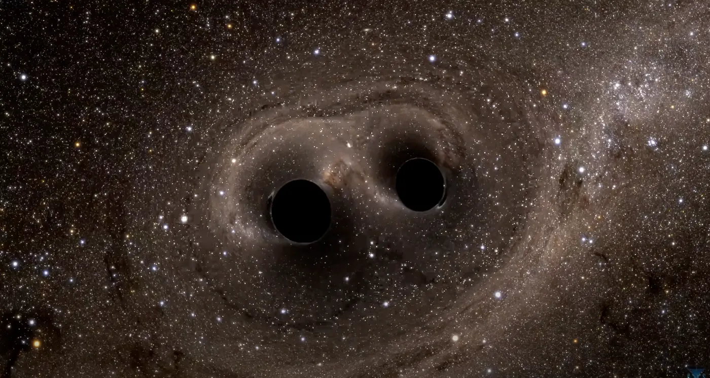

<https://www.youtube.com/watch?v=1agm33iEAuo>

Kara delik birleşmelerinden yakaladığımız kütleçekim dalgaları karmaşık yörünge dinamiklerine işaret ediyor. Genel görelilikle gayet uyumlular ama bence resmin tamamını yansıtmıyor olabilirler.

<https://www.youtube.com/watch?v=I_88S8DWbcU>

Gözlemlediğimiz içe spiral, birleşme ve sönümlenme evreleri elektromanyetik alan etkileşimlerini fazlasıyla andırıyor. Bu yüzden elektromanyetik etkilerin bu sistemlerde gerçekten bir rol oynayıp oynamadığını masaya yatırmamız şart.

## Fikir: kısa ömürlü bir yük

Olay şu: Kara deliklerin durağan haldeyken elektromanyetik açıdan nötr olduğu varsayılır. Fakat bu dinamik süreçlerde kısa ömürlü ya da kalıntı bir yük taşıyor olabilirler. Böylesi bir yük de birleşme dinamiklerini saf kütleçekim modellerinin tek başına açıklayamayacağı biçimde değiştirebilir. Üstelik bu olaylardan yayılan elektromanyetik radyasyon, kütleçekim dalgalarının tek başına ele vermediği kara delik özelliklerine dair ipuçları barındırabilir.

Bunun akla yatkın olduğunu düşünmemin üç nedeni var: İlki bilginin nasıl kodlandığıyla alakalı. Nasıl ki ses dalgaları kaynaklarına dair frekans, genlik ve faz modülasyonu üzerinden tonla ayrıntı taşıyorsa, kara deliğin etrafındaki bölgeden yayılan elektromanyetik dalgalar da kütleçekim dalgası dedektörlerinin kaçırdığı yapısal ve dinamik bilgileri taşıyor olabilir. İkincisi, farklı fizik alanlarının birbirine bağlanması. Aşırı kütleçekim alanlarında, genel görelilikteki doğrusal olmayan etkiler aracılığıyla uzay-zaman eğriliği ile elektromanyetik alanlar arasındaki etkileşim, gözlemleyebileceğimiz ve saf kütleçekim tahminlerinden ayrışan izler bırakabilir. Üçüncüsü ise gözlemlerimizdeki boşluk. Mevcut modeller elektromanyetik nötrlük varsayımına dayanıyor; fakat madde yutma veya birleşme evrelerinde ortaya çıkacak anlık bir yüklenme, tespit edebileceğimiz elektromanyetik eşlikçiler doğurabilir ve bunlar da kütleçekim dalgalarından edindiğimiz bilgileri tamamlar.

Bu doğrultuda üç somut adım öneriyoruz: Kütleçekim dalgası olaylarıyla eşzamanlı elektromanyetik izlerin sistematik biçimde incelenmesi, birleşme dinamikleri için kütleçekim ile elektromanyetizmayı birleştiren modellerin geliştirilmesi ve elektromanyetik spektrumdaki verilerle hesapladığımız kara delik parametreleri arasındaki korelasyonların taranması. Bu yaklaşım, tıpkı astronominin optik, radyo ve X-ışını gözlemlerini harmanlayarak sıçrama yapması gibi, karmaşık sistemlerin fiziğini gerçekten çözebilmek için çok habercili gözlemlere ihtiyaç duyulduğu fikrine dayanıyor.

## Kara delikleri anlamanın anahtarı olarak çok habercili astronomi

Çok habercili yaklaşım evreni anlama biçimimizi kökten değiştiriyor çünkü tek bir sinyale bel bağlamak yerine farklı bilgi taşıyıcılarını aynı anda inceliyor. Kütleçekim dalgalarını, elektromanyetik radyasyonu, nötrinoları ve kozmik ışınları bir araya getiriyor. Her haberci, aynı astrofiziksel olay hakkında tablonun bambaşka bir parçasını önümüze koyuyor.

Kara delikler özelinde konuşursak; kütleçekim dalgaları kütleleri ve dönüş hızlarını ortaya koyarken elektromanyetik sinyaller yük durumunu ve manyetik alan yapısını gösterebilir, X-ışınları ise yakın çevre hakkında fikir verir. Bu durum, her enstrümanın esere farklı bir tını kattığı bir orkestrayı andırıyor; her haberci büyük resme kendi yapboz parçasını ekliyor.

Zaten doğrudan bu konu üzerinde çalışan harika isimler ve merkezler mevcut. Caltech'ten Nobel ödüllü ve LIGO öncüsü Kip Thorne, yeni teorilere son derece açık bir isim. Potsdam'daki Max Planck Enstitüsü'nden Alessandra Buonanno, kütleçekim dalgası modellemesinde dünyanın önde gelen liderlerinden. Perimeter Institute'ten Luis Lehner, aşırı kütleçekim alanlarındaki elektromanyetik etkiler konusunda uzman. Arizona Üniversitesi'nden Vasileios Paschalidis, manyetohidrodinamik etkileşimler üzerine araştırmalar yürütüyor. Frankfurt Goethe Üniversitesi'nden Luciano Rezzolla, çok habercili astronomi dendiğinde akla gelen ilk uzmanlardan. Harvard'dan Sheperd Doeleman ise Event Horizon Telescope'un direktörlüğünü yürütüyor. Kurum bazında ise Potsdam'daki Max Planck Kütleçekim Fiziği Enstitüsü, LIGO Bilimsel İşbirliği, Kanada'daki Perimeter Institute ve İtalya'daki Avrupa Kütleçekim Gözlemevi takip edilmesi gereken en önemli adresler.

Konuyla ilgili öne çıkan güncel araştırmalardan bazıları şunlar: Annual Review of Astronomy and Astrophysics'te yayımlanan Multi-messenger Astrophysics with Gravitational Waves, Nature Reviews Physics'teki Electromagnetic Counterparts of Gravitational Wave Sources ve Physical Review D'de çıkan Charged Black Holes in Modified Gravity. Güncel literatürü ise arXiv.org arşivinde gr-qc (Genel Görelilik) ve astro-ph.HE (Yüksek Enerjili Astrofiziksel Olaylar) kategorileri altında rahatlıkla takip edebilirsiniz.

## Multi-Messenger-Astronomie als Schlüssel zum Verständnis Schwarzer Löcher

Çok habercili astronomi yaklaşımı evreni anlama biçimimizi baştan aşağı değiştiriyor çünkü aynı anda farklı bilgi taşıyıcılarına odaklanıyor. Yalnızca tek tip bir sinyale güvenmek yerine kütleçekim dalgalarını, elektromanyetik ışı رابطyı, nötrinoları ve kozmik ışınları tek potada eritiyor. Her haberci, aynı astrofiziksel olaya dair kendine has bilgiler taşıyor.

Kara delikler söz konusu olduğunda; kütleçekim dalgaları bize kütleleri ve dönme hızlarını fısıldarken elektromanyetik sinyaller yük durumlarını ve manyetik alan yapılarını gözler önüne serebiliyor, X-ışınları ise ortamın hemen çevresi hakkında çok şey söylüyor. Tıpkı her enstrümanın parçaya farklı bir ses kattığı bir orkestra gibi; her haberci büyük resme kendi yapboz parçasını getiriyor.

Tam da bu eksende çalışan çok kıymetli araştırmacılar ve kurumlar var. Caltech bünyesindeki Nobel ödüllü LIGO öncüsü Kip Thorne, taze teorilere sonuna kadar açık bir bilim insanı. Potsdam Max Planck Enstitüsü'nden Alessandra Buonanno, kütleçekim dalgalarının modellenmesinde dünyadaki lider isimlerden. Perimeter Institute araştırmacısı Luis Lehner, aşırı kütleçekim alanlarındaki elektromanyetik etkiler üzerine uzmanlaşmış durumda. Arizona Üniversitesi'nden Vasileios Paschalidis, manyeto-hidrodinamik etkileşimleri araştırıyor. Frankfurt Goethe Üniversitesi'nden Luciano Rezzolla ise çok habercili astronominin yetkin uzmanları arasında. Harvard Üniversitesi'nden Sheperd Doeleman da Event Horizon Telescope projesinin başında yer alıyor. Bu alanda önerebileceğim başlıca kurumlar ise Potsdam'daki Max Planck Kütleçekim Fiziği Enstitüsü, LIGO Bilimsel İşbirliği, Kanada'daki Perimeter Institute ve İtalya'daki Avrupa Kütleçekim Gözlemevi.

Göz atmaya değer güncel araştırmalar ve makaleler arasında Annual Review of Astronomy and Astrophysics dergisindeki Multi-messenger Astrophysics with Gravitational Waves, Nature Reviews Physics'te çıkan Electromagnetic Counterparts of Gravitational Wave Sources ve Physical Review D sayfalarındaki Charged Black Holes in Modified Gravity çalışmaları sayılabilir. Güncel ön baskıları ise arXiv.org üzerinde gr-qc (General Relativity) ve astro-ph.HE (High Energy Astrophysical Phenomena) alt başlıklarında bulabilirsiniz.
