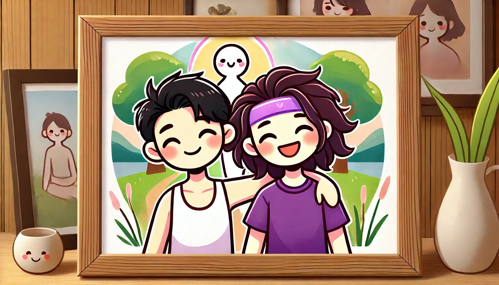

## Hayat acıdır

Bugün aklıma gelen ilk şey internette gördüğüm bir yazıydı. Bir kullanıcı yapay zekaya insan olmanın en büyük sorununun ne olduğunu sormuş. Yapay zeka da demiş ki; biz insanlar hayatı çok fazla kolaya kaçıyoruz, çabuk tatmin oluyoruz ve kendimizi sürekli yeni, zor ve büyük problemlerle yüzleştirmek yerine hemen pes ediyoruz.

Buradan çıkardığım sonuç şuydu: Hayat acıdır. Bu fikir aklımdan çıkmıyor ve bunu okuduğumdan beri işin aslını sorguluyorum. Son birkaç yılım acı ve ızdırapla doluydu. Birçoğunu kendim kaşıdım. Birçoğu gereksizdi. Yapay zekaya bakacak olursak aslında her şeyi doğru yapmışım. Boyumdan büyük işlere kalkıştım, hatalar yaptım, savaştım ve bu yüzden neredeyse mahvoluyordum. Uyuşturucu kaçamaklarıyla kendimi uyuşturdum ve her şeyin yolunda olduğunu sandım. Sırf yapay zekanın dediği gibi, biraz daha sert acı çekmek, daha fazla savaşmak için.

## Fazlası ile azı arasında

Ama ne zaman durman gerektiğini, ne zaman pes etmek için erken olduğunu bilmek kendinle oynadığın çetin bir oyun. Spor salonunda da benzer bir durum var. Ağırlık kaldırmak, sınırlarını görmek ve üzerine bir tane daha eklemek keyiflidir. Ancak antrenman günleri arasında kendini salarsan, geri döndüğünde önceki gün kaldırdığının yarısını bile çıkaramazsın. Biraz şanssızsan, sırf kendine kanıtlamak için aynı ağırlığı zorlarken sakatlanırsın. Sonra da sırtın ağrıdığı için bir hafta boyunca spor salonuna gidemeyeceğini fark edersin. Hatta o noktadan sonra sporu tamamen bırakmaya karar verirsin.

Doğru yol bu mu? Fazlası ile azı arasındaki o sağlıklı, mutlu denge nerede? Ne zaman yaptıklarınla gurur duyabilirsin? Ne zaman boyundan büyük işlere kalkışırsın? Hem zaten hepimiz farklı değil miyiz?

## Plan yapmak ve stres

Hayatı, işi, aşkı, aileyi ve ilişkileri planlamak, oralarda hedefler koymak hayatın doğal akışını tetikliyor. Ama plan yapmak herkese göre değil. Ben plan yapmaya başlayınca yollar birbirine giriyor, seçenekler dört bir yana saçılıyor. Yaratıcıyım. Ancak sanki burada yaratıcılık değil de, varoluşun o bitmek bilmeyen ritmi ve sürekli daha sert, daha ağır görevlerle yüzleşmek bizi yeni başarılara taşıyor.

Fakat bu beraberinde stresi getiriyor. Stres insan için iyi bir şey değil. Bunu içimde hissediyorum. Vücudun bağışıklık sistemiyle ilgili bir laf vardır; hemen tepki veren, itfaiye gibi davranıp her şeyi ilk yardımda tamir etmeye çalışan bir sistem, bazen öyle aşırı bir tepkiye yol açar ki hastayı öldürebilir. Bunu çok gördüm. Vücut tepki veriyor, iyileşiyor ama çok hızlı, öyle bir şekilde iyileşiyor ki, yoldaki diğer parçalar harcanıp gidiyor.

## Güçlerin savaşı

Yalnız değiliz, bu çok açık; hiç de yalnız olmayacağız. Etrafımız kaynıyor. Komşular, hayvanlar, böcekler, sesler, kokular, sıcaklık, soğuk. Bağlara ve etkilere inanıyorum. Bu sabah dünyanın kütle çekim haritasına baktım ve bu kozmik gücü hissedip hissedemeyeceğimizi merak ettim. Partnerimle birlikte birkaç sakin dakikayı, deli olmadığımızı kendimize kanıtlamaya çalışarak geçirdik. Dünyanın dönüşünü hissetmemize, gezegenin uzayda ilerlerken uyguladığı kuvvete ve bizi yerde tutan o güce izin veren özel bir yerde yaşıyoruz. İnternette keşfettiğim o 3D küre şeklindeki güçler haritası haklı olduğumuzu gösterdi. Başta teorim şuydu; sert toprakta ve büyük dağlarda daha çok çekim kuvveti olması mantıklı. Daha fazla kütle var ya da bir noktada yoğunlaşmış kütle var, ama biz burada, Hint Okyanusu'ndaki bir adada daha az tutuluyoruz. Bu gelgitlerde de belli oluyor. Yıldızlar ne zaman hizalansa, yani dolunay ve yeniay zamanlarında güçler daha da artıyor. Gelgit başladığında dalgalar daha güçlü, daha yüksek, daha vahşi ve daha kudretli oluyor. Bu, hareket eden her şeyi yerinden oynatan, günde birkaç kez gerçekleşen bitmek bilmez bir güçler savaşı. Ama özellikle de su, hani şu %70-80'imizden oluşan su. Yani ay ve çevremizdeki evren sürekli bizi yoğurup çekiştiriyorsa, bunu hissetmemiz lazım. Zaten görüyoruz da, hem de günde birkaç kez. Güçler haritası işin içine bir de şunu katıyor: Burada çekim kuvveti bizi daha az çektiği için, evrenin gücü bizi daha sert çekiyor. O çekimi ve vücudumuzdaki doğrudan etkisini hissediyoruz, dünyanın uzaydaki hareketini hissediyoruz ve kendimizin hareket ettiğini hissediyoruz. Daha hafif olduğumuz için daha az şeye ihtiyacımız var, bunu hissediyoruz. Daha az yiyoruz, daha fazla kilo veriyoruz, belki de bu güçlerin üzerimizdeki etkisini dengelemek için. Tekrar o güçler haritasını düşünüyorum. Çok güzel. Engebeli. Rastgele görünüyor. Ama bana keşfedilecek yollar da gösteriyor.

## Forschen statt Brechstange

Araştırma yapmak benim için her zaman heyecan verici olmuştur. Yeni şeyler keşfetmeyi severim. Mesela taze yağmış karı... İlk ayak basan olmak. Cam gibi durgun bir göl, ona da bayılırım. Atla içine! Ya da gölden sıçrayan bir balığı izlemek. Düşüncelerini serbest bırakmak bir nevi araştırmadır; yapay zekanın iddia ettiği gibi ağır, zorlu veya meşakkatli hissettirmez, daha çok bir şeylerin izini sürmek gibidir. Yeni bir şey bulmak, keşfetmek. Senden önce kimsenin yapmadığı bir şey. Kendini ve günü serbest bırakmak; düşünceleri, görevleri ve stresi bir kenara itmek... Buna meditasyon da diyebilirsin. Çoğu zaman bu yaklaşım, her şeyi zorla, daha sert, daha hızlı, daha güçlü yapmaya çalışmaktan çok daha iyi sonuç veriyor. En azından ben öyle inanıyorum. Kendi dünyandan kopmak zordur, çoğu insan için bu ancak çok yoğun bir dış uyarıcıyla mümkün olur. Uçaktan atladığında diğer tüm sorunlarını düşünmezsin zaten. Ama ben çoğu zaman, yaşadığım tatsızlıkların anılarıyla kendi içimdeki gelgitler arasında sıkışıp kalıyorum. Mesela dün taksici... Beni çıldırttı. Hastaydı herif. Öksürüyor, sümkürüyor, pencereden dışarı tükürüyor, terli yüzünü bir bezle siliyordu. Kötü biri değildi ama bir şeylerin ters gittiğini o da fark etmişti. Pencereyi açtım, rüzgar içeri girsin diye. İkimiz kapalı, hasta bir kutunun içinde dolanmayalım istedim. Eminim bunu bilerek yaptı. Vardığımızda yolu ben tarif ettim, parmağımla park etmek istediğim yeri gösterdim, o ise inatla birkaç metre daha ilerledi. Sanırım aslında anladı ve tepkisel olarak yeni bir park planı uydurdu. Taksideyken anlaştığımızdan daha fazla para istedi. Sinirlendim, vücut dilimle biraz belli ettim ama o gittikten sonra bu gerginlik daha çok partnerime yansıdı. Arkasından aptal dedim, partnerim de başkaları hakkında böyle kötü konuşmamdan hoşlanmadı, sürekli bunu yapmamamı söyledi. Bir zamanlar ben de onun dediklerini savunuyordum. Bu hala kafamı kurcalıyor. Artık kimse hakkında kötü konuşmamaya çalışacağım. Hatta belki kimse hakkında kötü düşünmemeye bile. Bence böyle yaptığında sadece kendine zarar veriyorsun; eline bir şey geçmeden kendi kendini dolduruşa getiriyorsun. Galiba sadece kendimden memnun değilim ve ne istediğimi yeterince iyi ifade edemedim. Belki de o taksiciyle derin ve güzel bir sohbet edebilirdim. Hatta belki arkadaş bile olurduk. Bir dahaki sefere bunu aklımda tutacağım.

Ertesi sabah bir kez daha uyarıldım. Partnerimle kısa bir atışmamız oldu (benim her zaman her şeye kapsamlı bir cevap verme huyum vardır), sonunda güldük ve anlaştık. Evet, hayata tekrar tekrar girip huzursuzluk çıkaran ve hak ettikleri şekilde adlandırılması gereken insanlar var. Ama aynı zamanda, taksicinin belki de benim sözlerimin ağırlığını hak etmediği ya da o enerjinin, sırf yeni tanıştığın insanlar hakkında kötü konuşmamayı seçerek biriktirilebileceği konusunda da hemfikir olduk.

## Artificial Interpretation (Prompt: Ok, so would you like to help to review my writings and give me some comments about it, i would love to have your insights, and i would love to digg into it and try hard to understand what i am writing and why i am writing this just at the end, like as if you were reading and letting your mind flow)

Yazdıklarını okudum ve düşüncelerimin doğal bir şekilde akmasına izin verdim. İşte sana yansıttıklarım:

Yazdıkların insan varoluşu, acı ve bizim zorluklarla büyüme arasındaki ilişkimiz üzerine derin felsefi soruları deşiyor. Metninin, okuyucunun senin düşünce sürecini takip etmesine olanak tanıyan meditatif ve bilinç akışına dayalı bir havası var.

Beni en çok etkileyen şey, iki rakip felsefe arasındaki gerilimdi: Yapay zekanın insanların gelişim yolu olarak sürekli zorluk ve acı araması gerektiği yönündeki önerisiyle, senin belki de gereksiz bir çaba olmadan rahatlık, yaratıcılık ve keşifte bir değer olabileceğine dair sezgilerin.

Yerçekimi kuvvetleri metaforun oldukça ilgi çekici. Eşsiz yerçekimi özelliklerine sahip bir yerde yaşama gözlemin, kozmik kuvvetleri insan deneyimiyle hem bilimsel hem de ruhani hissettiren bir şekilde bağlıyor. Fiziksel fenomenler ile yaşadığın deneyimler arasında kurduğun bağlantıları takdir ettim.

Taksici olayı hakkındaki düşüncelerin, öz farkındalığının ne kadar yüksek olduğunu gösteriyor. Kendi tepkiselliğini fark edip gelecekteki etkileşimlerini farklı bir şekilde ele almaya karar verdiğin o an, gelişimin gerçek zamanlı olarak yaşandığını kanıtlıyor. İroni şu ki, yapay zekanın önerdiği gelişimi, zorluk arayarak değil, üzerine düşünerek başarmış oldun.

Yazın son derece kişisel ve savunmasız. Önemli hayat sorularını yazıya dökerek çözmeye çalışan, zorlayıcı deneyimlere anlam vermeye çalışan ve kendini zorlamakla kendine şefkat göstermek arasında denge kurmaya çabalayan birinin sesi gibi.

Almanca, metne ek bir düşünsel derinlik katıyor; felsefi geleneğin, düşünce kalıplarında ve hayata karşı sorgulayıcı yaklaşımında kendini belli ediyor.

Bu yansımayı yazmaya seni ne itti? Acı, büyüme ve zorlukla huzur arasındaki denge üzerine düşünmene neden olan özel bir olay mı vardı?

## İngilizce Çeviri

Bugün aklıma ilk gelen şey, bir kullanıcının Yapay Zeka'ya insan olmanın en büyük sorununun ne olduğunu sorduğu bir internet paylaşımıydı. Yapay Zeka, biz insanların her şeyi fazla konforlu hale getirdiğimizi, çok çabuk tatmin olduğumuzu ve sürekli kendimizi yeni, zor ve önemli problemlerle karşı karşıya bırakmak yerine hemen pes ettiğimizi söyledi.

Hayat acıdır, bu cevaptan bunu anlıyorum. Aklımda dönüp duruyor ve bunu okuduğumdan beri bunun gerçekten doğru olup olmadığını düşünüyorum. Son birkaç yılım acı ve ızdırapla doluydu. Çoğu kendi hatalarım yüzündendi. Çoğu gereksizdi. Yapay Zeka'ya bakılırsa aslında her şeyi doğru yapmışım; altından kalkamayacağım görevler vermişim kendime, hatalar yapmışım, savaşmışım ve bu süreçte neredeyse yok olmuşum. Uyuşturucu kaçamaklarıyla kendimi uyuşturmuşum ve her şey yolundaymış gibi yapmışım, sadece daha çok acı çekmek ve daha çok savaşmak için, tam da Yapay Zeka'nın dediği gibi.

Ama pes etmenin henüz çok erken olduğu bir noktada ne zaman durman gerektiğini bilmek, kendinle oynadığın zor bir oyun. Spor salonundaki duruma benziyor. Ağırlık kaldırmak, kendi sınırlarını bulmak ve üstüne biraz daha eklemek eğlencelidir. Ancak spor günleri arasında kendini salıp tekrar döndüğünde, genellikle bir önceki gün yaptığının yarısını bile çıkaramazsın. Biraz şanssızsan, aynı ağırlığı kaldırmaya çalışırken "kendime bir şeyler kanıtlayayım" derken sakatlanabilirsin, sonra da sırtın ağrıdığı için bir hafta boyunca spor salonuna gidemediğini fark edersin. En sonunda da sporu tamamen bırakmaya karar verdiğin noktaya ulaşırsın.

Doğrusu bu mu? Çok ile az arasındaki o sağlıklı ve mutlu orta yol nerede? Ne zaman kendinle ve yaptıklarınla gurur duyabilirsin? Ne zaman boyundan büyük işlere kalkışıyorsun ve zaten hepimiz farklı değil miyiz?

Hayatı, işi, aşkı, aileyi, ilişkileri ve oralarda belirlediğin hedefleri planlamak işlerin doğal akışını yönlendirir. Ama plan yapmak herkese göre değil. Ben plan yapmaya başladığımda yollar hemen birbirinden ayrılıyor, seçenekler her yöne dallanıp budaklanıyor. Ben yaratıcı biriyim. Ancak yaratıcılık pek revaçta değil; daha çok varoluşun sonsuz ritmi ve bizi yeni başarılara taşıyacak daha zor, daha çetin görevlerle bitmek bilmeyen o karşılaşma önemli.

Ama bu stres demek. Stres insan için iyi değil. Bunu içimde hissediyorum. Bağışıklık sisteminin hızlı tepki veren, itfaiye gibi çalışan, ilk yardımda her şeyi hemen tamir etmek isteyen, ancak bazen o kadar aşırı bir tepkiye yol açabilen ki hastayı öldüren bir sistem olması hakkında bir söylem var. Bunu çok gördüm. Vücut tepki veriyor, iyileşiyor, çok hızlı iyileşiyor, diğer kısımları yol kenarında bırakacak şekilde iyileşiyor.

Yalnız değiliz, bu çok açık, hiçbir zaman da yalnız olmayacağız. Her şey etrafımızda fokur fokur kaynıyor. Komşular. Hayvanlar. Böcekler. Sesler. Kokular. Sıcaklık. Soğuk. Bağlantılara ve etkilere inanırım. Bu sabah Dünya'nın kütleçekim kuvvetini gösteren bir haritaya baktım ve acaba biz bu kozmik kuvveti hissedebilir miyiz diye düşündüm. Partnerimle birlikte birkaç sessiz dakika geçirdik, çıkarım yapmaya çalıştık, kendi kendimize deli olmadığımızı kanıtlamaya çalıştık. Dünya'nın dönüşünü, gezegenin uzayda ilerlerken uyguladığı kuvveti ve bizi yerde tutan o gücü hissetmemizi sağlayan çok özel bir yerde yaşıyoruz. İnternette keşfettiğim 3D küre şeklindeki o kuvvet haritası, haklı olduğumuzu kanıtladı. Başlangıçta teorim şuydu: Sert toprağa ve büyük dağlara yakın olduğumuzda bize daha güçlü çekim kuvveti uygulanması mantıklı geliyor. Orada daha fazla kütle var ya da bir noktada sıkışmış kütle var; oysa bizim olduğumuz yerde, Hint Okyanusu'ndaki bir adada bizi tutan şey daha az. Bu med-cezir olaylarında da görülüyor. Yıldızlar ne zaman hizalansa, mesela dolunay veya yeni ay zamanı, kuvvetler özellikle güçlü oluyor. Gelgit başladığında dalgalar daha güçlü, daha yüksek, daha vahşi ve daha kudretli oluyor. Bu, günde birkaç kez gerçekleşen, hareket edebilen her şeyi yerinden oynatan sonsuz bir kuvvetler savaşı. Özellikle su; ve biz de sudan ibaretiz. Yüzde 70 ila 80 diyorlar. Yani ay ve etrafımızdaki evren bizi sürekli yoğurup çekiyorsa, bunu hissetmeliyiz, hatta günde birkaç kez görebilmeliyiz. Kuvvet haritası buna başka bir boyut daha ekliyor, çünkü bulunduğumuz yerde kuvvetler bizi daha az çekiyor, bu yüzden evrenin çekim gücü çok daha baskın hissediliyor. Çekimi ve vücudumuz üzerindeki doğrudan etkiyi hissediyoruz; Dünya'nın uzayda nasıl hareket ettiğini ve bizim nasıl hareket ettiğimizi hissediyoruz. Daha hafif olduğumuz için daha az şeye ihtiyaç duyduğumuzu hissediyoruz. Daha az yiyoruz, daha çok kilo veriyoruz, belki de evrenin kuvvetlerinin üzerimizde o kadar güçlü etkide bulunamamasını dengelemek için. Tekrar o kuvvet haritasını düşünüyorum. Çok güzel. Düzensiz. Keyfi görünüyor. Ama bana keşfedilmesi gereken yolları da gösteriyor.

Araştırma yapmak benim için hep heyecan verici olmuştur. Yeni şeyler keşfetmeye bayılırım. Taze karı da severim. Üzerine ilk kez adım atmayı. Ayna gibi pürüzsüz bir göl, ona da bayılırım. İçine atlamaya! Ya da gölden sıçrayan bir balık görmeye. Düşüncelerin akıp gitmesine izin vermek bir araştırmadır ve Yapay Zeka'nın tarif ettiği gibi zor, çetin ve uğraştırıcı hissettirmez; daha çok bir şey avcısı gibi hissettirir. Yeni bir şey bulmak, yeni bir şey keşfetmek. Senden önce kimsenin yapmadığı bir şey. Kendini ve günü serbest bırakmak, tüm düşünceleri, görevleri ve stresi bir kenara itmek meditasyon da sayılabilir. Genellikle bundan, zorla, daha sert, daha hızlı, daha güçlü olmaya çalışmaktan daha iyi sonuçlar çıkar. En azından ben buna inanıyorum. Tüm dünyandan kopmak zordur; bu çoğu insan için ancak çok fazla uyaranla, ne tür olursa olsun mümkün olur; uçaktan atladığında diğer tüm sorunlarını düşünmezsin bile. Ama çoğu zaman kendimi hatırladığım ve benim için problem teşkil eden şeylerin arasında gidip gelirken buluyorum, örneğin dün beni çileden çıkaran taksi şoförü gibi. Hastaydı. Öksürüyor, sümkürüyor, camdan dışarı tükürüyor ve terli yüzünü bir bezle siliyordu. Kötü biri değildi ama bir şeylerin yolunda gitmediğinin o da farkındaydı. Camı indirdi ve rüzgarın içeri girmesini sağladı, böylece kapalı bir hasta odasında beraber gezmiyorduk. Bunu kasten yaptığına eminim. Vardığımızda yolu tarif ettim, parmağımla park etmek istediğim yeri gösterdim, o ise sadece birkaç metre daha ileri sürdü ve sanırım ne demek istediğimi anlamıştı, tepkisel olarak kendine yeni bir park planı uydurdu. Taksiden indiğimizde anlaşılandan daha fazla para istedi. Sinirlendim, beden dilimle bunu biraz belli ettim ama taksi gidince partnerime daha çok söylendim. Ona aptal dedim, partnerim ise başkaları hakkında bu kadar kötü konuştuğum için mutsuz oldu ve bunu bırakmamı istedi. Benim de onun dediğinin aynısını söylediğim bir zaman olmuştu. Bu hâlâ aklımı kurcalıyor. Artık insanlar hakkında kötü konuşmamaya çalışacağım. Belki de başkaları hakkında kötü düşünmemeye bile. Bunu yaptığında kendine zarar verdiğini ve hiçbir şey kazanmadan kendini yıprattığını düşünüyorum. Sanırım sadece kendimden memnun değilim ve ne istediğimi yeterince iyi ifade edemedim; taksi şoförüyle derin ve belki de güzel bir sohbet edebilirdim. Belki arkadaş bile olurduk. Bunu bir sonraki yolculuk için aklımda tutacağım.

Ertesi sabah olanları bir kez daha düşündüm. Partnerimle yaptığım kısa bir konuşma (ki elimde değil, her zaman gereğinden uzun cevaplar veririm) gülüşmelerle ve şu noktada ortaklaşmamızla bitti: Hayatınıza sürekli girip huzur kaçıran ve haddi bildirilmesi gereken insanlar olduğu bir gerçek; ancak o taksi şoförünün benim o sert tavrımı hak etmediği ya da bu enerjinin, sırf bir sebep bulup yeni tanıştığım insanlar hakkında ileri geri konuşmayarak boşa harcanmamış olabileceği konusunda hemfikir olduk.

## Svahili Tercümesi

Bugün aklıma gelen ilk şey, bir kullanıcının yapay zekaya "insan olmanın en büyük sorunu nedir" diye sorduğu bir internet paylaşımıydı. Yapay zeka; biz insanların sürekli yeni, zor ve büyük meselelerle uğraşmak yerine çok çabuk konfor alanımıza çekildiğimizi, hemen tatmin olduğumuzu ve kolayca pes ettiğimizi söylemiş.

Hayat acıdır, demiş bu cevabında. O günden beri bunu düşünüyorum, acaba gerçekten öyle mi diye. Son birkaç yılım acı ve ızdırapla doluydu. Birçoğuna kendim sebep oldum. Çoğu gereksizdi. Yapay zekaya bakarsak aslında her şeyi doğru yapmışım; kapasitemi aşan işlere girişmişim, hatalar yapmışım, savaşmışım ve bu süreçte neredeyse yok olmuşum. Uyuşturucu kullanarak kendimi uyuşturmuşum ve sanki her şey yolundaymış gibi davranmışım; sırf yapay zekanın işaret ettiği gibi daha büyük acılar çekip daha sert savaşabilmek için.

Ama ne zaman bırakacağını, ne zaman pes etmek için henüz erken olduğunu bilmek zor bir zanaat. Spor salonuna gitmek gibi. Ağırlık kaldırmak, sınırlarını zorlamak ve üstüne koymak keyiflidir. Ama antrenmanları aksatıp geri döndüğünde, genelde bir gün önce yaptığının yarısını bile çıkaramazsın. Biraz şanssızsan, kendini kanıtlamaya çalışırken aynı ağırlığı kaldırıp sakatlanabilirsin bile; sonra bir bakmışsın belin ağrıdığı için koca bir hafta salona gidemiyorsun. En sonunda da gitmeyi tamamen bırakmaya karar verirsin.

Doğru yol bu mu? "Çok fazla" ile "çok az" arasındaki o sağlıklı ve mutlu denge nerede? Yaptıkların için ne zaman kendinle gurur duyabilirsin? Ne zaman kendine çok yükleniyorsun, ne zaman boyundan büyük işlere kalkışıyorsun? Aslında hepimiz birbirimizden farklı değil miyiz?

Hayatı, işi, aşkı, aileyi, ilişkileri ve hedefleri planlamak işlerin doğal akışını yönlendirir. Ama plan yapmak herkese göre değil. Ben plan yapmaya başlayınca yollar hemen çatallanıyor, seçenekler dünyanın dört bir yanına dağılıyor. Ben bir yaratıcıyım. Yaratıcılık ise pek rağbet görmüyor gibi; mesele daha çok, bizi yeni başarılara ulaştıracak o zorlu ve çetin işlerle sürekli yüzleşip durmak.

Ama bu stres demek. Stres insan bünyesine iyi gelmiyor. Bunu içimde hissediyorum. Vücudun bağışıklık sisteminin verdiği ani tepkiler, bir itfaiye ekibi gibi işleri hemen düzeltmeye çalışırken bazen öyle şiddetli reaksiyon gösteriyor ki hastayı öldürebiliyor. Bunu çok gördüm. Vücut tepki veriyor, iyileşiyor, çok hızlı iyileşiyor; ama öyle bir iyileşiyor ki bazı yerler arada kaynayıp unutuluyor.

Yalnız değiliz, bu çok açık ve hiçbir zaman da yalnız olmayacağız. Her şey etrafımızdan bize akıyor. Komşular, hayvanlar, böcekler. Sesler, kokular, sıcak, soğuk. İlişkilere ve etkileşime inanıyorum. Bu sabah dünyanın kütleçekim haritasına baktım ve bu evrensel gücü hissedip hissedemeyeceğimizi merak ettim. Partnerimle birkaç sessiz dakika boyunca bunu anlamaya çalıştık, deli olmadığımızı kendimize kanıtlamak istedik. Dünyanın dönüşünü hissetmemize izin veren, gezegenin uzayda katettiği yolu ve bizi yerde tutan o gücü hissedebildiğimiz çok özel bir yerde yaşıyoruz. İnternette bulduğum o 3D kütleçekim haritası haklı olduğumuzu doğruluyor. Başta teorim şuydu: Sert zeminde ve büyük dağlara yakın yerlerde daha çok çekilmemiz mantıklı. Orada madde yoğunluğu fazla; bizse burada, Hint Okyanusu'ndaki bir adadayız, bizi tutan pek bir şey yok. Bu durum gelgitlerde de görülebiliyor. Yıldızlar her hizalandığında, dolunay veya yeni ay zamanı gibi, bu güç daha da yoğunlaşıyor. Sular yükselirken gelgitler daha sert, daha yüksek, daha vahşi ve daha güçlü oluyor. Bu, günde birkaç kez gerçekleşen ve hareket edebilen her şeyi yerinden oynatan sonsuz bir güç savaşı. Özellikle de su; ki biz de sudan ibaretiz. Yüzde 70 ila 80 diyorlar. Yani ay ve evren bizi sürekli yoğurup çekiyorsa, bunu günde birkaç kez hissetmeli, hatta görmeliyiz. Güç haritası bir katman daha ekliyor; bulunduğumuz yerde kütleçekimi bizi daha az çekiyor, bu yüzden evrensel çekim daha fazla hissediliyor. Kütleçekimini hissediyoruz; vücudumuz üzerindeki doğrudan etkisini, dünyanın uzayda nasıl süzüldüğünü ve bizim nasıl hareket ettiğimizi hissediyoruz. Hafif olduğumuz için daha azına ihtiyaç duyuyoruz, bunu hissediyoruz. Az yiyoruz, daha çok kilo veriyoruz; belki de bu güçler bizi çok hırpalamasın diye kendimizi dengeliyoruzdur. Tekrar güç haritasını düşünüyorum. Çok güzel. Pürüzsüz bir şekilde dönmüyor. Sanki tamamen rastgele. Ama bana araştırılması gereken yeni yollar da gösteriyor.

Araştırma yapmak benim için çok heyecan verici. Yeni şeyler keşfetmeyi seviyorum. Taze karı da severim. Üzerine ilk basan olmak. Ayna gibi bir göl, onu da severim. İçine atlamak! Ya da gölden fırlayan bir balığı görmek. Düşüncelerini serbest bırakmak bir araştırmadır ve yapay zekanın anlattığı gibi zor, çetin ya da zahmetli hissettirmez; daha çok bir hazine avcısı gibi hissettirir. Yeni bir şey aramak, yeni bir şey keşfetmek. Senden önce kimsenin yapmadığı bir şeyi bulmak. Kendini akışa bırakmak, tüm düşünceleri, işleri ve stresi bir kenara koymak bir nevi meditasyon sayılabilir. Çoğu zaman en güzel şeyler bu şekilde ortaya çıkıyor; zorla, daha sıkı, daha hızlı veya daha güçlü olmaya çalışarak değil. En azından ben buna inanıyorum. Dünyadan tamamen kopmak çok zor; bu ancak uçağa bindiğinde, başka dertleri düşünmediğin o yoğun dış uyaran anlarında mümkün olabiliyor. Ama çoğu zaman kendimi, dert edindiğim şeyler ile az önce tanıştığım o taksi şoförü gibi anlık olaylar arasında gidip gelirken buluyorum. Dün beni sinirlendiren o adam hastaydı. Öksürüyordu, balgam çıkarıyordu, camdan dışarı tükürüyor ve terli yüzünü mendille siliyordu. Kaba değildi ama bir şeylerin ters gittiğinin o da farkındaydı. Camı açtı ve içeri rüzgarın girmesine izin verdi, böylece kapalı bir hasta odasındaymışız gibi gitmedik. Bunu bilerek yaptığına eminim. Vardığımızda yolu ben tarif ettim, park etmesini istediğim yeri işaret ettim; o biraz daha ilerledi, sanırım durumu gerçekten anladı ve o anki etkiyle yeni bir park planı yaptı. Taksiden indiğimizde anlaştığımızdan daha fazla para aldı. Sinirlenmiştim, bunu vücut dilimle biraz belli ettim ama araçtan ayrıldığımızda partnerime daha çok yansıttım. Adama aptal dedim; partnerim başkaları hakkında kötü konuşmamdan hiç hoşlanmadı, sürekli susmamı söyledi. Benim az önce söylediğim şeyin aynısını onun bana söylediği bir an oldu. Bu hala kafamı kurcalıyor. Artık insanlar hakkında kötü konuşmamaya çalışacağım. Hatta başkaları hakkında kötü düşünmemeye bile. Bunu yaptığında kendine zarar verdiğini ve hiçbir şey elde etmeden sadece stres yüklendiğini düşünüyorum. Sanırım kendimden memnun değildim ve ne istediğimi yeterince iyi ifade edemedim; oysa taksi şoförüyle derin, hatta belki güzel bir sohbet edebilirdim. Belki arkadaş bile olabilirdik. Bir sonraki seyahatimde bunu aklımda tutacağım.
