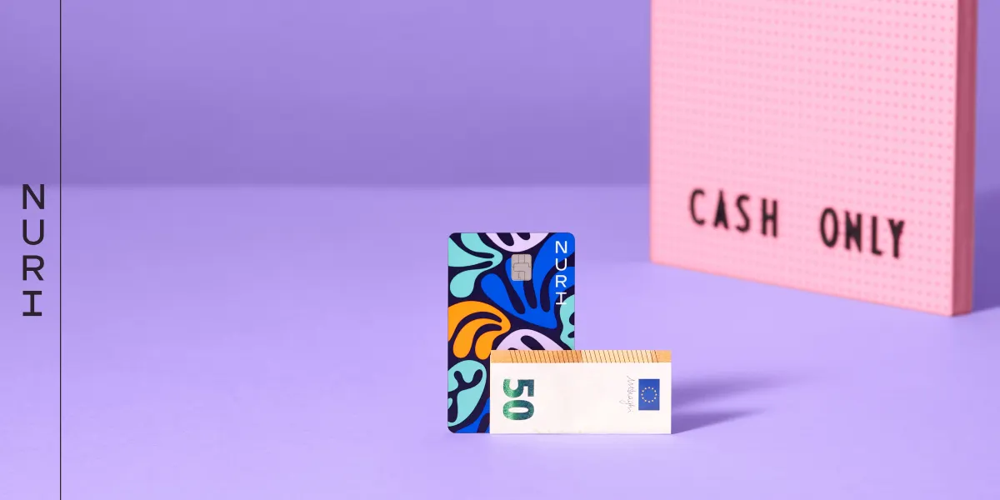

Bu yazı, Berlin merkezli LIT Creative ajansının Nuri markasını nasıl yarattıklarını anlattıkları videonun bir özeti.

Müşterinin eski adı [Bitwala](http://bitwala.com) idi. Sadece kripto kullanıcılarına değil, çok daha geniş bir kitleye hitap edebilmek için markada büyük bir değişime gitmek istediler [[03:02](http://www.youtube.com/watch?v=5izlzod-RXk&t=182)]. Ajans, sürecin sürekli git-gellerle dolu olduğunu, öyle bir adım atıp hemen diğerine geçilen düz bir çizgi şeklinde ilerlemediğini söylüyor [[04:16](http://www.youtube.com/watch?v=5izlzod-RXk&t=256)]. Nuri ismini seçtiler çünkü hem basit hem kapsayıcı, üstelik ismi de boştaydı [[07:16](http://www.youtube.com/watch?v=5izlzod-RXk&t=436), [10:20](http://www.youtube.com/watch?v=5izlzod-RXk&t=620)]. Markanın rotasını çizen temel fikirler ise cesur tipografi ile büyüme, pozitiflik, iyimserlik ve çeşitlilik hissiydi [[25:10](http://www.youtube.com/watch?v=5izlzod-RXk&t=1510)].

Ajans sonunda bu projeden ne öğrendiklerini paylaşıyor [[30:36](http://www.youtube.com/watch?v=5izlzod-RXk&t=1836)]. Asla müşteriyi hafife alma. Mükemmel süreç diye bir şey yok. Birbiriyle uyumsuz parçalardan oluşan bir Frankenstein yaratma, bütünlüğü olan tek bir marka inşa et. Markalaşma kararlarını her zaman stratejiye ve vizyona bağla. Kararları birlikte verin ve sonrasında da arkasında durun.

[www.nuri.com](http://www.nuri.com)
