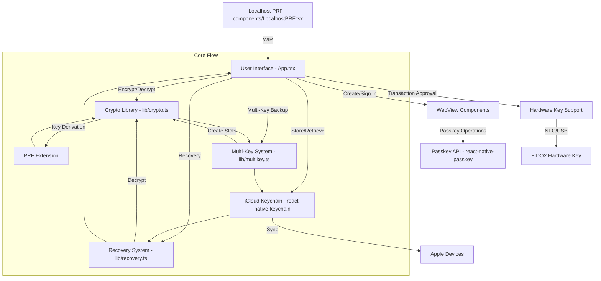
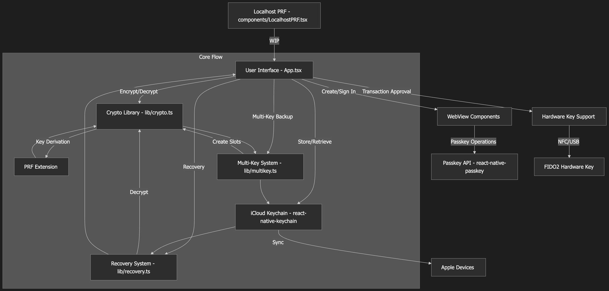

Burada Nuri wallet'ın kod tabanını, yani README.md ve ana App.tsx dosyasını inceleyeceğiz. Önce kodun ne işe yaradığına, ardından mimariyi özetleyen bir Mermaid şemasına bakalım.

## Uygulama ne işe yarıyor

Nuri, passkey tabanlı Bitcoin seed şifrelemesi üzerine kurulu bir React Native Expo uygulaması. Bitcoin seed'lerini şifrelemek, iCloud Keychain'de saklamak ve birden fazla passkey ile geri yüklemek için PRF (Pseudo-Random Function - Sözde Rastgele Fonksiyon) uzantılı WebAuthn passkey'leri kullanıyor. Uygulama, Face ID veya Touch ID destekleyen ve iCloud Keychain özelliği aktif olan iOS 16 ve üzeri cihazlar için geliştirilmiş.

Bir passkey oluşturup giriş yaptığınızda, uygulama PRF üzerinden şifreleme anahtarlarını türetiyor. Bu anahtarlarla Bitcoin seed'ini XChaCha20-Poly1305 algoritmasıyla şifreliyor. Yedekler, birden fazla passkey ile şifresi çözülebilecek şekilde ayarlanabiliyor; buna sürüm 3 formatı deniyor. Şifrelenmiş yedekler, kullanıcı başına özel bir namespace ile iCloud Keychain'e kaydediliyor.

İşlemleri onaylamak için YubiKey gibi donanım güvenlik anahtarı desteği de var ancak iOS, donanım anahtarlarında PRF kullanımını kısıtlıyor. Kurtarma işlemi ise yedeğe ait herhangi bir passkey veya guardian DEK (Data Encryption Key) anahtarlarıyla yapılabiliyor.

## Kod nasıl organize edilmiş

Root klasöründe konfigürasyon dosyaları ve giriş noktaları bulunuyor. Ana arayüz ve iş mantığının olduğu `App.tsx`, React Native giriş noktası `index.js`, `package.json`, `tsconfig.json` gibi dosyalar burada. Temel yardımcı araçlar `lib/` klasöründe yer alıyor. Buradaki `crypto.ts`; HKDF-SHA256 ile anahtar türetme, XChaCha20-Poly1305 ile şifreleme ve PRF normalizasyonu işlemlerini üstleniyor.

`multikey.ts` daha fazla passkey için key slot'ları barındıran çoklu anahtar yedeklerini yönetiyor, `recovery.ts` yedek sürümünü tespit edip seed'leri kurtarıyor, `inAppLocalhostServer.ts` muhtemelen uygulama içi bir sunucu için tasarlanmış ve hâlâ geliştirilme aşamasında. `components/` klasöründe, henüz tamamlanmamış olan localhost PRF sunucusu için `LocalhostPRF.tsx` bulunuyor.

Ayrıca WebView bileşenleri mevcut: `EmbeddedPRF.tsx` domain'e bağlı passkey kimlik doğrulaması için, `CreatePasskeyWebView.tsx` ise yeni passkey'ler oluşturmak için kullanılıyor. `docs/` klasöründe detaylı dokümantasyon ve PRF ile PWA testleri için HTML dosyaları gibi örnekler var. `scripts/` klasöründe guardian özellikleri için `guardian-server.mjs` benzeri dosyalar, `assets/` içinde ise uygulama ikonları ve açılış ekranları yer alıyor.

## App.tsx, güvenlik ve bağımlılıklar

Uygulamanın kalbi `App.tsx` dosyası; arayüzü ve wallet durumunu (state) yönetiyor. PRF, DEK, guardian'lar, donanım anahtarları ve yedeklerin durumu burada tutuluyor. Arayüz sizi adım adım yönlendiriyor: Passkey oluşturma, giriş yapma, seed şifreleme, iCloud'a kaydetme, kurtarma anahtarlarını ekleme ve seed'i kurtarma süreçleri bu akış üzerinden ilerliyor.

Passkey işlemleri `passkey.nuri.com` domain'ine bağlı WebView'lar üzerinden yürütülüyor. Donanım anahtarları işlemleri NFC veya USB üzerinden onaylıyor. Kurtarma akışı ise tek anahtarlı yedekleri (v1) ve çoklu anahtar yedeklerini (v3) yöneterek kullanıcıdan anahtar seçmesini istiyor.

Güvenlik tarafında şifreleme, her passkey için özel bir slot'a şifrelenmiş bir master key kullanıyor. Yedekler iCloud Keychain'de, örneğin `com.nuri.seed.backup.Alice` gibi kullanıcıya özel servis isimleriyle saklanıyor. Bazı kısıtlamalar mevcut; PRF cihazla eşleşmiş durumda, bu nedenle başka bir cihazda kurtarma yapmak için manuel DEK paylaşımı gerekiyor ve iOS donanım anahtarlarında PRF kullanımını kısıtlıyor.

Ana bağımlılıklar; WebAuthn için `react-native-passkey`, iCloud için `react-native-keychain`, kripto primitifleri için `@noble/hashes`, `expo-random` ve `react-native-webview` gibi kütüphaneler. Proje bir proof of concept niteliğinde; localhost PRF veya guardian kurtarma gibi bitmemiş özellikler barındırıyor. MIT lisanslı ve güvenlik uyarılarına oldukça önem veriyor.

## Mimari şeması

Bu Mermaid akış şeması, sistemin yüksek seviyeli mimarisini ve ana parçaların şifreleme/kurtarma süreçlerinde nasıl birlikte çalıştığını gösteriyor.

Şema, kullanıcının uygulamadaki etkileşimiyle başlayıp passkey, şifreleme, yedekleme ve kurtarma akışlarını detaylandırıyor. Ayrıca donanım anahtarları ve iCloud gibi dış sistemlerle olan entegrasyonları da içeriyor.

