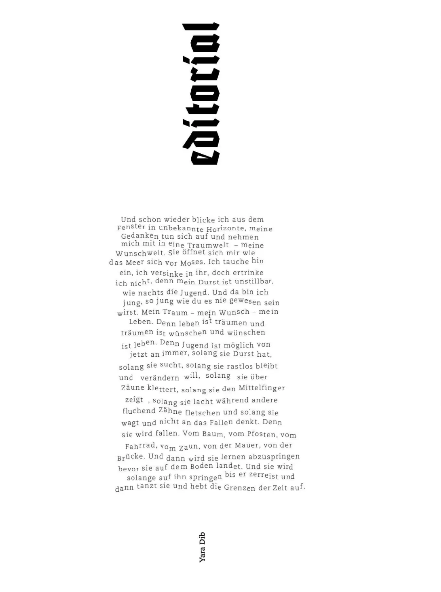

# proud magazine Berlin, Başyazı #23

Yara Dib’in proud magazine Berlin Başyazı #23’teki metni.

proud magazine’den bir başyazı. Buraya tekrar koyuyorum, çünkü konu gençlik ve hayaller, yani her zaman güncel.

Yine pencereden bilmediğim ufuklara bakıyorum; düşüncelerim genişliyor ve beni kendi kurduğum bir hayal dünyasına sürüklüyor. Tıpkı denizin Hz. Musa’ya açılması gibi önüme seriliyor her şey. İçine dalıyor, içinde kayboluyorum ama boğulmuyorum; çünkü susuzluğum, tıpkı gecenin gençliği gibi dindirilemez. Ve orada gencim, senin asla olamayacağın kadar genç. Hayalim, dileğim, hayatım. Çünkü yaşamak hayal kurmaktır, hayal kurmak dilemektir, dilemek ise yaşamaktır. Çünkü gençlik; susadığı, aradığı, huzursuz olup değiştirmek istediği, çitlerin üstünden atladığı, orta parmağını gösterdiği, başkaları küfredip dişlerini gıcırdatırken güldüğü, cesaret edip düşmeyi aklına bile getirmediği sürece her an mümkündür. Çünkü düşecek. Ağaçtan, direkten, bisikletten, çitten, duvardan, köprüden. Ve sonra yere çakılmadan önce nasıl atlayacağını öğrenecek. Yere, o parçalanana kadar zıplayacak, sonra da dans edip zamanın sınırlarını ortadan kaldıracak.

Y
a
r
a

D
i
b
