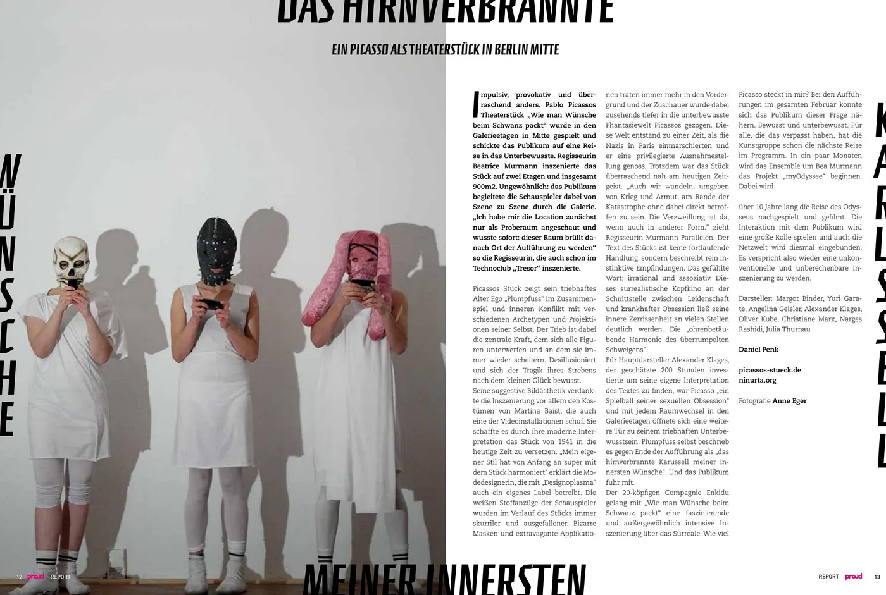

# proud magazine Berlin, Berlin Mitte’de bir Picasso tiyatrosu, yazan: Daniel Penk

Yazan: Daniel Penk, proud magazine Berlin’de yayımlandı. Fotoğraflar: Anne Eger.

proud magazine’den Mitte’deki galeri katlarında sergilenen Picasso oyunu üzerine bir yazı. Bunu burada paylaşıyorum çünkü Berlin’de tam olarak böyle şeyler oluyor ve sadece dergide kalması yazık olurdu.

*İÇ DÜNYAMIN ÇILGINLIKLARI*

## Galeri katlarında Picasso

Dürtüsel, provokatif ve şaşırtıcı derecede farklı. Pablo Picasso’nun "Arzuları Kuyruğundan Yakalamak" adlı tiyatro oyunu, Mitte’deki galeri katlarında sahnelendi ve izleyiciyi bilinçaltına doğru bir yolculuğa çıkardı. Yönetmen Beatrice Murmann, oyunu iki kata ve toplam 900 metrekarelik bir alana yaydı. Alışılmadık olan şuydu: Seyirciler oyuncuları sahneden sahneye galeri boyunca takip etti. Daha önce "Tresor" tekno kulübünde de sahne koyan yönetmen, "Mekana ilk başta sadece prova alanı olarak bakmıştım ama hemen anladım; burası resmen bir sahne olabilmek için bağırıyor" diyor.

## Plumpfuss, kostümler ve dürtüler

Picasso’nun oyunu, dürtüleriyle yaşayan alter egosu "Plumpfuss"un farklı arketipler ve kendi yansımalarıyla olan etkileşimini ve iç çatışmasını anlatıyor. Burada temel güç dürtü; tüm karakterler buna boyun eğiyor ve sürekli bu yüzden kaybediyorlar. Hayal kırıklığı içindeler ve kendi küçük mutluluk arayışlarının trajedisinin farkındalar. Oyunun etkileyici görsel estetiği, aynı zamanda video enstalasyonlarından birini de yapan Martina Baist’in kostümlerine borçlu. Modern yorumuyla 1941 tarihli bu oyunu günümüze taşımayı başardı. "Designoplasma" adında kendi markasını da yürüten moda tasarımcısı, "Kendi tarzım en başından beri oyunla harika bir uyum sağladı" diyor. Oyuncuların beyaz kumaş kostümleri, oyun ilerledikçe giderek tuhaflaştı ve sıra dışı hale geldi. Garip maskeler ve abartılı aplikasyonlar ön plana çıktıkça, izleyici Picasso’nun bilinçaltındaki fantastik dünyaya daha da derin çekildi. Bu dünya, Nazilerin Paris’i işgal ettiği ve kendisinin ayrıcalıklı bir konumda olduğu bir dönemde ortaya çıkmıştı. Yine de oyun, günümüz ruhuna şaşırtıcı derecede yakındı. Yönetmen Murmann paralellik kurarak, "Biz de savaş ve yoksullukla çevrili halde, doğrudan etkilenmeden felaketin kıyısında dolanıyoruz. Umutsuzluk burada, sadece başka bir biçimde" diyor. Oyunun metni kesintisiz bir olay örgüsü değil, sadece içgüdüsel hisleri tarif ediyor. Hissedilen kelimeler mantıksız ve çağrışımsal. Tutku ile hastalıklı takıntı arasındaki bu sürrealist zihin filmi, içindeki parçalanmışlığı birçok noktada net bir şekilde ortaya koydu: "Şaşkına dönmüş sessizliğin sağır edici uyumu."

## Oyuncular ve sırada ne var

Metne kendi yorumunu katmak için yaklaşık 200 saatini veren başrol oyuncusu Alexander Klages için Picasso, "cinsel takıntılarının oyuncağıydı" ve galeri katlarındaki her oda değişimi, onun dürtüsel bilinçaltına açılan yeni bir kapıydı. Plumpfuss’un kendisi bunu oyunun sonuna doğru "iç dünyamdaki arzuların çılgın atlıkarıncası" olarak tanımladı. Ve seyirci de buna bindi.

20 kişilik Compagnie Enkidu, "Arzuları Kuyruğundan Yakalamak" ile sürrealizm üzerine büyüleyici ve olağanüstü yoğun bir sahneleme gerçekleştirdi. İçimde ne kadar Picasso var? Şubat ayı boyunca süren performanslarda seyirci bu soruya yaklaşma şansı buldu; hem bilinçli hem de bilinçaltı düzeyde. Kaçıranlar için sanat grubu bir sonraki yolculuğu şimdiden planladı bile. Birkaç ay içinde Bea Murmann ve ekibi "myOdyssee" projesine başlayacak. Bu projede Odysseus’un yolculuğu 10 yıl boyunca yeniden sahnelenecek ve filme alınacak. Seyirciyle etkileşim büyük bir rol oynayacak ve bu sefer internet dünyası da dahil edilecek. Yine alışılmadık ve öngörülemez bir prodüksiyon olacağı kesin.

Oyuncular: Margot Binder, Yuri Garate, Angelina Geisler, Alexander Klages, Oliver Kube, Christiane Marx, Narges Rashidi, Julia Thurnau

Metin: Daniel Penk
Fotoğraf: Anne Eger

[picassos-stueck.de
](http://picassos-stueck.de)[ninurta.org](http://ninurta.org)
