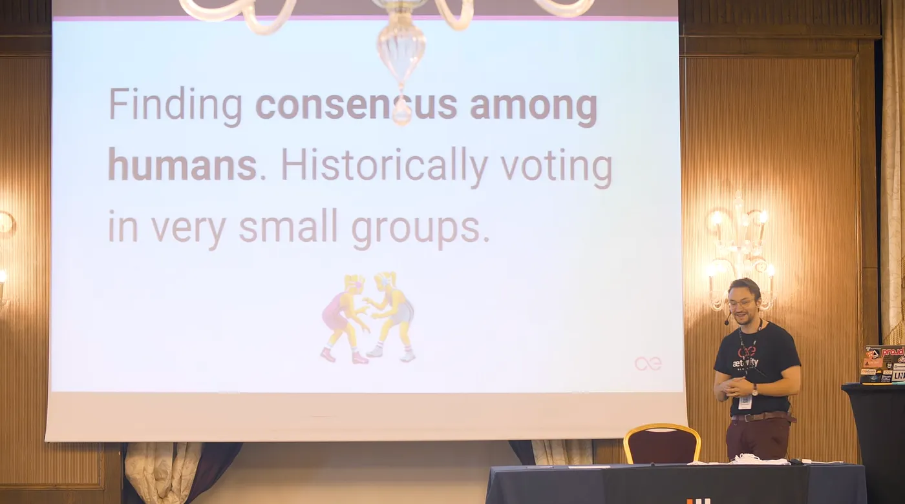

*Blockchain Yönetişimi*

Son konuşmamda blockchain dünyasında yönetişim konusuna değindim. Buradan çıkardığım temel sonuçları şöyle özetleyebilirim:

Merkeziyetsiz yönetişim gerçekten zor bir iş. Blockchain’lerin merkeziyetsiz yapısı müthiş güçlü bir araç; ancak sıra insanların ortak bir kararda buluşmasına gelince işler bir hayli karışıyor. Madenciler, kullanıcılar, geliştiriciler... Her birinin beklentisi birbirinden çok farklı olduğu için uzlaşıya varmak inanılmaz zahmetli. Peki, bir kararın sadece tek bir grubun değil, tüm topluluğun yararına olduğunu nasıl garanti edeceğiz?

Oylama süreçleri de başlı başına bir problem. Klasik oylama yöntemleri blockchain dünyasının dinamiklerine tam oturmuyor. Bu yüzden adil, şeffaf ve herkesin denetimine açık yeni oylama modelleri geliştirmemiz şart.

Bir de farklı grupların beklentilerini nasıl dengeleyeceğimiz sorusu var. Madenciler işlem ücretlerinin yüksek olmasını isterken, kullanıcılar ücretlerin düşmesini bekliyor. Bu tarz gerilimler ciddi sorunlara yol açabiliyor. Dolayısıyla proof-of-stake, proof-of-work ve delege usulü oylama gibi yönetişim modellerini çok daha detaylı incelememiz gerekiyor. Her modelin başarılı olduğu noktalar olduğu kadar, çuvalladığı taraflar da var.

Açık kaynaklı geliştirme süreçleri ve her şeyin şeffaf bir şekilde konuşulması, güveni inşa eden temel unsurdur. Blockchain yönetişiminde insanların hesap verebilir kalmasını sağlayan şey de tam olarak budur.

Blockchain yönetişimi hakkındaki bu tartışmaya herkesin dahil olmasını istiyorum. Bu teknolojinin nereye evrileceğini biz belirleyebiliriz, ancak bunu ancak birlikte başarabiliriz.
