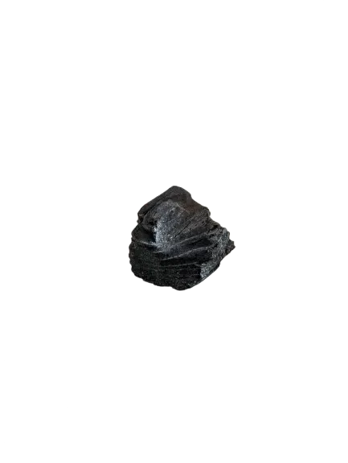
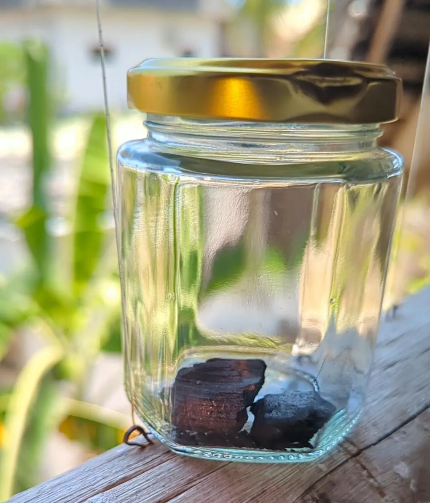
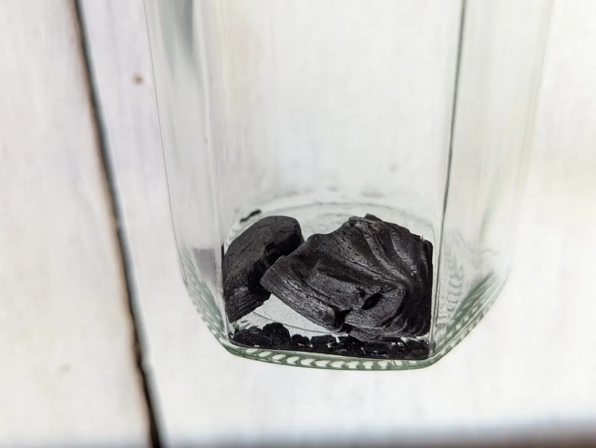

Kısacası durum şu: Murchison göktaşının içinde, Güneşimizden ve gezegenimizden bile yaşlı olan "güneş öncesi" yıldız tozları var. Ayrıca içinde, hayatın yapı taşları olan amino asitlere de rastlandı; bu da yaşamın temelinin uzaydan gelmiş olabileceğine dair çok önemli bir ipucu. Üstelik bu göktaşından bir parçaya sahip olmanız mümkün; ister özel tasarım bir takı olarak, ister hisseli sahiplik yöntemiyle.

*Murchison göktaşından bir parça*

## Güneş sisteminin doğumundan kalma bir zaman kapsülü

Elmaslar kızların en iyi arkadaşı olabilir ama dürüst olmak gerekirse, evrensel ölçekte oldukça yeniler. Eğer gerçekten sıra dışı bir şey, evrenin başlangıcından kalma bir parça arıyorsanız Murchison göktaşına bakmalısınız. Douglas Adams'ın dediği gibi: "Uzay büyüktür. Gerçekten çok büyük. Ne kadar uçsuz bucaksız, devasa ve akıl almaz derecede büyük olduğunu hayal bile edemezsiniz." Ve bu göktaşı tüm o mesafelere tanıklık etti.

Tıpkı güneş sistemimizin doğumundan kalma bir zaman kapsülü gibi. 1969'da Dünya'ya çakıldığında dışarıdan bakınca sıradan bir kaya gibi görünüyordu ancak içinde, milyarlarca yıl önce uzayda yaşananlara tanıklık etmiş minicik yıldız tozu tanecikleri saklıydı.

Bu güneş öncesi tanecikler, bizden çok daha önce, eski yıldızların merkezinde oluştu. Galaksiler şekillenirken, elementler yaratılırken ve nihayetinde hayatın başlangıcını hazırlayan o devasa yıldız tozu süreci yaşanırken oradaydılar. Güneşimizden bile yaşlı, evren henüz emekleme aşamasındayken var olan bir yıldızın parçasına dokunduğunuzda, bu sonsuz evrende aslında ne kadar küçük olduğunuzu iliklerinize kadar hissediyorsunuz.

Üstelik bu sadece merak uyandırıcı bir konu değil. Bu taneciklerde yıldızların nasıl evrimleştiğine, galaksilerin nasıl oluştuğuna ve hatta belki de yaşamın başlangıcına dair çok kıymetli bilgiler gizli. Bilim insanları, evrenimizin işleyiş kurallarını çözebilmek için bu parçaları büyük bir titizlikle inceliyor.

Hayat uzayda mı başladı? Murchison göktaşında, yaşamın temel yapı taşları olan amino asitler dahil birçok organik molekül bulunuyor. Bu da insanın, hayatın tohumlarının Dünya'ya bu tür göktaşlarıyla taşınmış olabileceğini düşünmesine neden oluyor.

Eğer bilimin derinliklerine inmek isterseniz, Murchison.net üzerinden göktaşıyla ilgili en güncel araştırmaları ve keşifleri takip edebilirsiniz.

## Evrenden bir parçaya sahip olun

Uzaydan bir parça taşımaya ne dersiniz? Murchison.net, Murchison göktaşının parçalarını içeren sınırlı sayıda bir koleksiyon için ünlü bir mücevher tasarımcısıyla iş birliği yapıyor. Bu parçalardan sadece 42 tane üretilecek; her biri hem insan elinden hem de kozmostan izler taşıyor. Dünya'nın kökenlerini üzerinde taşıyan bir mücevher takarken kurulacak sohbetleri bir düşünün.

Yakında göktaşının hisseli sahipliği için dijital sertifika da alabileceksiniz. Bu, bir sanat eserinin parçasına sahip olmak gibi, evrenin başlangıcıyla aranızda gerçek bir bağ kurmak gibi bir şey. Sertifikalar Pump.fun üzerinden erişilebilir olacak; böylece sadece koleksiyoncular veya müzeler değil, herkes evrenden bir parçaya sahip olabilecek.

Murchison göktaşı bize evrendeki mucizelerin çokluğunu ve her şeyin birbiriyle nasıl bağlantılı olduğunu hatırlatıyor. Bizi zamanda derin bir yolculuğa çıkaran ve bu uçsuz bucaksız evrendeki yerimizi gösteren, uzaydan gelmiş paha biçilemez bir hazine bu. Ve yakında sizin kendi hikayenizin de bir parçası olabilir.

Daha fazlasını mı öğrenmek istiyorsunuz? Bu belgesele bir göz atın. Sizi evrenin tarihi boyunca bir yolculuğa çıkarıyor ve bu göktaşının bizim için ne anlam ifade ettiğini anlatıyor.

[www.murchinson.net](http://murchinson.net)

## Gerçekler

Murchison göktaşı, güneş öncesi yıldız tozlarını barındırıyor; bu da onun güneş sistemimizden daha eski olduğu anlamına geliyor. Erken dönem güneş sisteminden günümüze ulaşan bir zaman kapsülü olduğu için bilimsel değeri paha biçilemez. 4,6 milyar yaşında ve oluştuğundan beri yapısı neredeyse hiç değişmedi.

Karbon açısından zengin bir göktaşı türü olan karbonlu kondrit sınıfına giriyor ve bu oldukça nadir rastlanan bir tür. Dünya'ya düşen göktaşlarının sadece yüzde 4'ü karbonlu kondritlerden oluşuyor.

Göktaşı, muhtemelen dış asteroit kuşağındaki karbon zengini bir asteroitten kopup geldi ve Dünya'ya ulaşana kadar bir milyon yıldan fazla yol kat etti. Toplamda yaklaşık 100 kilogramlık bir kütle bulundu; kütlenin büyük bir kısmı atmosfere girerken yandı. Dünya'ya düşmüş bu türdeki en büyük göktaşlarından biridir.

Farklı bileşiklerin zengin bir karışımı. İçinde amino asitler, şekerle ilişkili bileşikler, alkoller ve asitler gibi organik maddeler var; bunların bazıları prebiyotik kimya açısından kritik öneme sahip.

Murchison üzerine yapılan çalışmalar dünyanın dört bir yanındaki laboratuvarlarda ve bilimsel konferanslarda sürekli yeni ufuklar açmaya devam ediyor. Göktaşı inceleyen her müze ve üniversite, koleksiyonunda ona yer vermek istiyor.

İlk bakışta pek dikkat çekici görünmeyebilir ama aslında galaksimizden bize ulaşan, eşsiz ve son derece değerli bir örnek.
