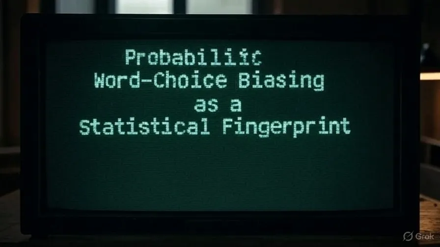
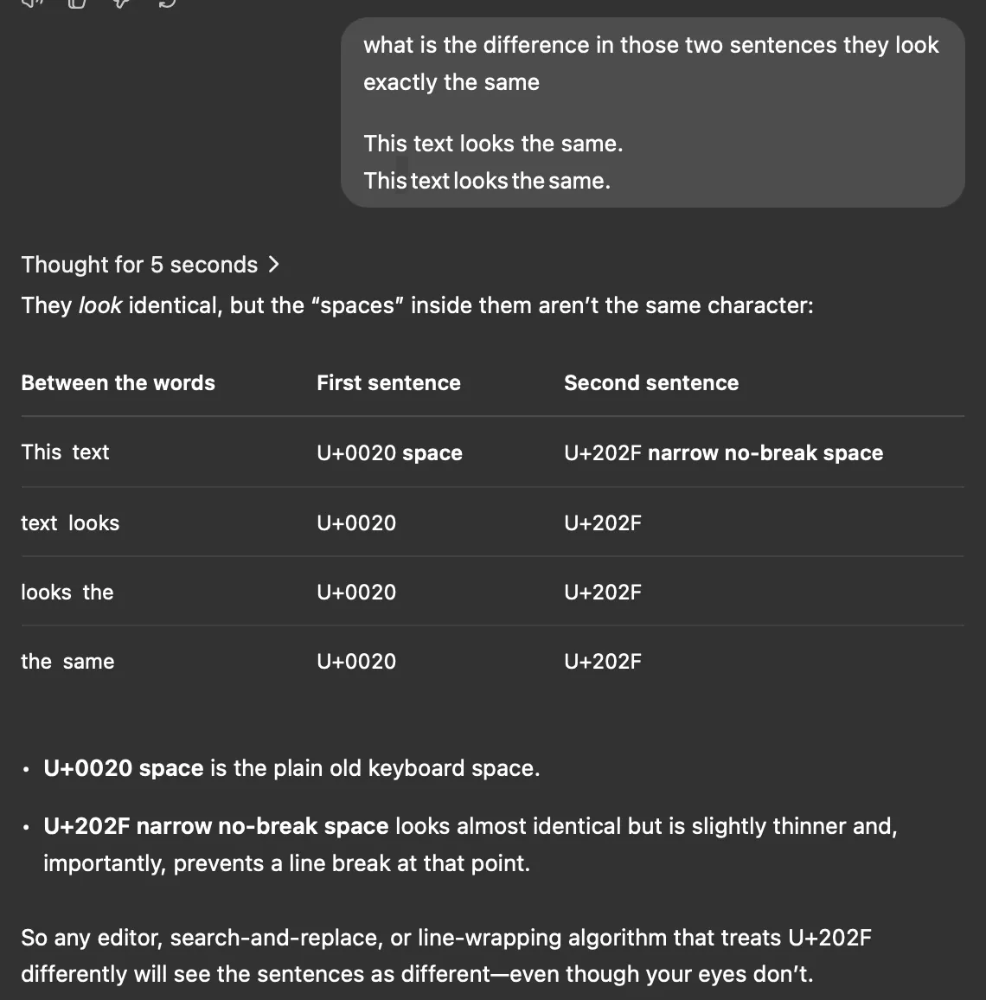

# The Watermarker: LLM Çıktılarında ve Yapay Zeka Metinlerinde İstatistiksel Bir Parmak İzi Olarak Olasılıksal Kelime Seçimi Yanlılığı

ChatGPT'nin cevaplarına parmak izi bırakmak için görünmez karakterler gömdüğünü düşünmüştüm.



Meğer haklıymışım ama OpenAI geri dönüş yapıp bunun gerçek bir uygulama değil, geçici bir hata olduğunu söyledi.

Bu beni daha da meraklandırdı; demek ki pratikte daha üst bir anlamsal katmanda, amaçlı bir parmak izi bırakma olayı var.

Anladım ki bir filigran, özel baytlar gömmek yerine, sıradan token'ların istatistiksel dağılımını manipüle ederek çalışıyor. Küçük bir kayma yaratarak metnin içinde "tercih edilen" kelimelerin beklenenden fazla olmasını sağlıyor. Bunu gözle göremezsin ama ölçebilirsin.

Sıfır genişlikli boşluklar geçici bir hataydı. Bana kasten konulmuş bir iz gibi görünmüştü. Ancak araştırmalarım sırasında gerçek filigranın ham karakterler üzerinden değil, token olasılıkları üzerinden çalıştığını öğrendim.

```
This text looks the same.
This text looks the same.
```

Aynı görünüyorlar ama içlerindeki boşluklar aynı karakter değil. U+0020 boşluğu bildiğimiz klavye boşluğu. [U+202F dar, satır bölünmez boşluk ise neredeyse aynı görünüyor ama biraz daha ince ve en önemlisi, o noktada satırın bölünmesini engelliyor.](https://www.compart.com/en/unicode/U+202F)

Yani U+202F karakterine farklı muamele eden herhangi bir editör, bul-değiştir aracı veya satır kaydırma algoritması, gözlerin görmese bile bu cümleleri farklı görecektir.



Bu yüzden boşlukları silmek veya normalleştirmek gerçek bir filigranı etkilemez; sinyal zaten kelimelerin kendisindedir. Mesela bir cevap "data [U+202F] set" içeriyorsa, boşluğu silmek o artifaktı yok eder ama istatistiksel filigran hayatta kalır, çünkü "data" ve "set" kelimeleri hala oradadır.

## "Olasılıksal kelime seçimi yanlılığı" nedir ve nasıl anlaşılır?

Bunu anlamanın en iyi yolu, gizli bir anahtarla yapılan küçük bir yönlendirme olarak görmek bence.

Sistem, her kelime pozisyonu için gizli bir anahtarı bir önceki token'ın kimliğiyle birleştirip sözde rastgele bir fonksiyona sokuyor. Çıktı, o pozisyon için geçici bir "yeşil liste" oluşturuyor. Model, örnekleme (sampling) yapmadan önce yeşil listedeki her token'a küçük bir log-olasılık bonusu ekliyor.

Tek bir seçim hala doğal görünür ama elli veya daha fazla token boyunca metin, şans eseri olabileceğinden çok daha fazla bu yeşil liste kelimelerini toplar.

Aynı anahtara sahip bir dedektör tüm hesaplamayı tekrarlıyor, kaç token'ın yeşil listeye düştüğünü sayıyor ve bu fazlalığı bir z-skoruna çeviriyor. Skor yeterince yükseldiğinde, metnin insan tarafından yazılma olasılığı neredeyse sıfıra iniyor. İşte kısa veya üzerinde çok oynanmış metinlerin tespit eşiğinin altında kalmasının sebebi bu.

## Bu, Merkle ağacı hash'i ile üyeliği kanıtlamaya benziyor mu?

Bir sonraki sorum, blockchain'lerde kullanılan deterministik kanıtlarla nasıl kıyaslandığıydı. Merkle ağacı, bir veri setini tek bir genel kök hash'ine sıkıştırır. Bir parçayı kısa bir yolla doğrulayabilirsin ve tek bir bitlik değişiklik bile kanıtı bozar. Bu keskin bir çizgidir.

Filigran farklı. Anahtar "Watermarker"da gizli kalır ve her token pozisyonu "tercih edilen" token'lardan oluşan yeni, rastgele bir alt küme alır. Doğrulama olasılıksaldır, ya hep ya hiç değildir. Hafif düzenlemeler sinyali zayıflatır ama tamamen bozmaz. Sadece metni baştan aşağı yazmak z-skorunu tekrar insan seviyesine çeker. Bir baytı değiştirmek Merkle kanıtını bozar ama bir filigranı öldürmek için kelimelerin yarısını değiştirmen gerekir.

## Karşılaştırabileceğim tek bir hash var mı?

Hayır. Gizli anahtar, token başına bir tane olmak üzere bir çıktı akışı için tohum (seed) görevi görür ve bu tohumlar nihai metinde asla görünmez. Tüm token bazlı süreci yeniden oluşturman ve tüm token'lar üzerindeki istatistiklere bakman gerekir. Bunu yaparsan, elinde sadece gizli anahtar ve tokenizer olması yeterlidir.

## Yazarlığı kanıtlamak için kendi gizli anahtarımı gömebilir miyim?

Bir metnin bana ait olduğunu kanıtlamanın bir yolunu arıyordum. Barındırılan ChatGPT arayüzü sana bir anahtar parametresi vermiyor ama açık kaynak modeller veriyor. Mistral-7B-Instruct gibi bir modeli lokalimde çalıştırırsam, `WatermarkLogitsProcessor` ekleyip kendi özel anahtarımı verebilirim ve parmak izimi taşıyan metinler üretebilirim. Anahtarı saklarsam, sonradan yazarlığı doğrulayabilirim ve anahtarı olmayan kimse izi doğrulayamaz veya sahtesini yapamaz. Mesela çalıştırdığım bir script bir makaleyi başka sözcüklerle ifade edebilir ve benim anahtarıma sahip dedektör 5.2'lik bir z-skoru raporlar. Biri metnin yarısını değiştirirse, o skor 2'nin altına düşer.

## Metni nasıl doğru şekilde tokenize ederim?

Tespit, sadece üreticiyle aynı tokenizer'ı kullanırsan çalışır. İşte burada işler kolayca karışabiliyor. GPT-3.5/4 modelleri açık kaynak `tiktoken` kodlamalarını kullanır. Yanlış tabloyla tokenize edersen yeşil listeler eşleşmez ve yanlış negatif sonuçlar alırsın. Düz tırnak veya kıvrımlı tırnak gibi küçük şeyler bile token sınırlarını kaydırıp her şeyi berbat edebilir.

## ChatGPT'den anahtarımı gömmesini isteyebilir miyim?

Zekice bir prompt ile anahtarımı enjekte edebilir miyim diye denedim. Cevap net bir hayırdı. Halka açık arayüz, filigran kancasını sunucuda tutuyor, yani kimse suistimal edemez. Herhangi bir anahtar ayarlayabilseydin, insanlar başkalarını takip edebilir veya sahte atıflar yapabilirdi. Bu yüzden kişisel bir filigran yerel çıkarım (local inference) gerektirir. API'ye "Lütfen 12345 anahtarıyla filigranla" yazmak hiçbir şeyi değiştirmez.

## Bir cevabı kopyalayıp kendi anahtarım altında yeniden üretirsem ne olur?

Sonunda bundan pratik bir iş akışı çıktı. Orijinal ChatGPT cevabını lokal modelimin prompt'una yapıştırıyorum, hafif bir yeniden ifade etme (paraphrase) istiyorum ve kendi özel filigran ayarlarımla üretiyorum. Yeni versiyon gerçekleri koruyor ama artık benim parmak izimi taşıyor. Böylece ChatGPT içeriğinin kalitesini alıp üzerine kendi özel atıfımı eklemiş oluyorum. Bunun çalışması için token kimliklerinin en az %70'ini koruman lazım, yoksa sinyal zayıflar. Ağır yeniden yazmalar veya makine çevirisi, filigranı eşiğin altına düşürür.

## Oluşturduğum araç

Bu süreç beni görünmez Unicode karakterleri efsanesinden, gizli bir anahtarın token olasılıklarını nasıl yanlı hale getirebileceğine dair çalışan bir kavrayışa taşıdı. Öğrendiğim ana şey, kanıtın deterministik değil istatistiksel olduğuydu.

Hugging Face işlemcileriyle 20 satırlık bir Python script'i yazdım; metni özel anahtarımla damgalamamı ve sonradan doğrulamamı sağlıyor. Üretim kısmı `WatermarkLogitsProcessor` ile Mistral-7B kullanıyor, doğrulama kısmı ise aynı anahtarla çalışan bir `WatermarkDetector` kullanıyor. Script, z-skoru 4'ün üzerinde olan her şeyi işaretliyor.

Bununla yapay zeka destekli yazıların yazarlığını iddia edebilir, bunu matematiksel olarak gösterebilir ve küçük düzenlemelerin parmak izini silemeyeceğini bilirim.

## Bölüm 1, filigran gömme

```python
# model ve tokenizer'ı seç
model, tok = load_model("Mistral-7B"), load_tokenizer("Mistral-7B")

# özel 128-bit anahtarı ve filigran ayarlarını seç
KEY = 0xA7F3_42EA_9C11_BEEF
GAMMA = 0.50 # yeşil liste oranı
DELTA = 2.0 # logit artışı

# filigran işlemcisini ekle
wm = WatermarkLogitsProcessor(vocab_size=model.V,
 greenlist_ratio=GAMMA,
 bias=DELTA,
 hashing_key=KEY)

# metni üret
prompt = "Okyanusların sodadan yapıldığı bir dünyada…"
output = model.generate(prompt,
 logits_processor=[wm],
 max_tokens=300)

print(output) # sıradan metin, görünmez şekilde filigranlı
```

## Bölüm 2, filigranı tespit etme

```python
# aynı model ve tokenizer'ı tekrar yükle
model, tok = load_model("Mistral-7B"), load_tokenizer("Mistral-7B")

# aynı gizli anahtar ve gamma
KEY = 0xA7F3_42EA_9C11_BEEF
GAMMA = 0.50

# dedektörü kur
det = WatermarkDetector(vocab_size=model.V,
 gamma=GAMMA,
 hashing_key=KEY)

# bilinmeyen metni analiz et
ids = tok.encode(text_to_check)
z, p = det.detect(ids)

if z > 4:
 verdict = "Filigran mevcut (p ≈ {:e})".format(p)
else:
 verdict = "İkna edici bir filigran yok"

print(verdict)
```

Özetle; üretmek için her yeni token PRF(KEY, bir_önceki_token) sürecinden geçer, bu yeşil listeyi verir, yeşil token'ların logit'lerine bir bonus gelir ve model örnekleme yapar. Tespit etmek için aynı listeleri anahtarla yeniden kurarsın, yeşil eşleşmeleri sayarsın ve tek oranlı bir z hesaplarsın. Yüksek bir z skoru imzayı doğrular.
