Şuraya kendim için küçük bir not bırakayım, grafiği yatay değil dikey hizalamam gerekiyor.

Bu, görelilik teorisinin durum diyagramı. Özel ve genel görelilik, bunların neleri kapsadığı, Newton mekaniğinin yerini nasıl aldıkları ve kuantum kütleçekimi yaklaşımlarının bunlarla nasıl bağlantılı olduğu burada yer alıyor.

```mermaid
stateDiagram-v2
    direction TB
    state "RelativityTheory" as RelativityTheory {
        [*] --> SpecialRelativity
        [*] --> GeneralRelativity
    }

    state "SpecialRelativity" as SpecialRelativity {
        [*] --> Postulates
        [*] --> MathematicalFramework
        [*] --> KeyConsequences
        [*] --> Applications
        [*] --> ExperimentalTests
        Postulates --> PrincipleOfRelativity
        Postulates --> ConstancyOfLightSpeed
        MathematicalFramework --> LorentzTransformations
        MathematicalFramework --> MinkowskiSpacetime
        MathematicalFramework --> FourVectorsAndTensors
        MathematicalFramework --> RelativisticKinematics
        KeyConsequences --> RelativityOfSimultaneity
        KeyConsequences --> TimeDilation
        KeyConsequences --> LengthContraction
        KeyConsequences --> MassEnergyEquivalence
        KeyConsequences --> RelativisticDopplerEffect
        KeyConsequences --> VelocityAdditionFormula
        Applications --> ParticlePhysics
        Applications --> AcceleratorDesign
        Applications --> Electrodynamics
        Applications --> Astrophysics
        ExperimentalTests --> MichelsonMorley
        ExperimentalTests --> KennedyThorndike
        ExperimentalTests --> IvesStilwell
        ExperimentalTests --> MuonLifetime
        ExperimentalTests --> ParticleAccelerators
        ExperimentalTests --> GPSSystem
    }

    state "GeneralRelativity" as GeneralRelativity {
        [*] --> FoundationalPrinciples
        [*] --> MathematicalStructure
        [*] --> PhysicalPhenomena
        [*] --> CosmologicalImplications
        [*] --> ExtremeGravityObjects
        [*] --> ExperimentalConfirmations
        [*] --> TheoreticalExtensions
        [*] --> OpenProblems
        FoundationalPrinciples --> EquivalencePrinciple
        FoundationalPrinciples --> GeneralCovariance
        MathematicalStructure --> SpacetimeCurvature
        MathematicalStructure --> MetricTensor
        MathematicalStructure --> GeodesicEquation
        MathematicalStructure --> EinsteinFieldEquations
        PhysicalPhenomena --> GravitationalTimeDilation
        PhysicalPhenomena --> LightBending
        PhysicalPhenomena --> GravitationalRedshift
        PhysicalPhenomena --> PerihelionPrecession
        PhysicalPhenomena --> FrameDragging
        PhysicalPhenomena --> GravitationalLensing
        CosmologicalImplications --> ExpandingUniverse
        CosmologicalImplications --> BigBangCosmology
        CosmologicalImplications --> CosmicMicrowaveBackground
        CosmologicalImplications --> DarkEnergy
        CosmologicalImplications --> LargeScaleStructure
        ExtremeGravityObjects --> BlackHoles
        ExtremeGravityObjects --> NeutronStars
        ExtremeGravityObjects --> GravitationalWaves
        ExtremeGravityObjects --> AccretionDisks
        ExtremeGravityObjects --> Jets
        ExperimentalConfirmations --> EddingtonExpedition
        ExperimentalConfirmations --> PoundRebka
        ExperimentalConfirmations --> ShapiroTimeDelay
        ExperimentalConfirmations --> HulseTaylorBinaryPulsar
        ExperimentalConfirmations --> GPSCorrections
        ExperimentalConfirmations --> LIGOVirgo
        ExperimentalConfirmations --> EventHorizonTelescope
        ExperimentalConfirmations --> GRAILMission
        TheoreticalExtensions --> PostNewtonianApproximation
        TheoreticalExtensions --> ParameterizedPPN
        TheoreticalExtensions --> NumericalRelativity
        TheoreticalExtensions --> QuantumGravityApproaches
        OpenProblems --> DarkMatter
        OpenProblems --> BlackHoleInformationParadox
        OpenProblems --> SingularityTheorems
        OpenProblems --> QuantumGravity
    }

    NewtonianMechanics --> SpecialRelativity : superseded by
    NewtonianMechanics --> GeneralRelativity : superseded by
    ClassicalGravity --> NewtonianMechanics : part of
    QuantumMechanics --> StringTheory : related to
    QuantumMechanics --> LoopQuantumGravity : related to
    PostNewtonianApproximation --> SpecialRelativity : related to
    PostNewtonianApproximation --> NewtonianMechanics : related to
    QuantumGravityApproaches --> QuantumMechanics : related to
    QuantumGravityApproaches --> StringTheory : related to
    QuantumGravityApproaches --> LoopQuantumGravity : related to
```

Bunu Mermaid Share ile hazırladım. Grafik ID: chart_1756354351463_48ybl32fi, versiyon: 1, oluşturulma ve son güncelleme tarihi: 28.08.2025, 07:12:31 (oluşturulma 28.08.2025 04:12:31Z, güncelleme 28.08.2025 04:12:31Z). Buradan [canlı olarak görüntüleyebilirsin](https://mermaid.emino.app/?chart=chart_1756354351463_48ybl32fi) https://mermaid.emino.app/?chart=chart_1756354351463_48ybl32fi
