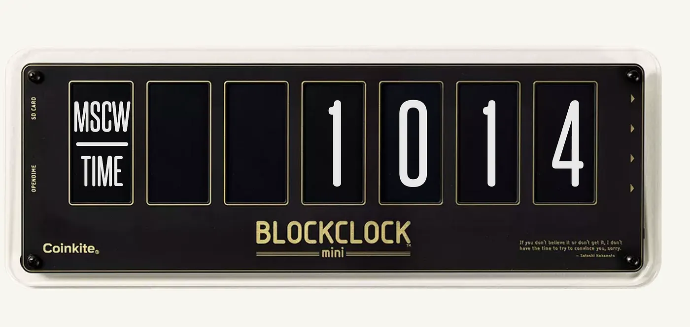

# Saat kaç? Moskova saati. Ya da 1 ABD dolarıyla kaç Bitcoin alabilirsiniz

Bitcoin ve kripto çevrelerinde herkes "Saat kaç? Moskova saati" der. Bu bir "Moscow Time" ya da MSAT muhabbetidir; kısacası bir dolara kaç satoshi alabileceğinizi söylemenin bir yoludur.

Moscow Time'ı hesaplamak için 1.000.000'ı Bitcoin'in dolar bazındaki fiyatına bölüyorsunuz. Bu da size dolar başına düşen satoshi miktarını veriyor. Buna Moskova saati denmesinin sebebi, Bitcoin 10.000 dolar civarındayken bir dolara yaklaşık 10.000 sat alabiliyor olmanızdı. Bu da askeri saat dilimindeki UTC+3 olan Moskova saatine, yani "10:00"a benziyordu.

Bitcoin fiyatı düştükçe bir dolara daha çok sat alırsınız, yani sat'lar ucuzlar. Fiyat yükseldiğinde ise her dolarla daha az sat alabileceğiniz için Moskova saati düşer. Bitcoin'ciler bunu, Bitcoin'in küçük birimlerle neler alabildiğini takip etmek için bir ölçü birimi olarak kullanıyor.

Bir örnek verelim. Bitcoin 40.000 dolarsa, 1.000.000 bölü 40.000 eşittir 25 eder; yani her 1 dolar için 25 sat alırsınız. Bitcoin 20.000 dolara düşerse, 1.000.000 bölü 20.000 eşittir 50 eder; yani 1 dolara 50 sat alırsınız ve sat'lar ucuzlamış olur.

Bitcoin'ciler bunu sever çünkü insanı bütün Bitcoin'lerden ziyade önce sat'larla düşünmeye zorlar. Ayrıca Bitcoin'in zamanla nasıl daha kıt hale geldiğini gösterir ve insanları sat'lar hala ucuzken biriktirmeye teşvik eder.

Yani biri "Saat Moskova saati!" dediğinde, muhtemelen o an bir dolara kaç sat alabileceğinizi kastediyordur. Bitcoin fiyatını fiat para birimiyle değil, satoshi cinsinden takip etmenin bir yolu bu.
