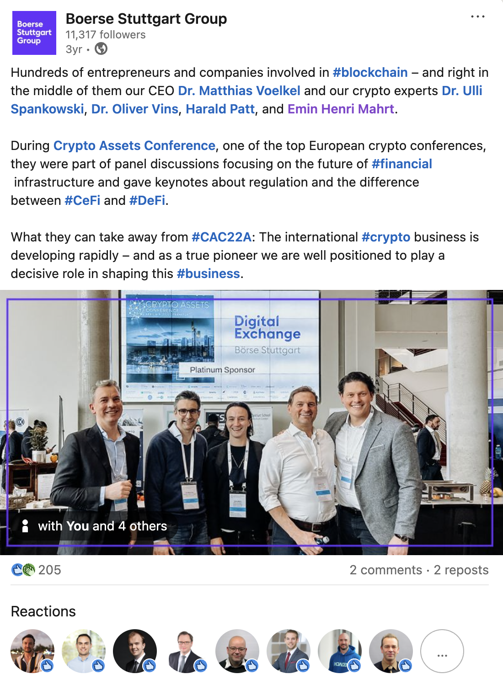

Bu, Börse Stuttgart Digital Exchange ([BSDEX](https://www.bsdex.de)) altyapı ekibinden birinin, merkezi güvenlik ile merkeziyetsiz inovasyonun nasıl bir arada çalıştığını anlattığı yazısının özeti.

## Sıfır toplamlı bir oyun değil

Merkezi Finans (CeFi) ile Merkeziyetsiz Finans (DeFi) uzun süredir sıfır toplamlı bir oyun gibi görülüyor. Yazar bu konuda farklı düşünüyor. Bu, bir tarafın diğerini ele geçirmesi değil, ikisinin bir araya gelmesi.

Sıradan bir kullanıcı ya da temkinli bir kurumsal yatırımcı için doğrudan izinsiz bir DeFi protokolüne atlamak çoğu zaman fazla büyük bir adım. Teknik riskler var, kullanımı zor arayüzler var ve en önemlisi regülasyonla ilgili yanıtsız sorular var. Yazara göre CeFi tam da burada en önemli rolünü oynuyor. [BSDEX](https://www.bsdex.de) gibi regüle ve şeffaf bir geçit görevi gören şirketler, kitle pazarına ihtiyaç duyduğu kolaylığı sunuyor. MiCAR uyumluluğunun hukuki kesinliğini ve güvenli saklamayı getiriyorlar, kullanıcılar da alttaki blockchain'in verimliliğinden yararlanmaya devam ediyor.

## DeFi motor, CeFi arayüz

Yani yazar bu ikisini rakip olarak değil, kendi güçlü yönleri olan iki parça olarak görüyor. DeFi motor. 7/24 likidite sağlıyor, zincir üstü denetimlerle şeffaflık sağlıyor, akıllı kontratlarla otomatik getiri sağlıyor ve finansal inovasyonun laboratuvarı. CeFi ise arayüz. Müşteri desteği, regülatör raporlaması ve basit giriş yollarıyla insani katmanı oluşturuyor, kodun karmaşasını bir bankanın ya da bireysel kullanıcının güvenebileceği bir hizmete dönüştürüyor.

Yazar, önümüzdeki yıllarda ikisi arasındaki çizginin bulanıklaşmasını bekliyor. Yön, CeDeFi denen bir modele doğru, yani merkezi ön yüzlerin merkeziyetsiz arka uçlara bağlandığı bir model. Böylece hukukun istediği güvenlik ve uyumluluk korunuyor, yine de merkeziyetsiz protokollerin hızı ve küresel erişimi kullanılıyor. Yazarın hedefi aynı: kripto ekosistemini profesyonelleştirmek, böylece dijital varlıklar geleneksel finans standartlarının güvenilirliğiyle her portföyün normal bir parçası haline gelsin.

## Konuşma ve ek okuma

Yazı, yazarın iki dünyanın nasıl birbirine bağlandığını ve bunun Avrupa dijital varlık regülasyonunun geleceği için ne anlama geldiğini daha derinlemesine anlattığı bir konuşmayla bitiyor.

[Konuşmayı YouTube'da izle](https://www.youtube.com/watch?v=eDYt0Bynze8)

Ayrıca ek okuma bağlantıları da var: [Emin Mahrt: CeFi vs DeFi Explained (YouTube)](https://www.youtube.com) adlı bir röportaj, borsanın kendisi [Börse Stuttgart Digital Exchange (BSDEX)](https://www.bsdex.de), yazarın [LinkedIn](https://www.linkedin.com) profili ve [Understanding MiCA via European Commission](https://finance.ec.europa.eu).

