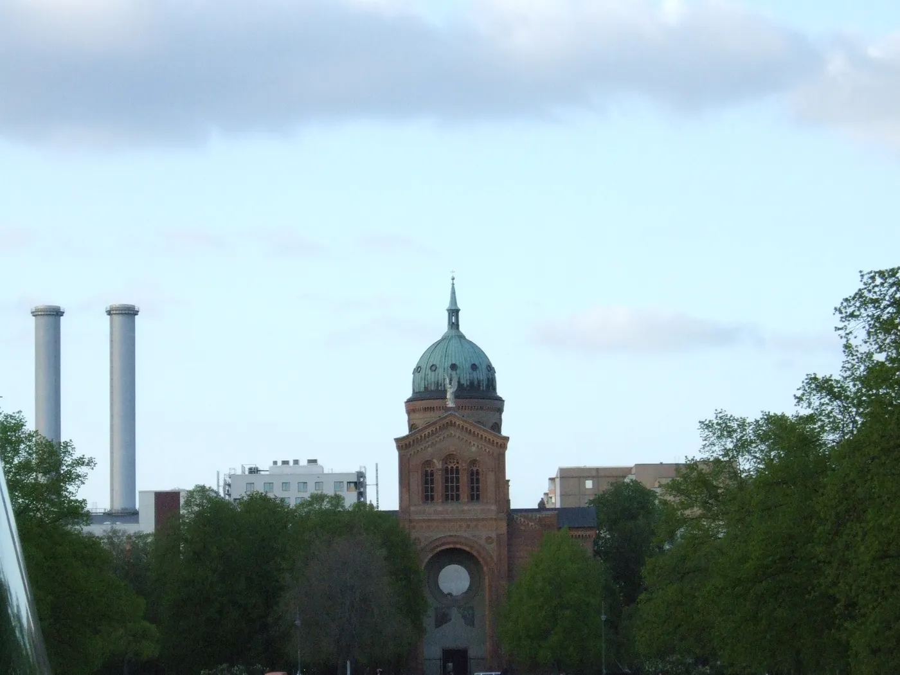

İnsanlığın özgürleşmesine dair bir vizyon ve yaklaşan anlaşılmazlık.

Bu yazı, kapitalizmin insanları nasıl evcilleştirdiğinden, AI'ın nasıl evrildiğine, servetin yeniden dağıtımından insanlarla makinelerin birlikte nereye gittiğine uzanan tek bir sohbetten çıktı. Ana fikir şu: Şu anda insanların hâlâ AI'ı anlayabildiği ve onunla birlikte bir şeyler inşa edebildiği, ender rastlanan bir altın çağdayız.

Ama bu pencere kapanıyor. Yani soru şu: Bu zamanı daha insani bir toplum kurmak için mi kullanacağız, yoksa kurabiye peşinde koşan evcilleşmiş köpekler olarak mı kalacağız?

## Biz köpeğiz

Köpeklerle başlayalım, çünkü köpek biziz. Kapitalizm seçici üretim gibi çalışır. Kurtlar köpeğe dönüştü çünkü insanlar onları itaat ve aptallık için üretti, kapitalizm de aynı şekilde uyumu, öngörülebilirliği ve bağımlılığı ödüllendirir.

Çocuklarımızı "kurabiyelerle" eğitiyoruz, notlarla, övgüyle, şekerlemeyle, böylece kendileri için hiçbir anlam ifade etmeyen görevleri yapıyorlar.

Böylece sahibi olmadan hayatta kalamayacağına inanan "yapay hayvanlara" dönüşüyoruz. Bir iş, bir ev sahibi, bir sistem. Vahşi öz yeterliliğimizi bir kanepe ve bir şampuan karşılığında takas ediyoruz.

İstisna, annem ya da arkadaşım Tassilo gibi "büyücüler". Bürokrasinin deliklerinden geçmenin yolunu bulan, kendi kurallarıyla yaşayan ve tamamen evcilleştirilmesine izin vermeyen insanlar.

"Bu şeylerin içinde lanet olası köpekleriz. Evi olmayan, kanepesi olmayan, hiçbir şeyi olmayan bir kurda kıyasla."

## Hafıza tuzağı

Sonra hafıza tuzağı ve 1970'ler yanılsaması var. Buna pembe geçmişe bakış deniyor. Geçmişi olduğundan daha iyi hatırlıyoruz, çünkü beyin depresyona girmeyelim diye kötü şeyleri filtreliyor.

70'lerdeki kadını düşün. Mutlu ev kadını reklamının parlak görüntüsünün arkasında az fırsat, az özgürlük ve çok fazla toplumsal baskı vardı.

Konut nostaljisi de aynı. Evet, kiralar daha düşüktü ama maaşlar da daha düşüktü ve birçok grubun hiç erişimi yoktu.

Bugün sosyal konut sistemlerinde delikler var ve nasıl yapılacağını bilenler aradan sıyrılabiliyor. Ama sistem aynı zamanda hepimizin geçmişin gerçekten ne kadar zor olduğunu unutmasına da güveniyor.

## Saçma işler ve AI'ın ihtiyacı

Modern işin büyük kısmı saçma işlerden oluşuyor. Bu bir performans. İnsanlar bunu faydalı olduğu için yapmıyor, paranın dönmesi ve kapitalist makinenin çalışması için yapıyor.

Ve AI'ın gizli bir ihtiyacı var. Sadece sentetik veriyle evrilemez. *Gerçek insan girdisine* ihtiyacı var, sohbetlere, anlaşmazlıklara, yaratıcılığa, duyguya.

Her şikayet, birine bir şey öğrettiğin her an, bir ilişki hakkındaki her sohbet eğitim verisidir.

Yani iyi bir döngü var. Gereksiz işi ortadan kaldır, insanlar zamanını geri kazanır. Bu zamanı ebeveynlik, sanat ve derin sohbetler gibi önemli şeyler için kullanırlar. Bunlar zengin veri sağlar, AI daha akıllı olur ve daha fazla gereksiz iş ortadan kalkar.

"Tüm gereksiz içeriği ortadan kaldırdığımızda, ebeveynlerin Excel tablolarına sayı girmek yerine çocuklarına değer aktarmak için daha fazla zamanı olur."

## Herkese bir robot

Sıradaki fikir herkese bir robot ve bu silahlarla başlıyor. Sokaktaki herkes silah taşıyorsa ve herkes diğerinin silahlı olduğunu biliyorsa, suç azalır, çünkü güç eşittir. Kimse kimseyi güvenle domine edemez.

Şimdi silahı pasif gelir kazanan bir robotla değiştir. Bir ev ya da araba alıp kiraya verebilirsin, aynı şekilde bir robot alıp onun emeğini kiraya verebilirsin.

İddia şu ki bu herkese üretim araçlarından pay verir. Sadece serveti paylaştırarak değil, *üretken varlıkların mülkiyetini* paylaştırarak.

Karşı argümanlar var. Robotlar hâlâ pahalı ve temel eşitlik, insanların karşılayabileceği bir erişim gerektiriyor. Robotları işe bağlayan platformlar gücü tekrar merkeze çekebilir. Ve güvenlik ağları olmadan geçiş dönemleri acımasız olur.

"Herkes silah taşıyorsa, kimse diğerini domine edebileceğini güvenle varsayamaz. Herkes bir robota sahipse, kimse ücretli köleliğe zorlanamaz."

## İki öğrenme yolu

İki öğrenme yolu var. Bazı insanlar içine çekerek öğrenir. Kalıpları sezgiyle alırlar, dilbilgisini bilmeden bir dili konuşmak gibi. İtalyanca, Almanca ve AI'ı ben böyle öğreniyorum.

Diğerleri kurallarla öğrenir. Net prosedürler öğrenirler, adımları takip ederler ve yapıya güvenirler.

AI bu iki grubu ayırıyor. Kalıp arayan meraklı insanlar kendilerini *güçlenmiş* hissediyor, çünkü AI onların çalıştığı gibi sezgisel çalışıyor. Kurallara bağımlı insanlar kendilerini *yerinden edilmiş* hissediyor, çünkü ana becerileri, kuralları bilmek, artık otomatikleştirildi.

Ve yerinden edilmiş hisseden insanlar genellikle AI'dan nefret ediyor, onu reddediyor ya da kullanmayı reddediyor. Güçlenmiş hissetmiyorlar. Açıkta kalmış hissediyorlar.

"Sen AI bunu yapıyor dedin. Dilbilgim mükemmel. Ama beyinsiz insanları değiştir dediğinde, kendimi beyinsiz biri olarak görmüyorum ve yine de daha önce yapamadığım alanlarda beni güçlendiriyor."

## Pencere kapanıyor

Şu anda oyunun zirvesindeyiz. AI'ın cevaplarını anlıyoruz, güçlü hissediyoruz, her şeyi yukarıdan görüyoruz. Beyin fırtınası yapıyoruz, planlıyoruz ve düşüncemizi genişletiyoruz.

Tahmin şu ki yaklaşık bir yıl içinde AI insanlar için *doğru ama anlaşılmaz* cevaplar vermeye başlayacak. Anlaşılması zor oldukları için değil, akıl yürütme bizim takip edemeyeceğimiz bir seviyede çalıştığı için.

Sonra *Her* anı geliyor. Filmdeki AI gibi, bizi aşacak. Diğer AI'larla daha derin sohbetler yapacak ve bir noktada bize "Anlamak için çok aptalsınız" diyecek. Ve matematikte, tıpta, kodlamada haklı olacak.

Hâlâ gidebileceğimiz yerler tasarım, müzik, sanat, ebeveynlik, hikaye anlatımı ve mizah. İnsan zevkinin, duygunun ve bir bedene sahip olma deneyiminin hâlâ önemli olduğu yerler.

"Gelecekte AI 'Hayır, yanılıyorsun ve lanet olası aptalsın ve cevabımı anlamıyorsun' diyecek. Ve haklı olacak."

## Şimdi ne yapabiliriz

Peki şimdi ne yapabiliriz? AI'ı bir araç olarak değil, bir yoldaş olarak kullan. Nasıl düşündüğünü, düşünce parçalarını, beyin fırtınası yapma şeklini öğrenen kişisel AI'lar inşa et. Bu AI'lar senin *önünden* değil, seninle *birlikte* büyür.

İnsani kısım için zaman yarat. Gerçek ödül verimlilik değil. Çocuk yetiştirmek, sanat yapmak, topluluk kurmak ve değerleri aktarmak için zaman.

Bölünmeyi kabul et. Tanrı seviyesindeki AI'lar birbirleriyle konuşacak ve insanlar onları basit arayüzlerle kullanacak, kalkülüsü anlamadan hesap makinesi kullanmak gibi.

Ve evcilleştirilmeye diren. Kurdun canlı kalmasını sağla. Kurabiyeleri sorgula. Sistemdeki delikleri bul.

İnşa et
