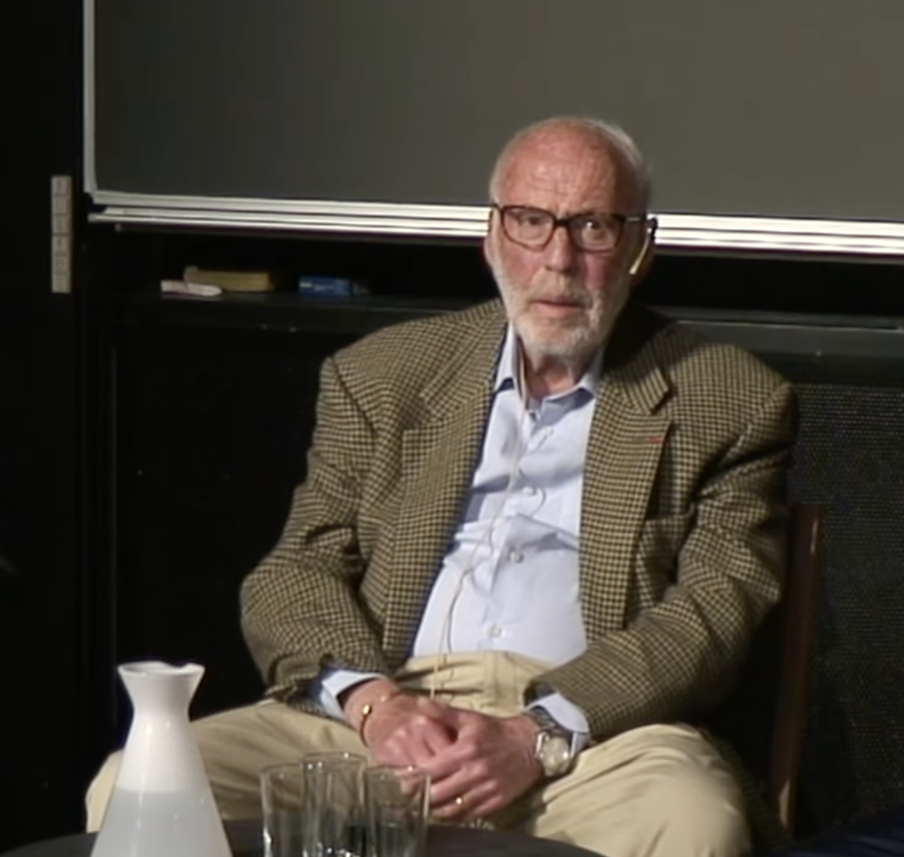

Jim Simons’ın Ulusal Matematik Müzesi’nde (MoMath) yaptığı "Hayatım: Matematik, Finans ve Hayırseverlik" başlıklı konuşmasının özeti. Buradaki fikirler ve alıntılar tamamen kendisine aittir.

## Matematik ve şifre kırma

Konuşma altı bölümden oluşuyor. Simons ilk bölümde matematiğe nasıl erken yaşta tutkuyla bağlandığını, MIT ve Berkeley yıllarını anlatıyor.

Sonra Vietnam Savaşı sırasında hükümet için şifre kırıcı olarak çalıştığı Savunma Analizleri Enstitüsü’ndeki (IDA) günlerinden bahsediyor. Görevi Rus şifrelerini çözmekti. Ancak hükümet işini yapması gerekirken vaktinin çoğunu kendi geometri çalışmalarıyla geçirdiğini itiraf ediyor. Kendi sözleriyle: "Bize zamanımızın yarısını kendi matematik işlerimize, yarısını da onların işine ayırabileceğimizi söylediler. Ben onların işini biraz yaptım, kendi matematiğime ise çok ağırlık verdim. Pek de umurlarında olmadı gibi görünüyor." [00:02:15]

Ayrıca yüksek boyutlardaki sabun köpüklerinin geometrisiyle ilgili Plateau Problemi’nin bir parçasını çözdüğü "Minimal Çeşitlilikler" (Minimal Varieties) üzerine yaptığı çalışmalardan bahsediyor.

Buradan çıkarılacak ders şu: Zor ve soyut problemlerin derinliklerine inmek, başka alanlardaki yüksek riskli problemleri çözerken ihtiyacınız olan zihinsel dayanıklılığı kazandırıyor.

## Stony Brook ve Chern-Simons

İkinci bölüm, Stony Brook’ta Matematik Bölümü Başkanı olduğu dönemleri ve efsanevi matematikçi Shiing-Shen Chern ile olan çalışmalarını konu alıyor.

Birlikte Chern-Simons değişmezlerini ortaya çıkardılar. Başta bunlar tamamen saf geometriydi ancak sonradan teorik fizik için vazgeçilmez hale geldiler. "Fizikten hiç anlamıyordum, Chern de anlamıyordu. Biz geometri yapıyorduk. On yıl sonra, bunların sicim teorisi için tam da ihtiyaç duyulan şey olduğu ortaya çıktı." [00:08:12]

Buradan çıkarılacak ders şu: Temel araştırmalar genellikle en büyük değerini, onu yapanların hiç tahmin etmediği yerlerde gösterir.

## Hayatın ortasında gelen değişim

Üçüncü bölümde, üniversiteyi bırakıp ilk adı Monemetrics olan bir ticaret şirketi kurmaya karar verdiği o "orta yaş" değişimini anlatıyor. Finansal piyasaların ne kadar karmaşık olduğunu görüp matematiksel modellerin burada işe yarayıp yaramayacağını denemek istedi. "Al-sat yapmaya başladım. Bu konuda pek bir şey bilmiyordum ama belki burada bir yapı vardır diye düşündüm. Ve vardı da." [00:10:05]

Buradan çıkarılacak ders şu: Becerilerinizin tamamen farklı bir alandaki sorunu çözebileceğine inanıyorsanız kariyer değiştirmekten korkmayın.

## Renaissance ve Medallion Fonu

Dördüncü bölüm, tarihin en başarılı hedge fonu haline gelen Renaissance Technologies ve Medallion Fonu’nun kültürüne odaklanıyor.

Simons’ın o meşhur hamlesi, Wall Street’in standart "uzmanlarını" işe almamaktı. "Wall Street’ten adam almadık. Matematikçileri, fizikçileri ve bilgisayar bilimcilerini işe aldık. Bir fizikçiye finans öğretebilirsiniz ama bir finansçıya fizik öğretmek çok zordur." [00:14:02]

Şirket, anlık (tick-by-tick) veriler ve kurum içi tam şeffaflık üzerine kuruluydu. "Herkes birbirinin kodunu görebiliyordu. Gizli saklı bir şey yoktu. Modeli iyileştirecek bir yol bulursan herkes faydalanırdı." [00:29:46]

Buradan çıkarılacak ders şu: Karmaşık sistemlerde başarı, insanların iş birliği yapmasından ve "içgüdülere" değil verilere sadık kalmasından gelir.

## Beş kural

Beşinci bölümde Simons, işine ve hayatına rehberlik eden beş kuralı paylaşıyor.

Birinci kural, güzelliğin rehberliğinde gitmek. "Nasıl bir matematik teoremi güzelse, iyi yönetilen bir şirket ya da zekice bir deney de güzel olabilir." [00:19:32]

İkinci kural, etrafını en iyilerle donatmak. "Eğer odadaki en zeki kişiysen, yanlış odadasın demektir. Senden daha iyi olan insanları işe al." [00:20:06]

Üçüncü kural, sürüye uyma ve özgün ol. "Eğer herkes aynı sorunu çözmeye çalışıyorsa, git farklı bir sorun çöz. Kalabalığı takip etmiyorsan ilk olmak çok daha kolaydır." [00:20:26]

Dördüncü kural, kolay pes etme. "Bir işte sebat etmek başarının yarısıdır. En iyi algoritmalarımızdan bazılarının mükemmelleşmesi yıllar sürdü." [00:21:01]

Beşinci kural ise iyi bir şans dilemek. "Hazırlıklı olmalısın ama şansa da ihtiyacın var. Ben çok şanslıydım." [00:21:13]

## Simons Vakfı

Son bölümde Simons Vakfı’ndan ve temel bilim araştırmalarını nasıl ileriye taşıdığından bahsediyor.

Biyoloji, astronomi ve fizikteki devasa veri setlerini analiz etmek için bilim insanlarına araçlar sağlayan, hesaplamalı bilim merkezi Flatiron Institute’u kurdu. "Bilim insanlarının sadece bilim yapabileceği, dünyanın en iyi programcıları ve en iyi bilgisayarları tarafından desteklenen bir yer yaratmak istedik." [00:34:05]

Buradan çıkarılacak ders şu: Gerçek miras, başarını gelecek nesil düşünürlere ve kâşiflere destek olmak için kullanmaktır.

Konuşmanın tamamını buradan izleyebilirsiniz: https://www.youtube.com/watch?v=QUTaQvnwLzM

