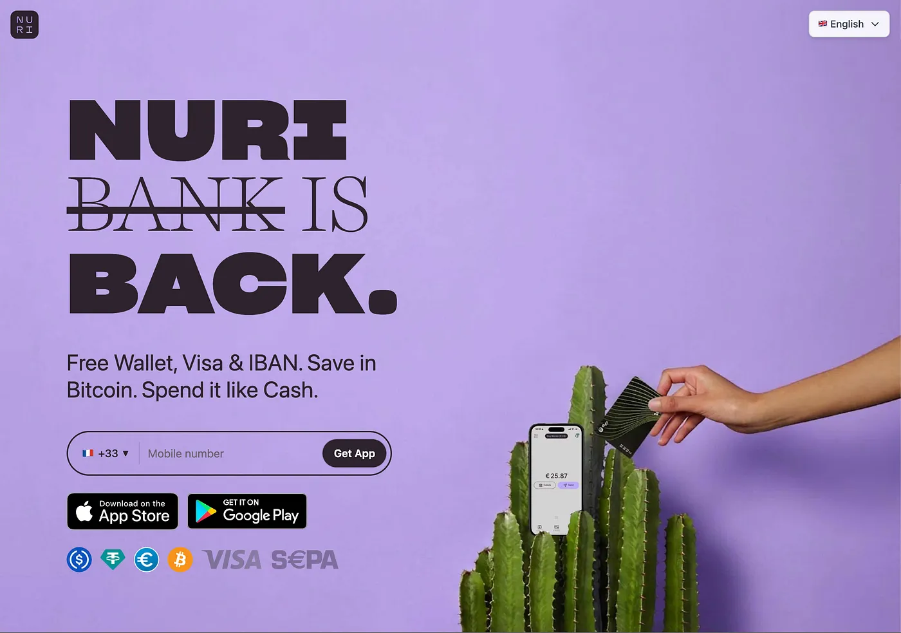

*Bitcoin neobank geri döndü, ama bankasız.*

## Bitwala'dan Nuri'ye

2015'te Berlin'de küçük bir ekibin basit bir fikri vardı. Bitcoin'i
harcayabilir hale getirmek. Buna Bitwala dediler. Sonraki altı yılda
şirket 32 Avrupa ülkesinde 500.000 kullanıcıya ulaştı, 42 milyon euro
risk sermayesi topladı ve Almanya'nın en bilinen kripto markalarından
biri oldu.

2021'de Bitwala, "yeni gerçeklik" anlamına gelen Nuri adını aldı ve
tasarruf planları, yatırım hesapları ve Solarisbank ile bir ortaklıkla
ana akım bankacılığa yöneldi.

## Sonra her şey çöktü

Sonra her şey çöktü.

2022'nin kripto kışı Nuri'yi tam da en kötü zamanda vurdu. Terra
Luna battı, Three Arrows Capital battı ve hepsinden önemlisi Celsius
Network battı, bu zincirleme reaksiyon şirketi likiditesiz bıraktı.
Celsius, Nuri'nin faiz ürünlerinin arkasındaki kilit ortaktı.

Celsius para çekme işlemlerini dondurduğunda, Nuri'nin iş modeli bir
gecede çöktü. Üstüne bir de Almanya'da bankacılık lisansı alma
baskısı vardı.

9 Ağustos 2022'de Nuri Berlin'de iflas başvurusunda bulundu. Üç ay
süren yeniden yapılanma izledi. Alıcı bulunamadı, yeni yatırımcı
gelmedi. 18 Ekim 2022'de CEO Kristina Walcker-Mayer tüm müşterilerden
paralarını 18 Aralık'a kadar çekmelerini istedi. Nuri kapandı.

500.000 kullanıcı paralarını cüzdanlarından ve banka hesaplarından
çekmek zorunda kaldı. Orijinal kurucular eski Bitwala adıyla, Bitcoin'e
odaklanan sade bir uygulamayla geri döndüler. Nuri markası ve
[nuri.com](http://nuri.com) alan adı yeni sahiplerine satıldı ve
hikaye tam burada başlıyor.

## Markayı neden aldık

Biz Berlin'den bir grup Bitcoin geliştiricisiyiz ve Bitwala'nın ilk
kullanıcılarıyız, Nuri markasını aldık çünkü orijinal vizyonun doğru
olduğuna inanıyoruz, sadece birkaç şey yanlış gitti. Bitcoin'i günlük
harcamalarla bir araya getirmek bugün 2021'de olduğundan daha da
geçerli.

Eski Nuri'yi öldüren ürün fikri değildi. Karşı taraf riskiydi,
emanet altyapısıydı ve iflas edip şirketi de beraberinde götüren bir
ortaktı.

## Banka yok

Yeni Nuri sıfırdan inşa edildi. Eski kod, eski mimari ve eski risk,
hepsi geride kaldı. Ve büyük bir fark var. Banka yok.

Nuri'yi açtığında bir passkey oluşturuyorsun. PRF denen kriptografik
bir süreçle bu passkey, özel anahtarını doğrudan cihazında türetiyor.
Sunucuda hesap yok, kimlik bilgilerinin olduğu bir veritabanı yok ve
paranı tutan bir şirket yok.

Passkey cüzdanın kendisi. O andan itibaren Bitcoin, Euro ve Dolar
stablecoin gönderip alabiliyorsun. Kimliğini doğrulamana gerek yok,
form doldurmuyorsun ve beklemiyorsun. Parmağını dokunduruyorsun ve
cüzdanın var.

Kimliğini doğrulamak istersen daha fazlasını alıyorsun. Ücretsiz bir
Visa banka kartı, banka transferleri için bir IBAN ve kripto ile normal
bankacılık sistemi arasında para taşımanın bir yolu. Ama cüzdan
bunların hiçbiri olmadan da çalışıyor. İzinsiz giriyorsun ve yine de
her şeyi alıyorsun.

## Paranı kimse tutmuyor

Eski Nuri başarısız oldu çünkü kullanıcı fonlarını üçüncü bir tarafa
emanet etti. Biz etmiyoruz. Bitcoin'in MuSig2 Taproot multisig ile
güvence altına alınmış bir self-custodial cüzdanda duruyor.
Stablecoin'lerin Gnosis Chain üzerinde bir Safe Smart Account'ta
yaşıyor. Visa kartın Gnosis Pay üzerinde çalışıyor, IBAN'ın ve banka
transferlerin Monerium'un e-para altyapısı üzerinde çalışıyor.

Her ortak bir hizmet veriyor ama hiçbiri paranı tutmuyor. Bir ortak
yarın ortadan kaybolursa, fonların hâlâ senin, onchain ve passkey'inle
ulaşıyorsun. Neobank ile bankasız neobank arasındaki fark bu.

## Para olarak Bitcoin

Nuri bir trading uygulaması değil. Borsa değil ve altcoin'lerde
spekülasyon yapılacak bir yer değil. Nuri, Bitcoin'i çevirip satılacak
bir varlık olarak değil, para olarak gören bir cüzdan. Bitcoin'de
biriktiriyorsun çünkü şimdiye kadar yapılmış en sağlam para.

Visa kartınla harcıyorsun çünkü dünya hâlâ Euro ve Dolar ile dönüyor.
Dönüşüm arka planda oluyor ve senin düşünmene gerek yok. USDT, USDC,
EURe ve yerel para birimlerinde daha fazla stablecoin destekliyoruz.
Ama internetin yerel küresel nakit parası stablecoin değil, Bitcoin.

Stablecoin'ler köprü, Visa kartı arayüz ve Bitcoin temel. Bitcoin'de
biriktir ve nakit gibi harca.

## Magic Internet Money

Magic Internet Money en eski Bitcoin meme'i, eski bir reddit reklamı
ve hâlâ bunun ne olduğunu söylemenin en dürüst yolu. İnternette
yaşayan para. Çalışmak için bankaya, hükümete ya da kimsenin iznine
ihtiyaç duymayan para. Herkese, her yere, hemen gönderebileceğin para.

Eski finansal sistem kim olduğunu soruyor, nerede yaşadığını, ne kadar
kazandığını ve belgelerini görüp göremeyeceğini. Nuri bir passkey
oluşturmak ister misin diye soruyor. Ürün bu ve vizyon bu. Herkes
için para.

## Şimdi yayında

Nuri şu anda iOS ve Android'de 32 Avrupa ülkesinde yayında ve önümüzdeki
3 ay içinde 40 ülkeye daha açılıyoruz. Uygulamayı indir, bir passkey
oluştur ve saniyeler içinde Bitcoin, Euro ve Dolar gönderip almaya
başla. Cüzdan ücretsiz, Visa kartı ücretsiz ve IBAN ücretsiz, minimum
bakiye ya da aylık ücret ödemiyorsun.

Paran, özgür.

*Uygulamayı* [*nuri.com*](https://nuri.com) *adresinden indir*
