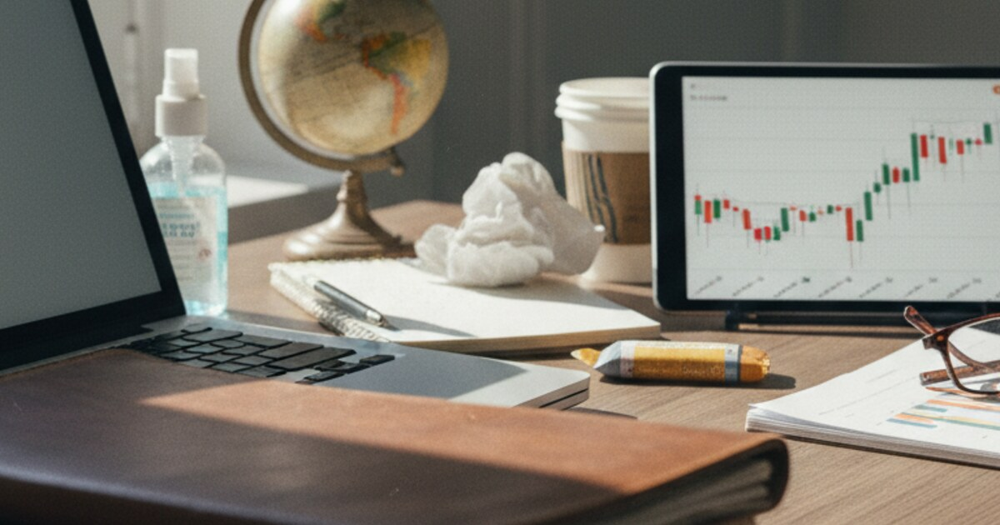

# 2020 Yatırım Protokolü: Bir Kriz Yönetimi Örnek Olay İncelemesi

Bu yazı, piyasaların tüm dünyada çıldırdığı, ekonominin kilitlendiği Mart ve Nisan 2020 dönemi hakkında. Kimsenin hiçbir şeyi kestiremediği o günlerde, 10 yıllık bir perspektifle net bir yatırım planı hazırlamak istedim.

Mart 2020'de piyasalar daha önce eşi benzeri görülmemiş şekilde tepki verdi. Duygularımla karar vermemek ve zihnimi toparlamak için karantinanın 12. gününde *2020 Let's Go - Investing* adlı bir belge hazırladım. Ana hedefim, kısa vadeli gürültüye odaklanmayı bırakıp uzun vadede değer yaratmaktı.

Başlangıç noktam gayet netti:

> "Ben bir trader değilim; bu yüzden inandığım ve hisse değerinin önümüzdeki 5 ila 10 yıl içinde artacağını düşündüğüm şirketlere odaklanıyorum. Kısacası: 10 yıl sonra, satın aldığım günden daha değerli olacaklar."

İşte bu yazı; krizin tam ortasında seçtiğim şirketlere, gerekçelerime ve o plana geriye dönük bir bakış.

## Nasıl Seçtim?

Karmaşık piyasa verilerini basitleştirmeye çalıştım. Bir hissenin geçmiş performansına (gözle görülür bir tablo olarak) ve sunduğu ürünlerin kalitesine baktım.

Birincisi, grafik. Karmaşık teknik göstergelerden ziyade, hissenin uzun vadeli seyrine güvendim.

> "Önce son 3, 5 ve 10 yıllık grafiklerine bakıyorum. Eğer grafik birkaç ufak sarsıntı dışında istikrarlı bir şekilde yukarı gidiyorsa, bu şirketin mevcut Corona çöküşünü de atlatacağına inanıyorum..."

İkincisi, corona indirimi. Piyasadaki o kırmızı tabloyu dev şirketlerin batışı olarak değil, bir nakit paniği olarak okudum. Dolayısıyla fiyatların normale döneceğini varsayıyordum.

> "Geçtiğimiz ay tüm hisseler %10-15'ten fazla değer kaybettiği için, önümüzdeki birkaç yıl içinde en azından bu %10-15'lik düşüşü geri almayı umuyorum."

Üçüncüsü, öğrenme aracı olarak risk almak (*skin in the game*). Para yatırmak sadece getiriyle ilgili değildi; beni aynı zamanda derinlemesine araştırma yapmaya zorluyordu.

> "Bir şeye finansal olarak yatırım yaptığınız an ilginiz artar... Otomatik olarak ona sadık kalırsınız ve bu sadakat sizi daha özgüvenli ve bilgili kılar."

## Ne Aldım ve Neden Aldım?

O dönemki portföyü dört gruba ayırdım: Dijital altyapı, değer ve istikrar, aykırı (contrarian) ve derin değer yatırımları, son olarak da girişim ve tohum sermayesi.

İlk grup dijital altyapı ve ödemeler üzerineydi. Fikrim şuydu: Zaten her şey dijitalleşiyor, pandemi sadece bu süreci hızlandırıyor.

Visa ve Mastercard, hem kripto paraya karşı bir koruma (hedge) hem de nakit paranın tamamen ortadan kalkacağına dair bir bahisti.

> "Dijital ödemelerin önümüzdeki on yıl içinde, hatta sonsuza kadar durdurulamaz bir şekilde büyüyeceğine inanıyorum... Mastercard ve Visa her yerde kabul ediliyor, her sisteme entegre edilebiliyor; kesinlikle parlak bir gelecekleri ve güçlü pazar konumları var."

Amazon ve Adobe'yi seçtim çünkü bulut bilişim, e-ticaret ve yaratıcı profesyonellerin vazgeçilmez araçları gibi temel altyapıları ellerinde tutuyorlardı.

> "Amazon gerçekten çılgınca... sattıkları ürünler ve sağladıkları sunucularla sürekli büyüyorlar."

> "Adobe o kadar sağlam bir duruşa sahip ki, önümüzdeki on yıl içinde -veya herhangi bir zamanda- piyasadan silinmeleri çok düşük bir ihtimal."

TSMC (Taiwan Semiconductor), güçlü rakamlarıyla tüm teknoloji sektörü için "kazma kürek" satan taraftı.

> "Geçmişteki gelişim benim için önemli... Ayrıca kâr marjı sadece %1-4 olan şirketlerden de pek haz etmiyorum."

## Değer, Donanım ve Sağlık

İkinci grup değer, donanım ve sağlık sektörü üzerine. Buradaki gerekçelerim, ürünleri bizzat kullanmamdan ve içeriden duyduklarımdan geliyordu; bazıları buna "dedikodu yatırımı" (*scuttlebutt investing*) der.

Lenovo'da hisse fiyatı ile ürün kalitesi birbirini tutmuyordu.

> "Bir Thinkpad laptopum ve bir Motorola telefonum var, ikisi de harika... Benim için hisse fiyatlarının sürekli neden düştüğünün bir mantığı yok."

Bir tıbbi teknoloji şirketi olan Getinge'yi, orada çalışan bir aile yakınımdan aldığım ve üretimin arttığına dair birinci ağızdan bilgilerle seçtim.

> "Kararımdaki en önemli etken kardeşimle yaptığım konuşmaydı... Bana halinden memnun olduğunu ve pandemi nedeniyle şirketin üretimi artıracağını söyledi."

Pfizer ve Bayer, temel ihtiyaçlar söz konusu olduğunda fazla ucuz görünüyordu. Bayer'i, ismindeki Monsanto riski ve yarattığı hukuki sürece rağmen seçtim; çünkü Alman şirketlerinin yönetilme biçimine uzun süredir güveniyorum.

> "Sağlık hizmetlerine olan yüksek talep nedeniyle büyüme potansiyelleri bana 'mantıklı' geliyor."

## Aykırı Bahisler, Bitcoin, Altın ve Tohum Yatırımı

Üçüncü grup, aykırı (contrarian) ve altyapı bahisleri. Bu şirketlerin büyük sorunları veya etik soru işaretleri vardı ama sistemin onlara ihtiyacı olduğu için satın aldım.

Rheinmetall ve Airbus'ı "batamayacak kadar büyük", altyapı ve savunmanın temel taşları olarak gördüm.

> "Airbus düşerse devletin onu kurtarmaması son derece düşük bir ihtimal... Airbus'ın eski gücüne döneceğine dair harika bir bahis."

> "Almanya merkezli, altyapı odaklı, büyük bir oyuncuya yatırım yapmak istedim... Yüksek kârlı işlere bakmaya başladığınızda bu tip şirketlerin dışında kalmak neredeyse imkansız."

Dördüncü grup ise alternatif varlıklar ve girişim sermayesiydi. Piyasa ile korelasyonu düşük getiriler ve erken aşama büyüme için yüksek riskli yatırımlar.

Bitcoin, halving süreci ve dijital kıtlık üzerine bir bahisti.

> "Şu an her gün 0.1 Bitcoin alıyorum... Bitcoin halving nedeniyle bu yılın çok büyük olabileceğine inanıyorum."

Altın, paranın değer kaybetmesine karşı bir sigortaydı.

> "Euro zamanla değer kaybedecek. Altın, on yıllardır istikrarlı olan en yaygın varlık... Euro nakit varlıklarımın en az %10'unu altına yatırmayı planlıyorum."

Ve sonra, kitle fonlaması yoluyla tohum yatırımları. Xolo OU, çünkü kendim zaten kullanıyordum. Mevo, canlı yayın üzerine 10 yıllık bir bahis. Ve Koawach, DACH bölgesindeki (Almanya, Avusturya, İsviçre) alternatif gıda üzerine bir bahis.

## 22. Gün Kontrol Listesi

9 Nisan'a gelindiğinde içgüdülerden net rakamlara geçtim. Alım yapmak bir bağımlılık gibi gelmeye başlamıştı, bu yüzden süreci disipline etmek için katı bir kontrol listesi oluşturdum.

Sallantılı iş modellerini elemek için bir şirketin kâr marjının %20'nin üzerinde olması gerekiyordu. Şirketin sağlıklı olması için borç/özsermaye oranının %60'ın altında olması şarttı. Gelir ve kazançlar 5 yıl boyunca istikrarlı bir şekilde büyümeliydi. Ardından, üretecekleri nakde göre ucuz olan şirketleri bulmak için F/K (Fiyat/Kazanç) ve PD/DD (Piyasa Değeri/Defter Değeri) oranlarını kullandım. Pazar payının korunup korunamayacağını anlamak içinse rakiplere bakmak şarttı.

## Plan Aslında Ne Hakkındaydı?

Sonuçta, *2020 Let's Go* belgesi, bir yatırımcı olarak kendi zihninizi nasıl yöneteceğinize dair bir vaka çalışmasıdır. Piyasaların %30-40, hatta %50 daha fazla düşebileceğini kabul ettim; bu da çöküş anlarında gelen o meşhur donup kalma hissini ortadan kaldırdı.

Visa ve Amazon gibi sürekli büyüyen değerleri (*compounders*), Bitcoin ve tohum yatırımları gibi oynak bahislerle ve altın gibi güvenli limanlarla harmanladım. Böylece portföy çeşitlendi ve tahminler üzerine değil, işlerin nasıl yürüdüğüne dair net bir inanç üzerine kuruldu.
