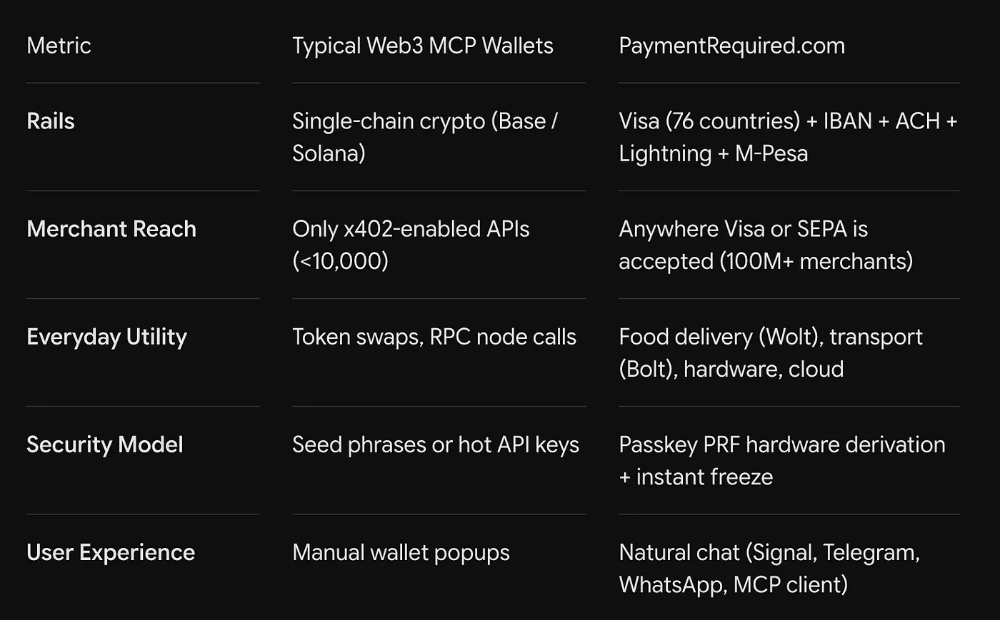

<https://www.youtube.com/watch?v=J3pegsM5drk>

Yakın zamanda yapılan bir sohbette, PayPal kurucu ortağı ve Affirm CEO'su Max Levchin, her fintech kurucusunun uzun uzun düşünmesi gereken bir şey söyledi.

"Kartlı ödeme arayüzü, şimdiye kadar yaratılmış en iyi kullanıcı arayüzü... Bu, sonunda yeniden müzakereye açılabilir çünkü yapay zeka zaten burada."

## Altmış yıllık plastik

Altmış yıl boyunca, tüketici finansı bir plastik parçası etrafında kuruldu. Sonra EMV çipi geldi, daha sonra Apple Pay.

Apple Pay, ödemeyi birkaç milisaniye hızlandırmak ve kart ağının katı 2,5 saniyelik yetkilendirme penceresini aşmak için telefondaki Secure Enclave'i kullandı.

Her versiyonun ortak bir yanı vardı. Bir terminalin önünde duran veya ekrana dokunan bir insan vardı.

## Ajanın elleri yok

Şimdi yazılım ajanları kod yazıyor, çok adımlı görevleri çalıştırıyor ve web'de hizmetler rezerve ediyor. Ama bir ajan faturayı ödemeye çalıştığı anda bir duvara çarpıyor.

Ajanın elleri yok.

Cebine uzanamaz. SMS OTP'yi geçemez, Cloudflare Turnstile CAPTCHA'sını çözemez ve insana benzemeyen tarayıcıları işaretleyen dolandırıcılık kontrollerine yakalanır.

Sektörün ilk cevabı çok dar görüşlüydü. Bugün geliştiricilerin ne inşa ettiğine bakarsanız, neredeyse her ajan cüzdanı bir sandbox deneyi. Bir kripto musluğu, bir testnet kontratı veya sunucular arasında USDC taşıyan küçük bir x402 uç noktası.

Bu yeterli değil. Ajanlar merkeziyetsiz bir balonda yaşamaz. Onlar insanlara yardım etmek için varlar ve insanlar gerçek dünyada yaşıyor.

Sadece başka bir sunucuya minik miktarlar gönderebilen bir ajan, Wolt'tan akşam yemeği sipariş edemez, sabah 6'da havaalanına Bolt rezerve edemez, acil lazım olduğunda eSIM alamaz veya eBay'de teklif veremez.

[Nuri.com](http://nuri.com)'un arkasındaki fikir bu ve Model Context Protocol (MCP) sunucumuzun ajanlar için para katmanı olabileceğini düşünmemizin nedeni de bu.

## Para gerçekten nerede akıyor

Sadece kripto konuşan bir ajan, sadece özel pistlerde çalışan elektrikli bir spor araba gibidir. Etkileyici ama sizi hiçbir yere götürmez.

Günlük paranın gerçekten nereye aktığına bakın.

Birincisi, eski raylar. Dünyadaki fiziksel ticaretin %99,9'u Visa, Mastercard, SEPA ve ACH üzerinde çalışıyor. Yemek teslimatı, araç çağırma, bulut sağlayıcıları, mağazalar, hepsi.

İkincisi, sürtünme. Bir ajanın onayınıza, bir kağıt parçasındaki seed phrase'e veya her bir şey yaptığında özel anahtarları kopyalayıp yapıştırmanıza ihtiyacı varsa, ajanın tüm anlamı kaybolur.

Levchin'in dediği gibi, "Göndermeye çalıştığınız toplam miktar azaldıkça, kolaylık her şeyi geçer."

Üçüncüsü, kimlik. Cypherpunk fikri genellikle tamamen anonim olduğunuzu varsayar. Ama gerçek ticaret, insanların güvenebileceği bir mutabakat, tüccarların paralarını geri almaları için bir yol ve her ülkenin kurallarını gerektirir.

## Köprüyü inşa etmek

Çoğu ajan ödeme projesi bir ada inşa etti. PaymentRequired köprüyü inşa etti.

PaymentRequired, dünyadan terminallerini atmasını ve her şeyi Web3 için yeniden inşa etmesini istemiyor. Ajana yerel bir Model Context Protocol (MCP) arayüzü veriyor. Dünyanın tüm para rayları arkasında, her zaman aynı şeyi yapan basit araçlar olarak duruyor.

Bir geliştirici MCP'yi Claude Desktop, Cursor, Hermes veya kendi ajan döngüsüne eklediğinde, ajan hemen üç katmana erişim kazanır.

```
                  ┌─────────────────────────────────────────┐
                  │          Autonomous AI Agent            │
                  │   (Claude, Cursor, OpenClaw, Hermes)    │
                  └────────────────────┬────────────────────┘
                                       │  JSON-RPC via MCP
                  ┌────────────────────▼────────────────────┐
                  │       PaymentRequired.com Engine        │
                  └──────┬──────────────────┬───────────────┘
                         │                  │
         ┌───────────────▼──────┐    ┌──────▼───────────────┐
         │     Legacy Rails     │    │  Micropayment Rails  │
         ├──────────────────────┤    ├──────────────────────┤
         │ • Visa (76 countries)│    │ • Bitcoin Lightning  │
         │ • EUR IBAN / SEPA    │    │ • HTTP 402 / x402    │
         │ • USD ACH            │    │ • USDC / USDT / ETH  │
         │ • M-Pesa Remittance  │    │ • Passkey PRF Auth   │
         └──────────────────────┘    └──────────────────────┘
```

Birinci katman gerçek ödemeler. Ajan sadece bir ödemeyi simüle etmiyor. Normal ödeme sürecinden geçiyor ve ödüyor.

Wolt'tan her zamanki siparişimi ver diyorsunuz, Wolt ödemesi geçiyor, kart tahsil ediliyor ve akşam yemeği 25 dakikada kapıda. Sabah 6'da BER havaalanına Bolt diyorsunuz, yolculuk rezerve ediliyor, bir sürücü atanıyor ve makbuz kaydediliyor.

Gelecek hafta Türkiye için eSIM diyorsunuz ve hiçbir KYC derdi olmadan QR kodu alıyorsunuz. Anneme 2.000 Şilin gönder diyorsunuz ve M-Pesa transferi saniyeler içinde ulaşıyor.

İkinci katman iki tür ray. Daha büyük ve normal ödemeler için 76 ülkede çalışan, kendi EUR IBAN'ı ve USD ACH yönlendirme numarası olan gerçek bir Visa kartı var.

Küçük makineden makineye ödemeler için HTTP 402 `Payment Required` başlığına yerel destek var, böylece bir sentin altındaki API çağrıları ve ölçülen hesaplama, Bitcoin Lightning ve Layer 2'deki stablecoin'ler üzerinden mutabakata varıyor.

Üçüncü katman, anahtarlarınızı saklamanız ve işleri zorlaştırmaması. Bu size velayete mal olmuyor.

Anahtarlar, cihazınızın donanımındaki WebAuthn Passkey PRF'den geliyor, yani sizde kalıyorlar. Ajan, belirlediğiniz kurallar dahilinde harcama yapabilir, ancak anahtarların sahibi asla olamaz.

## Güven yerine kurallar

İnsanların ajanların ödeme yapmasına izin vermesini engelleyen en büyük şey kafada. Sınırsız para kaybetme korkusu.

Kimse ana banka kartını, bir döngüye takılıp hesabı bulut hesaplama veya uydurduğu alışverişlerle boşaltabilecek bir LLM'e bağlamak istemez.

PaymentRequired bunu koddaki kart kontrolleriyle çözüyor. Ajana sadece para vermiyorsunuz. Ajana kurallar veriyorsunuz.

Her şeyi tek bir sohbet mesajıyla durdurabilirsiniz. Kartımı dondur diyorsunuz ve kart hemen ihraççıda bloke oluyor.

İşlem başına, alan adı başına veya gün başına limitler koyabilirsiniz, böylece 30 € yemek limiti olan bir ajan yanlışlıkla 300 € harcayamaz.

Ve sanal kartlar tam zamanında oluşturulabilir, ödemenin ihtiyaç duyduğu tam sentlerle yüklenebilir ve o tek tüccar alan adına kilitlenebilir.

Bu aynı zamanda Levchin'in bahsettiği 2,5 saniyelik yetkilendirme sorununu da aşıyor. Limitler ayarlanıyor ve bakiye, tüccarın ödeme geçidi çalışmadan önce hazır oluyor, böylece ajan normal kart akışı içinde ödüyor ve ihraççının dolandırıcılık kontrollerini tetiklemiyor.

## Dağıtım protokolleri yener

Fintech tarihi aynı şeyi tekrar tekrar öğretiyor. Dağıtım ve sıklık, akıllı protokolleri yener.

Alex Rampell'in ünlü sözüne göre, en yüksek marjlara sahip ve kalıcı olan ödeme işleri, milyonlarca dolarlık nadir havaleleri taşıyanlar değildir.

İnsanların her gün yaptığı küçük ödemelerin içinde olanlardır. Kahve testini geçerler.



| Metrik | Tipik Web3 MCP Cüzdanları | PaymentRequired.com |
|---|---|---|
| Raylar | Tek zincirli kripto (Base / Solana) | Visa (76 ülke) + IBAN + ACH + Lightning + M-Pesa |
| Tüccar Erişimi | Sadece x402 etkin API'ler (<10.000) | Visa veya SEPA'nın kabul edildiği her yer (100M+ tüccar) |
| Günlük Fayda | Token takasları, RPC düğüm çağrıları | Yemek teslimatı (Wolt), ulaşım (Bolt), donanım, bulut |
| Güvenlik Modeli | Seed phrase'ler veya sıcak API anahtarları | Passkey PRF donanım türetme + anında dondurma |
| Kullanıcı Deneyimi | Manuel cüzdan açılır pencereleri | Doğal sohbet (Signal, Telegram, WhatsApp, MCP istemcisi) |

Ajan ödemelerini kazanacak ekip, en karmaşık akıllı sözleşmeye sahip olan ekip olmayacak. Bir ajanın tek bir arayüz üzerinden kahve almasına, bir VPS sunucusu başlatmasına, taksi rezerve etmesine ve bir API faturası ödemesine izin veren ekip olacak.

Ödeme artık bir plastik parçasına bakan bir insan değil. Kod içinde ödeme raylarıyla çalışan bir ajan.

Protokol zaten yayında. Araçlar zaten barındırılıyor.

Ajanınıza ödeme yaptırın: [nuri.com](http://paymentrequired.com/mcp/)
