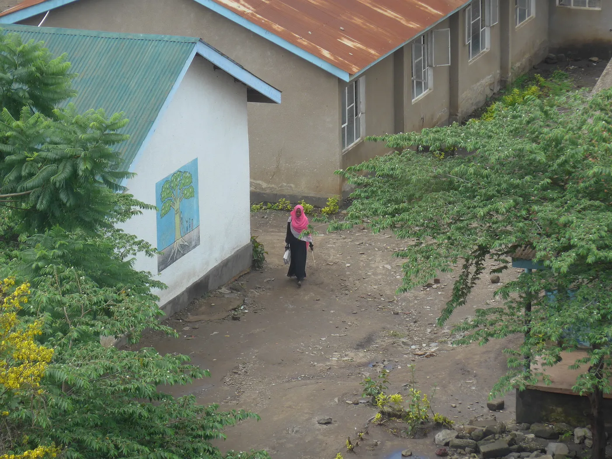

# Romanya, Tanzanya ve Zanzibar'da Soğuk Savaş Diplomasisinin Yankıları ve 1972 Vize Kaldırma Anlaşmasının Mirası

Şöyle bir düşünün. 2020'lerdesiniz, Avrupalı bir dijital göçebe ya da turistsiniz ve tropik bir kaçamak yapmak istiyorsunuz. Doğu Afrika haritasına bakıyorsunuz ve Zanzibar'ın beyaz kumsallarını görüyorsunuz. Elinizde İngiltere, Fransa, Almanya ya da Avrupa'nın hemen hemen her ülkesinin pasaportu varsa, kredi kartınızı çıkarıp vize ücretini ödüyorsunuz.

Ama elinizde Rumen pasaportu varsa, elini kolunu sallayarak geçiyorsunuz.

## Rumen pasaportu neden farklı

Romanya hâlâ vatandaşlarına Tanzanya Birleşik Cumhuriyeti'ne vizesiz giriş hakkı veren tek Avrupa ülkesi. Buna yarı özerk Zanzibar adaları da dahil. Bu yeni çıkmış bir turizm fikri ya da bir AB ticaret anlaşması falan değil. Bu, Soğuk Savaş'ın tuhaf bir döneminden geriye kalan bir miras. Hikâyenin içinde dağ taş demeyen dayanıklı bir 4x4, krallar gibi hüküm sürmüş iki lider ve bir kralın arabalarına benzin sağlasın diye kurulmuş bir petrol rafinerisi var.

## İki hükümdar ve 1972 anlaşması

Meseleyi anlamak için 1972 baharına dönmemiz lazım. Soğuk Savaş tüm hızıyla sürüyordu ve bağımsızlığını yeni kazanmış Afrika devletleri, kapitalist Batı ile komünist Doğu arasında yollarını bulmaya çalışıyordu.

Nicolae Ceaușescu, Romanya'nın komünist diktatörüydü ve Moskova'nın güdümünde değil, kendi dış politikasını yürütmek istiyordu.1 Romanya'nın Üçüncü Dünya gözünde "gelişmekte olan kardeş ülke" gibi görünmesini arzuluyordu. Batı'nın sömürgeci geçmişi ya da Sovyetler'in baskısı olmadan sanayi yardımı getiren bir ülke.1

Mart 1972'de Ceaușescu büyük bir Afrika turuna çıktı ve yolu Tanzanya'nın Dar es Salaam kentine düştü. Orada Devlet Başkanı Julius Nyerere ile tanıştı. İnsanlar Nyerere'ye *Mwalimu*, yani öğretmen derdi. Kendisi, Afrika'ya özgü bir sosyalizm modeli olan *Ujamaa*'nın arkasındaki isimdi.3

Çok farklı dünyaların insanlarıydılar ama ortak noktaları çoktu. İkisi de taviz vermeden devasa sosyal mühendislik projeleri yürütüyordu. Nyerere kırsal alandaki köyleştirme politikasıyla, Ceaușescu da "sistemleştirme" adını verdiği kentleşme/köy birleştirme hamlesiyle.3 İkisi de mutlak güçle ve bir hanedan gibi onlarca yıl hüküm sürdüğü için, tarihçiler ve siyasi analistler aralarındaki bağı sık sık "iki hükümdarın dostluğu" diye tanımlar.

28 Mart 1972'de iki ülke bir Vize Kaldırma Anlaşması imzaladı.6 Standart prosedürleri bir kenara bırakan bu hamle, iki sosyalist devlet arasında seyahat etmeyi son derece kolaylaştırdı. Üstelik bu anlaşma zamana meydan okudu. Ceaușescu'nin 1989'daki kanlı devrilişini atlattı, Romanya'nın AB'ye girmesine dayandı, Tanzanya'nın çok partili demokrasiye geçişinden bile etkilenmedi. Sonra gelen hükümetlerden hiçbiri bu anlaşmayı iptal etmeye yanaşmadı.

## Aru Jeep Chauchenko

Anlaşma dediğiniz kâğıt üstünde bir imzadan ibarettir ama Ceaușescu elle tutulur bir iz bırakmayı iyi biliyordu. Araba diplomasisinde üstüne yoktu ve yanında Romanya'nın en iyi mekanik elçisini getirdi: ARO 240 arazi aracını.7

ARO, yani Auto Romania, lüks bir SUV falan değildi. En zorlu yollar için tasarlanmış, karmaşık elektronik aksamlara ihtiyaç duymayan, basit ve dayanıklı bir makineydi.7 1972'deki ziyareti sırasında Ceaușescu, Tanzanya liderlerine ve Zanzibar'ın devrimci hükümetine gıcır gıcır birkaç ARO 240 cip hediye etti.5

Bu araçlar sadece sembolik bir hediye olarak kalmadı. Cipler doğrudan Doğu Afrika'nın çetin arazi şartlarına daldı ve rüştünü ispatladı. Yerli tamirciler araçları kolayca onarabiliyordu; nitekim kısa sürede her köşe başında görünür olup Rumen-Tanzanya iş birliğinin simgesi haline geldiler.

Arabaları hediye eden diktatörle özdeşleştiren Tanzanya ve Zanzibar halkı, markayı adamın isminin okunuşuyla birleştirip kendi diline uyarladı. "ARO" zamanla "Aru", "Ceaușescu" ise "Chauchenko" oluverdi.

Onlarca yıl boyunca "Aru Jeep Chauchenko" savanlarda cirit attı. Doğu Avrupa sanayisinin bir parçası ile yepyeni bir kelime, Afrika güneşinin altında yan yana yaşamaya devam etti.5

## Petrol, mühendisler ve kralın arabalarına yakıt

Ama hikâye Tanzanya arazilerinde bitmiyor. Hint Okyanusu'nu aşıp Zanzibar'ın eski yöneticilerine, yani Umman Sultanlığı'na kadar uzanıyor.

Yüzyıllar boyunca Zanzibar, büyük Umman İmparatorluğu mekiğinin mekânıydı; Umman ile Doğu Afrika kıyıları bugün bile kültür ve insan bağlarıyla birbirine sıkı sıkıya bağlıdır.8 Romanya, Bağlantısızlar dünyasına kendi katı modernleşme anlayışını sunarken en değerli ihracat kalemi ARO cipleri değildi. Petrol konusundaki bilgi birikimiydi.

Rumen Petrol Okulu son derece yetkin bir teknik kadro yetiştirmişti ve 1970'ler ile 1980'lerde Romanya, dünyanın en büyük ikinci petrol ekipmanı ihracatçısı konumundaydı.9 O dönemin diplomatik kulislerinde, Rumen otomotiv gururunun Orta Doğu devlet aklıyla kesiştiği özel bir anlaşmadan bahsedilir. Umman'ın yeni Sultanı Kabus bin Said, kraliyet araç filosu için işlenmiş yakıta ihtiyaç duyuyordu. Ceaușescu da bölgede petrol rafinerileri kurulmasına yardımcı olmaları için en iyi Rumen mühendislerini gönderdi.

Bu hamle Ceaușescu'nun stratejisini net bir şekilde özetliyor. Romanya ham petrolü işleyecek mühendisleri ve teknolojiyi ihraç ederken sadece fabrika kurmuyordu; ülkeler arasında kişisel borçluluk bağları inşa ediyordu. Bölgeye gelen Rumen mühendisler, teknik bilgiyi iyi niyet ve ham maddeyle takas etmeye dayalı devasa bir insan kaynağı ihracatı planının parçasıydı.1

## Döngü 2020'de tamamlanıyor

Derken günümüzde hikâye başladığı noktaya döndü.

Aralık 2020'de Umman Sultanlığı turist sayısını artırmak amacıyla tek taraflı bir karar alarak 100'den fazla ülkenin vatandaşına 14 güne kadar vizesiz seyahat imkânı tanıdı.10 Romanya da o listedeydi.

Böylece 1970'lerin araba ve petrol diplomasisinden kalan mirasa ve bugünün ekonomik vizyonuna teşekkür borçlu olan Rumen pasaportu sahipleri, artık eski Umman İmparatorluğu'nun her iki yakasına da elini kolunu sallayarak gidebiliyor. Bir tarafta Doğu Afrika'daki Zanzibar var, Ceaușescu ile Nyerere'nin 1972'de kapılarını açtığı yer; diğer tarafta ise Basra Körfezi'ndeki Umman var, Sultanlığın 2020'de vizeyi kaldırdığı kadim topraklar.

## Kim kimdir

Peki bu hikâyede kim kimdir? Chauchenko, Romanya'nın eski komünist lideri Nicolae Ceaușescu. Aru Jeep, Tanzanya'ya hediye ettiği dayanıklı Rumen arazi aracı ARO. İki hükümdar, mutlak güçle hüküm sürdükleri için Ceaușescu ve Nyerere'ye takılan lakap. Petrol diplomasisi, Romanya'nın dünyanın en büyük petrol teknolojisi ihracatçılarından birine dönüşüp bunu rafineriler kurmak ve Orta Doğu monarşileriyle bağ kurmak için kullanması. Vize döngüsü ise tüm bu ilişkilerin günümüze bıraktığı miras, yani Rumenlerin bugün Tanzanya, Zanzibar ve Umman'a vizesiz girebilmesi.

Bugün binlerce Rumen, Zanzibar kumsallarına ayak basarken Avrupa'nın geri kalanını yavaşlatan vize kuyruklarını doğrudan atlıyor. Çoğu farkında bile olmadan Soğuk Savaş döneminden kalma bir hikâyenin son perdesini yaşıyor. İki liderin kaleme aldığı, bir "Aru Jeep Chauchenko"nun çamurları yara yara yol aldığı, Rumen rafineri mühendislerinin yakıt sağladığı ve diplomatik tarihin köklü mirası sayesinde bugün hâlâ yaşayan bir hikâye bu.

### Kaynakça

1. Into Africa, Nicolae Ceauşescu’s tour of March–April 1972, Journals, erişim tarihi 10 Mart 2026, [https://journals.lwbooks.co.uk/tcc/vol-2018-issue-15/article-9215/](https://journals.lwbooks.co.uk/tcc/vol-2018-issue-15/article-9215/)
1. Exporting hard modernity, construction projects from Ceaușescu’s Romania in the ‘Third World’, ResearchGate, erişim tarihi 10 Mart 2026, [https://www.researchgate.net/publication/241728057_Exporting_hard_modernity_construction_projects_from_Ceausescu's_Romania_in_the_'Third_World'](https://www.researchgate.net/publication/241728057_Exporting_hard_modernity_construction_projects_from_Ceausescu's_Romania_in_the_'Third_World')
1. Socialisms Between Cooperation and Competition, Ideology, Aid and Cold War Politics in Tanzania’s relations with East Germany, OpenEdition Books, erişim tarihi 10 Mart 2026, [https://books.openedition.org/editionsmsh/51520?lang=en](https://books.openedition.org/editionsmsh/51520?lang=en)
1. Romanian rural systematization program, Wikipedia, erişim tarihi 10 Mart 2026, [https://en.wikipedia.org/wiki/Romanian_rural_systematization_program](https://en.wikipedia.org/wiki/Romanian_rural_systematization_program)
1. Communist dictator Ceauşescu’s ARO jeep put up for auction again for lower price, erişim tarihi 10 Mart 2026, [https://www.romaniajournal.ro/society-people/communist-dictator-ceausescus-aro-jeep-put-up-for-auction-again-for-lower-price/](https://www.romaniajournal.ro/society-people/communist-dictator-ceausescus-aro-jeep-put-up-for-auction-again-for-lower-price/)
1. Volume IV, Annexes, INTERNATIONAL COURT OF JUSTICE, erişim tarihi 10 Mart 2026, [https://www.icj-cij.org/index.php/node/142428](https://www.icj-cij.org/index.php/node/142428)
1. ARO 24, Eastern Europe’s Answer to Jeep and Land Rover, YouTube, erişim tarihi 10 Mart 2026, [https://www.youtube.com/watch?v=m7BIFXcwxMo](https://www.youtube.com/watch?v=m7BIFXcwxMo)
1. Tanzania Consulate General Zanzibar, زنجبار قنصلية عامة تنزانيا, fm.gov.om, erişim tarihi 10 Mart 2026, [https://www.fm.gov.om/en/missions/om-tz-zanzibar-cg/](https://www.fm.gov.om/en/missions/om-tz-zanzibar-cg/)
1. History of Romanian Technology and Industry, springerprofessional.de, erişim tarihi 10 Mart 2026, [https://www.springerprofessional.de/history-of-romanian-technology-and-industry/26543184](https://www.springerprofessional.de/history-of-romanian-technology-and-industry/26543184)
1. Entry visas, fm.gov.om, erişim tarihi 10 Mart 2026, [https://www.fm.gov.om/en/visitors/entry-visas/](https://www.fm.gov.om/en/visitors/entry-visas/)
