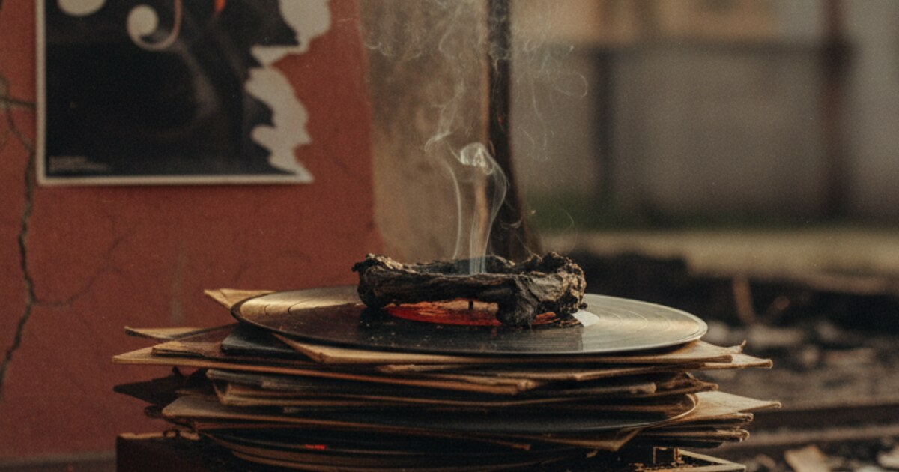

Bu, Fela Kuti ve onun meşhur Zombie parçası hakkındaki bir belgeselin özeti. Tırnak içindeki kısımlar videoda ekrana gelen metinler. En sondaki bilgiler ise biraz ek araştırmadan geliyor.

Fela Kuti, 1976'da "Zombie"yi çıkardı. Şarkı, Nijerya ordusuyla açıktan dalga geçiyor. Askerlerin, emir almadan adım bile atamayan robotlardan farkı olmadığını söylüyor. Ordu buna pek gülmedi. 1.000 askerle gelip Kalakuta Republic adını verdiği komün binasını ateşe verip yerle bir ettiler ve annesini pencereden aşağı attılar.

Kısa özet: Bir şarkı orduyu öyle bir sinirlendirdi ki koca bir yerleşkeyi dümdüz ettiler. Aşağıda videodaki hikayenin tamamını, şarkı sözlerini ve olayın perde arkasını bulabilirsin.

## Videoda anlatıldığı gibi hikaye

Video bu satırları sırasıyla ekrana getiriyor.

> "Fela'nın 1974'teki Alagbon Close ve 1976'daki Kalakuta Show albümleri, Nijerya polisi ve ordusunda büyük bir öfke uyandırmıştı. Fela ve Africa 70'in bu yüzden yediği dayak ve gördüğü baskı, 1976'nın sonlarında çıkan Zombie albümü sonrasında yaşananların yanında hiçbir şeydi..."

> "Albüm çıktıktan aylar sonra, büyük bir ordu saldırısı sonucu Fela'nın Kalakuta Republic binası tamamen yandı ve Fela dahil birçok kişi ağır yaralandı. Kalakuta'nın yerle bir edilmesi tabii ki sadece Zombie yüzünden olmadı ama Fela ile ordu arasındaki zaten gergin olan ortamı iyice kaynama noktasına getirdi."

> "Zombie şarkısında, Africa 70'in acil ve tempolu marş ritmi eşliğinde Fela ve vokalistler üniformalı adamların kafa yapısıyla dalga geçiyor. 'Hazırol! Uygun adım marş! Ağır adım! Selam dur!' diye bağırıyor Fela, 'Sıraya gir! Dağıl! Yere yat! Git öldür! Git öl! Git geber!' Her emrin ardından kadın vokalistlerin alaycı yanıtı geliyor: 'Zombie!'"

> "Fela devam ediyor: 'Beyin yok, iş yok, mantık yok joro jara jo; ona git öldür de joro jara jo; ona git geber de joro jara jo (yani, "beyin yok, iş yok, mantık yok, sol sağ sol"; ona git öldür de sol sağ sol; ona git geber de sol sağ sol.")'"

> "Ordu için Fela'nın sözleri bardağı taşıran son damlaydı, gururlarına ve prestijlerine doğrudan bir saldırıydı. İşin daha da kötüsü, bir de üstüne kadınlar tarafından aptal yerine konulmak iyice ağırlarına gitti. Daha da fenası, Zombie tüm Afrika'da hit olmuştu ve bu hakarete uluslararası bir boyut kazandırmıştı. Ordunun cevabı ise dehşet vericiydi..."

> "18 Şubat 1977'de, çoğu silahlı yaklaşık 1.000 asker Fela'nın Kalakuta Republic'teki binasına baskın yaptı. Etrafı sardılar, telleri parçalayıp içeri daldılar. İçeridekileri soydular ve insanlık dışı işkence ettiler; özellikle şanssız erkeklerin testislerine tüfek dipçikleriyle vurdular; özellikle şanssız kadınlara tecavüz ettiler (birinin meme uçlarını taşlarla ezdiler)..."

> "Fela ağır şekilde dövüldü, kafatası çatladı ve birçok kemiği kırıldı. O zamanlar 77 yaşında olan annesini pencereden aşağı attılar, bacağı kırıldı ve ağır travma geçirdi. Ordu sonra binayı ateşe verdi ve itfaiyenin yaklaşmasına engel oldu..."

> "Çıkan yangın içerideki her şeyi kül etti; Africa 70'e ait altı araç, tüm ana bant kayıtları ve müzik ekipmanları, dört kanallı bir stüdyo, tüm üyelerin şahsi eşyaları ve hatta Fela'nın kardeşi Dr. Beko Ransome Kuti'nin (o da saldırıda ağır dövülmüştü) işlettiği ücretsiz sağlık kliniği bile yandı..."

> "Olay yerine gelen ilk gazetecileri askerler dövdü. Merak edip yaklaşan vatandaşlara da aynısını yaptılar. Ordu hiçbir şahit istemiyordu. Ama bu konuda başarılı olamadılar; yangının ve sonrasındaki manzaranın fotoğrafları birkaç gün içinde Nijerya basınında boy boy yayınlandı."

> "Fela'nın siyasi duruşu Gana makamlarının da hoşuna gitmemişti, özellikle de Ganalı öğrencilerin sokaklarda polise ve askere karşı 'Zombie!' diye bağırmasından sonra. Birkaç çalkantılı aydan sonra Fela Nijerya'ya geri gönderildi."

## Şarkı sözleri

Şarkı çağrı ve yanıt şeklinde ilerliyor. Fela bir satır söylüyor, kadınlar "Zombie" diye cevap veriyor.

Nakarat

> Zombie o, zombie *(Zombie o, zombie)*
> Zombie o, zombie *(Zombie o, zombie)*

1. Kıta

> Zombie no go go, unless you tell am to go *(Zombie)*
> Zombie no go stop, unless you tell am to stop *(Zombie)*
> Zombie no go turn, unless you tell am to turn *(Zombie)*
> Zombie no go think, unless you tell am to think *(Zombie)*

2. Kıta

> Tell am to go straight
> *A joro, jara, joro*
> No brake, no job, no sense
> *A joro, jara, joro*
> Tell am to go kill
> *A joro, jara, joro*
> No brake, no job, no sense
> *A joro, jara, joro*
> Tell am to go quench
> *A joro, jara, joro*
> No brake, no job, no sense
> *A joro, jara, joro*

Köprü

> Go and kill! *(Joro, jara, joro)*
> Go and die! *(Joro, jara, joro)*
> Go and quench! *(Joro, jara, joro)*
> Put am for reverse! *(Joro, jara, joro)*

Outro, askeri komutlar

> Attention! *(Zombie)*
> Quick march! *(Zombie)*
> Slow march! *(Zombie)*
> Left turn! *(Zombie)*
> Right turn! *(Zombie)*
> About turn! *(Zombie)*
> Double up! *(Zombie)*
> Salute! *(Zombie)*
> Open your hat! *(Zombie)*
> Stand at ease! *(Zombie)*
> Fall in! *(Zombie)*
> Fall out! *(Zombie)*
> Fall down! *(Zombie)*
> Get ready! *(Zombie)*
> Halt! Order!

## Tarih ne diyor

Saldırı 18 Şubat 1977'de gerçekleşti. Kayıtlara göre yaklaşık 1.000 asker katıldı.

Annesi Funmilayo Ransome-Kuti, tanınmış bir kadın hakları savunucusu ve siyasi aktivistti. Pencereden atıldığında aldığı yaraların komplikasyonları nedeniyle 1978'de hayatını kaybetti.

Yıkımdan sonra yapılan resmi soruşturmada binanın "meçhul bir asker" tarafından yakıldığına karar verildi. Yani ordudan kimse sorumlu değildi. Fela buna "Unknown Soldier" adlı yeni bir şarkıyla cevap verdi.

Video Fela'nın Gana'dan geri gönderildiğini söylüyor. Bu 1978'de oldu. Akra'daki bir konserde "Zombie" çalınırken çıkan isyanlardan sonra ülkeye girişi yasaklandı.

Ve son perde. Fela ve hareketi, annesinin ölümünü protesto etmek için Lagos'taki Dodan Kışlası'na sembolik bir tabut taşıdı.
