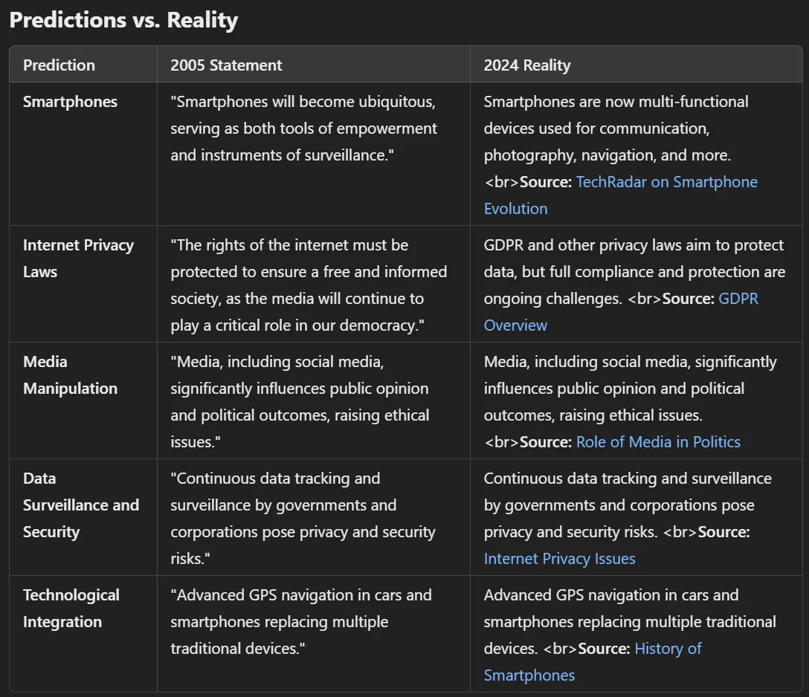

Medya ve teknoloji üzerinden yapılan manipülasyon artık hayatımızın her yerinde. Dünyayı nasıl algıladığımızı da attığımız adımları da bu belirliyor. 2005 yılında, henüz 17 yaşımdayken Emin Henri Mahrt adıyla lise bitirme tezimi yazdım: "Teori Gerçeğe Karşı". Bu yazıda o tezden yola çıkarak kendi deneyimlerimi, siyaset teorilerini, gerçek vakaları ve medyayı kontrol etmenin aslında ne kadar büyük bir güç sağladığını anlatıyorum.

## Görmediğin manipülasyon

Manipülasyon her zaman öyle kör göze parmak yapılmaz. Çoğu zaman tükettiğimiz medya ve kullandığımız teknoloji üzerinden düşüncelerimizi ve davranışlarımızı sessiz sedasız şekillendiren bir süreçtir bu. "Teori Gerçeğe Karşı"da manipülasyonu şöyle tanımlamıştım: "Bilgi akışını elinde tutanların, bireylerin algılarını ve kararlarını gizlice yönlendirmesi" (s. 2).

## Çin'de gördüklerim

Gelelim Çin'e. 2000 yılında Çin'de bulundum. Devlet kontrolünün nerelere varabileceğini, gözetleme sistemlerini ve bunların günlük hayatı nasıl etkilediğini bizzat yerinde gördüm.

Tiananmen Meydanı'nda durduğunuz an o kontrolü iliklerinize kadar hissediyorsunuz. Burası hem Çin'in geçmişteki mücadelelerinin hem de bugünkü gözetleme devletinin açık bir simgesi. O zamanlar şöyle yazmıştım: "Attığım her adım izleniyor, her hareketim kaydediliyor gibiydi. Güvenlik kameralarının o yoğun varlığı, devletin gözünün sürekli üstünüzde olduğunu durmadan hatırlatıyordu" (s. 3).

Jan Wong'un görgü tanıklığı anlatımları, Tiananmen Meydanı'nda yaşananlara bambaşka bir pencere açıyor. Şöyle diyor Wong: "Meydan tam bir kaos içindeydi ama o kargaşanın ortasında çok derin bir birlik ve başkaldırı hissi vardı" (s. 4). Bunun gibi tanıklıklar, bizzat yaşanan gerçekliğin o cilalanmış resmi tarihten ne kadar farklı olduğunu açıkça gösteriyor.

Gözetleme dijital dünyada da aynen devam ediyor. Çin'de e-posta takibi akılalmaz boyutlardaydı. Mahremiyetin çok az insanın erişebildiği bir lüks olduğu dijital bir panoptikondan bahsediyoruz. Şöyle yazmıştım: "E-postalarımın her an okunabileceğini bilmek, iletişim kurma biçimimi tümden değiştirdi. Devletin kolunun nerelere uzandığını insana ürpertici bir şekilde hatırlatıyordu" (s. 5).

## Siyaset teorisinde iktidar

Tez daha sonra siyaset teorisine, yani geçmişten bugüne düşünürlerin iktidar ve kontrol meselelerini nasıl ele aldığına odaklanıyor.

Maurice Joly'nin yazdıkları, siyasi manipülasyonu anlamak için temel taşlardan biridir. Joly, iktidardakilerin gerçeğin ve aklın peşinden gitmektense kontrolü elde tutmaya öncelik verdiğini savunur (s. 6). Bilginin otoriteyi korumak için bir silah gibi kullanıldığı günümüz dünyasına hâlâ birebir uyan bir tespit.

Machiavelli ve Montesquieu ise gücün nasıl kullanıldığına dair tarihsel bir bakış açısı sunuyor. Machiavelli'nin pragmatik yönetim tarzı, Montesquieu'nün idealist vizyonunun tam karşısında dursa da ikisi de otorite ile özgürlük arasındaki o ezeli kavgayı ortaya koyar. "Machiavelli'nin öğretileri her ne kadar acımasız görünse de iktidarın soğuk hesabını gözler önüne serer; Montesquieu ise dengeli bir yönetim vizyonu çizer" (s. 7).

Medya ve teknolojinin etkisi edebiyatta da sürekli karşımıza çıkar. Neil Postman Televizyon: Öldüren Eğlence kitabında "Eğlenerek kendimizi tüketiyoruz" der ve eğlence medyasının önemli meseleleri nasıl basitleştirip toplumsal tartışmayı nasıl sığlaştırdığını gösterir (s. 8). George Orwell'ın 1984 romanı bugün her zamankinden daha güncel; oradaki Büyük Birader ise şu anki gözetleme devletlerinin erken bir prototipi gibi. "Savaş barıştır. Özgürlük köleliktir. Cahillik güçtür." Orwell'ın bu sloganları bugünün dünyasında da yankılanmaya devam ediyor (s. 9). Vance Packard ise Çaktırmadan İkna Edenler kitabında reklamların davranışlarımızı ne kadar sinsice manipüle ettiğini anlatır. Packard'ın dediği gibi: "İnsanları arzularının ne kadar bilincine vardırırsanız, onları o kadar etkili kontrol edersiniz" (s. 10).

## Gerçek kontrol vakaları

Tez daha sonra modern medya aracılığıyla kurulan kontrole, teorinin somutlaştığı gerçek vakalar üzerinden bakıyor.

Bilgisayar uzmanı Boris F. gizemli bir şekilde hayatını kaybetti ve pek çok insan bunun onun bildiği hassas bilgilerle bağlantılı olduğuna inanıyor. Bu vaka, medyanın perde arkasındaki kontrol çarklarını açığa çıkaran insanların nasıl tehlikelerle yüz yüze kaldığını çok net gösteriyor. "Boris'in kaderi, rahatsız edici gerçekleri gün yüzüne çıkarmanın getirdiği riskleri acı bir şekilde hatırlatıyor" (s. 12).

Kevin Mitnick ve Karl Koch ise siber suçların ne kadar karmaşık bir hal aldığını gözler önüne seriyor. Onların hikayeleri, teknolojinin iki ucu keskin bir bıçak olduğuna dair birer uyarı niteliğinde. "Mitnick ve Koch gibi bilgisayar korsanları, doğruyla yanlış arasındaki çizginin sıklıkla bulanıklaştığı gri bir alanda faaliyet gösteriyor" (s. 13).

Bugün bilgiyi toplayıp analiz eden sistemler devasa ve inanılmaz derecede gelişmiş durumda. Bunlar, "her veri kırıntısından maksimum değeri çıkarmak, kişisel bilgileri birer metaya dönüştürmek" üzere inşa edilmiş sistemler (s. 14). Veri bir metaya dönüştüğünde ise bunun mahremiyet ve bireysel bağımsızlık üzerinde çok ağır bedelleri oluyor.

Bilgi işleme teknikleri, veri madenciliğinden psikolojik profillemeye kadar uzanıyor ve kusursuz işliyor. Bu yöntemler, "davranışları hissettirmeden ama çok güçlü bir şekilde manipüle etmek, kararlarımızı belki de hiç fark edemeyeceğimiz şekillerde biçimlendirmek için geliştirildi" (s. 15).

## 2005'te neleri öngörmüştüm?

Geleceğe baktığımızda, medya ve teknolojiyle yapılan manipülasyonun çok daha sofistike ve sinsi bir hale geleceği açık. "Teknoloji ilerledikçe kontrol ve yönlendirme yöntemleri de gelişecek. Dijital çağ, gözetleme ve manipülasyon için beraberinde eşi benzeri görülmemiş imkanlar getiriyor" (s. 16).

Akıllı telefonların geleceğini ve toplumu nasıl dönüştüreceğini de o zamandan görmüştüm: "Akıllı telefonlar her yana yayılacak; hem bir özgürleşme aracı hem de birer gözetleme aygıtı olarak hizmet edecek" (s. 17). Ayrıca internetin ve medyanın Almanya'nın geleceği için ne kadar hayati olduğunu da belirtmiştim: "Özgür ve bilinçli bir toplum için internet hakları mutlaka korunmalı, çünkü medya demokrasimizde kritik bir rol oynamayı sürdürecek" (s. 18).

Akıllı telefonlar. 2005'te şöyle yazmıştım: "Akıllı telefonlar her yana yayılacak; hem bir özgürleşme aracı hem de birer gözetleme aygıtı olarak hizmet edecek." 2024 itibarıyla akıllı telefonlar iletişim, fotoğrafçılık, navigasyon, ödemeler, eğlence ve çok daha fazlası için hayatın vazgeçilmez bir parçası oldu. Kaynak: TechRadar, Smartphone Evolution.

İnternet mahremiyeti yasaları. 2005'te şöyle yazmıştım: "Özgür ve bilinçli bir toplum için internet hakları mutlaka korunmalı, çünkü medya demokrasimizde kritik bir rol oynamayı sürdürecek." 2024'te kişisel verileri ve mahremiyeti korumayı amaçlayan GDPR gibi düzenlemeler var; ancak bunların tam anlamıyla uygulanması ve denetlenmesi hâlâ ciddi bir sorun. Kaynak: GDPR Overview.

Medya manipülasyonu. 2005'te şöyle yazmıştım: "Sosyal medya da dahil olmak üzere medya, kamuoyunu ve siyasi sonuçları ciddi biçimde etkileyerek etik sorunlar doğuruyor." 2024'te medya ve sosyal platformlar kamuoyunun şekillenmesinde, siyasi tartışmalarda ve seçimlerde belirleyici bir rol oynuyor. Kaynak: BBC, Role of Media in Politics.

Veri gözetimi ve güvenlik. 2005'te şöyle yazmıştım: "Hükümetler ve şirketler tarafından yapılan aralıksız veri takibi ve gözetleme, mahremiyet ve güvenlik riskleri yaratıyor." 2024'te hükümetler ve teknoloji devleri akılalmaz boyutlarda kişisel veri toplayıp işliyor; kitlesel gözetleme ve veri güvenliği ise çağımızın en büyük endişelerinden biri haline geldi. Kaynak: Internet Privacy Issues.

Teknolojik entegrasyon. 2005'te şöyle yazmıştım: "Arabalar ve akıllı telefonlardaki gelişmiş GPS navigasyonu, geleneksel birçok cihazın yerini alıyor." 2024'te akıllı telefonlar GPS cihazları, kameralar, müzik çalarlar, basılı haritalar ve hesap makineleri gibi eskiden ayrı ayrı kullandığımız sayısız aletin yerini aldı ya da hepsini tek bir çatı altında topladı. Kaynak: History of Smartphones.

## Özgür bir basın neden önemli

"Teori ve Gerçeklik" kitabında basının kamuoyunu ve iktidarı denetlemekte ne kadar önemli olduğunu yazmıştım. "Özgür basın demokratik bir toplumun temel taşıdır" demiştim. "Onsuz halk karanlıkta kalır, bilinçli kararlar veremez ve liderleri sorumlu tutamaz" (s. 19). Basın bir bekçi köpeğidir, yolsuzluğu ortaya çıkarır ve işleri şeffaf hale getirir. Ama aynı zamanda basının iktidardakiler tarafından ele geçirilebileceği ya da manipüle edilebileceği konusunda da uyarmıştım. "Medya devlet tarafından kontrol edildiğinde veya etkilendiğinde, bekçi köpeği olmaktan çıkar ve bir propaganda aracına dönüşür" (s. 20).

"Teori ve Gerçeklik" medya ve teknoloji yoluyla manipülasyonu birçok yönden ele alıyor. Kendi deneyimlerimi, tarihi ve o dönemden örnekleri bir araya getiriyor ve hayatlarımız üzerinde ne kadar kontrol olduğunu gösteriyor. Bu, farkında olmak, gerçekliğimizi şekillendiren güçleri görmek ve sorgulamak için bir çağrı.

Daha derine inmek istersen, işte orijinal tez PDF olarak.

[https://drive.google.com/file/d/0Bxircl2ROioAZmE5MGVkYTMtZWZlZS00NzViLTlkNTUtNjVkM2RjYWEyZWY0/view?usp=sharing&resourcekey=0-t8LONNTpyonCHQSfXUZLyw](https://drive.google.com/file/d/0Bxircl2ROioAZmE5MGVkYTMtZWZlZS00NzViLTlkNTUtNjVkM2RjYWEyZWY0/view?usp=sharing&resourcekey=0-t8LONNTpyonCHQSfXUZLyw)
