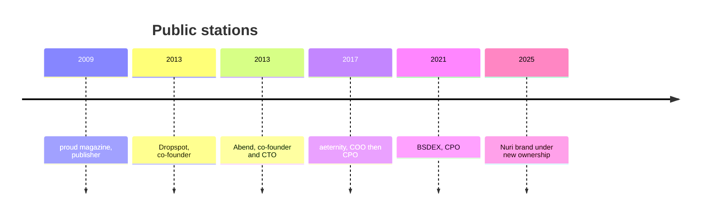

# About page research, 17 November 2026

Working notes for the expanded `/about` page. Every claim on the page maps to a row below. The body lives in `src/content/about.mjs`; HTML and the Markdown mirror render the same string.

## Source table

| Claim on the page | Source | Grade |
| --- | --- | --- |
| Born in Berlin, German-Turkish, product engineer and founder | [CoinAgenda speaker profile](https://coinagenda.com/emin-henri-mahrt/) | Self-description |
| Nuri brand and domain moved to new ownership in January 2025 | [Bitwala, goodbye Nuri](https://www.bitwala.com/blog/goodbye-nuri) | Primary |
| Current Nuri built by Nurisoft Development OÜ, Mahrt CEO, team of three | [nuri.com/trust](https://nuri.com/trust) | Self-description |
| Passkey-derived keys, MuSig2 2-of-2, timelock of about 77 days, offline recovery | [nuri.com/trust](https://nuri.com/trust), [recovery tool](https://github.com/nuri-com/local-nuri-prf-passkey-recovery-tool) | Self-description plus open source |
| Visa card via Wirex, euro IBAN via Monerium | [nuri.com/trust](https://nuri.com/trust) | Self-description |
| proud magazine, 2009 to 2014, 32 issues, monthly, Berlin | [DNB record 992028108](https://d-nb.info/992028108) | Primary |
| Publisher and press-responsible for proud | [Issue 26 masthead](http://web.archive.org/web/20120103153435/http://proud.de/uploads/26-proud-magazine-berlin-2011.pdf) | Primary |
| Circulation 20,000, free | [Fachzeitungen.de](https://www.fachzeitungen.de/zeitschrift-magazin-proud-magazine) | Secondary |
| Funktion One story cited by Wikipedia | [Berghain article](https://en.wikipedia.org/wiki/Berghain) | Secondary |
| Dropspot co-founder, location-based push news, Axel Springer shareholder | [BILD](https://www.bild.de/digital/smartphone-und-tablet/dropspot/app-zeigt-nachrichten-in-der-naehe-36168566.bild.html) | Secondary |
| Abend co-founder and CTO, automatic Facebook event ads | [Gust founder profile](https://gust.com/companies/abend) | Self-description |
| More than a thousand clubs and festivals | [The Hundert](https://the-hundert.com/startups/abend-the-berlin-facebook-event-promotion-startup) | Secondary |
| æternity COO in 2017 | [App Developer Magazine](https://appdevelopermagazine.com/5782/2018/1/9/Developing-on-blockchain-needs-to-become-easier) | Secondary |
| CPO from November 2018 | [Nägele workshop post](https://www.naegele.law/archiv/naegele-aeternity-and-the-2nd-lunch-and-learn-coding-workshop) | Secondary |
| Foundation board in 2019 | [Foundation announcement](https://medium.com/aeternity-crypto-foundation/%C3%A6ternity-crypto-foundation-names-emin-mahrt-board-member-we-are-now-preparing-for-developer-f0f07b5cad86) | Primary |
| BSDEX CPO | [Bank Blog byline](https://www.der-bank-blog.de/geburt-dezentrales-finanzsystem/technologie/37690031/), [CAC22A agenda](https://crypto-assets-conference.de/hubfs/Previous%20CAC%20-%20Agenda/FSBC%20_%20CAC22A%20_%20Agenda.pdf) | Secondary |
| Bitcoin since 2012, Room 77 | [Bitcoin Amsterdam speaker profile](https://bitcoin.amsterdam/speakers/emin-mahrt), [CoinDesk on Room 77](https://www.coindesk.com/tech/2020/10/19/closing-time-for-bitcoins-iconic-room-77-and-thats-ok-says-owner) | Self-description and secondary |
| GitHub account, smartcard repo | [github.com/eminogrande](https://github.com/eminogrande), [nuri-passkey-prf-smartcard](https://github.com/nuri-com/nuri-passkey-prf-smartcard) | Primary |
| Four embedded talks | YouTube URLs in the page; event pages and agenda PDF linked per item | Primary |
| Erlang/Elixir Meetup Krakow, 19 February 2019 | [Recording](https://www.youtube.com/watch?v=hNxnaf2TWGE) | Primary |
| Starfleet 2 Demo Day, Sofia, 12 April 2019 | [Recording](https://www.youtube.com/watch?v=X-IXkSGdoyo) | Primary |
| CV Labs Zug, 19 December 2019 | [Event post](https://forum.aeternity.com/t/aeternity-cv-labs-zug-december-19-2019/5593) | Primary |
| CoinAgenda Europe Monaco, 28 September 2021 | [Archived schedule](https://web.archive.org/web/20210922205016/https://coinagenda.com/europe-2021-schedule/) | Primary |
| Bitcoin Amsterdam moderator, 6 November 2026 | [Speaker profile](https://bitcoin.amsterdam/speakers/emin-mahrt), [archived agenda](https://web.archive.org/web/20261107171217/https://www.bitcoin.amsterdam/agenda) | Primary |
| Nasdaq TradeTalks, 22 May 2018 | [Video](https://www.nasdaq.com/videos/tradetalks%3A-blockchain-education-and-race-for-talent) | Primary |
| App Developer Magazine interview, January 2018 | [Article](https://appdevelopermagazine.com/5782/2018/1/9/Developing-on-blockchain-needs-to-become-easier) | Primary |

## Timeline

## Excluded weak claims

| Claim | Why it is out |
| --- | --- |
| DFJV recognition or membership | No public DFJV source names him or the magazine. |
| "first and only" passkey wallet | Breez shipped passkey login for seedless wallets earlier; the combination is the interesting part, not an absolute. |
| Mastercard | Only a Visa card via Wirex is documented. |
| "100+ countries" | Own pages have said 71, 100+ and 130 at different times. |
| Team of 100 at æternity | Self-description only; archived company pages and third parties count far fewer. |
| Contribution to the Liechtenstein Blockchain Act | He is absent from the consultation list in the government report; proximity is documented, authorship is not. |
| Abend sale or Series A | No press, register or investor source states either. |
| 1.5 million copies for proud | Inconsistent with 20,000 per issue over 32 issues. |
| Snippet-only Bitcoin Amsterdam sessions | Session pages return 404; only "Will Self-Custody Ever Be Safe?" is covered by the archived agenda. |
| "Since 1999" as a software claim | Public evidence starts with GitHub in 2013; 1999 is a self-description. |
| Blockchain Act, youth magazine, 100,000 visitors | No contemporary source. |

## Notes

- Talks keep the four embeddable recordings only. Starfleet 2 is a 3.5 hour stream and stays a text link.
- The foundation panel is a text link because only four embeds are wanted on the page.
- No talk post files and no `/talks` route changes in this task.
