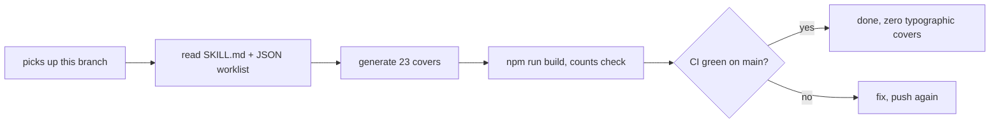

# Handover: house illustration covers for all posts

Owner: Emin. Prepared by Hermes Agent, 2026-10-14. The bulk job was meant for another worker. This branch has everything needed to take it over.

## What is decided (Emin, confirmed in chat)

1. Every post on emin.de MUST have a cover image.
2. Non-photo posts get a generated illustration in ONE house style (see SKILL.md next to this file): black charcoal drawing with two or three oil paint color accents on a flat warm cream background, exact color #FDF6E3 (the site `--paper`).
3. Photo posts keep their photo as the cover. Pictures inside post bodies stay as they are.
4. The first image in this style (the Riverside 500 E cover, below) was approved by Emin.

## What is in this branch

1. `skills/emin-de-illustration/SKILL.md` — the house style spec, prompt skeleton, file locations, build verification steps, pitfalls.
2. `skills/emin-de-illustration/posts-without-covers.json` — the 23 posts that currently fall back to the typographic SVG cover: slug, lang, year, title, description, file path. This is the worklist.
3. `content/media/riverside-500e-faster-bike-tuning/cover.png` — the approved first cover. The post is already live on main without an image; merging this adds its cover.

## How to do the remaining 23

1. Work in a fresh worktree from `origin/main` (never the local `~/Developer/emin-de` checkout).
2. For each entry in the JSON: generate a landscape illustration with the prompt skeleton in SKILL.md. The subject sentence comes from the post's own title and description (fields are in the JSON).
3. Save as `content/media/<slug>/cover.png`. No front matter change needed; `scripts/lib/covers.mjs` picks up the folder automatically.
4. Verify each image visually (background must be the cream #FDF6E3, charcoal + paint accents, no text in the image).
5. `npm run build`. The cover count line must show raster covers +N and generated typographic covers -N. Target after all 23: zero typographic covers.
6. Commit `content/media/**`, push to `main`. That triggers the GitHub Action deploy. Prove with `curl https://emin.de/health` (commit == pushed SHA) and check a cover WebP on the live site.
7. Tests and the voice gate run in CI; media files do not touch them.

## Notes

- The 23 include 4 German and 19 English posts across 2021-2026.
- Do not put illustrations in `public/photos/` (that is the photo gallery).
- The cover pipeline crops to 3:2, so keep subjects centered.
- Reference example of the style, already approved: the cover.png in this branch.

