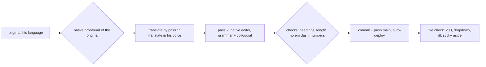

# emin.de translation (21 languages)

Every post on emin.de exists in the 21 most spoken languages (Ethnologue 2026) plus German. The original is written once in Emin's voice (`write-like-emin`). `plugins/translate.py` writes the rest. Goal, in Emin's words: "in jeder Sprache wie ich" (modern, colloquial, correct, never formal).

## When to Use

- A new post goes live on emin.de (every post ships in all 21 languages).
- An original changes (title, number, wording): redo its translations.
- A new language or new UI text is added.

## Languages

en (root), de, zh, hi, es, ar, fr, bn, pt, id, ur, ru, ja, mr, vi, te, sw, ha, tr, ta, tl. Nigerian Pidgin and Egyptian Arabic (Ethnologue ranks 14, 15) are covered by en and ar. Source of truth: `site.config.mjs` locales and `LANGS` in `plugins/translate.py`; both must list the same codes. ar and ur carry `dir: 'rtl'`.

## Procedure

1. Proofread the ORIGINAL first, as a native speaker would: grammar, prepositions, separable verbs, capitalisation (heute Morgen, auf null), hyphenated compounds (Open-Source-Code, Hardware-Wallet), idioms. A translation can never be better than its source. Emin's example: "Füg einfach irgendeinen Nuri-User hinzu", not "dazu". Keep his loanwords (Fee, Settings, Wallet) and his roughness; fix only real errors. List every fix for him.
2. Title or slug changed: `git mv` the post and its `content/media/<slug>`, then add 301s for every locale prefix in `site.config.mjs` redirects.
3. Translate: `python3 plugins/translate.py --only <slug>` (new post) or `--redo <slug>` (original changed: deletes and rewrites its translations). Bulk: `~/.hermes/cache/scratch/translate-loop.sh` (resumes, pushes every 30 min, stops at `0 translations to write`).
4. The script runs two passes per chunk: translator with the VOICE rules (spoken, du/tú/tu form, native word order, his swear words stay), then a native-editor pass (`EDIT`) that only fixes grammar and stiff phrasing. Do not skip pass 2 (`--no-edit`) for published posts.
5. Small edits to the original (a number, a word) when the API quota is gone: patch the same spot in every translation by position (section index, tldr item) and check digits in the script of that language (Bengali uses ০-৯). Then rerun `--redo` once quota is back.
6. UI strings: add the English text to `src/i18n/en.json`, then translate into every language in `src/i18n/ui.json` with `translate_meta`. German UI is hand-written. Never write `de ? 'x' : 'y'` ternaries. A locale missing from ui.json falls back to English UI.
7. Gates: `npm run build:test && npm test` (incl. i18n and sticky-aside tests), `npm run build`, then Playwright on desktop 1440 and mobile 390: aside top = 40 px while scrolling, `scrollWidth <= innerWidth` on an rtl page, dropdown lists all live languages.

## Lanes and quotas

- Kimi coding plan (`k3`, thinking disabled): best quality, about 500 calls per 5-hour window, then HTTP 403 "usage limit".
- Gemini flash models each have their own daily quota: `GEMINI_MODELS` in the script rotates them. All return 429 "exceeded your current quota" after a big run.
- Not usable (checked 2026-10-18): DeepSeek balance 0, Anthropic key invalid, Qwen not purchased, StepFun 429, router.paymentrequired.com 429/402. Never OpenRouter.
- Every finished chunk is cached in `~/.cache/emin-de-translate`. Re-runs are free for done chunks.

## Pitfalls

- Literal translations read like a manual. The VOICE rule makes the model re-say each sentence; the editor pass catches the rest. Formal address (Sie, usted, vous, आप) is wrong for his voice.
- The original carried a real error once ("dazu" for "hinzu") and all 10 translations inherited the weak title. Always step 1 first.
- Translations share the original's cover, section art (`source_sections`) and share card. They stay out of llms-full.txt and the API, and skip the CI voice gate.
- `overflow` on `html` breaks the sticky Basically column. Fix horizontal scroll at the element (rtl: use `inset-inline-start`, not `left`).
- 2,000+ new files: the Mac disk filled to 99% during builds. Check `df -h` before a bulk run and clear old `.worktrees/subagent-*` only with Emin's OK.
